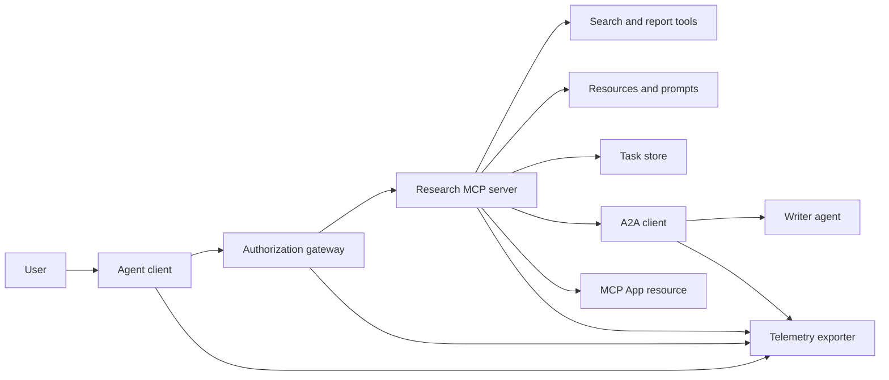
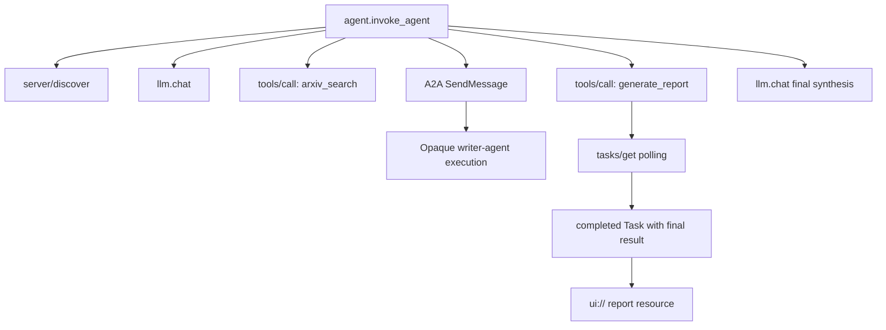
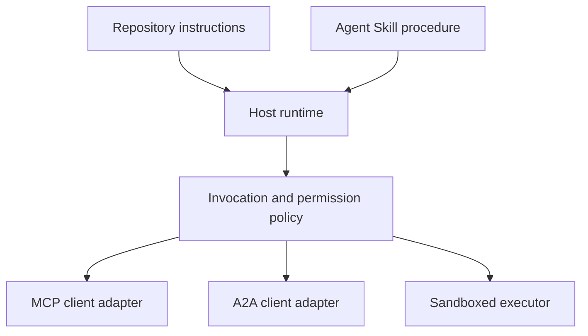

# Capstone: Stateless Tool Ecosystem · 结课项目：无状态工具生态

> A production agent system is a set of boundaries, not a pile of features. This capstone separates a readable in-process simulation from the protocol clients, authorization server, sandbox, and telemetry exporter a real deployment still needs.

**Type:** Build
**Languages:** Python (stdlib, in-process simulation)
**Prerequisites:** Phase 13 · 01 through 22, using MCP revision `2026-07-28`
**Time:** ~120 minutes

## Learning Objectives · 学习目标

- 把工具调用、任务型结果、委托工作、UI 资源、授权策略和追踪记录组合成一条完整流程。
- 在每个 MCP 请求上携带协议版本、客户端身份和能力（capabilities），而不是依赖连接级会话。
- 使用前先做服务器发现（server discovery），并通过官方 Tasks 扩展驱动长时间运行的工作。
- 区分「协议形态的模拟」与真正的 MCP、A2A、OAuth 或 OpenTelemetry 实现。
- 把每个被模拟的边界映射到生产环境中必须替换它的组件。
- 让 `AGENTS.md`、Agent Skill（智能体技能）、运行时适配器、工具和安全策略各司其职。
- 说明哪些结论可以由本地输出验证，哪些需要真实集成测试。

> Compose tool calls, task-shaped results, delegated work, UI resources, authorization policy, and trace records into one flow.
> Carry protocol version, client identity, and capabilities on every MCP request instead of relying on a connection session.
> Discover a server before use and drive long work through the official Tasks extension.
> Distinguish a protocol-shaped simulation from an MCP, A2A, OAuth, or OpenTelemetry implementation.
> Map each simulated boundary to the production component that must replace it.
> Keep `AGENTS.md`, an Agent Skill, runtime adapters, tools, and security policy in their correct roles.
> Explain which claims can be verified from local output and which need live integration tests.

## The Problem · 问题在哪

设计一个「调研并写报告」的系统：用户询问关于 agent 协议的论文。系统检索论文目录、委托摘要生成、产出报告、返回一个 UI 资源，并记录穿过系统的完整路径。

这句话背后藏着若干份相互独立的契约：

- 面向模型的工具 schema；
- 无状态请求信封（request envelope）与服务器发现契约；
- 网关对 actor、scope 与工具身份的决策；
- 长时间运行操作的契约；
- 一份委托协议；
- 宿主到应用的桥接；
- 追踪传播与导出；
- 一套可复用的操作规程。

`code/main.py` 用普通的 Python 函数和字典让这些边界保持可见。它不打开传输层、不联系 arXiv、不执行 OAuth、不调用 A2A 服务器、不渲染 MCP App、也不导出遥测数据。这让控制流易于检视，同时不会把一份模拟包装成合规服务。

> Design a research-and-report system. A user asks for papers on agent protocols. The system searches a paper catalog, delegates summarization, generates a report, returns a UI resource, and records the path through the system.
> `code/main.py` keeps those boundaries visible with ordinary Python functions and dictionaries. It does not open a transport, contact arXiv, perform OAuth, call an A2A server, render an MCP App, or export telemetry. This makes the control flow easy to inspect without presenting a simulation as a compliant service.

## The Concept · 概念

### Target architecture · 目标架构



这个架构是对公开协议模式的概念性组合。它不构成对任何产品私有内部实现的断言。

> The architecture is a conceptual composition of public protocol patterns. It is not a claim about the private internals of any product.

### Target trace · 目标追踪



在真实实现中，每一跳都要传播追踪上下文。Span 名称与属性必须遵循所选 instrumentation 版本支持的 OpenTelemetry 语义约定（semantic conventions）。仅凭一个共享的追踪标识符，并不能证明父子关系、导出或后端摄取是正确的。

> In a real implementation, every hop propagates trace context. Span names and attributes must follow the OpenTelemetry semantic conventions supported by the chosen instrumentation version. A shared trace identifier alone does not prove correct parentage, export, or backend ingestion.

### Current protocol surfaces · 当前协议暴露面

使用当前协议定义的方法名，不要用从旧草案里记下来的名字：

| 边界 | 当前暴露面 | 结课项目模拟的内容 |
|---|---|---|
| MCP 发现 | 强制的 `server/discover` | 一个直接返回版本、能力和服务器身份的函数 |
| MCP 请求上下文 | 每个请求的 `params._meta` 里携带版本、能力和客户端身份 | 传给每次模拟调用的新鲜请求元数据 |
| MCP 工具调用 | `tools/call` | 直接的 Python 函数分发 |
| MCP 任务轮询 | `io.modelcontextprotocol/tasks` 配合 `tasks/get` | 一个可用的句柄，随后是一个携带最终结果的已完成任务 |
| A2A 委托 | gRPC 和 JSON-RPC 里的 `SendMessage`；HTTP+JSON 里的 `POST /message:send` | 一个嵌套 span，没有远程调用或人为延迟 |
| MCP App 调用服务器工具 | `app.callServerTool({ name, arguments })` | 一个 HTML 字符串，没有真实桥接 |
| OAuth 授权 | 授权服务器、受保护资源元数据、受众与 scope 校验 | 静态 token 查找和 scope 成员判断 |
| OpenTelemetry | SDK、propagator、exporter 以及 collector 或后端 | 内存中的 span 字典 |

协议名称只是第一层。生产级测试必须跨真实线路去演练序列化、认证失败、取消、超时、重试和版本兼容。

> Use the method names defined by the current protocol, not names remembered from an older draft:
> Protocol names are only the first layer. Production tests must exercise serialization, authentication failures, cancellation, timeouts, retries, and version compatibility across the real wire.

### Stateless MCP changes the integration boundary · 无状态 MCP 改变了集成边界

修订版 `2026-07-28` 移除了协议会话和 `initialize` / `notifications/initialized` 握手，也移除了 `Mcp-Session-Id`。每个请求都携带这些带命名空间的 `_meta` 字段：

```json
{
  "io.modelcontextprotocol/protocolVersion": "2026-07-28",
  "io.modelcontextprotocol/clientCapabilities": {
    "extensions": {
      "io.modelcontextprotocol/tasks": {}
    }
  },
  "io.modelcontextprotocol/clientInfo": {
    "name": "capstone-client",
    "version": "1.0.0"
  }
}
```

服务器必须实现 `server/discover`。普通结果使用 `resultType: "complete"`；任务句柄使用 `resultType: "task"`。每个结果应在 `_meta.io.modelcontextprotocol/serverInfo` 中标明服务器身份。

Tasks 扩展包含 `tasks/get`、`tasks/update` 和 `tasks/cancel`。工具可以先返回 `resultType: "task"`；`tasks/get` 自身返回 `resultType: "complete"`，已完成的 `Task` 内含最终结果。旧的 `tasks/result` 与 `tasks/list` 方法不属于当前扩展。客户端必须在可能收到任务句柄的同一个请求里声明 `io.modelcontextprotocol/tasks`；否则服务器返回 `-32021`，其 `requiredCapabilities` 的形状就是缺失的客户端能力对象，包含 `extensions.io.modelcontextprotocol/tasks`。

> Revision `2026-07-28` removes protocol sessions and the `initialize` / `notifications/initialized` handshake. It also removes `Mcp-Session-Id`. Every request carries these namespaced `_meta` fields:
> The server must implement `server/discover`. Ordinary results use `resultType: "complete"`; a task handle uses `resultType: "task"`. Each result should identify the server in `_meta.io.modelcontextprotocol/serverInfo`.
> A client must advertise `io.modelcontextprotocol/tasks` in the same request that may receive a task handle. If it does not, the server returns `-32021` with `requiredCapabilities` shaped as the missing client-capability object, including `extensions.io.modelcontextprotocol/tasks`.

### Security posture · 安全姿态

目标部署采用纵深防御（defense in depth）：

- 在客户端类型要求时使用带 PKCE 的 OAuth 授权；
- 为签发的访问 token 绑定资源与受众；
- 网关 RBAC 校验所请求的工具与 scope；
- 上游凭据保存在模型可见上下文之外；
- 一份已固定（pinned）或经过评审的工具描述清单；
- 对不可信输入、敏感数据与后果性动作做「双规则」（Rule of Two）评审；
- 一个执行沙箱（sandbox），其文件系统、进程、网络、凭据与资源限制都在技能之外强制执行。

演示只实现了静态 token、scope 检查和描述哈希。它对策略流程有用，不构成安全验证。

> The intended deployment uses defense in depth:
> The demo implements only static tokens, scope checks, and description hashes. It is useful for policy flow, not security validation.

### Skills are procedure, not transport · 技能是规程，不是传输层

Agent Skill 能告诉运行时如何执行调研工作流、应当期待哪些工具契约、保存什么证据、何时停止。它不能让一个 MCP 服务器凭空存在、不能建立 A2A 兼容性、不能授予 scope，也不能创建沙箱。



当规程引用了配套文件时，要交付完整的技能目录。本课这个较旧的结课项目里的扁平工件是一份课程蓝图，并不能证明宿主会保留一个可移植的捆绑包。第 24 到 27 课会构建并测试完整的捆绑包生命周期。

> An Agent Skill can tell the runtime how to perform the research workflow, which tool contracts to expect, what evidence to save, and when to stop. It cannot make an MCP server exist, establish A2A compatibility, grant scopes, or create a sandbox.
> Ship the complete skill directory when the procedure references companion files. The flat artifact in this older capstone is a course blueprint, not evidence that a host preserves a portable bundle. Lessons 24 through 27 build and test the full bundle lifecycle.

### Course artifact metadata is a local adapter · 课程工件元数据是本地适配器

课程目录和安装器识别名为 `skill-*.md` 的扁平文件，但那是仓库约定，而不是可移植的 Agent Skills 包契约。它们的最小 frontmatter 解析器只读顶层键。因此本课把可移植的身份字段与课程目录字段放在同一层级：

```yaml
---
name: ecosystem-blueprint
description: Produce a full Phase 13 ecosystem architecture for a product need.
version: "1.0.0"
phase: "13"
lesson: "23"
tags: [mcp, capstone, ecosystem, architecture, a2a, otel]
---
```

`name` 和 `description` 是可移植的身份字段；`version`、`phase`、`lesson` 和 `tags` 是课程特有的目录扩展。课程解析器要求 `tags` 是行内列表，这样 `--tag capstone` 才能匹配到它。

可移植的目录式技能可以使用可选的 `metadata` 映射存放字符串值的扩展数据，但这并不会让 `metadata` 与本仓库的目录 schema 可以互换。如果这个扁平文件把 `version` 或 `tags` 嵌到 `metadata` 之下，最小解析器会跳过那些缩进键，目录会记录空版本，标签过滤也找不到该工件。生产宿主应使用安全的 YAML 解析器，并校验自己文档化的 schema。

> `name` and `description` are the portable identity fields. `version`, `phase`, `lesson`, and `tags` are course-specific catalog extensions. The course parser requires `tags` as an inline list so `--tag capstone` can match it.
> A portable directory skill may use the optional `metadata` map for string-valued extension data. That does not make `metadata` interchangeable with this repository's catalog schema. If this flat file nests `version` or `tags` below `metadata`, the minimal parser skips those indented keys, the catalog records an empty version, and tag filtering cannot find the artifact. Production hosts should use a safe YAML parser and validate their own documented schema.

### Simulation versus production · 模拟与生产的差距

| 层 | `code/main.py` | 生产替换物 | 所需证据 |
|---|---|---|---|
| 发现 | `server_discover()` 加静态 `TOOLS` | `server/discover` 加支持缓存的 `tools/list` | 线路报文、确定性顺序和 schema 校验 |
| 认证 | 以 token 为键的字典 | OAuth 授权与资源服务器校验 | 签发者、受众、scope、过期与失败测试 |
| 授权 | scope 成员判断 | 绑定 actor、工具、目标与租户的网关策略 | 允许与拒绝的审计用例 |
| 搜索 | 静态论文夹具（fixture） | 搜索 API 或 MCP 服务器 | 来源出处、排序与错误测试 |
| 任务 | 本地句柄加立即 `tasks/get` | 持久化的 `io.modelcontextprotocol/tasks` 存储，含 `tasks/get`、`tasks/update`、`tasks/cancel` 与 TTL | 状态迁移、输入、取消与恢复测试 |
| 委托 | sleep 加嵌套 span | A2A 客户端与远程 Agent Card | 契约、超时、重试与不透明性测试 |
| App | HTML 字符串与 URI | MCP Apps 资源与 `App` 桥接 | CSP、权限、工具调用与浏览器测试 |
| 遥测 | 内存列表 | OTel SDK 与 exporter | collector 回执与 trace-parent 断言 |
| 沙箱 | 无 | 宿主强制执行的隔离执行器 | 逃逸、出网、机密与资源限制测试 |

这张表就是交接边界。本地跑绿只验证了模拟本身。

> This table is the handoff boundary. A green local run validates the simulation only.

### Phase 13 map · Phase 13 全景图

| 课程 | 贡献 |
|---|---|
| 01-05 | 工具接口、调用、schema、结构化结果与确定性校验 |
| 06-14 | 无状态 MCP 请求信封、发现、传输层、资源、提示、扩展与 Apps |
| 15-18 | 投毒防御、OAuth、网关、注册表与生产级认证 |
| 19 | A2A 消息与任务委托 |
| 20 | OpenTelemetry GenAI 追踪设计 |
| 21 | 模型提供商路由 |
| 22 | 可移植技能契约与运行时边界 |

```figure
t3-capstone-chain
```

## Build It · 动手造

运行进程内 harness：

```bash
cd phases/13-tools-and-protocols/23-capstone-tool-ecosystem
python3 code/main.py
```

重点检查五件事：

1. `server/discover` 宣告修订版 `2026-07-28` 和 Tasks 扩展。
2. Alice 可以读取并生成报告，而 Bob 带 write scope 的调用被拒绝。
3. 一次编排器运行中的所有本地 span 共享同一个追踪标识符，并记录父 span 标识符。
4. 报告最初是一个任务句柄。`tasks/get` 返回一个已完成任务，其最终结果包含文本和一个 `ui://` 引用。
5. 被委托的 writer 保持不透明，因为编排器只记录边界 span。
6. 没有任何输出声称发生过网络连接、OAuth 交换、collector 导出、浏览器渲染或沙箱执行。

脚本会运行两次，因此产生两个根追踪（root trace）。审计条目是进程本地的，下一次运行时重置。

> Inspect five things:
> No output claims a network connection, OAuth exchange, collector export, browser render, or sandbox execution occurred.
> The script runs twice, so it produces two root traces. Audit entries are process-local and reset on the next run.

## Use It · 实战用法

一次只晋升一层：

1. 用真实的 `server/discover` 和 `tools/list` 调用替换 `server_discover()` 与静态工具列表。在每个请求中发送版本、身份和能力。
2. 用授权服务器与受保护资源校验替换静态 token。
3. 实现 `io.modelcontextprotocol/tasks` 扩展，并测试 `tasks/get`、`tasks/update`、`tasks/cancel`、超时、TTL 与重启恢复。不要添加 `tasks/result` 或 `tasks/list`。
4. 用能解析 Agent Card 并发送消息的 A2A 客户端替换委托桩（stub）。
5. 用官方 SDK 构建 App，并通过 `app.callServerTool` 调用服务器工具。
6. 把 span 导出到测试 collector，并在接收端断言父子关系。
7. 在第 26 课的沙箱契约内运行工具与脚本执行。
8. 把规程打包成完整的目录捆绑包，并通过第 27 课的发布门禁。

每次晋升都需要一个跨越新边界的集成测试。当线路变成真实之后，也不要删除低层的策略测试。

> Each promotion needs an integration test that crosses the new boundary. Do not delete the lower-level policy tests when the wire becomes real.

## Ship It · 交付

本课产出 `outputs/skill-ecosystem-blueprint.md`，一份旧式的单文件课程工件。它要求一页纸架构，覆盖原语、安全、委托、遥测、打包和最棘手的运维风险。它的顶层目录字段会由仓库真实的目录解析器与安装器解析器检验。

由于它不是目录式捆绑包，它无法携带 references、scripts、assets 或评测夹具。在这门课之外发布可复用技能时，请使用第 22 课与第 24 到 27 课的包格式。

> This lesson produces `outputs/skill-ecosystem-blueprint.md`, a legacy single-file course artifact. It asks for a one-page architecture covering primitives, security, delegation, telemetry, packaging, and the hardest operational risk. Its top-level catalog fields are exercised by the repository's real catalog and installer parsers.
> Because it is not a directory bundle, it cannot carry references, scripts, assets, or eval fixtures. Use the package format from Lessons 22 and 24 through 27 when publishing a reusable skill outside this course.

## Exercises · 练习

1. 运行 `code/main.py`。把输出能证明的事实，与仍需集成证据的生产级论断区分开。
2. 添加第二个静态后端，并为两个同名工具定义冲突裁决规则。然后把两个列表都替换成真实的 `tools/list` 调用。
3. 用一台 A2A 测试服务器替换 writer 桩。记录 Agent Card、消息请求、超时路径和返回的工件。
4. 添加一个能在进程重启后存活的任务存储。证明客户端可以凭 `tasks/get` 恢复、遵守 `pollIntervalMs`，并在没有 `tasks/result` 的情况下读取已完成任务的最终结果。
5. 构建一个最小 MCP App，并在带严格 CSP 与显式权限的浏览器里验证 `app.callServerTool`。
6. 通过 OTel SDK 把模拟的 span 导出到本地 collector。断言回执、追踪标识符、父子关系和错误状态。
7. 为仓库级维护规则编写 `AGENTS.md`，为可复用的调研规程编写单独的技能捆绑包。解释为什么这两个文件都不授予工具权限。

## Key Terms · 术语表

| 术语 | 人们怎么说 | 实际含义 |
|---|---|---|
| Capstone（结课项目） | "Everything wired together"（把所有东西接在一起） | 一次分阶段的集成，其模拟边界与真实边界始终保持清晰可辨 |
| Protocol-shaped simulation（协议形态的模拟） | "It is basically MCP"（它基本上就是 MCP） | 在数据与调用上形似某个协议、但并未实现其线路契约的本地实现 |
| Tasks extension（Tasks 扩展） | "Long tool call"（长时间的工具调用） | 可选的 `io.modelcontextprotocol/tasks` 生命周期，带持久身份、轮询、客户端输入、最终结果与取消语义 |
| Opacity boundary（不透明边界） | "The other agent handles it"（另一个 agent 会处理） | 调用方只能看到声明的接口与工件，看不到私有推理或内部状态 |
| Runtime adapter（运行时适配器） | "Skill integration"（技能集成） | 把可移植规程映射到发现、调用、工具、策略与上下文的宿主代码 |
| Integration evidence（集成证据） | "It passed"（它通过了） | 一份报文、工件或接收端观测，证明真实边界确实被跨越 |

## Further Reading · 延伸阅读

- [MCP specification 2026-07-28](https://modelcontextprotocol.io/specification/2026-07-28) —— 无状态请求、发现、工具、授权与传输行为。
- [MCP 2026-07-28 key changes](https://modelcontextprotocol.io/specification/2026-07-28/changelog) —— 会话移除、每请求元数据、MRTR、扩展与弃用项。
- [MCP Tasks extension](https://tasks.extensions.modelcontextprotocol.io/specification/draft/tasks) —— `tasks/get`、`tasks/update`、`tasks/cancel` 与由终止任务携带的最终结果。
- [MCP Apps SDK](https://github.com/modelcontextprotocol/ext-apps/blob/main/docs/overview.md) —— `App` 与 `app.callServerTool`。
- [A2A protocol](https://a2a-protocol.org/latest/) —— Agent Card、消息投递、任务、工件与传输绑定。
- [OpenTelemetry GenAI semantic conventions](https://opentelemetry.io/docs/specs/semconv/gen-ai/) —— 追踪与属性约定。
- [Agent Skills specification](https://agentskills.io/specification) —— 规程层使用的可移植包契约。
