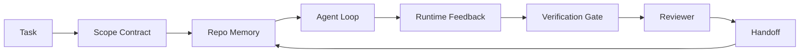

# Agent Workbench Engineering: Why Capable Models Still Fail · 智能体工作台工程：为什么能力强的模型仍然会失败

光有强的模型还不够。可靠的智能体需要一个工作台（workbench）：指令、状态、范围、反馈、验证、评审、交接。把这些全部剥掉，即便是最前沿的模型，产出的东西也不敢交付。

> A capable model is not enough. Reliable agents need a workbench: instructions, state, scope, feedback, verification, review, and handoff. Strip those away and even a frontier model produces work that is unsafe to ship.

**Type:** Learn + Build
**Languages:** Python (stdlib)
**Prerequisites:** Phase 14 · 01 (Agent Loop), Phase 14 · 26 (Failure Modes)
**Time:** ~45 minutes

## Learning Objectives · 学习目标

- 把模型能力与执行可靠性区分开。
- 说出决定一个智能体能否交付的七张工作台表面（surface）。
- 在一个小仓库任务上，对比「只有提示词的运行」和「工作台引导的运行」。
- 产出一份失败模式报告，把每张缺失的表面映射到它导致的症状。

> Separate model capability from execution reliability.
> Name the seven workbench surfaces that decide whether an agent ships.
> Compare a prompt-only run against a workbench-guided run on a small repo task.
> Produce a failure-mode report that maps each missed surface to the symptom it caused.

## The Problem · 问题在哪

你把一个前沿模型放进真实仓库，让它添加输入校验。它打开四个文件，写出看似合理的代码，宣布成功，然后停下。你跑测试，两个失败。第三个被动过的文件与校验毫无关系。没有任何记录说明这个智能体做了哪些假设、先试了什么、还剩什么没做。

模型对 Python 的理解没有错，错的是对「这份工作」的理解。它不知道什么算「完成」、哪里允许它写、哪些测试是权威的、下一个会话该如何接手。

这不是模型 bug，而是工作台 bug。智能体周围缺少了那些能把一次性生成变成可靠、可恢复工程的部件。

> You drop a frontier model into a real repo and ask it to add input validation. It opens four files, writes plausible code, declares success, and stops. You run the tests. Two fail. A third file is touched that had nothing to do with validation. There is no record of what the agent assumed, what it tried first, or what is left to do.
> The model was not wrong about Python. It was wrong about the work. It had no idea what counted as done, where it was allowed to write, what tests were authoritative, or how the next session was supposed to pick up.
> This is not a model bug. It is a workbench bug. The surface around the agent is missing the parts that turn a one-shot generation into reliable, resumable engineering.

## The Concept · 概念

工作台是任务进行中包裹着模型的运行环境。它有七张表面：

| Surface 表面 | What it carries 承载什么 | Failure when missing 缺失时的失败 |
|---------|-----------------|----------------------|
| Instructions 指令 | 启动规则、禁止动作、完成的定义 | 智能体靠猜来理解「交付」的含义 |
| State 状态 | 当前任务、动过的文件、阻塞点、下一步动作 | 每个会话都从零重启 |
| Scope 范围 | 允许的文件、禁止的文件、验收标准 | 改动泄漏进无关代码 |
| Feedback 反馈 | 捕获进闭环的真实命令输出 | 智能体对着 400 宣布成功 |
| Verification 验证 | 测试、lint、冒烟运行、范围检查 | 「看起来不错」直接进了 main |
| Review 评审 | 用不同角色做的第二遍检查 | 建造者给自己批作业 |
| Handoff 交接 | 改了什么、为什么、还剩什么 | 下个会话重新发现一切 |

工作台独立于模型。你可以换掉模型而保留这些表面；你不能换掉这些表面而保住可靠性。



闭环闭合在状态文件上，而不是聊天历史上。聊天是易失的。仓库才是记录系统（system of record）。

> A workbench is the operating environment that wraps the model during a task. It has seven surfaces:
> The workbench is independent of the model. You can swap the model and keep the surfaces. You cannot swap the surfaces and keep reliability.
> The loop closes on the state file, not on chat history. Chat is volatile. The repo is the system of record.

### Workbench versus prompt engineering · 工作台 vs 提示工程

提示词告诉模型「这一轮我要什么」。工作台告诉模型「跨轮次、跨会话该怎么做工作」。大多数智能体失败的故事，都是穿着提示工程外衣的工作台失败。

> Prompting tells the model what you want this turn. A workbench tells the model how to do work across turns and across sessions. Most agent failure stories are workbench failures wearing prompt-engineering clothes.

### Workbench versus framework · 工作台 vs 框架

框架给你一个运行时（LangGraph、AutoGen、Agents SDK）。工作台给智能体在这个运行时里干活的地方。两者都需要。本迷你系列讲的是第二个。

> A framework gives you a runtime (LangGraph, AutoGen, Agents SDK). A workbench gives the agent a place to work inside that runtime. You need both. This mini-track is about the second one.

### Reasoning from primitives, not from vendor taxonomies · 从原语推理，而不是从厂商分类法

现在有大量关于「harness engineering」的文字。Addy Osmani、OpenAI、Anthropic、LangChain、Martin Fowler、MongoDB、HumanLayer、Augment Code、Thoughtworks、walkinglabs 的 awesome 列表，以及 Medium 和 Hacker News 上源源不断的文章都在讨论它。他们对 harness 的边界、范围和词汇各执一词。我们不需要选边。七张表面是一层 UX；每一张工作台下面，都是同一套支撑任何可靠后端的分布式系统原语（primitives）。

先把「智能体」这个标签撕掉。一次智能体运行，是跨越时间、进程和机器的计算。要让它可靠，你需要任何生产系统都需要的那几样原语。

| Primitive 原语 | What it is 是什么 | What it carries for an agent 对智能体承载什么 |
|-----------|------------|------------------------------|
| Function 函数 | 带类型的 handler，尽量纯粹，自己负责输入与输出 | 一次工具调用、一次规则检查、一步验证、一次模型调用 |
| Worker 工作进程 | 持有一个或多个函数及生命周期的长驻进程 | 建造者、评审者、验证者、一个 MCP server |
| Trigger 触发器 | 调用函数的事件源 | 智能体循环 tick、HTTP 请求、队列消息、cron、文件变更、hook |
| Runtime 运行时 | 决定什么在哪里跑、配什么超时和资源的边界 | Claude Code 的进程、LangGraph 的运行时、一个 worker 容器 |
| HTTP / RPC | 调用方与 worker 之间的线路 | 工具调用协议、MCP 请求、模型 API |
| Queue 队列 | 触发器与 worker 之间的持久缓冲；背压、重试、幂等 | 任务看板、反馈日志、评审收件箱 |
| Session persistence 会话持久化 | 在崩溃、重启、换模型后仍存活的状态 | `agent_state.json`、checkpoint、KV 存储、仓库本身 |
| Authorization policy 授权策略 | 谁可以用哪个作用域调用什么函数 | 允许/禁止的文件、审批边界、MCP 能力清单 |

现在把七张工作台表面映射到这些原语上。

- **Instructions**——策略 + 函数元数据。规则就是检查（函数）。路由器（`AGENTS.md`）是附着在运行时启动上的策略。
- **State**——会话持久化。运行时每一步都会读的键控存储。文件、KV 还是 DB 都行；持久化语义才重要，存储后端不重要。
- **Scope**——按任务粒度的授权策略。允许/禁止的 glob 就是一条 ACL；需要审批的项构成一张权限格（permission lattice）。
- **Feedback**——写进队列的调用日志。每一次 shell 调用都是一条记录：持久、可回放。
- **Verification**——一个函数。对输入是确定性的，任务关闭时触发，失败即关闭（fails closed）。
- **Review**——一个独立 worker，对建造者的产物持只读授权，对评审报告持只写授权。
- **Handoff**——由会话结束触发器发出的一份持久记录。下个会话的启动触发器读它。

智能体循环本身就是一个 worker：消费事件（用户消息、工具结果、定时 tick），调用函数（先是模型，再是模型挑的工具），写记录（状态、反馈），发出触发器（验证、评审、交接）。没有任何神秘之处；和作业处理器的形状一模一样。

> Strip the agent label off for a moment. An agent run is computation that crosses time, processes, and machines. To make that reliable you need the same primitives any production system needs.
> The seven surfaces are a UX layer; underneath every workbench is the same set of distributed-systems primitives that hold up any reliable backend.
> The agent loop itself is a worker that consumes events (user message, tool result, timer tick), calls functions (the model, then the tools the model picks), writes records (state, feedback), and emits triggers (verify, review, handoff). No mystery; the same shape as a job processor.

### Patterns in circulation, translated to primitives · 流行模式翻译回原语

每一个流行的 harness 模式都能归约为那八个原语。翻译对照表。

| Vendor or community pattern 厂商/社区模式 | What it actually is 实际是什么 |
|------------------------------|--------------------|
| Ralph Loop (Claude Code, Codex, agentic_harness book)——当智能体想提前收工时，把原始意图重新注入一个全新的上下文窗口 | 一个把任务带着干净上下文重新入队的触发器；会话持久化把目标延续下去 |
| Plan / Execute / Verify (PEV) | 三个 worker，一个角色一个，靠状态和阶段之间的队列通信 |
| Harness-compute separation (OpenAI Agents SDK, April 2026)——把控制面从执行面里拆出来 | 换个说法的 control-plane / data-plane；比「智能体」这个标签早了几十年 |
| Open Agent Passport (OAP, March 2026)——执行前按声明式策略对每次工具调用做签名与审计 | 由前置动作 worker 强制执行的授权策略，外加一条带签名的审计队列 |
| Guides and Sensors (Birgitta Böckeler / Thoughtworks)——前馈规则 + 反馈可观测性 | 授权策略 + 验证函数 + 可观测性 trace |
| Progressive compaction, 5-stage (Claude Code reverse engineering, April 2026) | 一个状态管理 worker，像 cron 一样定期跑在会话持久化上，把状态压回预算内 |
| Hooks / middleware (LangChain, Claude Code)——拦截模型调用和工具调用 | 包在运行时调用路径周围的触发器 + 函数 |
| Skills as Markdown with progressive disclosure (Anthropic, Flue) | 一个函数注册表，函数元数据按需（just-in-time）加载进上下文 |
| Sandbox agents (Codex, Sandcastle, Vercel Sandbox) | 计算面：一个文件系统、网络、生命周期都隔离的运行时 |
| MCP servers | 用稳定 RPC 暴露函数的 worker，以能力清单做授权 |

这张表里的每一项，都是智能体社区给分布式系统里早已有名字的原语起了个新名字。作为营销标签有用；作为工程词汇没用。

> Every entry in that table is the agent community arriving at a primitive that already had a name in distributed systems and giving it a new one. Useful labels for marketing; not useful as engineering vocabulary.

### What the receipts actually say · 实际数据说了什么

「harness 压过模型」这个论断现在有数字背书了。值得知道，因为它们也是反驳「等更强的模型就行」的唯一诚实论据。

- Terminal Bench 2.0——同一个模型，只换 harness，一个编程智能体从 30 名开外升到第五名（LangChain，《Anatomy of an Agent Harness》）。
- Vercel——删掉自家智能体 80% 的工具；成功率从 80% 跳到 100%（MongoDB）。
- Harvey——法律智能体仅靠 harness 优化，准确率翻了一倍以上（MongoDB）。
- 88% 的企业级 AI 智能体项目到不了生产。失败集中在运行时，而不是推理（preprints.org，《Harness Engineering for Language Agents》，2026 年 3 月）。
- 一项 2025 年的基准研究覆盖三个流行的开源框架，报告约 50% 的任务完成率；长上下文 WebAgent 在长上下文条件下从 40-50% 崩到 10% 以下，主因是死循环和目标丢失（2026 年初被广泛报道）。

结论不是「harness 永远赢」。模型确实会随时间吸收 harness 的技巧。结论是：在今天，承重的工程在模型周围，而不是模型内部；承载这些重量的原语，正是每个生产系统一直都需要的那几样。

> Terminal Bench 2.0 — same model, harness change moved a coding agent from outside the top 30 to rank five (LangChain, *Anatomy of an Agent Harness*).
> Vercel — deleted 80% of its agent's tools; success rate jumped from 80% to 100% (MongoDB).
> The takeaway is not "harness wins forever." Models do absorb harness tricks over time. The takeaway is that today, the load-bearing engineering is around the model, not inside it, and the primitives that carry that load are the ones every production system has always needed.

### Where vendor writeups stop short · 厂商文章没说透的地方

这一部分你不必客气。

- LangChain 的《Anatomy of an Agent Harness》列举了十一个组件——prompts、tools、hooks、sandboxes、orchestration、memory、skills、subagents，以及一个运行时「dumb loop」。它没有提队列、作为部署单元的 worker、触发器语义、作为独立关注点的会话持久化，也没有提授权策略。它把 harness 当成一个你去配置的对象，而不是一个你去部署的系统。
- Addy Osmani 的《Agent Harness Engineering》立起了 `Agent = Model + Harness` 的框架和棘轮（ratchet）模式，但没说 harness 是用什么造的。它读起来像一个立场，不是一份规格。
- Anthropic 和 OpenAI 在表面层面走得最深，但都留在自家运行时里。2026 年 4 月 Agents SDK 的「harness-compute separation」公告，是第一份明确背书 control-plane / data-plane 拆分的厂商材料。那是一个原语级的想法，不是新想法。
- agentic_harness 这本书把 harness 当配置对象（Jaymin West 的《Agentic Engineering》第 6 章），其中最有力量的一句是「harness 是智能体系统里的主要安全边界」。那不过是授权策略换了个说法。
- Hacker News 的讨论串总是抵达同一个地方。2026 年 4 月的《The agent harness belongs outside the sandbox》一帖主张 harness 应该「更像一个 hypervisor，坐在一切之外，根据上下文和用户来授权访问」。这又一次是把授权策略当成独立的一个面。

你不必反驳以上任何一篇，也能看出缺口。他们在给一个已经存在的系统写 UX 描述；而我们在写这个系统。系统造对了，七张表面会从原语里自然长出来。造错了，再怎么打磨 `AGENTS.md` 也补不上一条缺失的队列。

所以当你在别处听到「harness engineering」时，把它翻译回原语。提示词和规则是策略和函数。脚手架是运行时。护栏是授权 + 验证。Hooks 是触发器。记忆是会话持久化。Ralph Loop 是重新入队。子智能体是 worker。沙箱是计算面。词汇在变；工程没有变。工作台是面向智能体的 UX；而 harness——在经受得住下一次厂商重新包装的意义上——是把函数、worker、触发器、运行时、队列、持久化和策略正确接线在一起的东西。

> It treats the harness as an object you configure, not as a system you deploy.
> When the system is built right, the seven surfaces fall out of the primitives. When it is built wrong, no amount of `AGENTS.md` polish fixes the missing queue.
> So when you hear "harness engineering" elsewhere, translate to primitives... The vocabulary changes; the engineering does not.

```figure
wb-seven-surfaces
```

## Build It · 动手造

`code/main.py` 把一个微型仓库任务跑两遍。第一遍只有提示词，第二遍把七张表面接好。同一个模型，同一个任务。脚本会统计失败的那一遍缺了哪些表面，并打印一份失败模式报告。

仓库任务刻意很小：给一个单文件 FastAPI 风格的 handler 添加输入校验，并写一个通过的测试。

运行：

```
python3 code/main.py
```

输出：两遍运行的并排日志、一份总结 prompt-only 运行的 `failure_modes.json`，以及 workbench 运行的一行结论。

这个智能体是一个很小的规则桩（stub）；重点在表面，不在模型。在本迷你系列的其余课程里，你会把每张表面重建为真正可复用的 artifact。

> Output: a side-by-side log of the two runs, a `failure_modes.json` summarizing the prompt-only run, and a one-line verdict for the workbench run.
> The agent is a tiny rule-based stub; the point is the surfaces, not the model. Across the rest of this mini-track you will rebuild each surface as a real, reusable artifact.

## Use It · 实战用法

工作台表面早已在三个地方真实存在，哪怕没人这么叫它们：

- **Claude Code、Codex、Cursor。** `AGENTS.md` 和 `CLAUDE.md` 是指令表面。斜杠命令是范围。Hooks 是验证。
- **LangGraph、OpenAI Agents SDK。** checkpoint 和 session store 是状态表面。交接（handoff）就是交接表面。
- **真实仓库上的 CI。** 测试、lint、类型检查是验证。PR 模板是交接。CODEOWNERS 是评审。

工作台工程，就是把这些表面显式化、可复用化的纪律，而不是让每个团队自己去重新发现它们。

> Claude Code, Codex, Cursor. `AGENTS.md` and `CLAUDE.md` are the instructions surface. Slash commands are scope. Hooks are verification.
> CI on a real repo. Tests, lint, and type-check are verification. The PR template is handoff. CODEOWNERS is review.
> Workbench engineering is the discipline of making those surfaces explicit and reusable, instead of leaving each team to rediscover them.

## Ship It · 交付

`outputs/skill-workbench-audit.md` 是一个可移植技能，审计现有仓库的七张工作台表面，报告哪些缺失、哪些残缺、哪些健康。把它放到任何智能体配置旁边；它会告诉你先修什么。

> `outputs/skill-workbench-audit.md` is a portable skill that audits an existing repo for the seven workbench surfaces and reports which are missing, which are partial, and which are healthy. Drop it next to any agent setup; it tells you what to fix first.

## Exercises · 练习

1. 挑一个你已经在跑智能体的仓库。给七张表面打分，从 0（缺失）到 2（健康）。你最弱的表面是哪张？
2. 扩展 `main.py`，让 prompt-only 运行也产出一个假的「成功」声明。验证验证门本可以抓住它。
3. 为你自己的产品加第八张表面。论证它为什么不能归并进现有七张之一。
4. 换一个会幻觉出额外文件写入的桩智能体，重跑脚本。哪张表面最先抓住它？
5. 把 Phase 14 · 26 的五种业界反复出现的失败模式映射到七张表面上。每张表面设计来吸收的是哪种模式？

> Pick a repo where you already run an agent. Score the seven surfaces from 0 (missing) to 2 (healthy). What is your weakest surface?
> Add an eighth surface for your own product. Justify why it does not collapse into one of the existing seven.
> Map the five industry-recurring failure modes from Phase 14 · 26 onto the seven surfaces. Which mode is each surface designed to absorb?

## Key Terms · 术语表

| Term 术语 | What people say 大家怎么说 | What it actually means 实际含义 |
|------|----------------|----------------------|
| Workbench（工作台） | 「那套环境」 | 围绕模型搭建、让工作变可靠的工程化表面 |
| Surface（表面） | 「一份文档」或「一个脚本」 | 智能体每一轮都读或写的、具名且机器可读的输入 |
| System of record（记录系统） | 「那些笔记」 | 聊天历史没了之后，智能体当作真相来源的文件 |
| Definition of done（完成的定义） | 「验收」 | 智能体无法伪造的、以文件为载体的客观清单 |
| Workbench audit（工作台审计） | 「仓库就绪检查」 | 开工前对七张表面做一次巡检，标记缺失的部件 |

## Further Reading · 延伸阅读

把这些当数据点读，而不是当权威读。每一篇都是一个不完整的分类法。在决定是否采纳之前，把每个概念翻译回原语（函数、worker、触发器、运行时、HTTP/RPC、队列、持久化、策略）。

> Read these as data points, not as authorities. Each one is a partial taxonomy. Translate every concept back to a primitive (function, worker, trigger, runtime, HTTP/RPC, queue, persistence, policy) before deciding whether to adopt it.

厂商框架：

- [Addy Osmani, Agent Harness Engineering](https://addyosmani.com/blog/agent-harness-engineering/) —— `Agent = Model + Harness` 与棘轮模式；基础设施着墨很少
- [LangChain, The Anatomy of an Agent Harness](https://blog.langchain.com/the-anatomy-of-an-agent-harness/) —— 十一个组件：prompts、tools、hooks、orchestration、sandboxes、memory、skills、subagents、runtime；缺队列、部署、授权
- [OpenAI, Harness engineering: leveraging Codex in an agent-first world](https://openai.com/index/harness-engineering/) —— Codex 团队对其运行时周围表面的看法
- [OpenAI, Unrolling the Codex agent loop](https://openai.com/index/unrolling-the-codex-agent-loop/) —— 把智能体循环归约为对函数调用的一个 `while`
- [Anthropic, Effective harnesses for long-running agents](https://www.anthropic.com/engineering/effective-harnesses-for-long-running-agents) —— 特定运行时内的长程表面
- [Anthropic, Harness design for long-running application development](https://www.anthropic.com/engineering/harness-design-long-running-apps) —— 应用向的设计笔记
- [LangChain Deep Agents harness capabilities](https://docs.langchain.com/oss/python/deepagents/harness) —— 运行时配置表面

有可用细节的实践者文章：

- [Martin Fowler / Birgitta Böckeler, Harness engineering for coding agent users](https://martinfowler.com/articles/harness-engineering.html) —— guides（前馈）+ sensors（反馈）；最干净的控制论框架
- [HumanLayer, Skill Issue: Harness Engineering for Coding Agents](https://www.humanlayer.dev/blog/skill-issue-harness-engineering-for-coding-agents) —— 「这不是模型问题，是配置问题」
- [MongoDB, The Agent Harness: Why the LLM Is the Smallest Part of Your Agent System](https://www.mongodb.com/company/blog/technical/agent-harness-why-llm-is-smallest-part-of-your-agent-system) —— 实测数据：Vercel 80% 到 100%、Harvey 准确率翻倍、Terminal Bench 30 名开外到前五
- [Augment Code, Harness Engineering for AI Coding Agents](https://www.augmentcode.com/guides/harness-engineering-ai-coding-agents) —— 约束优先的实操指南
- [Sequoia podcast, Harrison Chase on Context Engineering Long-Horizon Agents](https://sequoiacap.com/podcast/context-engineering-our-way-to-long-horizon-agents-langchains-harrison-chase/) —— 运行时问题优先于模型问题

书、论文与参考实现：

- [Jaymin West, Agentic Engineering — Chapter 6: Harnesses](https://www.jayminwest.com/agentic-engineering-book/6-harnesses) —— 书级篇幅，把 harness 当作主要安全边界
- [preprints.org, Harness Engineering for Language Agents (March 2026)](https://www.preprints.org/manuscript/202603.1756) —— 以 control / agency / runtime 组织的学术框架
- [walkinglabs/awesome-harness-engineering](https://github.com/walkinglabs/awesome-harness-engineering) —— 跨上下文、评估、可观测性、编排的精选阅读列表
- [ai-boost/awesome-harness-engineering](https://github.com/ai-boost/awesome-harness-engineering) —— 另一份精选列表（工具、评估、记忆、MCP、权限）
- [HKUDS/OpenHarness](https://github.com/HKUDS/OpenHarness) —— 内置个人智能体的开源 agent harness

值得为了分歧（而非共识）去读的 Hacker News 讨论串：

- [HN: Effective harnesses for long-running agents](https://news.ycombinator.com/item?id=46081704)
- [HN: Improving 15 LLMs at Coding in One Afternoon. Only the Harness Changed](https://news.ycombinator.com/item?id=46988596)
- [HN: The agent harness belongs outside the sandbox](https://news.ycombinator.com/item?id=47990675) —— 主张把授权作为独立的一个面

本课程内部的交叉引用：

- Phase 14 · 23 —— OpenTelemetry GenAI 约定：sensors 文献所指的可观测层
- Phase 14 · 26 —— 七张表面设计来吸收的失败模式目录
- Phase 14 · 27 —— 落在授权策略原语上的提示注入防御
- Phase 14 · 29 —— 生产运行时（队列、事件、cron）：本课原语在部署中的栖身之处
