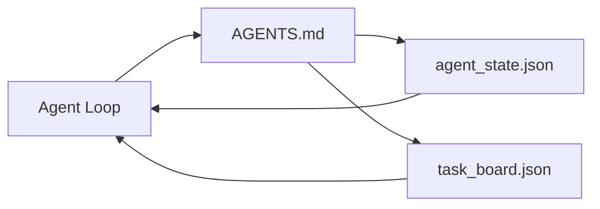

# The Minimal Agent Workbench · 最小智能体工作台

最小但有用的工作台只有三个文件：一个根指令路由器、一个状态文件、一个任务看板。其余一切都叠加在它们之上。如果一个仓库承载不了这三个文件，任何模型都救不了它。

> The smallest useful workbench is three files: a root instructions router, a state file, and a task board. Everything else is layered on top. If a repo cannot carry these three, no model will save it.

**Type:** Build
**Languages:** Python (stdlib)
**Prerequisites:** Phase 14 · 31 (Why Capable Models Still Fail)
**Time:** ~45 minutes

## Learning Objectives · 学习目标

- 定义构成最小可行工作台（minimum viable workbench）的三个文件。
- 解释为什么一个简短的根路由器胜过一篇冗长的单体 `AGENTS.md`。
- 构建一个智能体每轮都能读、结束时能写的状态文件。
- 构建一个不依赖聊天历史也能跨会话存活的任务看板。

> Define the three files that form the minimum viable workbench.
> Explain why a short root router beats a long monolithic `AGENTS.md`.
> Build a state file the agent can read at every turn and write at the end.
> Build a task board that survives multi-session work without chat history.

## The Problem · 问题在哪

大多数团队的做法是写一篇 3000 行的 `AGENTS.md`，然后宣布完工。模型把它加载进来，忽略掉自己概括不了的部分，然后在同样那些表面上继续失败。

你需要的是反面。一个极小的根文件，只在相关时才把智能体路由进更深的文档。一份持久状态，智能体行动前读、行动后写。一块任务看板，说明什么在进行、什么被阻塞、接下来做什么。

三个文件。各司其职。而且都足够机器可读，能在将来演化成真正的系统。

> Most teams reach for a workbench by writing a 3000-line `AGENTS.md` and calling it done. The model loads it, ignores the parts it cannot summarize, and still fails on the same surfaces it always failed on.
> You need the opposite. A tiny root file that routes the agent into deeper files only when relevant. Durable state the agent reads before acting and writes after. A task board that says what is in flight, what is blocked, and what is up next.
> Three files. Each one with a job. Each one machine-readable enough to evolve into a real system later.

## The Concept · 概念



### AGENTS.md is a router, not a manual · AGENTS.md 是路由器，不是手册

一份好的 `AGENTS.md` 很短。它把智能体指向：

- 状态文件（你在哪）。
- 任务看板（还剩什么）。
- 更深的规则（在 `docs/agent-rules.md` 下）。
- 验证命令（怎么确认它真的能跑）。

更长的内容放进更深的文档，按需加载。长手册会被忽略；短路由器会被遵循。

> A good `AGENTS.md` is short. It points the agent at: the state file (where you are), the task board (what is left), the deeper rules (under `docs/agent-rules.md`), the verification command (how to know it works).
> Anything longer goes in deeper docs, loaded only when needed. Long manuals get ignored. Short routers get followed.

### agent_state.json is the system of record · agent_state.json 是记录系统

状态承载：活动任务的 id、动过的文件、做过的假设、阻塞点、下一步动作。智能体每一轮都读它。下一个会话读它，而不是重放聊天记录。

状态放在文件里，因为聊天历史不可靠。会话会死，对话会被裁剪。文件不会。

> State carries: the active task id, the touched files, the assumptions made, the blockers, and the next action. The agent reads it at every turn. The next session reads it instead of replaying chat.
> State lives in a file because chat history is unreliable. Sessions die. Conversations get trimmed. The file does not.

### task_board.json is the queue · task_board.json 是队列

任务看板承载每一条状态为 `todo | in_progress | done | blocked` 的任务。它是状态为空时智能体从中取任务的队列，也是你想知道智能体是否在正轨上时读的队列。

看板上的一条任务有 id、目标、所有者（`builder`、`reviewer` 或 `human`）和验收标准。看板刻意保持小：当它长过一屏，你面对的是规划问题，不是看板问题。

> The task board carries every task with status `todo | in_progress | done | blocked`. It is the queue the agent pulls from when state is empty, and the queue you read when you want to know whether the agent is on track.
> A task on the board has an id, a goal, an owner (`builder`, `reviewer`, or `human`), and acceptance criteria. The board is small on purpose: when it grows past a screen, you have a planning problem, not a board problem.

### Three files is the floor, not the ceiling · 三个文件是地板，不是天花板

后续课程会加上范围契约、反馈运行器、验证门、评审清单和交接包。这里的三个文件是它们共同假设的基础。

> Later lessons add scope contracts, feedback runners, verification gates, reviewer checklists, and handoff packets. The three files here are what they all assume.

```figure
wb-three-files
```

## Build It · 动手造

`code/main.py` 把最小工作台写进一个空仓库，并演示一个智能体回合：

1. 读取 `agent_state.json`。
2. 若状态为空，从 `task_board.json` 取下一个任务。
3. 在范围内只动一个文件。
4. 写回更新后的状态。

运行：

```
python3 code/main.py
```

脚本会在自身旁边创建 `workdir/`，铺下三个文件，跑一个回合，并打印 diff。重新运行它，看第二个回合如何从第一个回合停下的地方接手。

> `code/main.py` writes the minimal workbench into an empty repo and demonstrates a single agent turn: reads `agent_state.json`... pulls the next task from `task_board.json` if state is empty... touches a single file inside scope... writes back updated state.
> The script creates `workdir/` next to itself, lays down the three files, runs one turn, and prints the diff. Re-run it to see how the second turn picks up where the first left off.

## Use It · 实战用法

在生产级智能体产品里，同样这三个文件以不同的名字出现：

- **Claude Code:** `AGENTS.md` 或 `CLAUDE.md` 做路由器，`.claude/state.json` 风格的存储做状态，hooks 做看板。
- **Codex / Cursor:** workspace rules 做路由器，session memory 做状态，聊天侧栏里排队的任务做看板。
- **自研 Python 智能体:** 就是你刚写的那三个文件。

名字会变。形状不变。

> Inside production agent products, the same three files show up under different names.
> Claude Code: `AGENTS.md` or `CLAUDE.md` for the router, `.claude/state.json`-style stores for state, hooks for the board.
> The names change. The shape does not.

## Production patterns in the wild · 野外生产模式

当三种模式叠加在它上面时，最小工作台就能在真实 monorepo 中存活。它们相互独立；挑你的仓库真正需要的那些。

**嵌套 `AGENTS.md` 与就近优先（nearest-wins）。** OpenAI 在其主仓库里放了 88 份 `AGENTS.md`，每个子组件一份。Codex、Cursor、Claude Code 和 Copilot 都会从当前工作文件向仓库根目录走，拼接沿途找到的每一份 `AGENTS.md`。子目录文件扩展根文件。Codex 另有 `AGENTS.override.md`，用于替换而非扩展；这个覆盖机制是 Codex 特有的，跨工具场景请避免使用。Augment Code 的测量是最关键的一句话：最好的 `AGENTS.md` 带来的质量跃升，相当于把模型从 Haiku 升级到 Opus；最差的 `AGENTS.md` 比没有文件还糟。

**要拒绝的反模式——即使它们看起来像覆盖面。** 相互冲突的指令会让智能体悄悄从交互模式掉进贪婪模式（ICLR 2026 AMBIG-SWE：解决率 48.8% → 28%）；要给优先级编号，而不是平铺堆叠。不可验证的风格规则（「遵循 Google Python Style Guide」）没有配套的强制命令，会让智能体自行发明合规；每条风格规则都要配上确切的 lint 命令。把风格放在命令前面会埋掉验证路径；命令在前，风格在后。为人类而不是为智能体写作会浪费上下文预算；简洁是一种 feature。

**跨工具 symlink。** 一个根文件加符号链接（`ln -s AGENTS.md CLAUDE.md`、`ln -s AGENTS.md .github/copilot-instructions.md`、`ln -s AGENTS.md .cursorrules`）让所有编程智能体共享同一份事实来源。Nx 的 `nx ai-setup` 从单一配置为 Claude Code、Cursor、Copilot、Gemini、Codex 和 OpenCode 自动完成这件事。

> Nested `AGENTS.md` with nearest-wins precedence. OpenAI ships 88 `AGENTS.md` files across its main repo, one per subcomponent... Augment Code's measurement is the line that matters: the best `AGENTS.md` files give a quality jump equivalent to upgrading from Haiku to Opus; the worst ones make output worse than no file at all.
> Anti-patterns to refuse, even when they look like coverage. Conflicting instructions silently drop the agent from interactive to greedy mode (ICLR 2026 AMBIG-SWE: 48.8% → 28% resolve rate)... Writing for humans instead of agents wastes context budget; terseness is a feature.
> Cross-tool symlinks. A single root file with symlinks keeps every coding agent on the same source of truth. Nx's `nx ai-setup` automates this across Claude Code, Cursor, Copilot, Gemini, Codex, and OpenCode from a single config.

## Ship It · 交付

`outputs/skill-minimal-workbench.md` 为任何新仓库生成三文件工作台：一份调校过的 `AGENTS.md` 路由器、一个键位正确的 `agent_state.json`，以及一个装着当前 backlog 的 `task_board.json`。

> `outputs/skill-minimal-workbench.md` generates the three-file workbench for any new repo: an `AGENTS.md` router tuned to the project, an `agent_state.json` with the right keys, and a `task_board.json` seeded with the current backlog.

## Exercises · 练习

1. 给 `agent_state.json` 加一个 `last_run` 时间戳。如果文件超过 24 小时，除非操作员确认，否则拒绝运行。
2. 给任务看板加一个 `priority` 字段，并把取数逻辑改成总是挑优先级最高的 `todo`。
3. 把 `task_board.json` 迁移到 JSON Lines，让每条任务一行，diff 在版本控制里更干净。
4. 写一个 `lint_workbench.py`：`AGENTS.md` 超过 80 行、或引用了不存在的文件，就失败。
5. 判断这三个文件里丢了哪一个伤害最大。为你的判断辩护。

> Add a `last_run` timestamp to `agent_state.json`. Refuse to run if the file is older than 24 hours unless an operator confirms.
> Add a `priority` field to the task board and change the puller to always pick the highest priority `todo`.
> Write a `lint_workbench.py` that fails if `AGENTS.md` is over 80 lines or references a file that does not exist.

## Key Terms · 术语表

| Term 术语 | What people say 大家怎么说 | What it actually means 实际含义 |
|------|----------------|----------------------|
| Router（路由器） | `AGENTS.md` | 简短的根文件，把智能体指向更深的文档和文件 |
| State file（状态文件） | 「那些笔记」 | 智能体身处何地的机器可读记录，每轮都写 |
| Task board（任务看板） | 「backlog」 | 带状态、所有者、验收标准的 JSON 任务队列 |
| System of record（记录系统） | 「事实来源」 | 聊天没了之后，工作台当作权威的文件 |

## Further Reading · 延伸阅读

- [agents.md — the open spec](https://agents.md/) —— 已被 Cursor、Codex、Claude Code、Copilot、Gemini、OpenCode 采用
- [Augment Code, A good AGENTS.md is a model upgrade. A bad one is worse than no docs at all](https://www.augmentcode.com/blog/how-to-write-good-agents-dot-md-files) —— 经过测量的质量跃升
- [Blake Crosley, AGENTS.md Patterns: What Actually Changes Agent Behavior](https://blakecrosley.com/blog/agents-md-patterns) —— 哪些经实证有效，哪些没有
- [Datadog Frontend, Steering AI Agents in Monorepos with AGENTS.md](https://dev.to/datadog-frontend-dev/steering-ai-agents-in-monorepos-with-agentsmd-13g0) —— 嵌套优先级的实战
- [Nx Blog, Teach Your AI Agent How to Work in a Monorepo](https://nx.dev/blog/nx-ai-agent-skills) —— 从单一配置生成到六个工具
- [The Prompt Shelf, AGENTS.md Best Practices: Structure, Scope, and Real Examples](https://thepromptshelf.dev/blog/agents-md-best-practices/) —— 经得起评审的章节排序
- [Anthropic, Claude Code subagents](https://code.claude.com/docs/en/sub-agents)
- Phase 14 · 31 —— 这个最小工作台要吸收的失败模式
- Phase 14 · 34 —— 本课预告的持久化状态 schema
