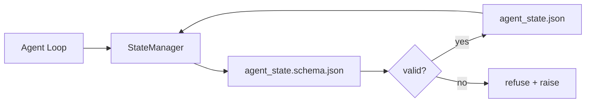

# Repo Memory and Durable State · 仓库记忆与持久状态

聊天历史是易失的，仓库是持久的。工作台把智能体状态存进受版本控制的文件，让下一个会话、下一个智能体、下一个评审者都从同一个事实来源读取。

> Chat history is volatile. The repo is durable. The workbench stores agent state in versioned files so the next session, the next agent, and the next reviewer all read from the same source of truth.

**Type:** Build
**Languages:** Python (stdlib + `jsonschema` optional)
**Prerequisites:** Phase 14 · 32 (Minimal Workbench)
**Time:** ~60 minutes

## Learning Objectives · 学习目标

- 定义什么属于仓库记忆，什么属于聊天历史。
- 为 `agent_state.json` 和 `task_board.json` 编写 JSON Schema。
- 构建一个能加载、校验、修改并原子化持久化状态的状态管理器（state manager）。
- 用 schema 在坏写入腐蚀工作台之前就拒绝它。

> Define what belongs in repo memory and what belongs in chat history.
> Author JSON Schemas for `agent_state.json` and `task_board.json`.
> Build a state manager that loads, validates, mutates, and persists state atomically.
> Use the schema to refuse bad writes before they corrupt the workbench.

## The Problem · 问题在哪

智能体结束了一个会话。聊天窗口关闭。下一个会话打开，问从哪里开始。模型说「让我看看文件」，读到过时的笔记，把已经完成的工作重做一遍。或者更糟：它重写了一个已完成的文件，因为没人告诉它文件已经完成了。

工作台的解法是仓库记忆（repo memory）：状态以 JSON 文件的形式住在仓库里，按 schema 写入，原子化持久化，在代码评审中对 diff 友好。聊天是瞬态信息流；仓库是记录系统（system of record）。

> The agent finishes a session. The chat closes. The next session opens and asks where to start. The model says "let me check the files," reads stale notes, and re-does work that was already complete. Or worse, it rewrites a finished file because no one told it the file was finished.
> The workbench fix is repo memory: state lives in JSON files in the repo, written under a schema, persisted atomically, diff-friendly in code review. Chat is a transient feed; the repo is the system of record.

## The Concept · 概念



### What belongs in repo memory · 什么属于仓库记忆

| 属于 | 不属于 |
|---------|-----------------|
| 当前任务 id | 原始聊天转录 |
| 本会话动过的文件 | token 级推理轨迹 |
| 智能体做过的假设 | 「用户好像有点不耐烦」 |
| 未解决的阻塞点 | 采样出的补全结果 |
| 下一步动作 | 厂商特定的模型 id |

检验标准是持久性：三个月后的 CI 重跑里它还有用吗？有用就进仓库；没用就进遥测。

> The test is durability: would this be useful three months from now in a CI rerun? If yes, repo. If no, telemetry.

### Schema-first state · schema 优先的状态

JSON Schema 是契约。没有它，每个智能体都发明新字段，每个评审者都要学一种新形状，每个 CI 脚本都得为历史版本写特例。有了它，坏写入就是一次被拒绝的写入。

schema 覆盖：

- 必需键。
- 允许的 `status` 取值。
- 禁止的取值（例如数组取 `null`）。
- 模式约束（任务 id 匹配 `T-\d{3,}`）。
- 用于迁移的版本字段。

> JSON Schema is the contract. Without it, every agent invents new fields, every reviewer learns a new shape, and every CI script has to special-case past versions. With it, a bad write is a refused write.
> The schema covers: required keys... allowed `status` values... forbidden values (e.g. `null` for arrays)... pattern constraints (task ids match `T-\d{3,}`)... version field for migrations.

### Atomic writes · 原子写入

状态写入必须能在部分失败中存活：写临时文件、fsync、rename 覆盖目标。状态文件是事实来源；一个写了一半的文件比没有文件更糟。

> State writes need to survive partial failures: write to a tempfile, fsync, rename over the target. The state file is the source of truth; a half-written one is worse than no file at all.

### Migrations · 迁移

schema 变更时，在 schema 升级的同一个提交里附上迁移脚本。状态文件带有 `schema_version` 字段；管理器拒绝加载它无法迁移的版本。

> When the schema changes, ship a migration script next to the schema bump. The state file carries a `schema_version` field; the manager refuses to load a file from a version it cannot migrate.

```figure
wb-state-persist
```

## Build It · 动手造

`code/main.py` 实现：

- `agent_state.schema.json` 和 `task_board.schema.json`。
- 一个仅用标准库的校验器（JSON Schema 的子集：required、type、enum、pattern、items）。
- `StateManager.load`、`StateManager.update`、`StateManager.commit`，采用原子的 temp-and-rename 写入。
- 一个演示：修改状态、持久化、重新加载，并证明往返一致。

运行：

```
python3 code/main.py
```

脚本会写 `workdir/agent_state.json` 和 `workdir/task_board.json`，跨两个回合修改它们，并在每一步打印校验过的状态。

> `code/main.py` implements: `agent_state.schema.json` and `task_board.schema.json`... a stdlib-only validator (subset of JSON Schema: required, type, enum, pattern, items)... `StateManager.load`, `StateManager.update`, `StateManager.commit` with atomic temp-and-rename writes.
> The script writes `workdir/agent_state.json` and `workdir/task_board.json`, mutates them across two turns, and prints the validated state at each step.

## Production patterns in the wild · 野外生产模式

四个模式把本课的最小实现升级成多智能体 monorepo 能赖以存活的东西。

**原子 temp-and-rename 不是可选项。** 2026 年 3 月 Hive 项目的一份 bug 报告干净地记录了这个失败模式：`state.json` 用 `write_text()` 写入，异常被捕获后吞掉。部分写入让会话在损坏的状态上恢复，且毫无征兆。修法永远是：在与目标相同的目录里 `tempfile.mkstemp`、写入、`fsync`、`os.replace`（POSIX 和 Windows 上的原子重命名）。本课的 `atomic_write` 做的正是这件事。

**每个非幂等工具调用都带幂等键（idempotency key）。** 如果智能体在调用工具之后、checkpoint 结果之前崩溃，恢复时会重试该工具调用。对读操作安全；对发邮件、数据库插入、文件上传危险。模式是：执行前把每个工具调用 ID 记进 `pending_calls.jsonl`。重试时先查 ID；存在就跳过调用并使用缓存结果。Anthropic 和 LangChain 都在 2026 年的指导意见里点名了这一点；LangGraph 的 checkpointer 出于同样的原因持久化待写入项。

**大工件与状态分开存。** 不要把 CSV、长转录或生成文件塞进 `agent_state.json`。把工件存成单独的文件（或上传到对象存储），状态里只留路径。checkpoint 保持小而快；工件独立增长。

**审计用事件溯源，恢复用快照。** 每次修改都追加进事件日志（`state.events.jsonl`）；周期性地把快照写进 `state.json`。恢复时先读快照，再重放快照时间戳之后的事件。磁盘开销更大，但能逐字重放智能体的决策——调试长程运行时必不可少。Postgres 内部的 WAL 就是同一形状。

**要么 schema 迁移，要么拒绝加载。** `schema_version` 整数就是契约。管理器加载未知版本的文件时拒绝读取。在 schema 升级的同一提交里附上迁移脚本；`tools/migrate_state.py` 每次启动时幂等地运行。

> Four patterns turn the lesson's minimum into something a multi-agent monorepo can survive.
> Atomic temp-and-rename is not optional... The fix is always: `tempfile.mkstemp` in the same directory as the target, write, `fsync`, `os.replace` (atomic rename on POSIX and Windows).
> Idempotency keys on every non-idempotent tool call... On retry, check for the ID; if present, skip the call and use the cached result.
> Separate large artifacts from state. Don't store CSVs, long transcripts, or generated files in `agent_state.json`.
> Event sourcing for audit, snapshots for resume. Append to an event log (`state.events.jsonl`) on every mutation; periodically snapshot to `state.json`.
> Schema migrations or refuse to load. The `schema_version` integer is the contract.

## Use It · 实战用法

在生产中：

- **LangGraph checkpointers。** 同一个想法，不同的存储。checkpointer 把图状态持久化到 SQLite、Postgres 或自定义后端。当 checkpointer 挂掉、你需要手工读状态时，本课教的 schema 就是你的抓手。
- **Letta memory blocks。** 带结构化 schema 的持久块（Phase 14 · 08）。同一纪律，用在长期运行的人格（persona）上。
- **OpenAI Agents SDK session store。** 可插拔后端，schema 感知。本课的状态文件就是本地文件后端。

> In production: LangGraph checkpointers. Same idea, different storage... The schema this lesson teaches is what you reach for when the checkpointer dies and you need to read state by hand.
> Letta memory blocks. Persistent blocks with structured schemas (Phase 14 · 08). Same discipline scoped to long-running personas.
> OpenAI Agents SDK session store. Pluggable backends, schema-aware. The state file in this lesson is the local-file backend.

## Ship It · 交付

`outputs/skill-state-schema.md` 生成一对项目专属的 JSON Schema（状态 + 看板）、一个接好原子写入的 Python `StateManager`，以及一个迁移脚手架，让下一次 schema 升级不会弄坏工作台。

> `outputs/skill-state-schema.md` generates a project-specific JSON Schema pair (state + board), a Python `StateManager` wired to atomic writes, and a migration scaffold so the next schema bump does not break the workbench.

## Exercises · 练习

1. 加一个 `last_human_touch` 时间戳。凡是距人类编辑不足五秒的智能体写入，一律拒绝。
2. 扩展校验器支持 `oneOf`，让一个任务可以是构建任务或评审任务，各自带不同的必需字段。
3. 加一个 `schema_version` 字段，并写出从 v1 到 v2 的迁移（把 `blockers` 改名为 `risks`）。
4. 把存储后端从本地文件换成 SQLite，保持 `StateManager` API 不变。
5. 用 50 毫秒的写入竞争让两个智能体打同一个状态文件。会出什么问题？原子重命名怎么救你？

> Add a `last_human_touch` timestamp. Refuse any agent write within five seconds of a human edit.
> Extend the validator to support `oneOf` so a task can be either a build task or a review task with different required fields.
> Add a `schema_version` field and write the migration from v1 to v2 (rename `blockers` to `risks`).
> Move the storage backend from a local file to SQLite. Keep the `StateManager` API identical.
> Run two agents against the same state file with a 50 ms write race. What goes wrong and how does the atomic rename save you?

## Key Terms · 术语表

| 术语 | 大家怎么说 | 实际含义 |
|------|----------------|------------------------|
| Repo memory（仓库记忆） | 「笔记文件」 | 存在仓库受控文件里、有 schema 约束的状态 |
| Schema-first（schema 优先） | 「校验输入」 | 在写方之前定义契约，拒绝漂移 |
| Atomic write（原子写入） | 「改个名就行」 | 写临时文件、fsync、重命名，部分失败无法腐蚀 |
| Migration（迁移） | 「schema 升级」 | 把 vN 状态转成 v(N+1) 状态的脚本 |
| System of record（记录系统） | 「事实来源」 | 工作台当作权威的工件 |

## Further Reading · 延伸阅读

- [JSON Schema specification](https://json-schema.org/specification.html)
- [LangGraph checkpointers](https://langchain-ai.github.io/langgraph/concepts/persistence/)
- [Letta memory blocks](https://docs.letta.com/v1-sdk/memory/memory-blocks)
- [Fast.io, AI Agent State Checkpointing: A Practical Guide](https://fast.io/resources/ai-agent-state-checkpointing/) —— 带幂等性的 schema 优先 checkpoint
- [Fast.io, AI Agent Workflow State Persistence: Best Practices 2026](https://fast.io/resources/ai-agent-workflow-state-persistence/) —— 并发控制、TTL、事件溯源
- [Hive Issue #6263 — non-atomic state.json writes silently ignored](https://github.com/aden-hive/hive/issues/6263) —— 真实项目里的那个失败模式
- [eunomia, Checkpoint/Restore Systems: Evolution, Techniques, Applications](https://eunomia.dev/blog/2025/05/11/checkpointrestore-systems-evolution-techniques-and-applications-in-ai-agents/) —— 从操作系统历史借来的 CR 原语，用于智能体
- [Indium, 7 State Persistence Strategies for Long-Running AI Agents in 2026](https://www.indium.tech/blog/7-state-persistence-strategies-ai-agents-2026/)
- [Microsoft Agent Framework, Compaction](https://learn.microsoft.com/en-us/agent-framework/agents/conversations/compaction) —— 厂商的 checkpoint 管理器
- Phase 14 · 08 —— memory blocks 与睡眠时间计算
- Phase 14 · 32 —— 本课为之建立 schema 的三文件最小集
- Phase 14 · 40 —— 从同一份 schema 读取的交接包
