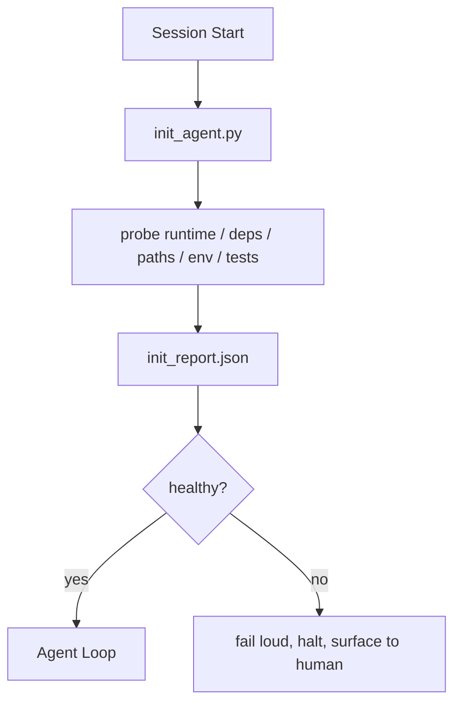

# Initialization Scripts for Agents · 面向智能体的初始化脚本

每个冷启动的会话都要交一笔税。智能体读同样的文件、重试同样的探测、重新发现同样的路径。init 脚本把这笔税只交一次，把答案写进状态。

> Every session that starts cold pays a tax. The agent reads the same files, retries the same probes, and rediscovers the same paths. An init script pays the tax once and writes the answers into state.

**Type:** Build
**Languages:** Python (stdlib)
**Prerequisites:** Phase 14 · 32 (Minimal Workbench), Phase 14 · 34 (Repo Memory)
**Time:** ~45 minutes

## Learning Objectives · 学习目标

- 识别哪些工作是智能体每个会话都不该重做的。
- 构建一个确定性的 init 脚本，探测运行时、依赖和仓库健康。
- 持久化探测结果，让智能体直接读它，而不是重跑检查。
- 初始化失败时，响亮地、快速地失败，并且只有一个地方可看。

> Identify the work an agent should never have to redo per session.
> Build a deterministic init script that probes runtime, dependencies, and repo health.
> Persist the probe result so the agent reads it instead of re-running checks.
> Fail loud, fast, and with one place to look when initialization fails.

## The Problem · 问题在哪

打开一个会话。智能体猜 Python 版本。猜测试命令。把仓库根目录列了五遍来找入口。尝试 import 一个没安装的包。问用户配置文件在哪。等它做出第一个真正的修改时，一万个 token 已经花在了本该一个脚本搞定的准备工作上。

解法是一个初始化脚本：它在智能体做任何事之前运行，写出一份 `init_report.json` 供智能体启动时读取。

> Open a session. The agent guesses the Python version. Guesses the test command. Lists the repo root five times to find the entry point. Tries to import a package that is not installed. Asks the user where the config file lives. By the time it makes a real edit, ten thousand tokens have gone to setup work that should have been a single script.
> The fix is one initialization script that runs before the agent does anything else and writes a `init_report.json` the agent reads at startup.

## The Concept · 概念



### What the init script probes · init 脚本探测什么

| 探测项 | 为什么重要 |
|-------|----------------|
| 运行时版本 | Python 或 Node 版本不对，意味着无声的错误版本 bug |
| 依赖可用性 | 缺包以后才发现，代价是现在抓住它的十倍 |
| 测试命令 | 智能体必须知道怎么验证；命令缺失说明工作台已经坏了 |
| 仓库路径 | 硬编码路径会漂移；解析一次然后钉死 |
| 环境变量 | 缺 `OPENAI_API_KEY` 是一个明确的失败面，不是运行时谜团 |
| 状态 + 看板新鲜度 | 崩溃会话留下的陈旧状态是隐患 |
| last-known-good commit | 会话结束时交接 diff 的锚点 |

### Fail loud, fail fast, fail in one place · 响亮地失败，快速地失败，失败在一个地方

探测失败意味着中止并向人类呈报。没有「智能体会自己想办法」这回事。init 的全部意义就在于：工作台坏了就拒绝启动。

> A probe failure means halt and surface to the human. No "the agent will figure it out." The whole point of init is to refuse to start when the workbench is broken.

### Idempotent · 幂等

连跑两次。第二次除了时间戳更新之外，应该是什么都不做的空操作。幂等性让你能把脚本接进 CI、hooks 或任务前的 slash 命令。

> Run it twice in a row. The second run should be a no-op except for a fresh timestamp. Idempotency is what lets you wire the script into CI, hooks, or a pre-task slash command.

### Init versus startup rules · init 与启动规则

规则（Phase 14 · 33）描述行动之前什么必须为真。init 是证明这些规则可以被检查的那个脚本。没有 init 的规则退化成「小心一点」。没有规则的 init 是一场精致的失败。

> Rules (Phase 14 · 33) describe what must be true to act. Init is the script that establishes that those rules can be checked. Rules without init become "be careful." Init without rules becomes a polished failure.

```figure
wb-init-probes
```

## Build It · 动手造

`code/main.py` 实现 `init_agent.py`：

- 五个探测项：Python 版本、经 `importlib.util.find_spec` 列出的依赖、测试命令可解析性、必需环境变量、状态文件新鲜度。
- 每个探测返回 `(name, status, detail)`。
- 脚本写出带完整探测集的 `init_report.json`，任何 block 级探测失败都以非零码退出。

运行：

```
python3 code/main.py
```

脚本打印探测表、写出 `init_report.json`，顺利路径下以零退出，否则以非零码退出并列出失败的探测项。

> `code/main.py` implements `init_agent.py`: Five probes: Python version, listed dependencies via `importlib.util.find_spec`, test command resolvability, required env vars, state file freshness.
> Each probe returns `(name, status, detail)`.
> The script writes `init_report.json` with the full probe set and exits non-zero if any block-severity probe fails.
> The script prints the table of probes, writes `init_report.json`, and exits zero on the happy path or non-zero with a list of failed probes.

## Production patterns in the wild · 野外生产模式

三个模式区分了有用的 init 脚本和走仪式的 init 脚本。

**Last-known-good commit 锚定。** 用一份在上次成功合并时写下的 `LKG` 文件对照当前 commit 做探测。如果 diff 超出预算（默认 50 个文件），拒绝启动，并要求人类批准新基线。Cloudflare 的 AI Code Review 就是用它来限定评审智能体的范围：每次评审会话都锚定同一个 last-known-good，绝不让漂移跨会话累积。

**带 TTL 的锁文件。** 第一次探测全部通过后写一个 `prereqs.lock`。后续运行在 N 小时内（默认 24 小时）信任这个锁，跳过昂贵的探测。init 脚本先读锁；如果锁还新鲜且依赖清单哈希匹配，就短路返回。Docker 的层缓存用的是同一模式：幂等探测 + 内容哈希 = 跳过。

**热路径里没有网络、没有 LLM、没有意外。** init 探测是确定性的管道活。一个调用 LLM 来分类失败的探测、或访问外部服务查 license 的探测，不是探测，是工作流。如果 dry run 里某个探测跑了超过三秒，把它当作工作台的坏味道：要么把它移出 init，要么缓存它的结果。

> Three patterns separate a useful init script from a ceremony.
> Last-known-good commit anchoring. Probe the current commit against a `LKG` file written on the last successful merge... This is what Cloudflare's AI Code Review uses to scope reviewer agents: every review session anchors against the same last-known-good and never compounds drift across sessions.
> Lock files with TTL... The init script reads the lock first; if it is fresh and the dependency manifest hash matches, it short-circuits.
> No network, no LLM, no surprises in the hot path. Init probes are deterministic plumbing... If a probe takes longer than three seconds in a dry run, treat that as a workbench smell and either move it out of init or cache its result.

## Use It · 实战用法

在生产中：

- **Claude Code hooks。** `pre-task` hook 调用 init 脚本，失败就拒绝启动智能体。
- **GitHub Actions。** 一个 `setup-agent` job 运行 init 脚本；智能体 job 依赖它。
- **Docker entrypoint。** 智能体容器在 exec 智能体运行时之前先跑 init 脚本；失败时日志浮出水面。

init 脚本是可移植的，因为它不调用任何特定框架。Bash、Make 或 tasks 文件都能包一层。

> In production: Claude Code hooks. `pre-task` hook calls the init script and refuses to launch the agent if it fails.
> GitHub Actions. A `setup-agent` job runs the init script; the agent job depends on it.
> Docker entrypoint. The agent container runs the init script before exec-ing the agent runtime; logs surface on failure.
> The init script is portable because it makes no calls to a specific framework. Bash, Make, or a tasks file can all wrap it.

## Ship It · 交付

`outputs/skill-init-script.md` 访谈项目，把它的准备工作归类成探测项，产出一份项目专属的 `init_agent.py`，外加一个在任何智能体步骤之前运行它的 CI workflow。

> `outputs/skill-init-script.md` interviews the project, classifies its setup work into probes, and emits a project-specific `init_agent.py` plus a CI workflow that runs it before any agent step.

## Exercises · 练习

1. 加一个探测项：把当前 commit 与 last-known-good commit 做 diff，改动超过 50 个文件就拒绝启动。
2. 把脚本接成写一个 `prereqs.lock` 文件，锁超过七天就拒绝启动。
3. 加一个 `--fix` 旗标：自动安装缺失的开发依赖，但未经批准绝不修改运行时依赖。
4. 把探测项从硬编码函数搬进 YAML 注册表。为这个取舍辩护。
5. 给每个探测项加时间预算。跑了超过三秒的探测项就是工作台的坏味道。

> Add a probe that diffs the current commit against the last-known-good commit and refuses to start if more than 50 files changed.
> Wire the script to write a `prereqs.lock` file and refuse to start if the lock is older than seven days.
> Add a `--fix` flag that auto-installs missing dev dependencies but never modifies runtime dependencies without approval.
> Move probes from hardcoded functions to a YAML registry. Defend the trade-off.
> Add a timing budget per probe. A probe that runs longer than three seconds is a workbench smell.

## Key Terms · 术语表

| 术语 | 大家怎么说 | 实际含义 |
|------|----------------|------------------------|
| Probe（探测项） | 「一个检查」 | 返回 `(name, status, detail)` 的确定性函数 |
| Init report（init 报告） | 「准备工作的输出」 | 与状态写在一起、装着探测结果的 JSON |
| Idempotent（幂等） | 「可以安全重跑」 | 连跑两次产出相同的报告，只有时间戳不同 |
| Fail loud（响亮失败） | 「别吞异常」 | 中止并向人类呈报；没有无声回退 |
| Setup tax（启动税） | 「引导成本」 | 智能体每个会话重新发现显而易见之事所花掉的 token |

## Further Reading · 延伸阅读

- [Anthropic, Effective harnesses for long-running agents](https://www.anthropic.com/engineering/effective-harnesses-for-long-running-agents)
- [GitHub Actions, composite actions for setup](https://docs.github.com/en/actions/sharing-automations/creating-actions/creating-a-composite-action)
- [microservices.io, GenAI dev platform: guardrails](https://microservices.io/post/architecture/2026/03/09/genai-development-platform-part-1-development-guardrails.html) —— 作为 init 的 pre-commit + CI 检查
- [Augment Code, How to Build Your AGENTS.md (2026)](https://www.augmentcode.com/guides/how-to-build-agents-md) —— init 的预期
- [Codex Blog, Codex CLI Context Compaction](https://codex.danielvaughan.com/2026/03/31/codex-cli-context-compaction-architecture/) —— 把会话启动视为压缩感知的 init
- Phase 14 · 33 —— 本脚本所启用的规则集
- Phase 14 · 34 —— 本脚本所播种的状态文件
- Phase 14 · 38 —— init 脚本所喂给的验证门
- Phase 14 · 40 —— 消费 init 报告 last-known-good 的交接
