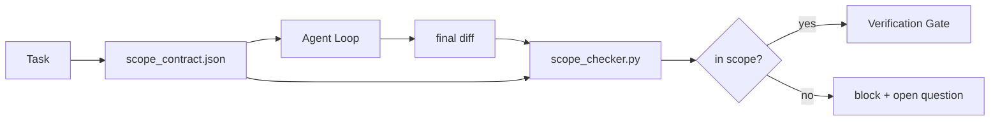

# Scope Contracts and Task Boundaries · 范围契约与任务边界

模型不知道工作在哪里结束。范围契约（scope contract）是一个按任务而设的文件，写明工作从哪里开始、到哪里结束、越界了怎么回滚。契约把「待在范围内」从一个愿望变成一个检查。

> The model does not know where the work ends. A scope contract is a per-task file that says where the work begins, where it ends, and how to roll back if it spills. The contract turns "stay in scope" from a wish into a check.

**Type:** Build
**Languages:** Python (stdlib)
**Prerequisites:** Phase 14 · 32 (Minimal Workbench), Phase 14 · 33 (Rules as Constraints)
**Time:** ~50 minutes

## Learning Objectives · 学习目标

- 写出智能体在任务开始时读、验证者在任务结束时读的范围契约。
- 规定允许的文件、禁止的文件、验收标准、回滚计划和审批边界。
- 实现一个范围检查器（scope checker），把 diff 与契约对比并标记违规。
- 让范围蔓延（scope creep）可见、自动、可评审。

> Write a scope contract that an agent reads at task start and a verifier reads at task end.
> Specify allowed files, forbidden files, acceptance criteria, rollback plan, and approval boundaries.
> Implement a scope checker that compares a diff against the contract and flags violations.
> Make scope creep visible, automatic, and reviewable.

## The Problem · 问题在哪

智能体会蔓延。任务是「修复登录 bug」。diff 却碰了登录路由、邮件工具函数、数据库驱动、README 和发布脚本。每一次触碰在当时都有一堆说得通的理由。加在一起，它们就成了一个与被评审的那个不同的改动。

范围蔓延是智能体工作中被监控得最少的失败模式，因为智能体会善意地叙述每一步。解法不是更严格的提示词。解法是磁盘上的一纸契约——写明承诺了什么——外加一个把结果与承诺对比的检查。

> Agents creep. The task is "fix the login bug." The diff touches the login route, the email helper, the database driver, the README, and the release script. Each touch had a plausible reason in the moment. Together they are a different change than the one that was reviewed.
> Scope creep is the most under-monitored failure mode in agent work because the agent narrates each step in good faith. The fix is not a stricter prompt. The fix is a contract on disk that says what was promised and a check that compares the result against the promise.

## The Concept · 概念



### What goes in a scope contract · 范围契约里放什么

| 字段 | 用途 |
|-------|---------|
| `task_id` | 链接到看板上的任务 |
| `goal` | 评审者能验证的一句话 |
| `allowed_files` | 智能体可以写的 glob |
| `forbidden_files` | 智能体即使无意也不能碰的 glob |
| `acceptance_criteria` | 证明完成的测试命令或断言行 |
| `rollback_plan` | 需要中止时操作员能执行的一段话 |
| `approvals_required` | 范围之外、需要人类明确签字的动作 |

没有 `forbidden_files` 的契约是不完整的。负空间是契约的一半。

> A contract without `forbidden_files` is incomplete. The negative space is half the contract.

### Globs, not raw paths · 用 glob，不用裸路径

真实的仓库会移动文件。把契约钉在 glob 上（`app/**/*.py`、`tests/test_signup*.py`），会话之间的一次重构就不会让契约失效。

> Real repos move files. Pin contracts to globs (`app/**/*.py`, `tests/test_signup*.py`) so a refactor between sessions does not invalidate the contract.

### Rollback is part of scope · 回滚是范围的一部分

列出怎么回滚，会逼契约作者思考可能出什么问题。一个回滚不了的契约，是不该被批准的契约。

> Listing how to roll back forces the contract author to think about what could go wrong. A contract you cannot roll back from is a contract that should not be approved.

### Scope check is a diff check · 范围检查就是 diff 检查

智能体产出 diff。检查器读 diff、允许的 glob、禁止的 glob，以及跑过的验收命令列表。每条违规都是一个带标签的发现（finding），验证门可以据此拒绝。

> The agent writes a diff. The checker reads the diff, the allowed globs, the forbidden globs, and a list of any acceptance commands that ran. Each violation is a tagged finding the verification gate can refuse.

### Two altitudes of scope: the feature list and the task contract · 范围的两个高度：特性清单与任务契约

范围契约约束的是一个任务，不是整个项目。一个智能体可以在登录修复的契约里待得完美无缺，然后在下一轮决定项目还需要一个设置页、一个暗色模式开关和一次路由器重写。从没有人问过契约「哪些工作在项目范围内」，只问过「哪些文件在任务范围内」。

第二个高度需要它自己的原语：一份智能体在会话开始时读的 `feature_list.json`。它是机器可读、有序的项目 backlog。智能体恰好挑一个 `status` 为 `todo` 的特性，把它的 `id` 写进当前范围契约，并且被禁止在同一会话里开始第二个特性。「一次只做一个特性」不再是智能体能自我合理化绕过去的一行提示词，而是它从磁盘上读到的值和验证门执行的一个检查。

```json
{
  "project": "knowledge-base",
  "active": "import-pdf",
  "features": [
    { "id": "import-pdf",   "status": "in_progress", "goal": "import a PDF into the library",        "done_when": "pytest tests/test_import.py && a sample PDF appears in the library view" },
    { "id": "full-text-search", "status": "todo",     "goal": "search document text and rank hits",   "done_when": "query returns ranked results with snippets" },
    { "id": "cite-answers", "status": "todo",         "goal": "answers carry source citations",        "done_when": "every answer renders at least one clickable citation" }
  ]
}
```

| 字段 | 用途 |
|-------|---------|
| `active` | 当前会话唯一可以触碰的特性；为空表示挑一个并设置它 |
| `features[].id` | 范围契约的 `task_id` 所指向的稳定 slug |
| `features[].status` | `todo`、`in_progress`、`done`、`blocked`；同一时刻只允许一个 `in_progress` |
| `features[].goal` | 评审者能验证的一句话 |
| `features[].done_when` | 把 `in_progress` 翻转为 `done` 的那条验收行 |

两条规则让这份清单承重而不是装饰。第一，「至多一个 `in_progress`」的不变式本身就是一次启动检查（Phase 14 · 33）：如果清单上出现两个，会话拒绝启动，直到人类解决它。第二，特性清单是文件而不是聊天消息，因为聊天会滚出上下文，而文件跨会话、跨智能体持久存在。交接（Phase 14 · 40）把完成特性的状态写回 `done`，让下一个会话面对一块准确的看板，而不是重新推导还剩什么。

契约与清单按最小权限组合，也就是下文描述的那次合并：任务契约的 `allowed_files` 必须落在当前活跃特性触及的范围之内，绝不能在外面。

> That second altitude needs its own primitive: a `feature_list.json` the agent reads at session start. It is the project backlog as a machine-readable, ordered file... "One feature at a time" stops being a line in the prompt the agent can rationalize past and becomes a value it reads off disk and a check the gate enforces.
> Two rules make the list load-bearing instead of decorative. First, the invariant "at most one `in_progress`" is itself a startup check (Phase 14 · 33): if the list shows two, the session refuses to start until a human resolves it. Second, the feature list is a file, not a chat message, because the chat scrolls out of context and the file persists across sessions and across agents.
> The contract and the list compose by least privilege, the same merge described below: the task contract's `allowed_files` must sit inside whatever the active feature touches, never outside it.

```figure
wb-scope-bounce
```

## Build It · 动手造

`code/main.py` 实现：

- `scope_contract.json` schema（JSON Schema 的子集，glob 数组）。
- 一个 diff 解析器，把动过的文件列表加跑过的命令列表变成一个 `RunSummary`。
- 一个 `scope_check`，对照契约返回 `(violations, in_scope, off_scope)`。
- 两个演示运行：一个待在范围内，一个蔓延。检查器用确切的文件和原因标记蔓延。

运行：

```
python3 code/main.py
```

输出：契约、两次运行、每次运行的裁决，以及保存下来的 `scope_report.json`。

> `code/main.py` implements: a `scope_contract.json` schema (subset of JSON Schema, glob arrays)... a diff parser that turns a list of touched files plus a list of run commands into a `RunSummary`... a `scope_check` that returns `(violations, in_scope, off_scope)` against the contract.
> Output: the contract, the two runs, the per-run verdicts, and a saved `scope_report.json`.

## Production patterns in the wild · 野外生产模式

一位践行「specsmaxxing」（调用智能体之前先写 YAML 范围契约）的从业者报告：三周内兔子洞率（rabbit-hole rate）从 52% 降到 21%，而智能体本身没有任何改动。起作用的是契约，不是模型。三个模式让这份收益留得住。

**违规预算，而不是二元失败。** `agent-guardrails`（Claude Code、Cursor、Windsurf、Codex 经由 MCP 使用的开源合并门）为每个任务提供 `violationBudget`：预算内的小幅范围滑动作为警告呈现；只有超出预算时合并门才拒绝。配合 `violationSeverity: "error" | "warning"` 使用。预算就是一道分界线：一边是能上线的门，另一边是被讨厌它的团队禁用的门。

**按路径族划分的不对称严重性。** 越界写 `docs/**` 通常是 `warn`；越界写 `scripts/**`、`migrations/**`、`config/prod/**` 永远是 `block`。这种不对称必须活在契约里，而不是运行时里，因为它是项目特定的，而且随任务变化。

**文件预算旁边放时间和网络预算。** `time_budget_minutes` 字段约束墙钟时间；运行时超过它就拒绝继续，除非重新审批。主机名上的 `network_egress` 允许列表防止智能体悄悄访问不属于任务的外部 API。这些同样是范围维度；文件 glob 是必要条件，不是充分条件。

**多契约合并语义（最小权限）。** 当两份范围契约同时适用（例如项目级契约加任务级契约），合并规则是：`allowed_files` 取**交集**（两份契约都必须允许该路径），`forbidden_files` 取**并集**（任一份都可以禁止），`time_budget_minutes` 取最严格的（min），`approvals_required` 累加。`network_egress` 的 `None` 表示不强制，`[]` 表示全部拒绝，`[...]` 是允许列表；合并时 `None` 让位于另一边，两个列表取交集，全部拒绝保持全部拒绝。把这一点写进契约 schema，让合并变成机械的、可评审的。

> A practitioner running "specsmaxxing" (scope contracts in YAML before invoking the agent) reports rabbit-hole rate dropped from 52% to 21% in three weeks without changing the agent. The contract did the work, not the model.
> Violation budgets, not binary failures... The budget is the difference between a gate that ships and a gate that gets disabled by the team that hated it.
> Severity asymmetry by path family... This asymmetry has to live in the contract, not in the runtime, because it is project-specific and changes per task.
> Time and network budgets next to file budgets... These are scope dimensions too; the file globs are necessary, not sufficient.
> Multi-contract merge semantics (least privilege)... State this in the contract schema so the merge is mechanical and reviewable.

## Use It · 实战用法

生产模式：

- **Claude Code slash 命令。** 一个 `/scope` 命令写出契约并把它钉为会话上下文。子智能体行动前先读契约。
- **GitHub PR。** 把契约作为 JSON 文件放进 PR 正文，或作为入库的工件。CI 对合并 diff 运行范围检查器。
- **LangGraph interrupts。** 范围违规触发中断；处理器询问人类：是契约需要长大，还是智能体需要退回。

契约随任务走。任务关闭时，契约归档到 `outputs/scope/closed/`。

> In production: Claude Code slash commands. A `/scope` command writes the contract and pins it as session context. Subagents read the contract before acting.
> GitHub PRs. Push the contract as a JSON file in the PR body or as a checked-in artifact. CI runs the scope checker against the merge diff.
> LangGraph interrupts. A scope violation triggers an interrupt; the handler asks the human whether the contract needs to grow or the agent needs to back off.
> The contract travels with the task. When the task closes, the contract is archived under `outputs/scope/closed/`.

## Ship It · 交付

`outputs/skill-scope-contract.md` 为一段任务描述生成范围契约，外加一个 glob 感知的检查器，在 CI 里对每份智能体 diff 运行。

> `outputs/skill-scope-contract.md` generates a scope contract for a task description and a glob-aware checker that runs in CI on every agent diff.

## Exercises · 练习

1. 加一个 `network_egress` 字段，列出允许的外部主机。触碰其他主机的运行一律拒绝。
2. 扩展检查器：对 `docs/**` 软失败，对 `scripts/**` 硬失败。为这种不对称辩护。
3. 让契约用一套静态规则（不靠 LLM）从 `goal` 字段推导 `allowed_files`。第一个边界情况会出什么问题？
4. 加一个 `time_budget_minutes`，墙钟时间一旦超过就拒绝继续。
5. 用两份契约打同一个 diff。两份都适用时，正确的合并语义是什么？

> Add a `network_egress` field listing allowed external hosts. Refuse runs that touch other hosts.
> Extend the checker to fail soft on `docs/**` and hard on `scripts/**`. Justify the asymmetry.
> Make the contract derive `allowed_files` from a `goal` field using a static rule set (no LLM). What goes wrong on the first edge case?
> Add a `time_budget_minutes` and refuse to continue once the wall clock exceeds it.
> Run two contracts against the same diff. What is the right merge semantics when both apply?

## Key Terms · 术语表

| 术语 | 大家怎么说 | 实际含义 |
|------|----------------|------------------------|
| Scope contract（范围契约） | 「任务简报」 | 按任务列出允许/禁止文件、验收、回滚的 JSON |
| Scope creep（范围蔓延） | 「它还顺手改了……」 | 同一任务里契约之外的文件被改动 |
| Rollback plan（回滚计划） | 「我们能回退」 | 供操作员中止用的一段话 runbook |
| Approval boundary（审批边界） | 「需要签字」 | 契约中列明需要人类明确批准的动作 |
| Diff check（diff 检查） | 「路径审计」 | 把动过的文件与契约 glob 对比 |

## Further Reading · 延伸阅读

- [LangGraph human-in-the-loop interrupts](https://langchain-ai.github.io/langgraph/concepts/human_in_the_loop/)
- [OpenAI Agents SDK tool approval policies](https://platform.openai.com/docs/guides/agents-sdk)
- [logi-cmd/agent-guardrails — merge gates and scope validation](https://github.com/logi-cmd/agent-guardrails) —— 违规预算、严重性分层
- [Dev|Journal, Preventing AI Agent Configuration Drift with Agent Contract Testing](https://earezki.com/ai-news/2026-05-05-i-built-a-tiny-ci-tool-to-keep-ai-agent-configs-from-drifting-in-my-repo/) —— 无外部依赖的 `--strict` 模式
- [Agentic Coding Is Not a Trap (production logs)](https://dev.to/jtorchia/agentic-coding-is-not-a-trap-i-answered-the-viral-hn-post-with-my-own-production-logs-33d9) —— specsmaxxing 的实据：52% → 21%
- [OpenCode permission globs](https://opencode.ai/docs/agents/) —— 细粒度的按权限划分范围
- [Knostic, AI Coding Agent Security: Threat Models and Protection Strategies](https://www.knostic.ai/blog/ai-coding-agent-security) —— 作为最小权限一环的范围
- [Augment Code, AI Spec Template](https://www.augmentcode.com/guides/ai-spec-template) —— 三层边界体系（must/ask/never）
- Phase 14 · 27 —— 与范围锁配套的提示词注入防御
- Phase 14 · 33 —— 本契约按任务特化的规则集
- Phase 14 · 38 —— 检查器向其汇报的验证门
