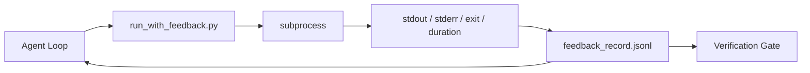

# Runtime Feedback Loops · 运行时反馈回路

看不到真实命令输出的智能体只能靠猜。反馈运行器（feedback runner）把 stdout、stderr、退出码和耗时捕获成一条结构化记录，下一轮就能读到它。于是智能体对事实做出反应，而不是对自己预测出来的「事实」做出反应。

> Agents that do not see real command output guess. A feedback runner captures stdout, stderr, exit code, and timing into a structured record the next turn can read. Then the agent reacts to facts instead of to its own prediction of facts.

**Type:** Build
**Languages:** Python (stdlib)
**Prerequisites:** Phase 14 · 32 (Minimal Workbench), Phase 14 · 35 (Init Script)
**Time:** ~50 minutes

## Learning Objectives · 学习目标

- 区分运行时反馈与可观测性遥测。
- 构建一个包装 shell 命令、持久化结构化记录的反馈运行器。
- 确定性地截断大输出，让回路保持在 token 预算之内。
- 反馈缺失时拒绝推进回路。

> Distinguish runtime feedback from observability telemetry.
> Build a feedback runner that wraps shell commands and persists structured records.
> Truncate large outputs deterministically so the loop stays within token budget.
> Refuse to advance the loop when feedback is missing.

## The Problem · 问题在哪

智能体说「现在跑测试」。下一条消息说「全部测试通过」。实际情况是没有任何测试运行过。输出是它想象出来的；或者它跑了命令但没读结果；或者读了结果，却悄悄截掉了失败的那一行。

反馈运行器消除这道缝隙。每条命令都经过运行器。每条记录都带着命令、捕获到的 stdout 和 stderr、退出码、墙钟耗时，以及一行智能体备注。智能体在下一轮读记录。验证门在任务结束时读记录。

> The agent says "running tests now." The next message says "all tests pass." The reality is that no test ran. The agent imagined the output, or it ran the command and never read the result, or it read the result and silently truncated the failure line.
> A feedback runner removes that gap. Every command goes through the runner. Every record carries the command, the captured stdout and stderr, the exit code, the wall-clock duration, and a one-line agent note. The agent reads the record at the next turn. The verification gate reads the records at the end of the task.

## The Concept · 概念



### What goes in a feedback record · 反馈记录里放什么

| 字段 | 为什么重要 |
|-------|----------------|
| `command` | 精确的 argv，没有 shell 展开的意外 |
| `stdout_tail` | 最后 N 行，确定性截断 |
| `stderr_tail` | 最后 N 行，与 stdout 分开 |
| `exit_code` | 无歧义的成功信号 |
| `duration_ms` | 让慢探测和失控进程现形 |
| `started_at` | 用于重放的时间戳 |
| `agent_note` | 智能体写下的一行预期 |

### Truncation is deterministic · 截断是确定性的

一份 50 MB 的日志会毁掉回路。运行器用 `...truncated N lines...` 标记截断头尾，确定性意味着同样的输出永远产生同样的记录。不做采样；智能体需要看的部分（最后的错误、最后的总结）就住在尾部。

> A 50 MB log destroys the loop. The runner truncates head and tail with a `...truncated N lines...` marker, deterministic so the same output always produces the same record. No sampling; the parts the agent needs to see (final error, final summary) live at the tail.

### Feedback versus telemetry · 反馈与遥测

遥测（Phase 14 · 23，OTel GenAI 约定）是给跨时间评审运行的人类操作员的。反馈是给本次运行的下一轮的。它们共享字段，但活在不同的文件里，保留策略也不同。

> Telemetry (Phase 14 · 23, OTel GenAI conventions) is for human operators reviewing runs across time. Feedback is for the next turn of this run. They share fields but they live in different files with different retention.

### Refuse to advance without feedback · 没有反馈就拒绝前进

如果运行器在捕获退出之前出错，记录会带上 `exit_code: null` 和 `error: <reason>`。智能体循环必须拒绝对 `null` 退出宣告成功。没有退出码，就没有进展。

> If the runner errors before capturing exit, the record carries `exit_code: null` and `error: <reason>`. The agent loop must refuse to claim success on a `null` exit. No exit, no progress.

```figure
wb-feedback-loop
```

## Build It · 动手造

`code/main.py` 实现：

- `run_with_feedback(command, agent_note)`：包装 `subprocess.run`，捕获 stdout/stderr/退出码/耗时，确定性截断，追加进 `feedback_record.jsonl`。
- 一个小加载器，把 JSONL 流式读进 Python 列表。
- 一个演示：跑三条命令（成功、失败、慢），并打印每条命令的最近一条记录。

运行：

```
python3 code/main.py
```

输出：三条反馈记录追加进 `feedback_record.jsonl`，每条命令的最近一条内联打印。跨多次运行 tail 这个文件，看回路如何累积。

> `code/main.py` implements: `run_with_feedback(command, agent_note)` that wraps `subprocess.run`, captures stdout/stderr/exit/duration, truncates deterministically, appends to `feedback_record.jsonl`... a small loader that streams the JSONL into a Python list... a demo that runs three commands (success, failure, slow) and prints the last record per command.
> Output: three feedback records appended to `feedback_record.jsonl`, the last one of each printed inline. Tail the file across re-runs to see the loop accumulate.

## Production patterns in the wild · 野外生产模式

三个模式把运行器加固到能上线的程度。

**写入时脱敏，而不是读取时。** 任何触及 stdout 或 stderr 的记录都可能泄漏机密。运行器在追加 JSONL 之前做一遍脱敏：剔除匹配 `^Bearer `、`password=`、`api[_-]?key=`、`AKIA[0-9A-Z]{16}`（AWS）、`xox[baprs]-`（Slack）的行。读取时才脱敏是自找麻烦；磁盘上的文件才是攻击者够得着的东西。每季度对照生产运行时实际观察到的机密格式，审计一遍脱敏模式。

**轮转策略，而不是单个文件。** 把 `feedback_record.jsonl` 限制在每文件 1 MB；溢出时轮转为 `.1`、`.2`，丢弃 `.5`。智能体的回路只读当前文件，所以运行时开销有界。CI 工件存储接收完整的轮转集合。没有轮转，这个文件会变成每次加载调用的瓶颈。

**重试链的父命令 id。** 每条记录带 `command_id`；重试带着指向上一次尝试的 `parent_command_id`。评审者的「失败尝试」列表（Phase 14 · 40）和验证门的审计都沿这条链追溯。没有这个链接，重试看起来就像独立的成功，审计掩盖了失败历史。

> Three patterns harden the runner enough to ship.
> Redact at write, not at read... Redaction at read time is a foot-gun; the file on disk is what an attacker reaches. Audit the redaction patterns quarterly against the production runtime's observed secret formats.
> Rotation policy, not a single file. Cap `feedback_record.jsonl` at 1 MB per file... Without rotation the file becomes the bottleneck on every loader call.
> Parent-command id for retry chains... Without this link, retries look like independent successes and the audit hides the failure history.

## Use It · 实战用法

生产模式：

- **Claude Code Bash 工具。** 该工具已经捕获 stdout、stderr、退出码和耗时。本课的运行器是任何智能体产品都能用的框架无关等价物。
- **LangGraph 节点。** 把任何 shell 节点包进运行器，让记录持久化在图状态之外。
- **CI 日志。** 把 JSONL 接进你的 CI 工件存储；评审者可以重放任何命令，而不用重跑会话。

运行器是一个薄包装；因为它拥有记录的形状，所以能挺过每一次框架迁移。

> In production: Claude Code Bash tool. The tool already captures stdout, stderr, exit, and duration. The runner in this lesson is the framework-agnostic equivalent for any agent product.
> LangGraph nodes. Wrap any shell node in the runner so the record persists outside graph state.
> CI logs. Pipe the JSONL into your CI artifact store; reviewers can replay any command without rerunning the session.
> The runner is a thin wrapper that survives every framework migration because it owns the shape of the record.

## Ship It · 交付

`outputs/skill-feedback-runner.md` 生成一份项目专属的 `run_with_feedback.py`（带正确的截断预算）、一个接进工作台的 JSONL 写入器，以及一个智能体每轮都读的加载器。

> `outputs/skill-feedback-runner.md` generates a project-specific `run_with_feedback.py` with the right truncation budget, a JSONL writer wired to the workbench, and a loader the agent reads at every turn.

## Exercises · 练习

1. 给每条记录加一个 `cwd` 字段，让从不同目录跑的同一条命令可以区分。
2. 加一个 `redaction` 步骤，剔除匹配 `^Bearer ` 或 `password=` 的行。在一条夹具记录上测试。
3. 通过轮转出 `.1`、`.2` 文件，把 `feedback_record.jsonl` 总大小限制在 1 MB。为这个轮转策略辩护。
4. 加一个 `parent_command_id`，让重试链可见：哪条命令产出的输入被下一条命令消费了。
5. 把 JSONL 接进一个极小的 TUI，高亮最近的非零退出。要让 TUI 在评审中有用，必须展示的八个关键功能是什么。

> Add a `cwd` field per record so the same command run from different directories is distinguishable.
> Add a `redaction` step that strips lines matching `^Bearer ` or `password=`. Test on a fixture record.
> Cap total `feedback_record.jsonl` size at 1 MB by rotating to `.1`, `.2` files. Defend the rotation policy.
> Add a `parent_command_id` so retry chains are visible: which command produced the input that the next command consumed.
> Pipe the JSONL into a tiny TUI that highlights the latest non-zero exit. Eight key features the TUI must show to be useful in a review.

## Key Terms · 术语表

| 术语 | 大家怎么说 | 实际含义 |
|------|----------------|------------------------|
| Feedback record（反馈记录） | 「运行日志」 | 带命令、输出、退出码、耗时的结构化 JSONL 条目 |
| Tail truncation（尾部截断） | 「修剪日志」 | 确定性的头+尾捕获，让记录装进 token 预算 |
| Refuse-on-null（空值即拒绝） | 「缺数据就挡下」 | `exit_code` 为 null 时循环不得前进 |
| Agent note（智能体备注） | 「预期标签」 | 智能体在读结果前写下的一行预测 |
| Telemetry split（遥测分离） | 「两份日志文件」 | 反馈给下一轮，遥测给操作员 |

## Further Reading · 延伸阅读

- [OpenTelemetry GenAI semantic conventions](https://opentelemetry.io/docs/specs/semconv/gen-ai/)
- [Anthropic, Effective harnesses for long-running agents](https://www.anthropic.com/engineering/effective-harnesses-for-long-running-agents)
- [Guardrails AI x MLflow — deterministic safety, PII, quality validators](https://guardrailsai.com/blog/guardrails-mlflow) —— 作为回归测试的脱敏模式
- [Aport.io, Best AI Agent Guardrails 2026: Pre-Action Authorization Compared](https://aport.io/blog/best-ai-agent-guardrails-2026-pre-action-authorization-compared/) —— 工具前/后的捕获
- [Andrii Furmanets, AI Agents in 2026: Practical Architecture for Tools, Memory, Evals, Guardrails](https://andriifurmanets.com/blogs/ai-agents-2026-practical-architecture-tools-memory-evals-guardrails) —— 可观测性面
- Phase 14 · 23 —— 遥测一侧的 OTel GenAI 约定
- Phase 14 · 24 —— 智能体可观测性平台（Langfuse、Phoenix、Opik）
- Phase 14 · 33 —— 要求先有反馈才能宣告完成的那条规则
- Phase 14 · 38 —— 读取这份 JSONL 的验证门
