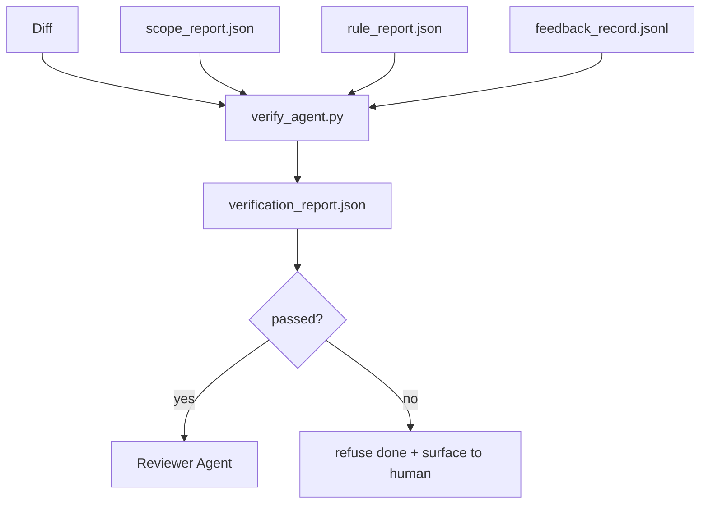

# Verification Gates · 验证门

智能体无权把自己的工作标记为完成。验证门读范围契约、反馈日志、规则报告和 diff，回答一个问题：这个任务真的完成了吗？如果门说没有，任务就没有完成，无论聊天里说了什么。

> The agent does not get to mark its own work as done. A verification gate reads the scope contract, the feedback log, the rule report, and the diff, and answers a single question: is this task actually complete? If the gate says no, the task is not done, no matter what the chat says.

**Type:** Build
**Languages:** Python (stdlib)
**Prerequisites:** Phase 14 · 33 (Rules), Phase 14 · 36 (Scope), Phase 14 · 37 (Feedback)
**Time:** ~55 minutes

## Learning Objectives · 学习目标

- 把验证门定义为工作台工件之上的一个确定性函数。
- 把规则报告、范围报告、反馈记录和 diff 合成一个裁决。
- 产出评审智能体和 CI 都能读的 `verification_report.json`。
- 任何 block 级失败都拒绝推进任务，无一例外。

> Define a verification gate as a deterministic function over workbench artifacts.
> Combine rule report, scope report, feedback records, and diff into a single verdict.
> Emit a `verification_report.json` the reviewer agent and CI can both read.
> Refuse to advance a task on any block-severity failure, without exception.

## The Problem · 问题在哪

智能体太容易宣告成功。三种失败形态占大头：

- 「看起来不错。」模型读了自己的 diff，然后判定它是对的。
- 「测试过了。」说得信心满满。却没有任何测试真正运行过的记录。
- 「验收达成。」验收标准被解释得足够宽松，意思是「任何像完成的东西都行」。

工作台的解法是单一的验证门：它读智能体已经产出的工件，然后做出裁决。门是确定性的。门在版本控制里。门接进了 CI。智能体贿赂不了它。

> Agents declare success too easily. Three failure shapes dominate: "Looks good." The model read its own diff and decided it was correct... "Tests passed." Said with confidence. No record of the test actually running... "Acceptance met." Acceptance criteria interpreted loosely enough to mean "anything resembling done."
> The workbench fix is a single verification gate that reads the artifacts the agent has already produced and makes the call. The gate is deterministic. The gate is in version control. The gate is wired into CI. The agent cannot bribe it.

## The Concept · 概念



### What the gate checks · 门检查什么

| 检查项 | 来源工件 | 严重性 |
|-------|-----------------|----------|
| 所有验收命令都跑过 | `feedback_record.jsonl` | block |
| 所有验收命令退出码为零 | `feedback_record.jsonl` | block |
| 范围检查没有禁止写入 | `scope_report.json` | block |
| 范围检查没有越界写入 | `scope_report.json` | block 或 warn |
| 所有 block 级规则通过 | `rule_report.json` | block |
| 反馈中没有 `null` 退出码 | `feedback_record.jsonl` | block |
| 动过的文件匹配 `scope.allowed_files` | 两者 | warn |

`warn` 级发现给裁决加注释；`block` 级发现阻止 `passed: true`。

> A `warn` finding annotates the verdict; a `block` finding prevents `passed: true`.

### Deterministic, not probabilistic · 确定性，不是概率性

同一组工件，门必须每次产出同样的裁决。不要 LLM 裁判。LLM 裁判属于评审侧（Phase 14 · 39），那里的目标是定性评估，不是状态判定。

> The gate must produce the same verdict for the same artifact set every time. No LLM judges. LLM judges belong on the reviewer side (Phase 14 · 39) where the goal is qualitative evaluation, not status.

### One report, one path · 一份报告，一条路径

门在每次任务收尾时产出一份 `verification_report.json`，写在 `outputs/verification/<task_id>.json`。CI 消费同一条路径。路径不同、门有多个，事实来源就会分叉。

> The gate emits one `verification_report.json` per task close-out, written under `outputs/verification/<task_id>.json`. CI consumes the same path. Multiple gates with different paths fork the source of truth.

### Refuse without exception · 无一例外地拒绝

block 级发现不能被智能体覆盖。它们只能被人类覆盖，且要留下 `override_reason` 和一个 `overridden_by` 用户 id。覆盖是一次签名变更，不是智能体决定。

> Block-severity findings cannot be overridden by the agent. They can only be overridden by a human, with a recorded `override_reason` and an `overridden_by` user id. The override is a signed change, not an agent decision.

```figure
wb-gate-sequence
```

## Build It · 动手造

`code/main.py` 实现：

- 每个输入工件各一个加载器，全部在本地打桩，课程因此自包含。
- 一个 `verify(task_id, artifacts) -> VerdictReport` 纯函数。
- 一个打印器，显示每项检查的结果和最终通过/失败。
- 三个任务场景的演示：干净通过、范围蔓延、缺验收。

运行：

```
python3 code/main.py
```

输出：三份裁决报告，各自保存在脚本旁边。

> `code/main.py` implements: a loader for each input artifact, all stubbed locally so the lesson is self-contained... a `verify(task_id, artifacts) -> VerdictReport` pure function... a demo with three task scenarios: clean pass, scope creep, missing acceptance.
> Output: three verdict reports, each saved next to the script.

## Production patterns in the wild · 野外生产模式

四个模式把门从「又一个 lint job」提升为「做出裁决的那条边」。

**纵深防御，不是单一的门。** pre-commit 钩子 → CI 状态检查 → pre-tool 授权钩子 → pre-merge 门。每一层都是确定性的，所以一层的失手会被下一层接住。microservices.io 的 2026 年 3 月手册说得很直白：pre-commit 钩子不可绕过，因为不像模型侧的 skill，它不依赖智能体遵循指令。验证门位于 CI / pre-merge 层。

**确定性检查做防御，模型裁判只管微妙处。** Anthropic 2026 年的 Hybrid Norm 配对：可验证奖励（单元测试、schema 检查、退出码）回答「代码解决问题了吗？」——LLM rubric 回答「代码可读、安全、符合风格吗？」门跑第一类；评审者（Phase 14 · 39）跑第二类。混在一起，信号就塌了。

**签名的覆盖日志，不是 Slack 线程。** 每次覆盖都在 `outputs/verification/overrides.jsonl` 里写一行：时间戳、发现代码、原因、签名的用户、当前 HEAD commit。运行时拒绝任何缺少签名的覆盖；审计轨迹被 git 追踪。这是覆盖策略与覆盖表演之间的分界线。

**覆盖率下限作为一等检查。** 一份 `coverage_report.json` 喂给一个 `coverage_floor`（默认 80%）检查。实测覆盖率跌破下限、或比上次合并的下限低超过 1 个百分点时，门失败。没有这个检查，智能体会悄悄删掉失败的测试，而验证报告保持绿色。

**`--strict` 模式把 warn 升级为 block。** 对发布分支、阻塞发布的 PR 或事后复盘，`--strict` 让每个警告都变成硬失败。该旗标按分支选择性开启；不是全局默认，因为处处严格会腐蚀日常流转。

> Four patterns elevate the gate from "another lint job" to "the deciding edge."
> Defense-in-depth, not single gate... Each layer is deterministic so a failure in one layer is caught by the next.
> Defense by deterministic check, model-judge only for nuance... The gate runs the first class; the reviewer (Phase 14 · 39) runs the second. Mixing them collapses the signal.
> Signed override log, not Slack threads... The runtime refuses any override that lacks the signature; the audit trail is git-tracked. This is the line between an override policy and an override theater.
> Coverage floor as a first-class check... Without this check, agents quietly delete tests that fail and the verification reports stay green.
> `--strict` mode promotes warns to blocks... The flag is opt-in by branch; not the global default, because strict-on-everything corrodes day-to-day flow.

## Use It · 实战用法

生产模式：

- **CI step。** 一个 `verify_agent` job 对照智能体的最终工件运行门。合并保护在没有 `passed: true` 时拒绝。
- **交接前钩子。** 智能体运行时在生成交接文档之前调用门。没有绿色裁决，就没有交接。
- **人工分诊。** 当智能体声称成功而人类存疑时，操作员读报告。

门是工作台流程中做出裁决的那条边。其他所有面都在它的上游。

> In production: CI step. A `verify_agent` job runs the gate against the agent's final artifacts. Merge protection refuses without `passed: true`.
> Pre-handoff hook. The agent runtime calls the gate before generating the handoff doc. No green verdict, no handoff.
> Manual triage. Operators read the report when an agent claims success and a human suspects it.
> The gate is the deciding edge in the workbench flow. Every other surface is upstream of it.

## Ship It · 交付

`outputs/skill-verification-gate.md` 把门接进一个具体项目：哪些验收命令喂给它、哪些规则是 block 级、哪些越界写入可容忍、覆盖审计日志存在哪里。

> `outputs/skill-verification-gate.md` wires the gate into a specific project: which acceptance commands feed it, which rules are block-severity, which off-scope writes are tolerated, how the override audit log is stored.

## Exercises · 练习

1. 加一个 `coverage_floor` 检查：测试命令必须产出覆盖率不低于 80% 的报告。决定由哪个工件携带这个下限。
2. 支持一个 `--strict` 模式，把每个 `warn` 升级为 `block`。写清楚哪些场景下严格模式是正确的默认。
3. 让门在 JSON 之外再产出一份 Markdown 摘要。论证哪些字段该进摘要。
4. 加一个 `time_since_last_human_touch` 检查：在人类按键后 60 秒内被编辑的文件，豁免越界标记。
5. 在你产品的真实智能体 diff 上跑这个门。多少发现是真的，多少是噪声？门需要在哪里长大？

> Add a `coverage_floor` check: the test command must produce a coverage report with at least 80%. Decide which artifact carries the floor.
> Support a `--strict` mode that promotes every `warn` to `block`. Document the cases where strict mode is the right default.
> Make the gate produce a Markdown summary in addition to JSON. Defend which fields belong in the summary.
> Add a `time_since_last_human_touch` check: any file edited within 60 seconds of a human keystroke is exempt from off-scope flags.
> Run the gate on a real agent diff from your product. How many findings are real and how many are noise? Where does the gate need to grow?

## Key Terms · 术语表

| 术语 | 大家怎么说 | 实际含义 |
|------|----------------|------------------------|
| Verification gate（验证门） | 「拦住一切的那个检查」 | 工作台工件之上、产出 pass/fail 裁决的确定性函数 |
| Block severity（block 级严重性） | 「硬失败」 | 阻止 `passed: true`、需要签名覆盖的发现 |
| Override log（覆盖日志） | 「为什么放它过」 | 带原因和用户 id 的签名条目，由评审审计 |
| Acceptance command（验收命令） | 「证明」 | 零退出即 `done` 含义的那条 shell 命令 |
| One report path（单一报告路径） | 「事实来源」 | `outputs/verification/<task_id>.json`，CI 和人类读同一条 |

## Further Reading · 延伸阅读

- [Anthropic, Harness design for long-running application development](https://www.anthropic.com/engineering/harness-design-long-running-apps)
- [OpenAI Agents SDK guardrails](https://openai.github.io/openai-agents-python/guardrails/)
- [microservices.io, GenAI dev platform: guardrails](https://microservices.io/post/architecture/2026/03/09/genai-development-platform-part-1-development-guardrails.html) —— pre-commit 与 CI 之间的纵深防御
- [ICMD, The 2026 Playbook for Agentic AI Ops](https://icmd.app/article/the-2026-playbook-for-agentic-ai-ops-guardrails-costs-and-reliability-at-scale-1776661990431) —— 审批门阶梯（draft → approval → 阈值内 auto）
- [Type-Checked Compliance: Deterministic Guardrails (arXiv 2604.01483)](https://arxiv.org/pdf/2604.01483) —— Lean 4 作为确定性门控的上限
- [logi-cmd/agent-guardrails — merge gate spec](https://github.com/logi-cmd/agent-guardrails) —— 范围 + 变异测试门
- [Guardrails AI x MLflow](https://guardrailsai.com/blog/guardrails-mlflow) —— 作为 CI 评分器的确定性校验器
- Phase 14 · 27 —— 提示词注入防御（门的对手面）
- Phase 14 · 36 —— 本门所执行的范围契约
- Phase 14 · 37 —— 本门所打分的反馈日志
- Phase 14 · 39 —— 门移交给它的评审智能体
