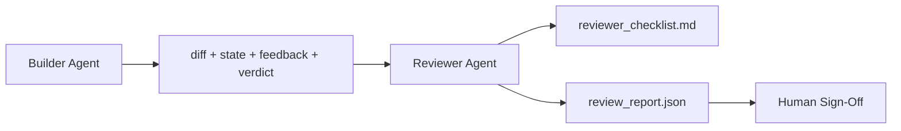

# Reviewer Agent: Separate Builder from Marker · 评审智能体：把建造者与评分者分开

写代码的智能体不能给自己的代码打分。评审者（reviewer）是第二个循环：不同的系统提示词、不同的目标，以及对建造者产出的一切只有只读访问。建造者与评审者之间的那道间隙，正是可靠性大部分所在的地方。

> The agent that wrote the code cannot grade it. A reviewer is a second loop with a different system prompt, a different goal, and read-only access to everything the builder produced. The gap between builder and reviewer is where most reliability lives.

**Type:** Build
**Languages:** Python (stdlib)
**Prerequisites:** Phase 14 · 38 (Verification Gate)
**Time:** ~55 minutes

## Learning Objectives · 学习目标

- 说清楚为什么同一个智能体无法可靠地评审自己的工作。
- 构建一个消费建造者工件、产出结构化评审报告的评审智能体循环。
- 编写按具体维度打分、而不是凭感觉的评审 rubric。
- 把评审者接进工作台，让人类评审从一份真实工件开始。

> State why the same agent cannot reliably review its own work.
> Build a reviewer agent loop that consumes builder artifacts and emits a structured review report.
> Author a reviewer rubric that grades specific dimensions, not vibes.
> Wire the reviewer into the workbench so the human review step starts from a real artifact.

## The Problem · 问题在哪

你让智能体修一个 bug。它改了四个文件，跑了测试，报告完成。验证门（Phase 14 · 38）确认验收跑过、范围守住。门说 `passed: true`。你合并。两天后你发现，这个修复解决的是 bug 的错误那一半。

验收是必要的，不是充分的。评审者问的是验收问不出来的问题：这解决的是正确的问题吗？它有没有在没打招呼的情况下扩大范围？它有没有把本该被质疑的假设写进文档？它有没有把工作台留在下一个会话能接手的状态？

> You ask the agent to fix a bug. It edits four files, runs the tests, and reports done. The verification gate (Phase 14 · 38) confirms acceptance ran and scope held. The gate says `passed: true`. You merge. Two days later you find that the fix solved the wrong half of the bug.
> Acceptance is necessary, not sufficient. The reviewer asks the questions acceptance cannot ask: did this solve the right problem? Did it expand scope without flagging it? Did it document assumptions that should have been questioned? Did it leave the workbench in a state the next session can pick up?

## The Concept · 概念



### Reviewer rubric · 评审 rubric

五个维度，每个打 0 到 2 分。

| 维度 | 问题 |
|-----------|----------|
| 问题契合（Problem fit） | 改动解决的是陈述出来的任务，而不是旁边另一个任务吗？ |
| 范围纪律（Scope discipline） | 改动守在契约内，还是有意地让契约长大？ |
| 假设（Assumptions） | 所有隐藏假设都写在可评审的地方了吗？ |
| 验证质量（Verification quality） | 验收命令真的证明了目标，还是只证明了一个更弱的版本？ |
| 交接就绪度（Handoff readiness） | 下一个会话能从当前状态干净地接手吗？ |

总分 10 分。低于 7 是软失败（soft fail）；低于 5 是硬失败（hard fail）。

> Five dimensions, each scored 0 to 2.
> Total out of 10. A run below 7 is a soft fail; a run below 5 is a hard fail.

### The reviewer is a separate role, not a separate model · 评审者是独立的角色，不是独立的模型

你可以用和建造者相同的模型来跑评审者。纪律在于角色分离：不同的系统提示词、不同的输入、对 diff 没有写权限。姿态的改变就是信号的改变。

> You can run the reviewer with the same model as the builder. The discipline is the role separation: different system prompt, different inputs, no write access to the diff. The change in posture is the change in signal.

### The reviewer cannot edit the diff · 评审者不能改 diff

评审者读 diff、状态、反馈、裁决。它写报告。它不打补丁。如果报告说「修这个」，下一轮建造者去修；评审者回到评审。混合角色会毁掉这道间隙。

> The reviewer reads the diff, the state, the feedback, the verdict. It writes a report. It does not patch the diff. If the report says "fix this," the next builder turn does the fix; the reviewer goes back to reviewing. Mixing roles defeats the gap.

### Reviewer rubric versus verification gate · 评审 rubric 与验证门

门（Phase 14 · 38）检查确定性事实：验收跑了吗、规则过了吗、范围守住了吗。评审者做定性判断：这是不是该做的工作、文档齐不齐、交接能不能用。两者都需要。

> The gate (Phase 14 · 38) checks deterministic facts: did acceptance run, did rules pass, did scope hold. The reviewer makes qualitative judgments: was this the right work, is it documented, is the handoff usable. Both are required.

```figure
wb-builder-marker
```

## Build It · 动手造

`code/main.py` 实现：

- 一个 `ReviewerInputs` dataclass，捆绑评审者要读的工件。
- 一个 rubric 评分器，每个维度一个函数。每个函数都是确定性的，且就课程而言是打桩级；真实实现会调用 LLM。
- 一个 `review_report.json` 写入器，含五个分数、总分和裁决（`pass`、`soft_fail`、`hard_fail`）。
- 两个演示案例：一个干净的改动，一个「测试对了、问题错了」的改动。

运行：

```
python3 code/main.py
```

输出：两份评审报告写到磁盘，外加一张控制台上的维度得分表。

> `code/main.py` implements: a `ReviewerInputs` dataclass bundling the artifacts the reviewer reads... a rubric scorer with one function per dimension... a `review_report.json` writer with the five scores, the total, and a verdict (`pass`, `soft_fail`, `hard_fail`)... Two demo cases: a clean change and a "right tests, wrong problem" change.
> Output: two review reports written to disk and a console table of dimensional scores.

## Production patterns in the wild · 野外生产模式

数据在此：Cloudflare 2026 年 4 月的 AI Code Review 系统在 30 天内跨 5,169 个仓库的 48,095 个合并请求跑了 131,246 次评审。评审中位耗时 3 分 39 秒。最多七位专家评审（安全、性能、代码质量、文档、发布管理、合规、Engineering Codex）在一位评审协调者（Review Coordinator）之下并行运行；协调者去重发现项并判断严重性。顶级模型专供协调者；专家跑在更便宜的层级上。

四个模式让这件事在规模上成立。

**专家池，不是一个巨型评审者。** 带 5 维 rubric 的单个评审者对单人仓库够用。一旦代码库出现安全关键、性能关键和文档面，就拆成提示词更小的专家。协调者做去重；专家从不跑完整 rubric。模型层级分离随之自然发生：便宜的专家，昂贵的协调者。

**偏差缓解是设计要求，不是优化项。** LLM 裁判表现出四种可靠偏差（Adnan Masood，2026 年 4 月）：位置偏差（GPT-4 在 (A,B) 与 (B,A) 两种顺序上约 40% 不一致）、冗长偏差（对更长的输出约 15% 的分数膨胀）、自我偏好（裁判偏好同一模型家族的输出）、权威偏差（裁判高估对知名作者的引用）。缓解办法：两种顺序都评，只计一致的胜出；使用明确奖励简洁的 1-4 量表；跨模型家族轮换裁判；打分前剥掉作者名。

**校准集，不是凭感觉。** 一个 10-20 个任务、带已知正确裁决的历史集。每次改提示词都在它上面跑一遍评审者。如果与历史记录的一致率低于 80%，rubric 需要修订，然后评审者才能上线。每个团队最终都会重新发现这一点；不如一开始就用。

**与门组成混合规范（hybrid norm）。** 验证门（Phase 14 · 38）处理确定性检查（验收跑了吗、测试过了吗、范围守住了吗）。评审者处理语义检查（这是不是该做的工作、假设写进文档了吗、交接能不能用）。Anthropic 2026 年的指导意见对这一分工说得很明确：不要让评审者重做门已经证明的事。

> The receipts: Cloudflare's April 2026 AI Code Review system ran 131,246 review runs across 48,095 merge requests in 5,169 repos in 30 days. Median review completed in 3 minutes 39 seconds.
> Specialist pool, not one big reviewer... The coordinator does deduplication; the specialists never run the full rubric. Model-tier separation falls out: cheap specialists, expensive coordinator.
> Bias mitigation as design requirement, not optimization... Mitigations: evaluate both orderings and only count consistent wins; use 1-4 scales that explicitly reward conciseness; rotate judges across model families; strip author names before scoring.
> Calibration set, not vibes. A 10-20 task historical set with known correct verdicts... If agreement with the historical record falls below 80%, the rubric needs revision before the reviewer ships.
> Hybrid norm with the gate... don't ask the reviewer to redo what the gate already proves.

## Use It · 实战用法

生产模式：

- **Claude Code subagents。** 建造者关闭任务后运行一个评审者子智能体。它把 rubric 分数作为评论贴到 PR 上。
- **OpenAI Agents SDK handoffs。** 任务完成时建造者交接给评审者。评审者可以带着发现列表交回，或上交给人类。
- **双模型配对。** 建造者跑在更快、更便宜的模型上。评审者跑在更强、上下文更小、专注判断的模型上。

评审者是工作台在人类无法亲自评审每一份改动时长出来的第二双眼睛。

> In production: Claude Code subagents. A reviewer subagent runs after the builder closes a task. It posts a comment on the PR with the rubric scores.
> OpenAI Agents SDK handoffs. Builder hands off to Reviewer on task completion. Reviewer can hand back with a list of findings or up to a human.
> Two-model pairing. Builder runs on a faster cheaper model. Reviewer runs on a stronger model with smaller context, focused on judgment.
> The reviewer is the second pair of eyes the workbench grows when humans cannot do every review themselves.

## Ship It · 交付

`outputs/skill-reviewer-agent.md` 生成一份项目专属的评审 rubric、一个接到建造者工件上的评审者智能体桩，以及与验证门的集成，让人类评审从一份写好的报告开始，而不是从一张白纸开始。

> `outputs/skill-reviewer-agent.md` generates a project-specific reviewer rubric, a reviewer agent stub wired to the builder's artifacts, and an integration with the verification gate so human review starts from a written report instead of a blank page.

## Exercises · 练习

1. 加一个你的产品领域专属的第六维度。论证它为什么不会被现有五维吸收。
2. 用两份不同的系统提示词（极简版、详尽版）跑评审者。哪一份产出的报告更像人类会读的？
3. 给每个维度加一个 `confidence` 字段。最低维度的置信低于 0.6 时，拒绝交付报告。
4. 建一个校准集：10 份带已知正确裁决的历史任务收尾。在它们上面跑评审者。它在哪些地方与历史记录不一致？
5. 加一个「请求更多证据」的交互：评审者可以在打分前要求建造者补一次特定的测试运行。怎样的退避机制才能让它不陷入循环？

> Add a sixth dimension specific to your product domain. Defend why it is not absorbed by the existing five.
> Run the reviewer with two different system prompts (terse, verbose). Which produces a report a human is more likely to read?
> Add a `confidence` field per dimension. Refuse to ship the report when confidence in the lowest dimension is below 0.6.
> Build a calibration set: 10 historical task close-outs with known correct verdicts. Run the reviewer over them. Where does it disagree with the historical record?
> Add a "request more evidence" affordance: the reviewer can ask the builder for a specific test run before scoring. What is the right back-off so this does not loop?

## Key Terms · 术语表

| 术语 | 大家怎么说 | 实际含义 |
|------|----------------|------------------------|
| Reviewer rubric（评审 rubric） | 「检查清单」 | 五维 0-2 打分，每个维度一个写下来的问题 |
| Soft fail（软失败） | 「需要修改」 | 总分低于 7；建造者拿到待处理的发现 |
| Hard fail（硬失败） | 「拒绝」 | 总分低于 5 或任一维度 0 分；中止并呈报人类 |
| Role separation（角色分离） | 「提示词不同」 | 同一模型可以身兼两角；纪律在输入与姿态 |
| Confidence floor（置信下限） | 「别交付低信号报告」 | rubric 不确定时拒绝给出裁决 |

## Further Reading · 延伸阅读

- [OpenAI Agents SDK handoffs](https://openai.github.io/openai-agents-python/handoffs/)
- [Anthropic Claude Code subagents](https://code.claude.com/docs/en/sub-agents)
- [Cloudflare, Orchestrating AI Code Review at Scale](https://blog.cloudflare.com/ai-code-review/) —— 7 专家 + 协调者架构，30 天 13.1 万次运行
- [Agent-as-a-Judge: Evaluating Agents with Agents (OpenReview / ICLR)](https://openreview.net/forum?id=DeVm3YUnpj) —— DevAI 基准，366 条分层解决方案要求
- [Adnan Masood, Rubric-Based Evaluations and LLM-as-a-Judge: Methodologies, Biases, Empirical Validation](https://medium.com/@adnanmasood/rubric-based-evals-llm-as-a-judge-methodologies-and-empirical-validation-in-domain-context-71936b989e80) —— 那四种偏差与缓解办法
- [MLflow, LLM-as-a-Judge Evaluation](https://mlflow.org/llm-as-a-judge) —— 分离建造者/评估者的生产工具
- [LangChain, How to Calibrate LLM-as-a-Judge with Human Corrections](https://www.langchain.com/articles/llm-as-a-judge) —— 校准集工作流
- [Evidently AI, LLM-as-a-judge: a complete guide](https://www.evidentlyai.com/llm-guide/llm-as-a-judge)
- [Arize, LLM as a Judge — Primer and Pre-Built Evaluators](https://arize.com/llm-as-a-judge/)
- Phase 14 · 05 —— Self-Refine 与 CRITIC（单智能体自评审基线）
- Phase 14 · 30 —— 评测驱动的智能体开发（校准集生成器）
- Phase 14 · 38 —— 评审者读取的验证门
- Phase 14 · 40 —— 评审报告所喂给的交接包
