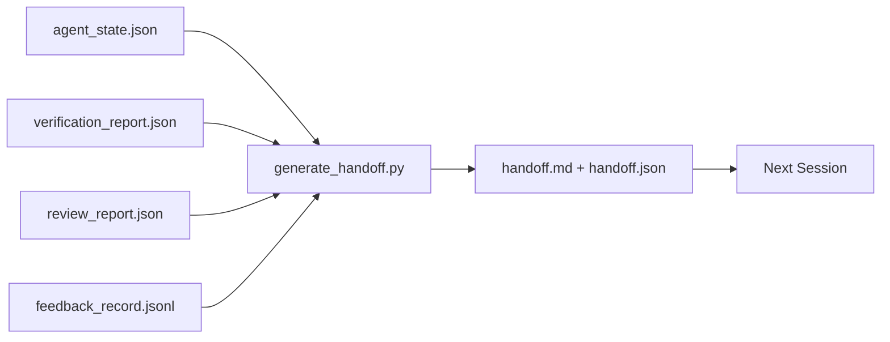

# Multi-Session Handoff · 多会话交接

会话总要结束，工作不会。交接包（handoff packet）是把「智能体干了一个小时」变成「下一个会话第一分钟就进入生产力」的工件。有意地建造它，而不是事后补一个。

> The session is going to end. The work is not. The handoff packet is the artifact that turns "the agent worked for an hour" into "the next session is productive in the first minute." Build it on purpose, not as an afterthought.

**Type:** Build
**Languages:** Python (stdlib)
**Prerequisites:** Phase 14 · 34 (Repo Memory), Phase 14 · 38 (Verification), Phase 14 · 39 (Reviewer)
**Time:** ~50 minutes

## Learning Objectives · 学习目标

- 识别每个交接包都需要的七个字段。
- 从工作台工件生成交接，而不是手写散文。
- 把大的反馈日志修剪成交接大小的摘要。
- 让下一个会话的第一个动作是确定性的。

> Identify the seven fields every handoff packet needs.
> Generate a handoff from the workbench artifacts without hand-writing prose.
> Trim large feedback logs into a handoff-sized summary.
> Make the next session's first action deterministic.

## The Problem · 问题在哪

会话结束。智能体说「很好，我们取得了进展」。下一个会话打开。下一个智能体问「我们做到哪了？」第一个智能体的回答已经不在了。下一个智能体重新发现、重跑同样的命令、把同样的问题再问人类一遍，用三十分钟找回上一个会话的最后三十秒。

一次糟糕的交接，其代价由任务的余生在每个会话里支付。解法是会话结束时自动生成的包：改了什么、为什么、试过什么、什么失败了、还剩什么、下次先做什么。

> The session ends. The agent says "great, we made progress." The next session opens. The next agent asks "where did we leave off?" The first agent's answer is gone. The next agent rediscovers, re-runs the same commands, re-asks the human the same questions, and burns thirty minutes recovering the last thirty seconds of the previous session.
> The cost of a bad handoff is paid every session for the life of the task. The fix is a packet generated automatically at session end: what changed, why, what was tried, what failed, what is left, what to do first next time.

## The Concept · 概念



### Seven fields every handoff carries · 每个交接都带的七个字段

| 字段 | 它回答的问题 |
|-------|---------------------|
| `summary` | 做了什么的一段话 |
| `changed_files` | diff 一览 |
| `commands_run` | 实际执行了什么 |
| `failed_attempts` | 试过什么、为什么没成 |
| `open_risks` | 什么可能在下个会话咬人，带严重性 |
| `next_action` | 下个会话迈出的第一步 |
| `verdict_pointer` | 指向验证与评审报告的路径 |

`next_action` 是承重的那个。除了 `next_action` 之外什么都有，那是一份状态报告，不是交接。

> The `next_action` field is the load-bearing one. A handoff with everything except `next_action` is a status report, not a handoff.

### Handoffs are generated, not written · 交接是生成的，不是手写的

手写的交接，就是硬日子里第一个被跳过的交接。生成器读工作台工件并产出包。智能体的职责是把工作台留在生成器能总结的状态，而不是亲自写总结。

> A hand-written handoff is a handoff that gets skipped on a hard day. The generator reads the workbench artifacts and emits the packet. The agent's job is to leave the workbench in a state the generator can summarize, not to write the summary.

### Two forms: human-readable and machine-readable · 两种形式：人类可读与机器可读

`handoff.md` 是人类读的。`handoff.json` 是下一个智能体加载的。两者来自同一批源工件。如果它们分叉了，以 JSON 为准。

> `handoff.md` is what the human reads. `handoff.json` is what the next agent loads. Both come from the same source artifacts. If they diverge, the JSON wins.

### Feedback log trimming · 反馈日志修剪

完整的 `feedback_record.jsonl` 可能有几百条。交接只带最后 K 条，外加每个非零退出的条目。下一个会话需要时可以加载完整日志，但包保持小。

> The full `feedback_record.jsonl` may be hundreds of entries. The handoff carries only the last K plus every entry with a non-zero exit. The next session loads the full log if it needs to, but the packet stays small.

### Leave a clean state · 留下一个干净的状态

交接描述工作。干净的状态让工作可恢复。它们不是一回事。如果下一个会话打开时面对一个应用了一半的 diff、一个智能体忘掉的临时文件、一条游离分支和一组没跑就报错的测试，那么再完美的 `handoff.md` 也一文不值。下一个智能体于是把前十分钟花在替上一个收拾残局上，而不是建造上，而且这个代价在任务的余生里逐会话复利累积。

所以，会话不是在特性跑通的那一刻结束的。它结束于工作台到达生成器能总结、下一个会话能信任的状态。清理是独立的阶段，在交接之前运行；而且它是一个检查，不是一个习惯——因为习惯就是硬日子里被跳过的那个东西。

| 检查 | 干净意味着 | 脏会卡住因为 |
|-------|-------------|----------------------|
| 工作树 | 每个改动都已提交，或带着说明显式 stash | 应用一半的 diff 在下一个智能体眼里像有意为之的工作 |
| 临时工件 | 没有留下 `*.tmp`、草稿目录、调试打印或注释掉的代码块 | 游离文件污染 diff 和下一个智能体的心智模型 |
| 测试 | 绿，或者红且失败原因写进了 `open_risks` | 无声的红测试是下一个会话踩进去的陷阱 |
| 特性看板 | `feature_list.json` 的状态反映现实（Phase 14 · 36） | 陈旧的看板把下一个会话派去已经完成的工作 |
| 分支 | 在预期的分支上，没有 detached HEAD，没有孤儿分支 | 错分支意味着下一个会话的第一个 commit 落错地方 |

清理阶段产出一份装着阻塞问题的 `clean_state.json`；空列表是交接生成器写包前断言的前置条件。建在脏树上的交接不是交接，是转发出去的一团乱麻。两个工件成对出现：清理证明工作台可以安全离开，交接证明下一个会话知道从哪里开始。

> A handoff describes the work. A clean state makes the work resumable. They are not the same thing. A perfect `handoff.md` is worthless if the next session opens to a half-applied diff, a temp file the agent forgot, a stray branch, and tests that error before they even run.
> So the session does not end when the feature works. It ends when the workbench is in a state the generator can summarize and the next session can trust. Cleanup is its own phase, run before the handoff, and it is a check, not a habit, because a habit is the thing that gets skipped on a hard day.
> The cleanup phase emits a `clean_state.json` of blocking issues; an empty list is the precondition the handoff generator asserts before it writes a packet. A handoff built on a dirty tree is not a handoff, it is a forwarded mess. The two artifacts pair: cleanup proves the workbench is safe to leave, the handoff proves the next session knows where to start.

```figure
wb-handoff-packet
```

## Build It · 动手造

`code/main.py` 实现：

- 一个加载器，把 state、verdict、review、feedback 汇进一个 `WorkbenchSnapshot`。
- 一个 `generate_handoff(snapshot) -> (markdown, payload)` 函数。
- 一个过滤器，挑出最后 K 条反馈条目加全部非零退出。
- 一个演示运行，把 `handoff.md` 和 `handoff.json` 写在脚本旁边。

运行：

```
python3 code/main.py
```

输出：打印出一份交接正文，外加磁盘上的两个文件。

> `code/main.py` implements: a loader that gathers state, verdict, review, and feedback into a single `WorkbenchSnapshot`... a `generate_handoff(snapshot) -> (markdown, payload)` function... a filter that picks the last K feedback entries plus all non-zero exits... a demo run that writes `handoff.md` and `handoff.json` next to the script.
> Output: a printed handoff body, plus both files on disk.

## Production patterns in the wild · 野外生产模式

Codex CLI、Claude Code 和 OpenCode 各有一套不同的压缩（compaction）故事；结构化交接包叠在三者之上。

**压缩策略各异；包 schema 不变。** Codex CLI 的 POST /v1/responses/compact 是服务端不透明的 AES blob（OpenAI 模型的快速路径）；回退方案是把本地的「handoff summary」作为一条 `_summary` user 角色消息追加。Claude Code 在上下文用到 95% 时跑五阶段渐进压缩。OpenCode 用基于时间戳的消息隐藏，加一个 5 标题的 LLM 摘要。三种不同机制，同一个需求：把压缩后能幸存的东西序列化成可移植的工件。包就是那个工件。

**新会话交接不是压缩。** 压缩延续一个会话；交接干净地关闭一个并开始下一个。Hermes Issue #20372 的提法（2026 年 4 月）是对的：当就地压缩开始劣化时，智能体应该写一份紧凑的交接、结束会话、在全新上下文里恢复。包就是让这次转移变便宜的东西。错误的做法是一路压缩到质量崩塌；正确的做法是为一次早而干净的交接留好预算。

**每分支每话题一个活跃交接。** 多智能体协作在陈旧交接上的翻车，比在坏模型输出上更多。始终带上 `branch`、`last_known_good_commit` 和一个 `status`（`active | superseded | archived`）。陈旧交接归档；只有活跃的那个驱动下一个会话。这是「交接即笔记」与「交接即状态」之间的分界。

**在 50-75% 上下文之前收尾，不要贴着墙。** 手写模式手册（CLAUDE.md + HANDOVER.md）报告的最佳结果出现在会话于 50-75% 上下文预算时结束，而不是 95%。包生成器在压缩伪影污染源状态之前干净地运行。上下文完好时写起来便宜；模型已经自顾不暇时写起来昂贵。

> Codex CLI, Claude Code, and OpenCode each ship a different compaction story; the structured handoff packet sits on top of all three.
> Compaction strategies vary; the packet schema does not... Three different mechanisms, same need: serialize what survives compression into a portable artifact. The packet is that artifact.
> Fresh-session handoff is not compaction. Compaction extends a session; handoff closes one cleanly and starts the next... The mistake is to keep compressing until quality collapses; the fix is to budget for an early, clean handoff.
> One active handoff per branch and topic... This is the difference between handoff-as-notes and handoff-as-state.
> Wrap up before 50-75% context, not at the wall... Cheap to write while context is intact; expensive when the model is already losing its place.

## Use It · 实战用法

生产模式：

- **会话结束钩子。** 用户关闭聊天时，运行时触发生成器。包进入 `outputs/handoff/<session_id>/`。
- **PR 模板。** 生成器的 markdown 同时也是 PR 正文。评审者不用再打开五个别的文件。
- **跨智能体交接。** 用一个产品（Claude Code）建造，用另一个（Codex）继续。包是通用语。

包小、规整、生产便宜。成本节省随每个会话复利。

> In production: Session-end hook. The runtime fires the generator when the user closes the chat. The packet goes into `outputs/handoff/<session_id>/`.
> PR template. The generator's markdown is also a PR body. Reviewers read it without opening five other files.
> Cross-agent handoff. Build with one product (Claude Code), continue with another (Codex). The packet is the lingua franca.
> The packet is small, regular, and cheap to produce. The cost saving compounds with every session.

## Ship It · 交付

`outputs/skill-handoff-generator.md` 产出一个按项目工件路径调校的生成器、一个运行它的会话结束钩子，以及一份下一个智能体启动时读取的 `handoff.json` schema。

> `outputs/skill-handoff-generator.md` produces a generator tuned to a project's artifact paths, an end-of-session hook that runs it, and a `handoff.json` schema the next agent reads on startup.

## Exercises · 练习

1. 加一个 `assumptions_to_validate` 字段，浮现每一条建造者记录了、但评审者打分没超过 1 的假设。
2. 对失败的运行和通过的运行，用不同的方式修剪反馈摘要。为这种不对称辩护。
3. 加一份「问人类的问题」清单。一个问题要达到什么门槛才进包，而不是进聊天消息？
4. 让生成器幂等：跑两次产出同一个包。要让这成立，什么必须保持稳定？
5. 加一节「下一个会话的前置条件」，精确列出下一个会话行动之前必须加载的工件。

> Add an `assumptions_to_validate` field that surfaces every assumption the builder logged but the reviewer did not score above 1.
> Trim the feedback summary differently for failing runs versus passing ones. Defend the asymmetry.
> Include a "questions for the human" list. What is the threshold for a question to make it into the packet versus into a chat message?
> Make the generator idempotent: running it twice produces the same packet. What needs to be stable for that to hold?
> Add a "next session prereqs" section listing exactly the artifacts the next session must load before acting.

## Key Terms · 术语表

| 术语 | 大家怎么说 | 实际含义 |
|------|----------------|------------------------|
| Handoff packet（交接包） | 「会话总结」 | 带七个字段的生成工件，markdown 与 JSON 双形态 |
| Next action（下一步动作） | 「先做什么」 | 开启下一个会话的那一个具体步骤 |
| Feedback trim（反馈修剪） | 「日志摘要」 | 最后 K 条记录加每个非零退出 |
| Status report（状态报告） | 「我们做了什么」 | 缺 `next_action` 的文档；有用，但不是交接 |
| Verdict pointer（裁决指针） | 「凭证」 | 指向验证与评审报告的路径，供追溯 |

## Further Reading · 延伸阅读

- [Anthropic, Effective harnesses for long-running agents](https://www.anthropic.com/engineering/effective-harnesses-for-long-running-agents)
- [OpenAI Agents SDK handoffs](https://openai.github.io/openai-agents-python/handoffs/)
- [Codex Blog, Codex CLI Context Compaction: Architecture, Configuration, Managing Long Sessions](https://codex.danielvaughan.com/2026/03/31/codex-cli-context-compaction-architecture/) —— POST /v1/responses/compact 与本地回退
- [Justin3go, Shedding Heavy Memories: Context Compaction in Codex, Claude Code, OpenCode](https://justin3go.com/en/posts/2026/04/09-context-compaction-in-codex-claude-code-and-opencode) —— 三家厂商压缩方案对比
- [JD Hodges, Claude Handoff Prompt: How to Keep Context Across Sessions (2026)](https://www.jdhodges.com/blog/ai-session-handoffs-keep-context-across-conversations/) —— CLAUDE.md + HANDOVER.md，50-75% 上下文预算
- [Mervin Praison, Managing Handoffs in Multi-Agent Coding Sessions: Fresh Context Without Losing Continuity](https://mer.vin/2026/04/managing-handoffs-in-multi-agent-coding-sessions-fresh-context-without-losing-continuity/) —— 分布式系统的视角
- [Hermes Issue #20372 — automatic fresh-session handoff when compression becomes risky](https://github.com/NousResearch/hermes-agent/issues/20372)
- [Hermes Issue #499 — Context Compaction Quality Overhaul](https://github.com/NousResearch/hermes-agent/issues/499) —— Codex CLI 里面向交接的提示词
- [Microsoft Agent Framework, Compaction](https://learn.microsoft.com/en-us/agent-framework/agents/conversations/compaction)
- [OpenCode, Context Management and Compaction](https://deepwiki.com/sst/opencode/2.4-context-management-and-compaction)
- [LangChain, Context Engineering for Agents](https://www.langchain.com/blog/context-engineering-for-agents)
- Phase 14 · 34 —— 生成器读取的状态文件
- Phase 14 · 38 —— 包所指向的验证裁决
- Phase 14 · 39 —— 打包进包里的评审报告
