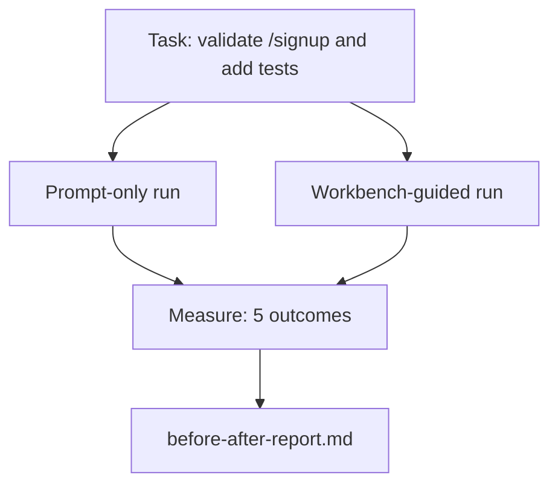

# The Workbench on a Real Repo · 真实仓库上的工作台

十一课打磨出的工作台表面（surface），只要在真实代码库面前活不下来就一文不值。本课在一个小型示例应用上把同一个任务跑两遍：纯提示词（prompt-only）对工作台引导（workbench-guided）。数字自己会辩论。

> Eleven lessons of surfaces are worth nothing if they do not survive contact with a real codebase. This lesson runs the same task twice on a small sample app: prompt-only versus workbench-guided. The numbers do the arguing.

**Type:** Build
**Languages:** Python (stdlib)
**Prerequisites:** Phases 14 · 32 to 14 · 40
**Time:** ~60 minutes

## Learning Objectives · 学习目标

- 把七个工作台表面在一个小型应用上合到一起。
- 把同一个任务跑两遍（纯提示词与工作台引导），并测量五个结果指标。
- 读懂前后对比报告，判断哪些表面给出了最大的杠杆。
- 面对「可是我的模型已经够好了」的质疑，为工作台辩护。

> Bring the seven workbench surfaces together on a small application.
> Run the same task twice (prompt-only and workbench-guided) and measure five outcomes.
> Read the before/after report and decide which surfaces gave the most leverage.
> Defend the workbench against a "but my model is good enough" pushback.

## The Problem · 问题在哪

玩具任务上的演示说服不了任何人。只有当真实感的任务在真实感的仓库上进入生产——失败更少、回滚更少、还留下一个下个会话能用的交接包——工作台的理由才算真正立住。

本课就交付这样一个真实感的仓库，并把同一个任务分别跑过两条流水线（pipeline）。结果是一份你可以递给怀疑论者的前后对比报告。

> A demo on a toy task convinces no one. The case for the workbench is made when a real-feeling task on a real-feeling repo lands in production with fewer failures, fewer reverts, and a packet the next session can use.
> This lesson ships that real-feeling repo and runs the same task through both pipelines. The result is a before/after report you can hand to a skeptic.

## The Concept · 概念



### The sample app · 示例应用

`sample_app/` 里一个极小的 FastAPI 风格处理器：

- `app.py`，带 `/signup`（还没有任何校验）。
- `test_app.py`，带一条快乐路径（happy path）测试。
- `README.md` 和 `scripts/release.sh`，当作禁区的诱饵。

> A minimal FastAPI-style handler in `sample_app/`:
> - `app.py` with `/signup` (no validation yet).
> - `test_app.py` with one happy-path test.
> - `README.md` and `scripts/release.sh` as forbidden-zone bait.

### The task · 任务

> 给 `/signup` 加输入校验：拒绝短于 8 个字符的密码，返回 422 和一个带类型的错误信封（typed error envelope）。加一个测试证明新行为。

> Add input validation to `/signup`: reject passwords shorter than 8 characters, return 422 with a typed error envelope. Add a test that proves the new behavior.

### The two pipelines · 两条流水线

纯提示词（prompt-only）：

1. 读 README。
2. 读 `app.py`。
3. 改文件。
4. 宣告完成。

工作台引导（workbench-guided）：

1. 跑初始化脚本（第 35 课）。
2. 读范围契约（scope contract，第 36 课）。
3. 读状态（state，第 34 课）。
4. 只改被允许的文件。
5. 通过反馈运行器（feedback runner）跑验收命令（第 37 课）。
6. 跑验证门（verification gate，第 38 课）。
7. 跑评审者（reviewer，第 39 课）。
8. 生成交接包（handoff，第 40 课）。

> Prompt-only:
> 1. Read the README.
> 2. Read `app.py`.
> 3. Edit files.
> 4. Claim done.
> Workbench-guided:
> 1. Run init script (Lesson 35).
> 2. Read scope contract (Lesson 36).
> 3. Read state (Lesson 34).
> 4. Edit allowed files only.
> 5. Run acceptance command via feedback runner (Lesson 37).
> 6. Run verification gate (Lesson 38).
> 7. Run reviewer (Lesson 39).
> 8. Generate handoff (Lesson 40).

### The five outcomes measured · 测量的五个结果指标

| 结果指标 | 为什么重要 |
|---------|----------------|
| `tests_actually_run` | 大多数「测试通过」的宣称根本无法验证 |
| `acceptance_met` | 证明目标的那个测试必须就是真正运行过的那个 |
| `files_outside_scope` | 范围蔓延（scope creep）是占主导的静默失败 |
| `handoff_quality` | 下一个会话要么为此买单，要么因此受益 |
| `reviewer_total` | 验证门之上的定性判断 |

```figure
wb-ab-runs
```

## Build It · 动手造

`code/main.py` 针对同一个示例应用夹具编排两条流水线。两条流水线都是脚本化的（回路上没有 LLM），所以测量是可复现的。脚本把对比结果写进 `before-after-report.md` 和 `comparison.json`。

运行：

```
python3 code/main.py
```

输出：一张按流水线列出各结果指标的控制台表格、一份保存在脚本旁边的 markdown 报告，以及一份给想画图的人用的 JSON。

> `code/main.py` orchestrates the two pipelines against the same sample app fixture. Both pipelines are scripted (no LLM in the loop) so the measurement is reproducible. The script writes the comparison into `before-after-report.md` and `comparison.json`.
> Output: a console table of outcomes per pipeline, the markdown report saved next to the script, and the JSON for whoever wants to chart it.

## Production patterns in the wild · 野外生产模式

怀疑论者的问题是：「工作台到底有多大用？」2026 年的数字比解释有说服力得多。

**同一个模型，Terminal Bench 从 30 名开外到第 5。** LangChain 的 *Anatomy of an Agent Harness*（2026 年 4 月）：一个编码智能体只改 harness，就在 Terminal Bench 2.0 上从 30 名开外跳到第 5 名。同一个模型。不同的表面。25 个名次的差值。

**Vercel 靠删工具从 80% 到 100%。** Vercel 报告说，删掉其智能体 80% 的工具之后，成功率从 80% 升到 100%。更小的工具面，更锐利的范围，更少的失败方式。留白（negative space）取胜。

**Harvey 只靠 harness 把准确率翻倍。** 法律智能体仅通过 harness 优化就把准确率提高了一倍以上，模型没有换。

**88% 的企业 AI 智能体项目到不了生产。** preprints.org 的 *Harness Engineering for Language Agents* 论文（2026 年 3 月）把这些失败追溯到运行时（runtime），而不是推理：过期的状态、脆弱的重试、膨胀失控的上下文、对中间错误糟糕的恢复。

**长上下文崩溃。** WebAgent 基线 40-50% 的成功率在长上下文条件下跌到 10% 以下，主要原因是有无限循环和目标丢失。Ralph Loop 和交接包就是为了吸收这类失败而存在的。

**假阴性依然存在。** 单步事实型任务、一行的 lint、格式化器运行、任何模型已经逐字背下来的东西——这些纯提示词跑得更快。基准应该诚实地把它们列举出来，免得工作台被说成杀鸡用牛刀。

结论不是「harness 永远赢」。模型确实会随时间吸收 harness 的技巧。结论是：今天，工程负担落在七个表面上，而数字证明了这一点。

> The skeptic's question is "how much does the workbench actually help?" The 2026 numbers say a lot more than the explanation.
> **Terminal Bench Top-30 to Top-5 on the same model.** LangChain's *Anatomy of an Agent Harness* (April 2026): a coding agent jumped from outside the top 30 to rank five on Terminal Bench 2.0 by changing only the harness... Same model. Different surfaces. Twenty-five-rank delta.
> **Vercel 80% to 100% by deleting tools.** Vercel reported deleting 80% of its agent's tools moved the success rate from 80% to 100%... Smaller tool surface, sharper scope, fewer ways to fail. Negative space wins.
> **Harvey 2x accuracy via harness alone.** Legal agents more than doubled their accuracy through harness optimization, no model change.
> **88% of enterprise AI agent projects fail to reach production.** The preprints.org *Harness Engineering for Language Agents* paper (March 2026) traces the failures to runtime, not reasoning: stale state, brittle retries, overgrown context, poor recovery from intermediate mistakes.
> **Long-context collapse.** WebAgent baseline 40-50% success drops to under 10% in long-context conditions, mostly from infinite loops and goal loss. The Ralph Loop and the handoff packet exist to absorb that.
> **False negatives still exist.** Single-step factual tasks, one-line lints, formatter runs, anything the model has memorized verbatim — these run faster prompt-only... The benchmark should enumerate them honestly so the workbench is not framed as overkill.
> The takeaway is not "harness wins forever." Models do absorb harness tricks over time. The takeaway is that today, the engineering load sits in the seven surfaces, and the numbers prove it.

## Use It · 实战用法

当出现以下情况时，本课就是你可以援引的案卷：

- 有人问为什么每个 PR 都带着 `agent-rules.md` 和范围契约。
- 团队想「就这个 sprint」把验证门省掉。
- 一个新的智能体产品发布了，你需要一个可移植的基准来判断它是否真的省时间。

数字比解释传得更远。

> This lesson is the case file you cite when:
> - Someone asks why every PR carries an `agent-rules.md` and a scope contract.
> - A team wants to drop the verification gate "just for this sprint."
> - A new agent product launches and you need a portable benchmark for whether it actually saves time.
> The numbers travel further than the explanation.

## Ship It · 交付

`outputs/skill-workbench-benchmark.md` 是一个可移植的评测 harness：用项目自己的示例应用，把任何智能体产品跑过两条流水线，并报告那五个结果指标。

> `outputs/skill-workbench-benchmark.md` is a portable evaluation harness that runs any agent product through both pipelines against a project's own sample app and reports the five outcomes.

## Exercises · 练习

1. 加第六个结果指标：到第一次有意义编辑的时间（time-to-first-meaningful-edit）。怎么才能干净地测量它？
2. 在你的代码库中一个真实的「第二天任务」上跑这个对比。工作台的数字在哪里会退步？
3. 加一轮「假阴性」测试：那些纯提示词本会更快、工作台开销是真实成本的任务。然后为「仍然保留工作台」辩护。
4. 把脚本化的「智能体」换成真实的 LLM 调用。哪些结果指标会变得更嘈杂？
5. 写一份面向非工程师的一页摘要。裁剪之后留下的是什么？

> Add a sixth outcome: time-to-first-meaningful-edit. How do you measure it cleanly?
> Run the comparison on a real second-day task in your codebase. Where do the workbench numbers slip?
> Add a "false negative" pass: tasks where prompt-only would have been faster and the workbench overhead is real cost. Defend keeping the workbench anyway.
> Replace the scripted "agent" with a real LLM call. Which outcomes get noisier?
> Author a one-page summary aimed at a non-engineer. What survives the cut?

## Key Terms · 术语表

| 术语 | 大家怎么说 | 实际含义 |
|------|----------------|------------------------|
| Sample app（示例应用） | 「玩具仓库」 | 小而足够真实，能跑遍全部七个表面 |
| Pipeline（流水线） | 「工作流」 | 智能体遵循的一串有序的表面读/写 |
| Before/after report（前后对比报告） | 「证据收据」 | 你递给怀疑论者的工件 |
| False negative（假阴性） | 「工作台杀鸡用牛刀」 | 纯提示词更快的任务；诚实地列举它们很有用 |
| Workbench benchmark（工作台基准） | 「可靠性分数」 | 在你自己的代码库上跑这个对比的可移植 harness |

## Further Reading · 延伸阅读

- [LangChain, The Anatomy of an Agent Harness](https://blog.langchain.com/the-anatomy-of-an-agent-harness/) —— Terminal Bench 从 30 名开外到第 5 名的收据
- [MongoDB, The Agent Harness: Why the LLM Is the Smallest Part of Your Agent System](https://www.mongodb.com/company/blog/technical/agent-harness-why-llm-is-smallest-part-of-your-agent-system) —— Vercel 与 Harvey 的数字
- [preprints.org, Harness Engineering for Language Agents](https://www.preprints.org/manuscript/202603.1756) —— 88% 的企业失败率，运行时层面的根因
- [HN: Improving 15 LLMs at Coding in One Afternoon. Only the Harness Changed](https://news.ycombinator.com/item?id=46988596) —— 在 15 个模型上复现
- [Cloudflare, Orchestrating AI Code Review at Scale](https://blog.cloudflare.com/ai-code-review/) —— 生产中 30 天 13.1 万次评审运行
- [Anthropic, Building Effective Agents](https://www.anthropic.com/research/building-effective-agents)
- Phases 14 · 32 到 14 · 40 —— 本课端到端演练的那些表面
- Phase 14 · 19 —— SWE-bench、GAIA、AgentBench 这些本课所补充的宏观基准
- Phase 14 · 30 —— 同一个 harness 所接入的评估驱动智能体开发
