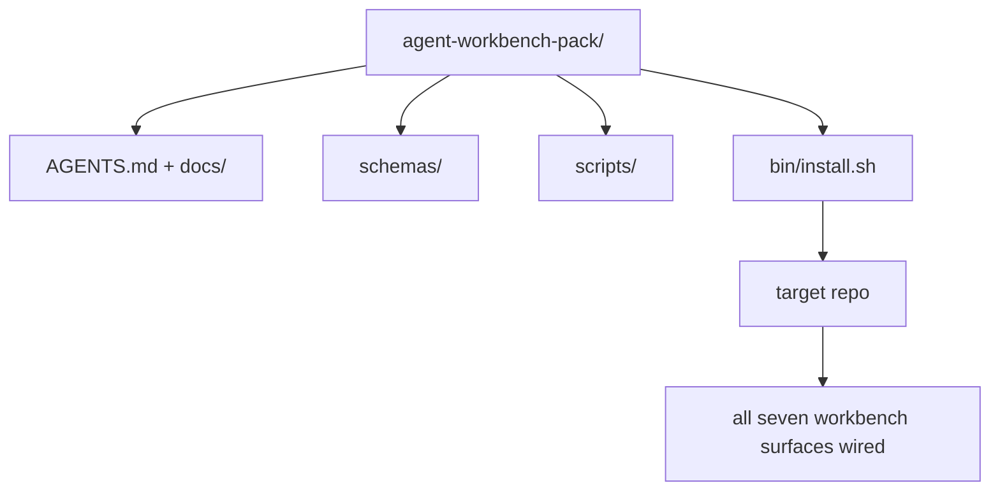

# Capstone: Ship a Reusable Agent Workbench Pack · 毕业项目：交付一个可复用的智能体工作台包

这个小专项的终点是一个你能丢进任何仓库的包（pack）。十一课的工作台表面压缩进一个目录，`cp -r` 一下，第二天早上智能体就能可靠地干活。毕业项目（capstone）就是这个课程赖以立足的工件。

> The mini-track ends with a pack you drop into any repo. Eleven lessons of surfaces compressed into a directory you can `cp -r` and have an agent working reliably the next morning. The capstone is the artifact this curriculum trades on.

**Type:** Build
**Languages:** Python (stdlib)
**Prerequisites:** Phases 14 · 31 to 14 · 41
**Time:** ~75 minutes

## Learning Objectives · 学习目标

- 把七个工作台表面打包进一个即插即用（drop-in）目录。
- 把 schema、脚本和模板固定下来，让新仓库拿到一个已知良好的基线。
- 加一个以幂等方式铺设包的安装脚本。
- 决定什么进包、什么不进，并为每一次取舍辩护。
- 用评审者可复现的证据演示一次智能体辅助的仓库变更。

> Package the seven workbench surfaces into one drop-in directory.
> Pin the schemas, scripts, and templates so a new repo gets a known-good baseline.
> Add a single installer script that lays down the pack idempotently.
> Decide what stays in the pack and what stays out, defending the cut for each.
> Demonstrate one agent-assisted repository change with evidence a reviewer can reproduce.

## The Problem · 问题在哪

一个活在 Google Doc、聊天记录和三个记不全的脚本里的工作台，就是一个每个季度都要重造一遍的工作台。解药是带版本的包：一个装着表面、schema、脚本和一条命令安装器的仓库或目录。

本课结束时，你的磁盘上会有交付好的 `outputs/agent-workbench-pack/`，以及一个能把它装进任何目标仓库的 `bin/install.sh`。

> A workbench that lives in a Google Doc, a chat history, and three half-remembered scripts is a workbench that gets rebuilt every quarter. The cure is a versioned pack: a repo or directory with the surfaces, the schemas, the scripts, and a one-command installer.
> You will end this lesson with `outputs/agent-workbench-pack/` shipped on disk and a `bin/install.sh` that drops it into any target repo.

## The Concept · 概念



### The pack layout · 包的布局

```
outputs/agent-workbench-pack/
├── AGENTS.md
├── docs/
│   ├── agent-rules.md
│   ├── reliability-policy.md
│   ├── handoff-protocol.md
│   └── reviewer-rubric.md
├── schemas/
│   ├── agent_state.schema.json
│   ├── task_board.schema.json
│   └── scope_contract.schema.json
├── scripts/
│   ├── init_agent.py
│   ├── run_with_feedback.py
│   ├── verify_agent.py
│   └── generate_handoff.py
├── bin/
│   └── install.sh
└── README.md
```

### What stays in, what stays out · 什么进包，什么不进

进：

- 表面 schema。它们是契约。
- 上面那四个脚本。它们是运行时。
- 那四份文档。它们是规则和量规。

不进：

- 项目专属的任务。任务属于目标仓库的看板，不属于包。
- 厂商 SDK 调用。包是框架无关的。
- 入职介绍文字。包活在团队现有入职材料的旁边，不在它们里面。

> In:
> - Surface schemas. They are the contract.
> - The four scripts above. They are the runtime.
> - The four docs. They are the rules and the rubric.
> Out:
> - Project-specific tasks. Tasks belong on the target repo's board, not in the pack.
> - Vendor SDK calls. The pack is framework-agnostic.
> - Onboarding prose. The pack lives next to the team's existing onboarding, not inside it.

### The installer · 安装器

一个简短的 `bin/install.sh`（或 `bin/install.py`）：

1. 没有 `--force` 时，拒绝覆盖已存在的包。
2. 把包复制进目标仓库。
3. 如果存在 `.github/workflows/`，就把 CI 接好。
4. 打印后续步骤：填看板、设验收命令、跑初始化脚本。

> A short `bin/install.sh` (or `bin/install.py`):
> 1. Refuses to install over an existing pack without `--force`.
> 2. Copies the pack into the target repo.
> 3. Wires up CI if a `.github/workflows/` exists.
> 4. Prints next steps: fill in the board, set acceptance commands, run the init script.

### Versioning · 版本化

包带一个 `VERSION` 文件。需要迁移的 schema 升级和脚本变更升主版本。仅文档的变更升补丁版本。目标仓库的 `agent_state.json` 记录它初始化时对齐的是哪个包版本。

> The pack carries a `VERSION` file. Schema bumps and script changes that require migrations bump the major. Doc-only changes bump the patch. The target repo's `agent_state.json` records which pack version it was initialized against.

```figure
wb-pack-install
```

## Build It · 动手造

`code/main.py` 把包装配到本课旁边的 `outputs/agent-workbench-pack/`，种子内容来自这个小专项前面几课的 schema 与脚本，以及你已经写好的文档。

运行：

```
python3 code/main.py
```

脚本复制并固定各个表面、写 README、打印包的目录树，然后以零退出。重复运行是幂等的。

> `code/main.py` assembles the pack into `outputs/agent-workbench-pack/` next to the lesson, seeded with the schemas and scripts from the previous lessons in this mini-track and the docs you already wrote.
> The script copies and pins the surfaces, writes the README, prints the pack tree, and exits zero. Re-running is idempotent.

## Production patterns in the wild · 野外生产模式

一个包只有在挺过 fork、升级和一个不友好的上游之后才有价值。四个模式让这件事成立。

**`VERSION` 是契约，不是营销。** 主版本升级要求一次状态迁移。次版本升级要求重跑一次检查器。补丁版本仅限文档。安装器每次安装都把 `.workbench-version` 写进目标仓库；当目标的锁与包的 `VERSION` 不一致时，`lint_pack.py` 拒绝交付。`npm`、`Cargo` 和 `pyproject.toml` 就是这样挺过 10 年变迁的；智能体没有改变任何规则。

**跨工具分发的单一来源。** Nx 提供一个 `nx ai-setup`，从单一配置铺设 `AGENTS.md`、`CLAUDE.md`、`.cursor/rules/`、`.github/copilot-instructions.md` 和一个 MCP 服务器。包应该同样如此：安装器生成符号链接（`ln -s AGENTS.md CLAUDE.md`），让单一事实来源扇出到每一个编码智能体。为了偏向某个工具而把包分叉，是一种失败模式。

**遇到非平凡状态就拒绝的 `uninstall.sh`。** 卸载包绝不能删除用户的 `agent_state.json`、`task_board.json` 或 `outputs/`。卸载器移除 schema、脚本、文档和 `AGENTS.md`（可用 `--keep-agents-md` 选择保留），并在状态文件有任何未提交变更时拒绝继续。状态属于用户；包不拥有它。

**技能即发布物：SkillKit 式分发。** 包以 SkillKit 技能的形式交付：`skillkit install agent-workbench-pack` 从单一来源把它铺设到 32 个 AI 智能体上。包仓库是事实来源；SkillKit 是分发渠道。厂商锁定瓦解；七个表面保持不变。

> A pack is only valuable if it survives forks, updates, and an unfriendly upstream. Four patterns make that work.
> **`VERSION` is the contract, not the marketing.** Major bumps require a state migration... The installer writes `.workbench-version` into the target repo on every install; `lint_pack.py` refuses to ship if the target's lock disagrees with the pack's `VERSION`. This is how `npm`, `Cargo`, and `pyproject.toml` survive 10 years of churn; nothing about agents changes the rules.
> **Single source for cross-tool distribution.** Nx ships one `nx ai-setup` that lays down `AGENTS.md`, `CLAUDE.md`, `.cursor/rules/`, `.github/copilot-instructions.md`, and an MCP server from a single config... Forking the pack to support one tool over another is a failure mode.
> **`uninstall.sh` that refuses on non-trivial state.** Uninstalling the pack must not delete the user's `agent_state.json`, `task_board.json`, or `outputs/`... State belongs to the user; the pack does not own it.
> **Skill-as-publishable, SkillKit-style distribution.** The pack ships as a SkillKit skill: `skillkit install agent-workbench-pack` lays it down across 32 AI agents from a single source. The pack repo is the source of truth; SkillKit is the distribution channel. Vendor lock-in collapses; the seven surfaces stay the same.

## Use It · 实战用法

包的三种交付形态：

- **作为你丢进仓库的目录。** `cp -r outputs/agent-workbench-pack /path/to/repo`。
- **作为公开的模板仓库。** fork 后定制，用 `VERSION` 控制漂移。
- **作为 SkillKit 技能。** 接进你的智能体产品，一条命令铺设完成。

包是食谱。每次安装是一份出品。

> Three places the pack ships:
> - **As a directory you drop into a repo.** `cp -r outputs/agent-workbench-pack /path/to/repo`.
> - **As a public template repo.** Fork-and-customize, with `VERSION` controlling drift.
> - **As a SkillKit skill.** Wired into your agent product so a single command lays it down.
> The pack is the recipe. Each install is a serving.

## Ship It · 交付

`outputs/skill-workbench-pack.md` 生成一个针对项目调校的包：规则按团队历史打磨，范围 glob 与仓库匹配，量规维度扩展出一个领域专属条目。

> `outputs/skill-workbench-pack.md` generates a project-tuned pack: rules sharpened to the team's history, scope globs matched to the repo, rubric dimensions extended with one domain-specific entry.

## Exercises · 练习

1. 决定哪份可选的第五文档值得提升进规范包。为这次取舍辩护。
2. 用 Python 重写安装器并加一个 `--dry-run` 标志。对比它和 bash 的人体工学。
3. 加一个 `bin/uninstall.sh`：安全移除包，并在状态文件有非平凡历史时拒绝执行。什么算非平凡？
4. 加一个 `lint_pack.py`：当包漂移出 `VERSION` 时失败。把它接进包自己仓库的 CI。
5. 写一份从手搓工作台迁移到这个包的运行手册。什么操作顺序能把停机时间降到最小？

> Decide which optional fifth doc deserves promotion into the canonical pack. Defend the cut.
> Rewrite the installer as Python with a `--dry-run` flag. Compare ergonomics against bash.
> Add a `bin/uninstall.sh` that safely removes the pack and refuses if state files have non-trivial history. What counts as non-trivial?
> Add a `lint_pack.py` that fails when the pack drifts from `VERSION`. Wire it into CI for the pack's own repo.
> Author the migration runbook from a hand-rolled workbench to this pack. What is the order of operations that minimizes downtime?

## Career Practice: Prove One Repository Change · 职业实践：证明一次仓库变更

打包演示只证明装配器能跑、能产出文件。它不证明你的智能体能完成一个新任务，不证明生成的检查能证明那个任务，也不证明部署后的系统真的能工作。把这些主张分开。

在你拥有或有权限修改的仓库里，选一个小而真实的任务。用一个你已经能访问的编码智能体。一个 bug 修复、一个有边界的特性或一个运维改进就足够了；安装好几个智能体不是这个练习的一部分。

在打包实验之外，另预算一个专门的工作会话。把下面链接的证据模板复制进你自己的 `learning-artifacts/` 目录。检入的模板和包保留作参考材料。

> The packaging demo proves that the assembler runs and produces files. It does not prove that your agent can complete a new task, that the generated checks prove that task, or that a deployed system works. Keep those claims separate.
> Choose a small real task in a repository you own or have permission to change. Use one coding agent you already have access to... installing several agents is not part of the exercise.
> Budget a separate working session beyond the packaging lab. Copy the evidence template linked below into your own `learning-artifacts/` directory. Preserve the checked-in template and pack as reference material.

### 1. Frame the task and choose the autonomy · 框定任务并选择自主级别

用第 43 课的任务框架（task frame）和第 44 课的证据计划。记录起始修订、可观察目标、非目标、允许路径和验收证据。找出真正需要这个行为的用户或操作员。

选一个工作模式：引导式步骤、带检查点的实现，或有界的自主运行。解释为什么不确定性、后果和可逆性能证明这个选择。小的本地重构可能比访问控制的变更需要更少的检查点。

设一个墙钟时间预算；如果智能体提供 token 或成本上限，也一并设置。测不到的指标就诚实记录为不可用。为反复失败、新增权限、预算耗尽或一个未决的契约决定定义停止条件；指名谁能解决它。

> Use the task frame from lesson 43 and the evidence plan from lesson 44. Record the starting revision, observable goal, non-goals, allowed paths, and acceptance evidence. Identify the real user or operator who needs the behavior.
> Choose a working mode: guided steps, checkpointed implementation, or a bounded autonomous run. Explain why the uncertainty, consequences, and reversibility justify it...
> Set a wall-time budget and a token or cost limit if the agent exposes one. Record unavailable measurements honestly. Define a stop condition for repeated failure, new permissions, budget exhaustion, or an unresolved contract decision; name who can resolve it.

### 2. Prepare the smallest useful environment · 准备最小可用的环境

取回相关的实现、调用方、测试和本地指令。记录每个来源为何属于上下文，以及哪些当前证据可以推翻一条过期的笔记。不要默认加载整个仓库。

对每个相关扩展做一次明确的选择：技能（skill）提供可重复的流程；MCP 工具提供访问；钩子（hook）运行确定性检查；插件（plugin）打包能力。只在任务需要时保留扩展，并只给它能让其工作的最小权限。

记录你拒绝的某个候选扩展的上下文或维护成本。复查一条过期的记忆或指令，当证据支持该决定时，在你自己拥有的配置里退役或替换它。重跑受影响的检查，确认移除没有丢掉必要的约束。

> Retrieve the relevant implementation, caller, test, and local instructions. Record why each source belongs in context and which current evidence would override a stale note. Do not load the whole repository by default.
> Make one explicit choice for each relevant extension: a skill supplies a repeatable procedure; an MCP tool supplies access; a hook runs a deterministic check; a plugin packages capabilities. Keep an extension only when the task needs it, with the least permissions that let it work.
> Record the context or maintenance cost of one proposed addition you reject. Recheck one stale memory or instruction, then retire or replace it in your learner-owned setup when the evidence supports that decision. Rerun the affected check to confirm the removal did not lose a needed constraint.

### 3. Capture the baseline and implement · 抓取基线并实现

编辑之前，跑最接近的现有检查，并展示目标行为的当前状态。保留命令、修订、结果和证据位置。尚不存在的特性也有基线：记录观察到的响应或不支持的操作。

让智能体在契约之内实现。保留一份干预日志，记录每次纠正、权限变更或计划修订的原因。委托是可选的；如果有用，在增加另一个 worker 之前先应用第 45 课的所有权与集成契约。

> Before editing, run the closest existing check and demonstrate the requested behavior's current state. Keep the command, revision, result, and evidence location. A feature that does not exist yet still has a baseline: record the observed response or unsupported operation.
> Let the agent implement inside the contract. Keep an intervention log with the reason for each correction, permission change, or plan revision. Delegation is optional; if useful, apply lesson 45's ownership and integration contract before adding another worker.

### 4. Challenge the evidence · 挑战证据

选择能观察到被变更表面的证明。UI 就重新构建并在相关宽度下检查实际呈现的旅程；API 就检查请求与序列化响应；CLI 就运行构建出的命令并检查退出码与输出。挑选你的任务需要的检查，并说明它们的局限。

独立于智能体的实现，从任务契约写出预期结果。在一份可丢弃的副本里，引入一个具体的错误结果，比如接受非法值或丢掉必需的响应字段。跑同一个验收检查：它必须因这个原因失败。

如果它依然绿，先加强断言或观察再信任它。恢复正确的实现并重跑成功。两份收据都保留。语法错误或坏掉的测试环境不算检测到了回归。

对照原始目标和允许路径评审最终 diff，包括改动的测试。请一位同伴或一个独立的评审会话，在不改实现的前提下挑战最弱的那个证明。最终判断仍归你；另一个智能体的附和不构成执行证据。

> Choose proof that observes the changed surface. For a UI, rebuild and inspect the served journey at relevant widths. For an API, inspect the request and serialized response. For a CLI, run the built command and check its exit code and output...
> Write an expected result from the task contract independently of the agent's implementation. In a disposable copy, introduce one specific incorrect result... Run the same acceptance check: it must fail for that reason.
> If it stays green, strengthen the assertion or observation before trusting it. Restore the correct implementation and rerun successfully. Keep both receipts. A syntax error or broken test setup does not count as detecting the regression.
> Review the final diff, including changed tests, against the original goal and allowed paths. Ask a peer or a separate reviewer session to challenge the weakest proof without editing the implementation. You still own the final judgment; another agent's agreement is not execution evidence.

### 5. Rehearse operation and recovery · 演练运行与恢复

在一个可丢弃的本地或预发环境中运行变更后的工件。每条观察都标注 `local`、`staging` 或 `live`，并带上精确的修订号或工件标识。本地演练支撑本地主张；这个练习不要求生产部署。

选一个与任务相关的失败信号、一个阈值、一个观察窗口和一个负责人。解释越过阈值时的响应。在演练中安全地触发该信号，并保留观察到的日志、指标或响应。

演练回滚到一个已知良好的工件，并确认先前的行为得到恢复。适用时考虑持久化数据；只替换二进制可能逆转不了一个数据变更。记录任何你无法验证的恢复步骤。

> Run the changed artifact in a disposable local or staging environment. Label every observation `local`, `staging`, or `live`, with the exact revision or artifact identity...
> Choose one failure signal related to the task, a threshold, an observation window, and an owner. Explain the response when that threshold is crossed...
> Rehearse rollback to a known-good artifact and check that the previous behavior is restored. Account for persistent data when applicable; replacing a binary alone may not reverse a data change. Record any recovery step you could not verify.

### 6. Improve the next run and hand it off · 改进下一次运行并交接

把结果与基线对比，包括耗时、可用的用量数据和人工干预。一个任务只能说明在那个任务上发生了什么；它不能确立智能体总体上更快或更可靠。

用第 46 课，把一个观察到的纠正提升为测试、更小的权限边界、自动化或更清晰的示例。重跑受影响的检查。清除临时改动，并把最终分支、变更文件、未决风险和下一步行动对下一个会话交代明确。

> Compare the result with the baseline, including elapsed time, available usage data, and human interventions. One task shows what happened on that task; it does not establish that an agent is generally faster or more reliable.
> Promote one observed correction into a test, a smaller permission boundary, an automation, or a clearer example using lesson 46. Rerun the affected check. Remove temporary mutations and leave the final branch, changed files, open risks, and next action explicit for the next session.

### Manual review rubric · 人工评审量规

让评审者检查证据文件，并至少复现最弱的那个验收检查。每一行用 `demonstrated`、`needs revision` 或 `unverified` 评级，附上证据指针和理由。填满的字段和通过的打包脚本不能替代这些观察。

| 维度 | 评审者应当挑战的证据 |
|---|---|
| 任务与自主度（Task and autonomy） | 起始行为、有界目标、有理有据的权限、预算，以及一条可用的停止规则 |
| 上下文与环境（Context and environment） | 相关来源、有理有据的工具访问，以及一次复查过的退役决定 |
| 验证（Verification） | 真实的前后行为，以及被同一个检查拒绝的一个故意引入的错误结果 |
| 评审与运行（Review and operation） | 检查过的 diff、独立挑战、带标注的运行时观察，以及演练过的恢复 |
| 迭代与交接（Iteration and handoff） | 一个已验证的改进、诚实的局限、干净的最终状态，和一个可复现的下一步 |

在宣称任务完成之前，先解决所有 `needs revision` 的发现。拿不到的证据保留 `unverified`，并相应收窄主张。作品集展示的是你在有界任务上的工程判断；它不是招聘或部署的保证。

> Have the reviewer inspect the evidence files and reproduce at least the weakest acceptance check. Use `demonstrated`, `needs revision`, or `unverified` for each row, with an evidence pointer and a reason. Filled fields and passing packaging scripts are not substitutes for these observations.
> Resolve `needs revision` findings before claiming the task complete. Leave unavailable evidence `unverified` and narrow the claim accordingly. The portfolio demonstrates your engineering judgment on a bounded task; it is not a hiring or deployment guarantee.

## Shipped Artifact · 交付工件

保留可复用的包，以及你填写完成的 [career-agent-evidence.md](https://github.com/rohitg00/ai-engineering-from-scratch/blob/main/phases/14-agent-engineering/42-agent-workbench-capstone/outputs/career-agent-evidence.md) 副本。这个模板把任务框架、执行计划、运行时收据、评审、恢复演练和交接串成一份可评审的案例研究。

> Keep the reusable pack and your completed copy of [career-agent-evidence.md](https://github.com/rohitg00/ai-engineering-from-scratch/blob/main/phases/14-agent-engineering/42-agent-workbench-capstone/outputs/career-agent-evidence.md). The template connects the task frame, execution plan, runtime receipts, review, recovery rehearsal, and handoff into one reviewable case study.

## Key Terms · 术语表

| 术语 | 大家怎么说 | 实际含义 |
|------|----------------|------------------------|
| Workbench pack（工作台包） | 「新手礼包」 | 一个带版本的、装着全部七个表面的目录 |
| Installer（安装器） | 「安装脚本」 | 幂等铺设包的 `bin/install.sh` |
| Pack version（包版本） | 「VERSION」 | schema/脚本变更升主版本，仅文档变更升补丁版本 |
| Drop-in pack（即插即用包） | 「cp -r 就能跑」 | 包在第一天无需按仓库定制即可工作 |
| Forkable template（可 fork 模板） | 「GitHub 模板」 | GitHub 的「Use this template」可以从中克隆的公开仓库 |

## Further Reading · 延伸阅读

- Phases 14 · 31 到 14 · 41 —— 这个包捆绑的每一个表面
- [SkillKit](https://github.com/rohitg00/skillkit) —— 把这个技能装到 32 个 AI 智能体上
- [Nx Blog, Teach Your AI Agent How to Work in a Monorepo](https://nx.dev/blog/nx-ai-agent-skills) —— 跨六个工具的单一来源生成器
- [agents.md — the open spec](https://agents.md/) —— 你的包的路由必须实现的东西
- [HKUDS/OpenHarness](https://github.com/HKUDS/OpenHarness) —— 包等价物的参考实现
- [Augment Code, A good AGENTS.md is a model upgrade](https://www.augmentcode.com/blog/how-to-write-good-agents-dot-md-files) —— 包文档的质量底线
- [Anthropic, Effective harnesses for long-running agents](https://www.anthropic.com/engineering/effective-harnesses-for-long-running-agents)
- [Anthropic, Harness design for long-running application development](https://www.anthropic.com/engineering/harness-design-long-running-apps)
- Phase 14 · 30 —— 消费这个包验证门的评估驱动智能体开发
- Phase 14 · 41 —— 这个包在其之上做出改进的前后对比基准
