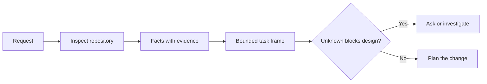

# Frame the Task Before the Agent Writes Code · 在智能体写代码之前，先框定任务

编码智能体能把一个清晰的任务很快实现出来，也能把一个不清晰的任务很快实现出来。速度是一样的，代价不是。

> A coding agent can implement a clear task quickly. It can also implement an unclear task quickly. The speed is the same. The cost is not.

**Type:** Learn + Build
**Languages:** Python (stdlib)
**Prerequisites:** Phase 14 lessons 31 and 36
**Time:** ~60 minutes

## Learning Objectives · 学习目标

- 在动手编辑之前，把一个请求变成一个有边界的任务框架（task frame）。
- 把仓库事实与假设、未决问题分开。
- 定义允许路径、禁止路径和验收证据。
- 判断侦察到什么程度才足够开工。

> Turn a request into a bounded task frame before editing.
> Separate repository facts from assumptions and open questions.
> Define allowed paths, forbidden paths, and acceptance evidence.
> Decide when reconnaissance is sufficient to begin work.

## The Expensive Failure · 昂贵的失败

「加上重复邮箱保护」听起来很具体，其实不是。唯一性该放在 API、领域服务还是数据库？比较是否区分大小写？哪种错误形态已经是公开契约？允许做迁移吗？哪个测试证明这个行为？

一个有能力的智能体会用貌似合理的选择把这些缝隙填上。这才是危险的情形：实现可以很干净、有测试，却依然和整个系统不兼容。

因此，编码智能体工作的第一个单位不是一次编辑，而是一个由仓库证据支撑的任务框架。

> “Add duplicate email protection” sounds specific. It is not. Does uniqueness belong in the API, domain service, or database? Is comparison case-sensitive? Which error shape is already public? Is a migration allowed? Which test proves the behavior?
> A capable agent will fill those gaps with plausible choices. That is the dangerous case because the implementation can be clean, tested, and still incompatible with the system.
> The first unit of coding-agent work is therefore not an edit. It is a task frame backed by repository evidence.

## The Task Frame · 任务框架

一个有用的框架有六个字段：

| 字段 | 问题 |
|---|---|
| 目标（Goal） | 哪个可观察的行为必须改变？ |
| 仓库事实（Repository facts） | 你在代码、测试、配置或历史里验证过什么？ |
| 允许路径（Allowed paths） | 变更可以落在哪里？ |
| 禁止路径（Forbidden paths） | 什么必须保持原样不动？ |
| 验收证据（Acceptance evidence） | 哪些命令或观察能证明目标？ |
| 未决项（Unknowns） | 哪些决定还需要证据或人的判断？ |

事实需要收据。「API 对重复返回 409」在你能指向现有测试或处理器之前不算事实。一个文件路径加行号就够；当行为要紧时，一条命令的结果更好。



> A useful frame has six fields:
> Facts need receipts. “The API uses 409 for duplicates” is not a fact until you can point to the existing test or handler. A file path and line is enough. A command result is better when behavior matters.

## Reconnaissance Is a Search for Constraints · 侦察是搜寻约束

不要通读整个仓库。去找那些约束这次变更的表面：

1. 当前行为及其调用方。
2. 最接近的现有测试。
3. 公开契约或序列化形状。
4. 管辖该路径的项目指令。
5. 构建与验证命令。
6. 能揭示本地模式的类似已完成变更。

当每个计划中的决定要么有证据支撑、要么被明确委托、要么被列为未决项时，就停下来。在那之后继续读，往往是在逃避。

> Do not read the entire repository. Search for the surfaces that constrain the change:
> 1. The current behavior and its caller.
> 2. The closest existing test.
> 3. The public contract or serialized shape.
> 4. The project instructions that govern the path.
> 5. The build and verification commands.
> 6. Similar completed changes that reveal local patterns.
> Stop when every planned decision is either supported by evidence, explicitly delegated, or listed as an unknown. More reading after that point is often avoidance.

## Unknowns Are Not Failures · 未决项不是失败

未决项（unknown）是受控的空隙。假设（assumption）是对这个空隙不受控的回答。

给每个未决项分类：

- **可发现的（Discoverable）：** 仓库或运行中的系统能回答它。
- **可裁决的（Decidable）：** 任务契约授权智能体去选。
- **人的（Human）：** 这个选择会改变产品行为、成本、风险或公开兼容性。
- **推迟的（Deferred）：** 这个选择在本切片之外，属于非目标。

智能体应该穿过可发现的和已委托的未决项继续前进。在人型未决项上，它应该在选择被埋进代码之前停下来。

> An unknown is a controlled gap. An assumption is an uncontrolled answer to that gap.
> Classify each unknown:
> - **Discoverable:** the repository or running system can answer it.
> - **Decidable:** the task contract gives the agent authority to choose.
> - **Human:** the choice changes product behavior, cost, risk, or public compatibility.
> - **Deferred:** the choice is outside this slice and belongs in non-goals.
> The agent should continue through discoverable and delegated unknowns. It should pause at human unknowns before the choice is buried in code.

## Acceptance Before Implementation · 先定验收，再谈实现

在补丁之前先写好证明。证明可以是：

- 一条聚焦的单元或集成测试命令；
- 一次带命名视口和预期状态的浏览器旅程；
- 一个线上请求和精确的响应契约；
- 一个带阈值的性能测量；
- 一个确认没有无关文件被改动的范围检查。

「测试通过」不是一个证明计划。要指名权威测试和它支撑的主张。

> Write the proof before the patch. The proof can be:
> - a focused unit or integration test command;
> - a browser journey with a named viewport and expected state;
> - a wire request and exact response contract;
> - a performance measurement with a threshold;
> - a scope check that confirms no unrelated file changed.
> “Tests pass” is not a proof plan. Name the authoritative test and the claim it supports.

## Build It · 动手造

实验创建一个 `TaskFrame`，校验它的边界与证据，并写出 `outputs/task-frame.md`。

从本课目录运行：

```bash
python3 code/main.py
python3 -m unittest discover code/tests -v
```

用四种方式弄坏这个例子：删掉目标、删掉一条事实收据、让允许路径与禁止路径重叠、删掉验收命令。校验器应该以各不相同的理由拒绝每一个框架。

> The lab creates a `TaskFrame`, validates its boundaries and evidence, and writes `outputs/task-frame.md`.
> Break the example in four ways: remove the goal, remove a fact receipt, overlap an allowed and forbidden path, and remove the acceptance command. The validator should refuse each frame for a different reason.

## Use It in a Real Repository · 在真实仓库里用起来

在让智能体动手编辑之前：

1. 把目标写成一个行为，而不是一次文件变更。
2. 记录两三条带精确证据的事实。
3. 写下最小的允许路径集合。
4. 明确写出留白（不许碰的部分）。
5. 写下能关闭任务的命令或观察。
6. 列出你还没有挣到决定权的决定。

框架应该能放进一屏。放不下，说明任务里可能装着多个可独立验证的变更。

> Before asking an agent to edit:
> 1. Write the goal as a behavior, not a file change.
> 2. Record two or three facts with exact evidence.
> 3. Name the smallest allowed path set.
> 4. Name negative space explicitly.
> 5. Write the command or observation that closes the task.
> 6. List the decisions you have not earned yet.
> The frame should fit on one screen. If it cannot, the task may contain multiple independently verifiable changes.

## Exercises · 练习

1. 从你的某个仓库里挑一个真实 bug 做框架，但不提出解决方案。
2. 找出框架里一个其实是假设的主张，用证据替换它。
3. 加一个其答案会改变公开契约的人型未决项。
4. 把一个过宽的允许路径拆成最小的安全集合。
5. 给验收证据加一条范围收据。

> Frame a real bug from one of your repositories without proposing a solution.
> Find one claim in the frame that is actually an assumption. Replace it with evidence.
> Add a human unknown whose answer would change the public contract.
> Split one broad allowed path into the smallest safe set.
> Add a scope receipt to the acceptance evidence.

## Further Reading · 延伸阅读

- [Nuseibeh and Easterbrook, Requirements Engineering: A Roadmap](https://www.cs.toronto.edu/~sme/papers/2000/ICSE2000.pdf) —— 把实现锚定在真实世界目标与不断演化的约束上。
- [Yang et al., SWE-agent: Agent-Computer Interfaces Enable Automated Software Engineering](https://arxiv.org/abs/2405.15793) —— 证明编码智能体周围的界面会改变其有效性。

## What You Keep · 你留下什么

保留 `outputs/task-frame.md`。它是下一课的输入——在那里，框架变成一份有证据支撑的执行计划。

> Keep `outputs/task-frame.md`. It is the input to the next lesson, where the frame becomes an evidence-backed execution plan.
