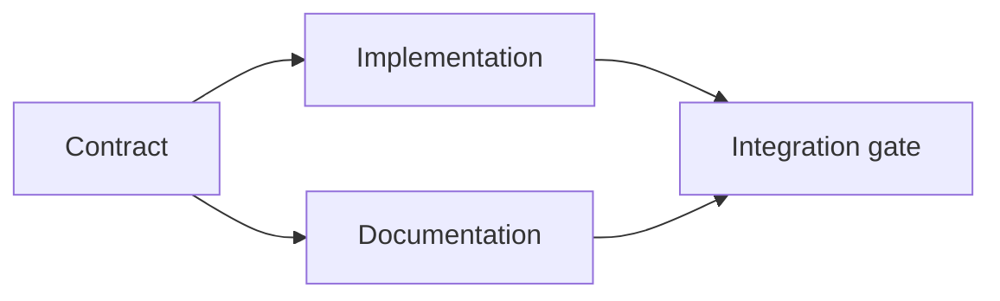

# Build an Evidence-Backed Execution Plan · 构建有证据支撑的执行计划

计划不是一份更漂亮的待办清单。它是一张依赖图：每个变更都有理由，每个终节点都有证明。

> A plan is not a prettier to-do list. It is a dependency graph in which every change has a reason and every terminal node has proof.

**Type:** Learn + Build
**Languages:** Python (stdlib)
**Prerequisites:** Phase 14 lesson 43
**Time:** ~65 minutes

## Learning Objectives · 学习目标

- 把任务框架转换成带证据与证明的工作项。
- 把顺序建模为依赖，而不是散文式的先后罗列。
- 在编辑之前检出缺失的事实、未知的依赖和环。
- 把能一起跑的步骤和必须等待的步骤分开。

> Convert a task frame into work items with evidence and proof.
> Model ordering as dependencies instead of prose sequence.
> Detect missing facts, unknown dependencies, and cycles before editing.
> Separate steps that can run together from steps that must wait.

## Why Agent Plans Fail · 为什么智能体的计划会失败

弱计划用将来时复述请求：

1. 更新 API。
2. 加测试。
3. 更新文档。

这个列表没有任何一处说明：发现了什么、为什么这些文件是对的、哪个契约先改、什么可以并发进行。智能体可以每一步都照做，仍然制造返工。

强计划对每个工作项做出五个承诺：

| 承诺 | 目的 |
|---|---|
| 标识符（Identifier） | 依赖与交接用的稳定引用 |
| 变更（Change） | 最小的行为或契约变更 |
| 证据（Evidence） | 证明该变更合理性的仓库事实 |
| 依赖（Dependencies） | 必须先为真的工作 |
| 证明（Proof） | 关闭该项的确切检查 |

> Weak plans repeat the request in future tense:
> Nothing in that list says what was found, why those files are correct, which contract changes first, or what can happen concurrently. An agent can follow every step and still create rework.
> A strong plan makes five commitments for each work item:

## Plan the Contract Before Its Implementations · 先规划契约，再规划实现

当多个表面依赖同一个行为时，先定义行为。测试、实现、文档和集成随后共享同一份契约，而不是各自发明四个版本。



这张图暴露了安全并发。契约定死之后，实现和文档可以齐头并进。集成等两者。

> When multiple surfaces depend on the same behavior, define the behavior first. Tests, implementation, documentation, and integration can then share one contract instead of inventing four versions.
> The graph exposes safe concurrency. Implementation and documentation can proceed together after the contract is fixed. Integration waits for both.

## Evidence Changes the Plan · 证据会改变计划

仓库证据不是装饰。它应该有能力改变工作本身：

- 一个现成的辅助函数消掉一个计划中的新抽象。
- 一个兼容性测试逼出一个迁移步骤。
- 一个部署约束把 schema 变更挪进另一个任务。
- 一个公开响应类型改变实现与文档的先后顺序。

如果证据不能改变计划，那它多半不是这个决策的证据。

> Repository evidence is not decoration. It should be capable of changing the work:
> - An existing helper removes a planned new abstraction.
> - A compatibility test forces a migration step.
> - A deployment constraint moves a schema change into another task.
> - A public response type changes the order of implementation and documentation.
> If the evidence cannot change the plan, it is probably not evidence for that decision.

## Design for Interruption · 为中断而设计

编码智能体的会话会意外终止。一个可恢复的计划，其工作项要小到让另一个会话能够判定：

- 哪一项已完成；
- 哪个证明跑过；
- 哪些工件变了；
- 哪些依赖现已解除阻塞；
- 下一个安全项是什么。

不要把状态只编码在聊天里打勾的复选框中。把计划存在工作旁边。

> Coding-agent sessions end unexpectedly. A resumable plan has work items small enough that another session can determine:
> - which item is complete;
> - which proof ran;
> - which artifacts changed;
> - which dependencies are now unblocked;
> - what the next safe item is.
> Do not encode state only in checked boxes inside a chat. Store the plan next to the work.

## Plan Validation · 计划校验

执行之前，出现以下情况就拒绝计划：

- 标识符重复；
- 工作项没有证据；
- 工作项没有证明；
- 依赖指向一个未知项；
- 图里含有环；
- 第一个不可逆动作发生在相关不确定性解决之前。

前五个检查是机械的。最后一个需要判断，应当显式指出。

> Reject the plan before execution when:
> - an identifier is duplicated;
> - a work item has no evidence;
> - a work item has no proof;
> - a dependency names an unknown item;
> - the graph contains a cycle;
> - the first irreversible action occurs before the relevant uncertainty is resolved.
> The first five checks are mechanical. The last requires judgment and should be called out explicitly.

## Build It · 动手造

`code/main.py` 对工作项建模、校验它们的收据、用拓扑排序计算执行波次（wave），并写出 `outputs/evidence-plan.json`。

运行：

```bash
python3 code/main.py
python3 -m unittest discover code/tests -v
```

这个例子产出三个波次。契约定义先跑。实现与文档一起跑。集成门最后跑。

> `code/main.py` models work items, validates their receipts, computes execution waves with a topological sort, and writes `outputs/evidence-plan.json`.
> The example produces three waves. Contract definition runs first. Implementation and documentation run together. The integration gate runs last.

## Use It with a Coding Agent · 和编码智能体一起用

让智能体在改文件之前先产出计划。从三件事评审计划：

1. 每条路径和行为主张都有仓库收据。
2. 每一项都有一个清晰的完成证明。
3. 图把昂贵或不可逆的工作推迟到它所依赖的不确定性解决之后。

批准的是计划，不是一个「我会小心」的模糊承诺。

> Ask the agent to produce the plan before it changes files. Review the plan for three things:
> 1. Every path and behavior claim has a repository receipt.
> 2. Every item has one clear completion proof.
> 3. The graph delays expensive or irreversible work until the uncertainty it depends on is resolved.
> Approve the plan, not a vague promise to be careful.

## Exercises · 练习

1. 加一个需要人类显式批准的迁移项。
2. 造一个环，并解释它背后隐藏的产品分歧。
3. 把一个带两条证明命令的项拆开。
4. 加一个能在第二波运行、且不碰任一现有分支的工作项。
5. 把计划渲染成 Markdown，同时保持 JSON 是事实来源。

> Add a migration item that requires explicit human approval.
> Create a cycle and explain the hidden product disagreement behind it.
> Split one item that has two proof commands.
> Add a work item that can run in the second wave without touching either existing branch.
> Render the plan as Markdown while keeping JSON as the source of truth.

## Further Reading · 延伸阅读

- [Nuseibeh and Easterbrook, Requirements Engineering: A Roadmap](https://www.cs.toronto.edu/~sme/papers/2000/ICSE2000.pdf) —— 关于目标、规约、一致与演化之间的迭代关系。
- [Barry Boehm, A Spiral Model of Software Development and Enhancement](https://dl.acm.org/doi/10.1145/12944.12948) —— 围绕风险化解而非固定线性顺序来安排开发。

## What You Keep · 你留下什么

保留 `outputs/evidence-plan.json`。它在下一课成为委托契约。

> Keep `outputs/evidence-plan.json`. It becomes the delegation contract in the next lesson.
