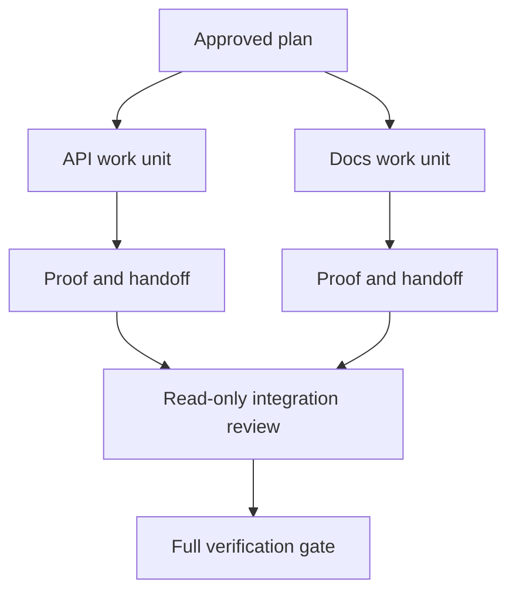

# Delegate Agent Work with Isolation and Merge Contracts · 用隔离与合并契约委托智能体工作

只有当工作相互独立时，并行智能体才省墙钟时间。否则它们只是把一个清晰的任务变成一个失败率更高的协调问题。

> Parallel agents save wall time only when the work is independent. Otherwise they convert one clear task into a coordination problem with a faster failure rate.

**Type:** Learn + Build
**Languages:** Python (stdlib)
**Prerequisites:** Phase 14 lessons 39 and 44
**Time:** ~70 minutes

## Learning Objectives · 学习目标

- 判断委托是否被真实的独立性证明合理。
- 给每个 worker 独占的文件所有权和明确的证明。
- 从依赖计算执行波次（wave）。
- 设计一个能安全合并智能体工作的合并契约。

> Decide whether delegation is justified by real independence.
> Give each worker exclusive file ownership and explicit proof.
> Compute execution waves from dependencies.
> Design a merge contract for combining agent work safely.

## The Parallelism Test · 并行性检验

不要因为智能体多就委托。至少满足下列一条时才委托：

- 两个调查能独立回答不同的未决项；
- 两个实现拥有互不相交的文件和契约；
- 评审者能在不改动的前提下检查一个已完成的工件；
- 一个缓慢的外部检查能在本地工作继续的同时运行。

当智能体需要同样的文件、同一个未决决定或同一个可变环境时，保持工作串行。

> Do not delegate because more agents are available. Delegate when at least one of these is true:
> - two investigations can answer different unknowns independently;
> - two implementations own disjoint files and contracts;
> - a reviewer can inspect a completed artifact without changing it;
> - a slow external check can run while local work continues.
> Keep work serial when agents need the same files, the same unresolved decision, or the same mutable environment.

## A Work Unit Is a Contract · 工作单元即契约

每个被委托的单元需要：

| 字段 | 含义 |
|---|---|
| 目标（Goal） | 一个可观察的结果 |
| 负责人（Owner） | 一个可问责的 worker |
| 路径（Paths） | 独占的写所有权 |
| 依赖（Dependencies） | 开工前必须完成的单元 |
| 证明（Proof） | 返还给集成者的确切证据 |
| 交接（Handoff） | 变更的文件、做出的决定、剩余风险 |

「把后端搞定」不是一个工作单元。「在 `app/accounts.py` 里实现重复检查，并用聚焦的 account 测试证明它」才是。

> Each delegated unit needs:
> “Handle the backend” is not a work unit. “Implement the duplicate check in `app/accounts.py` and prove it with the focused account test” is.

## Isolation Has Three Layers · 隔离有三个层次

1. **文件系统隔离：** 独立的 worktree 或沙箱防止意外的共享编辑。
2. **所有权隔离：** 契约防止两个 worker 有意编辑同一路径。
3. **状态隔离：** 独立的日志和输出防止一个 worker 覆盖另一个 worker 的证据。

文件系统隔离解决不了所有权。两个干净的 worktree 仍可能产出相互冲突的设计。合并契约必须在开工之前解决共享接口。



> 1. **Filesystem isolation:** separate worktrees or sandboxes prevent accidental shared edits.
> 2. **Ownership isolation:** contracts prevent two workers from intentionally editing the same path.
> 3. **State isolation:** separate logs and outputs prevent one worker from overwriting another worker's evidence.
> Filesystem isolation does not solve ownership. Two clean worktrees can still produce conflicting designs. The merge contract must resolve shared interfaces before work begins.

## The Integrator Does Not Rebuild the Work · 集成者不重做工作

集成者应该：

1. 确认每份交接符合它被分配的范围；
2. 读证明输出，而不只是 worker 的总结；
3. 按依赖顺序合并变更；
4. 跑完整的跨单元验证门；
5. 拒绝隐藏的范围扩张；
6. 把冲突记录为新决定，而不是悄悄改掉。

如果集成需要重写某个 worker 的大部分结果，那说明最初的分解就是错的。

> The integrator should:
> 1. confirm each handoff matches its assigned scope;
> 2. read the proof output, not just the worker's summary;
> 3. combine changes in dependency order;
> 4. run the full cross-unit gate;
> 5. reject hidden scope expansion;
> 6. record conflicts as new decisions, not silent edits.
> If integration requires rewriting most of a worker's result, the original decomposition was wrong.

## Human and Agent Roles · 人与智能体的分工

委托不取消人的判断。改变公开行为、风险、权限或不可逆成本的选择，仍然由人拥有。智能体可以拥有有界的调查、实现、验证和评审。

这就是校准自主（calibrated autonomy）：系统在证据和回滚都强的地方给予自由，在后果高的地方要求一个检查点。

> Delegation does not remove human judgment. The human still owns choices that change public behavior, risk, authority, or irreversible cost. Agents can own bounded investigation, implementation, verification, and review.
> This is calibrated autonomy: the system grants freedom where evidence and rollback are strong, and requires a checkpoint where consequence is high.

## Build It · 动手造

实验检查路径重叠、校验依赖、计算安全的执行波次，并写出 `outputs/delegation-plan.json`。

运行：

```bash
python3 code/main.py
python3 -m unittest discover code/tests -v
```

把 docs 单元改成拥有 `app/`。计划应当被阻塞，因为这个父路径与 API 单元重叠。

> The lab checks path overlap, validates dependencies, computes safe execution waves, and writes `outputs/delegation-plan.json`.
> Change the docs unit to own `app/`. The plan should block because that parent path overlaps the API unit.

## Exercises · 练习

1. 把一个真实变更分解成两个独立工作单元和一个集成者。
2. 找出一个只是看起来独立的并行切分方案。说出那个共享的决定。
3. 加一个只读的研究 worker，其产出是一张事实表。
4. 加一个合并门：用所有单元契约检查最终的变更文件集合。
5. 为依赖失效的 worker 定义一条取消规则。

> Decompose a real change into two independent work units and one integrator.
> Find a proposed parallel split that only looks independent. State the shared decision.
> Add a read-only research worker whose output is a fact table.
> Add a merge gate that checks the final changed-file set against all unit contracts.
> Define a cancellation rule for a worker whose dependency becomes invalid.

## Further Reading · 延伸阅读

- [Reid Smith, The Contract Net Protocol](https://doi.org/10.1109/TC.1980.1675516) —— 对分布式任务分配与结果汇报的早期形式化处理。
- [Eric Horvitz, Principles of Mixed-Initiative User Interfaces](https://dl.acm.org/doi/10.1145/302979.303030) —— 决定自动化何时行动、何时把控制交还给人。

## What You Keep · 你留下什么

保留 `outputs/delegation-plan.json`。它记录切分为何安全、每条路径归谁，以及集成必须收到什么证明。

> Keep `outputs/delegation-plan.json`. It records why the split is safe, who owns each path, and what proof integration must receive.
