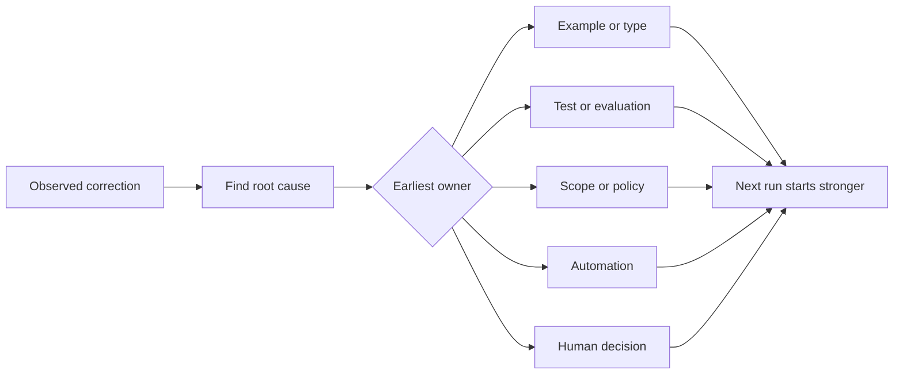

# Turn Every Agent Correction into a System Improvement · 把每一次智能体纠正变成系统改进

只活在聊天里的纠正，只修复一次运行。被提升为测试、边界、示例或工具的纠正，改进之后的每一次运行。

> A correction that lives only in chat fixes one run. A correction promoted into a test, boundary, example, or tool improves every later run.

**Type:** Learn + Build
**Languages:** Python (stdlib)
**Prerequisites:** Phase 14 lessons 37 to 41
**Time:** ~65 minutes

## Learning Objectives · 学习目标

- 把智能体纠正转换成持久的控制（control）。
- 把每个控制放在能阻止复发的最早一层。
- 用稳定指纹给重复的教训去重。
- 退役不再保护真实风险的控制。

> Convert agent corrections into durable controls.
> Place each control at the earliest layer that can prevent recurrence.
> Deduplicate repeated lessons with stable fingerprints.
> Retire controls that no longer protect a real risk.

## Corrections Are Evidence · 纠正就是证据

当你告诉智能体「别改那个文件」，你学到的是：范围边界不可执行。当你说「这个输出形状不对」，你学到的是：缺了一个示例或一个测试。当安装再次失败，你学到的是：环境知识应该进自动化。

把纠正当作对工作系统的一次观察，而不是提示词写作的失败。

> When you tell an agent “do not edit that file,” you have learned that the scope boundary was not executable. When you say “this output shape is wrong,” you have learned that an example or test was missing. When setup fails again, you have learned that environment knowledge belongs in automation.
> Treat the correction as an observation about the work system, not as a prompt-writing failure.

## Promote to the Earliest Effective Layer · 提升到最早生效的层

用这个顺序：

| 复发的失败 | 持久的归宿 |
|---|---|
| 错误结果或回归 | 测试或评估 |
| 越界或不安全的动作 | 范围或权限策略 |
| 反复的安装或命令失误 | 自动化或工具 |
| 反复的输出格式错误 | 规范示例加校验器 |
| 含糊的本地约定 | 带场景检查的指令 |
| 产品分歧 | 人类决定记录 |

越早的控制越便宜。一个能防止非法状态的类型，强过事后抓住它的评审评论。一条聚焦的测试，强过一段求智能体记住的文字。



> Use this order:
> Earlier controls are cheaper. A type that prevents an invalid state is stronger than a review comment that catches it later. A focused test is stronger than a paragraph asking the agent to remember.

## The Ratchet Record · 棘轮记录

记录：

- 症状；
- 根因；
- 后果；
- 复发次数；
- 选定的控制；
- 对该控制的验证；
- 负责人；
- 复审或退役的日期。

不要提升每一个一次性的偏好。只有当复发或后果足以证明永久复杂性合理时，才提升一条纠正。

> Capture:
> - symptom;
> - root cause;
> - consequence;
> - recurrence count;
> - chosen control;
> - verification for the control;
> - owner;
> - date to review or retire it.
> Do not promote every one-off preference. Promote a correction when recurrence or consequence justifies permanent complexity.

## Separate Cause from Symptom · 把原因和症状分开

「智能体改了 README」是症状。可能的原因包括：

- 任务允许了仓库根目录；
- 文档被默认当作安全；
- 计划把实现和文档捆在了一起；
- 两个 worker 的所有权重叠。

每个原因属于不同的控制。一条只是复述症状的规则，会在下一个稍有不同的情况里失效。

> “The agent edited README” is a symptom. Possible causes include:
> - the task allowed the repository root;
> - docs were implicitly considered safe;
> - the plan bundled implementation and documentation;
> - two workers had overlapping ownership.
> Each cause belongs to a different control. A rule that merely repeats the symptom will fail in the next slightly different case.

## Controls Also Decay · 控制也会衰减

旧的控制会相互冲突、撑大上下文，并编码一个已经不存在的系统。每条被提升的规则都需要一次退役检查。出现以下情况就移除或重写它：

- 底层架构变了；
- 一个更强的可执行控制取代了它；
- 失败在有意义的观察窗口内没有复发；
- 该控制制造的摩擦超过了它防止的风险。

目标不是最长的指令文件。目标是保住来之不易判断的最小系统。

> Old controls can conflict, bloat context, and encode a system that no longer exists. Every promoted rule needs a retirement check. Remove or rewrite it when:
> - the underlying architecture changed;
> - a stronger executable control replaced it;
> - the failure has not recurred across a meaningful window;
> - the control creates more friction than the risk it prevents.
> The goal is not the longest instruction file. It is the smallest system that preserves hard-won judgment.

## Build It · 动手造

实验给纠正分类、把它们提升为控制、给重复项做指纹，并写出 `outputs/feedback-ratchet.json`。

运行：

```bash
python3 code/main.py
python3 -m unittest discover code/tests -v
```

加两条措辞不同但原因相同的纠正。改进归一化，直到它们坍缩成一个控制，同时不让无关的失败被坍缩到一起。

> The lab classifies corrections, promotes them into controls, fingerprints duplicates, and writes `outputs/feedback-ratchet.json`.
> Add two differently worded corrections with the same cause. Improve the normalization until they collapse into one control without collapsing unrelated failures.

## Exercises · 练习

1. 从最近一次编码会话里拿五条纠正，给它们真正的归属分类。
2. 用一条可执行测试替换一条文字规则。
3. 加后果权重，让严重的首次发生能被立即提升。
4. 给实验输出加负责人和退役日期。
5. 评审一条现有的智能体指令，只有在证明存在更强的控制之后才删除它。

> Take five corrections from a recent coding session and classify their real owners.
> Replace one prose rule with an executable test.
> Add consequence weighting so a severe first occurrence can be promoted immediately.
> Add an owner and retirement date to the lab output.
> Review one existing agent instruction and delete it only after proving a stronger control exists.

## Further Reading · 延伸阅读

- [Basili, Caldiera, and Rombach, The Goal Question Metric Approach](https://www.cs.toronto.edu/~sme/CSC444F/handouts/GQM-paper.pdf) —— 把目标变成问题与可操作的度量。
- [Shinn et al., Reflexion](https://arxiv.org/abs/2303.11366) —— 用反馈轨迹改进后续决策，而不改模型权重。
- [Madaan et al., Self-Refine](https://arxiv.org/abs/2303.17651) —— 任务回路内部的迭代反馈与修订。

## What You Keep · 你留下什么

保留 `outputs/feedback-ratchet.json`。它是智能体辅助工程（Agent-Assisted Engineering）路径的持久终点，也是未来工作台变更的输入。

> Keep `outputs/feedback-ratchet.json`. It is the durable end of the Agent-Assisted Engineering path and the input to future workbench changes.
