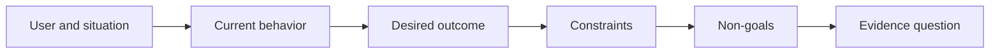

# Define the Outcome Before You Choose the Output · 先定义成果，再选择产出

快速实现会放大「选错问题」的惩罚。先塑造成果（outcome），让速度指向正确的方向。

> Fast implementation increases the penalty for choosing the wrong problem. Shape the outcome first so speed points in the right direction.

**Type:** Learn + Build
**Languages:** Python (stdlib)
**Prerequisites:** None
**Time:** ~60 minutes

## Learning Objectives · 学习目标

- 写一个不点名解决方案的成果框架。
- 识别用户、情境、当前行为和期望的改变。
- 把约束和非目标写明白。
- 在方案泄漏固化成范围之前检出它。

> Write an outcome frame without naming a solution.
> Identify the user, situation, current behavior, and desired change.
> Make constraints and non-goals explicit.
> Detect solution leakage before it hardens into scope.

## Output Is Not Outcome · 产出不是成果

「做一个事件助手」点名的是一个产出（output）。它没说谁需要它、什么会变好、什么必须保持安全。

成果框架说的是：

> 当生产告警到达时，值班工程师在两分钟内识别出故障服务和一个安全的下一步动作，同时诊断保持只读且可审计。

这句话可以由软件、运行手册、一次数据修复或一个更小的界面变更来满足。它让团队附着在结果上，而不是附着在某人最先想象出来的那个工件上。

> “Build an incident assistant” names an output. It does not say who needs it, what becomes better, or what must remain safe.
> An outcome frame says:
> That sentence can be satisfied by software, a runbook, a data repair, or a smaller interface change. It keeps the team attached to the result rather than the first artifact someone imagined.

## The Six-Part Frame · 六部分框架

| 部分 | 问题 |
|---|---|
| 用户（User） | 谁直接承受这个问题？ |
| 情境（Situation） | 何时何地发生？ |
| 当前行为（Current behavior） | 今天发生什么，包括哪些变通办法？ |
| 期望成果（Desired outcome） | 哪个可观察的状态应该改善？ |
| 约束（Constraints） | 哪些安全、政策、成本或兼容性限制是定死的？ |
| 非目标（Non-goals） | 哪些诱人的邻近工作被排除在外？ |



## Find Solution Leakage · 找出方案泄漏

当成果陈述里包含一个没被证据挣到的产品形态、界面、模型选择、框架或架构时，它就在泄漏方案。

- 「用户收到每周 AI 摘要」泄漏了摘要和节奏。
- 「用户在批准前理解账户变更」陈述的是结果。
- 「部署一个向量数据库」泄漏了基础设施。
- 「评审期间能拿到相关政策证据」陈述的是一种能力。

当兼容性真正把技术定死时，约束可以点名技术。要记录它为什么被定死。

> Outcome statements leak solutions when they contain a product form, interface, model choice, framework, or architecture that has not been earned by evidence.
> - “Users receive a weekly AI summary” leaks the summary and cadence.
> - “Users understand account changes before approval” states the result.
> - “Deploy a vector database” leaks infrastructure.
> - “Relevant policy evidence is available during review” states a capability.
> Constraints can name technology when compatibility truly fixes it. Record why it is fixed.

## Constraints Protect the Outcome · 约束保护成果

约束不是实现细节。它们是真实世界目标的一部分：

- 诊断期间不写生产环境；
- 在事件时间预算内响应；
- 现有审计事件保持权威；
- 不加新的运行时依赖；
- 无障碍行为保持完好。

一个靠违反约束才到达成果的构建，并没有到达成果。

> Constraints are not implementation details. They are part of the real-world goal:
> - no production writes during diagnosis;
> - response within the incident time budget;
> - existing audit events remain authoritative;
> - no new runtime dependency;
> - accessibility behavior remains intact.
> A build that reaches the outcome by violating a constraint has not reached the outcome.

## Non-Goals Create a Boundary · 非目标画出边界

非目标防止一个有用的切片长成一个平台。好的非目标具体到足以拒绝工作：

- 不做自动修复；
- 不做新的告警路由系统；
- 不取代事件指挥官；
- 这个切片不做历史分析。

> Non-goals prevent a useful slice from turning into a platform. Good non-goals are concrete enough to reject work:
> - no automatic remediation;
> - no new alert-routing system;
> - no replacement of the incident commander;
> - no historical analytics in this slice.

## Build It · 动手造

实验校验一个 `OutcomeFrame` 并写出 `outputs/outcome-frame.json`。

```bash
python3 code/main.py
python3 -m unittest discover code/tests -v
```

把期望成果换成「用那个事件助手」。校验器应当标记出：提议的产出泄漏进了成果。

> The lab validates an `OutcomeFrame` and writes `outputs/outcome-frame.json`.
> Replace the desired outcome with “use the incident assistant.” The validator should flag that the proposed output leaked into the outcome.

## Exercises · 练习

1. 把你待办列表里的一个特性请求重写成成果框架。
2. 加一个会改变「哪些方案仍可行」的约束。
3. 加两个能让第一切片保持小的非目标。
4. 找出最早能证伪期望成果的那个观察。
5. 写出三个都能满足同一成果的不同产出。

> Rewrite a feature request from your backlog as an outcome frame.
> Add one constraint that changes which solutions remain possible.
> Add two non-goals that keep the first slice small.
> Identify the earliest observation that would disprove the desired outcome.
> Write three different outputs that could satisfy the same outcome.

## Further Reading · 延伸阅读

- [Nuseibeh and Easterbrook, Requirements Engineering: A Roadmap](https://www.cs.toronto.edu/~sme/papers/2000/ICSE2000.pdf) —— 把真实世界目标当作软件工作的锚。
- [Dardenne, van Lamsweerde, and Fickas, Goal-Directed Requirements Acquisition](https://doi.org/10.1016/0167-6423(93)90021-G) —— 把高层目标精化为约束与可操作需求。

## What You Keep · 你留下什么

保留 `outputs/outcome-frame.json`。下一课会用人们实际执行的工作流来检验它。

> Keep `outputs/outcome-frame.json`. The next lesson tests it against the workflow people actually perform.
