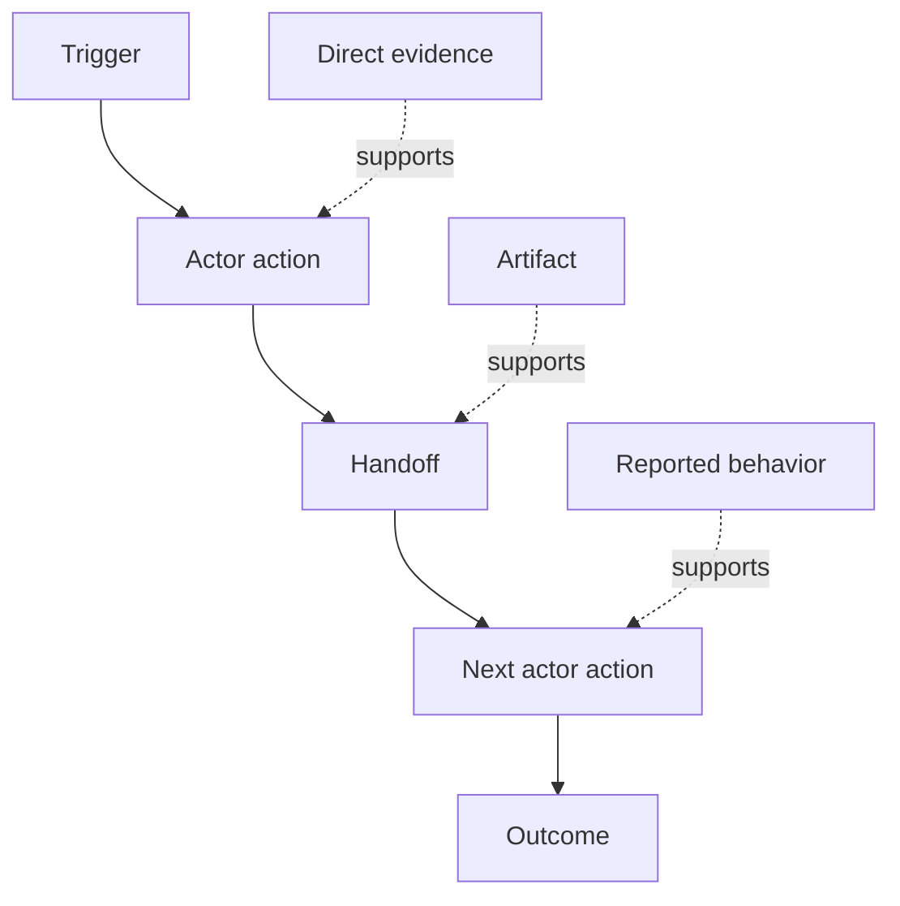

# Discover the Workflow People Actually Perform · 发现人们真正执行的工作流

> Requirements are not waiting in a meeting to be collected. They are scattered across actions, workarounds, records, and disagreements.

**Type:** Learn + Build
**Languages:** Python (stdlib)
**Prerequisites:** Phase 14 lesson 47
**Time:** ~70 minutes

## Learning Objectives · 学习目标

- 把当前工作流（workflow）建模为带证据的有序动作。
- 区分直接观察与转述或推断出的行为。
- 定位摩擦（friction）、交接（handoff）、权限（authority）与隐藏状态（hidden state）。
- 让不确定的论断保持可见，而不是把它们悄悄变成需求。

> Model the current workflow as ordered actions with evidence.
> Separate direct observation from reported or inferred behavior.
> Locate friction, handoffs, authority, and hidden state.
> Keep uncertain claims visible instead of turning them into requirements.

## Start with the Current System · 从当前系统开始

不要从「问人们想要什么功能」开始。从重建现在实际发生的事情开始。

对每一个步骤，记录：

| 字段 | 示例 |
|---|---|
| 执行者（Actor） | 值班工程师（on-call engineer） |
| 触发（Trigger） | 生产告警到达 |
| 动作（Action） | 打开告警，然后搜索多个仪表盘 |
| 输入（Input） | 告警负载和部署记录 |
| 输出（Output） | 候选服务及其负责人 |
| 摩擦（Friction） | 在三个工具之间来回切换上下文 |
| 权限（Authority） | 事故指挥官（incident commander）批准一次写操作 |
| 证据（Evidence） | 屏幕录制、事故日志、操作手册（runbook） |

工作流比屏幕上看到的更大。它还包括等待、复制粘贴、私下沟通（side channels）、审批、错误恢复，以及那些人们已经不再留意的步骤。

> Do not begin by asking what features people want. Begin by reconstructing what happens now.
> The workflow is larger than the screen. It includes waiting, copy-paste, side channels, approval, error recovery, and the steps people have stopped noticing.

## Evidence Has Strength · 证据有强弱之分

使用一个简单的证据阶梯（evidence ladder）：

1. **直接行为（Direct behavior）**：观察、trace、录屏或系统事件。
2. **产物（Artifact）**：工单、runbook、日志、表单或已完成的输出。
3. **转述行为（Reported behavior）**：某个人描述自己在做什么。
4. **推断（Inference）**：团队据此推测大概发生了什么。

四类都可能有用，但只有前两类能直接证明当前行为。给后两类打上标签，避免置信度悄悄膨胀。



> Use a simple evidence ladder: ... All four can be useful. Only the first two prove current behavior directly. Label the rest so confidence does not silently inflate.

## Search for Four Things · 搜索四样东西

- **摩擦（Friction）**：重复的劳动、延迟、重新进入或恢复。
- **隐藏状态（Hidden state）**：记在脑子里、聊天记录或个人笔记里的事实。
- **权限（Authority）**：被允许做出重大变更（consequential change）的人或系统。
- **例外（Exceptions）**：正常工作流不再成立的那些情形。

AI 功能常常在交接和例外处失败，因为被塑造过的路径只有正常路径（happy path）这一条。

> **Friction:** repeated effort, delay, re-entry, or recovery. **Hidden state:** facts carried in memory, chat, or personal notes. **Authority:** the person or system allowed to make a consequential change. **Exceptions:** the case where the normal workflow stops being normal.
> AI features often fail at handoffs and exceptions because the happy path was the only path shaped.

## Do Not Average Away Disagreement · 不要把分歧平均掉

两个用户可能出于充分的理由执行不同的工作流。在弄清这些变体（variant）代表什么之前，先保留它们：

- 不同的角色；
- 不同的风险等级；
- 遗留流程与当前流程并存；
- 专业程度差异；
- 真实的政策分歧。

被平均之后的工作流，可能谁的实际情况都描述不了。

> Two users can perform different workflows for good reasons. Preserve the variants until you understand whether they represent: ... An averaged workflow can describe nobody.

## Build It · 动手造

本课的实验（lab）把证据存储在每个工作流步骤上，校验顺序与置信度，计算直接证据占比（direct-evidence ratio），并写出 `outputs/workflow-evidence.json`。

```bash
python3 code/main.py
python3 -m unittest discover code/tests -v
```

再加一条部署记录缺失的异常路径。保持主顺序不变，并记录分支从哪里开始。

> The lab stores evidence on every workflow step, validates ordering and confidence, calculates the direct-evidence ratio, and writes `outputs/workflow-evidence.json`.
> Add an exception path in which the deployment record is missing. Keep the main order intact and record where the branch begins.

## Exercises · 练习

1. 仅凭一份日志重建一个工作流，不做任何访谈。
2. 访谈一位用户，标出所有仍然缺乏直接证据的论断。
3. 增加一个权限边界和一个失败恢复步骤。
4. 对两个工作流变体分别建模，不要合并它们。
5. 找出一个「移除了可见步骤、却对隐藏工作毫无影响」的候选功能。

## Further Reading · 延伸阅读

- [Nuseibeh and Easterbrook, Requirements Engineering: A Roadmap](https://www.cs.toronto.edu/~sme/papers/2000/ICSE2000.pdf)，尤其是它把需求获取（elicitation）视为解释、建模与验证、而非简单收集的论述。
- [Gotel and Finkelstein, An Analysis of the Requirements Traceability Problem](https://doi.org/10.1109/ICRE.1994.292398)，关于在需求与其来源之间维持可追溯关系的困难。

## What You Keep · 你保留的产物

保留 `outputs/workflow-evidence.json`。下一课会用它把观察到的摩擦和不确定性变成一张假设地图（assumption map）。

> Keep `outputs/workflow-evidence.json`. It turns observed friction and uncertainty into an assumption map in the next lesson.
