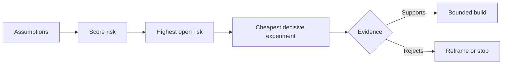

# Map Assumptions and Resolve the Riskiest One First · 映射假设，先解决风险最高的那个

> A roadmap hides uncertainty inside features. An assumption map exposes what must be true before those features deserve to exist.

**Type:** Learn + Build
**Languages:** Python (stdlib)
**Prerequisites:** Phase 14 lesson 48
**Time:** ~65 minutes

## Learning Objectives · 学习目标

- 把提议中的工作转化为显式假设（assumption）。
- 分别为影响（impact）、不确定性（uncertainty）与不可逆性（irreversibility）打分。
- 按风险而不是热情来选择下一个实验。
- 用证据和决策替换已被检验的假设。

> Convert proposed work into explicit assumptions.
> Score impact, uncertainty, and irreversibility separately.
> Choose the next experiment by risk, not enthusiasm.
> Replace tested assumptions with evidence and decisions.

## Every Build Contains Bets · 每次构建都包含押注

一个事故（incident）工具可能依赖下面所有条件同时为真：

- 告警上下文包含足够识别出一个服务的信息；
- 工程师会信任一个不是他们自己推导出来的推荐；
- 期望的响应时间在运营上确实重要；
- 所需数据可以在不获得不安全权限的情况下访问；
- 这个工作流发生得足够频繁，值得维护。

这些不是实现任务。它们是这个构建要有价值、可用、可行且安全所依赖的前提条件。

> An incident tool may depend on all of these being true: ... These are not implementation tasks. They are conditions for the build to be valuable, usable, feasible, and safe.

## Assumption Classes · 假设的分类

| 类别 | 问题 |
|---|---|
| 价值（Value） | 结果足够重要吗？ |
| 可用性（Usability） | 用户能理解它并据此行动吗？ |
| 可行性（Feasibility） | 系统能用现有的数据和约束把它做出来吗？ |
| 可存续性（Viability） | 组织能承受它的成本、归属与运营吗？ |
| 安全性（Safety） | 它失败时能否不带来不可接受的后果？ |

把假设写成可证伪（falsifiable）的陈述。「The feature is useful」无法被检验；「Eight of ten on-call engineers identify the correct service faster with the read-only result」就可以。

> Write assumptions as falsifiable statements. “The feature is useful” cannot be tested. “Eight of ten on-call engineers identify the correct service faster with the read-only result” can.

## Risk Is Not One Number · 风险不是一个数字

本课的实验使用三个维度，各取 1 到 5 分：

- **影响（Impact）**：假设为假时造成的损害。
- **不确定性（Uncertainty）**：当前证据的薄弱程度。
- **不可逆性（Irreversibility）**：投入之后再想学习的成本。

示例评分用影响乘以不确定性，再加上不可逆性。这个公式并不普适。它的目的是迫使团队说清楚：为什么某个未知数应该先于另一个被解决。



> The lab uses three dimensions from one to five: ... The example score multiplies impact and uncertainty, then adds irreversibility. The formula is not universal. Its purpose is to force the team to state why one unknown should be resolved before another.

## Design an Experiment, Not a Confirmation Ritual · 设计实验，而不是确认仪式

一个有用的检验（test）要有：

- 一个可能为假的论断；
- 一个总体（population）或真实的样本；
- 一个可观察的结果；
- 一个在看到结果之前就定好的阈值（threshold）；
- 针对通过、失败与含糊证据的下一步决策。

避免那种只能证明「团队把这个想法造了出来」的检验。

> A useful test has: ... Avoid tests that only demonstrate that the team can build the idea.

## Reversibility Changes Order · 可逆性改变顺序

后果严重且不可逆的选择需要更早拿到证据。一次只读回放（read-only replay）可以先于生产集成。一个临时适配器（adapter）可以先于数据迁移。一条由人批准的推荐可以先于自动动作。

构建的形状应当跟随不确定性的形状。

> High-consequence, irreversible choices need earlier evidence. A read-only replay can precede a production integration. A temporary adapter can precede a data migration. A human-approved recommendation can precede automatic action.
> The shape of the build should follow the shape of uncertainty.

## Build It · 动手造

实验对假设排序，区分已检验与仍未检验（open）的论断，选出最高的未解风险，并写出 `outputs/assumption-map.json`。

```bash
python3 code/main.py
python3 -m unittest discover code/tests -v
```

修改最高风险假设上的证据，观察下一个实验如何随之改变。

> The lab ranks assumptions, distinguishes tested from open claims, selects the highest open risk, and writes `outputs/assumption-map.json`.
> Change the evidence on the highest-risk assumption and observe how the next experiment changes.

## Exercises · 练习

1. 为你想构建的功能写出五条假设。
2. 补上你的功能清单遗漏的一条安全假设。
3. 定义一个会让你停止构建的阈值。
4. 用一个更便宜的决定性检验替换一次大型实验。
5. 把风险排序与路线图优先级做对比，并解释二者的错位。

## Further Reading · 延伸阅读

- [Barry Boehm, A Spiral Model of Software Development and Enhancement](https://dl.acm.org/doi/10.1145/12944.12948)，一个风险驱动的开发循环：在更深的投入之前先消除不确定性。
- [Dardenne, van Lamsweerde, and Fickas, Goal-Directed Requirements Acquisition](https://doi.org/10.1016/0167-6423(93)90021-G)，在精炼目标的同时暴露障碍与约束。

## What You Keep · 你保留的产物

保留 `outputs/assumption-map.json`。下一课会用它选出能产出决定性证据的最小切片（smallest slice）。

> Keep `outputs/assumption-map.json`. The next lesson uses it to choose the smallest slice that can produce decisive evidence.
