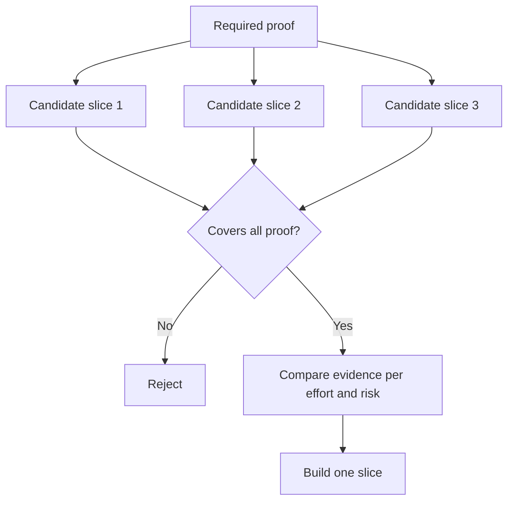

# Choose the Smallest Slice That Can Change the Decision · 选出能改变决策的最小切片

> Small is useful only when it proves something important. A tiny build that cannot change the next decision is merely incomplete.

**Type:** Learn + Build
**Languages:** Python (stdlib)
**Prerequisites:** Phase 14 lesson 49
**Time:** ~65 minutes

## Learning Objectives · 学习目标

- 用「它能证明哪些假设」来定义切片（slice）。
- 在结果价值、不确定性削减、工作量与后果之间取得平衡。
- 优先选择可逆的证据，而不是过早的生产承诺。
- 拒绝那些删掉了工作流中风险部分的切片。

> Define a slice by the assumptions it proves.
> Balance outcome value, uncertainty reduction, effort, and consequence.
> Prefer reversible evidence over premature production commitment.
> Reject slices that omit the risky part of the workflow.

## Vertical Means Evidence End to End · 「垂直」意味着端到端的证据

一个有用的切片要穿过观察一个结果所需的最小真实工作流。它可以在用户、数据、时长和能力上很窄，但不应该靠恰好删掉你要检验的那个不确定性来变窄。

例子：

- 对十起真实事故做只读回放，检验服务识别与操作员信任。
- 在合成数据上做一个精致的仪表盘，可能检验了可理解性，却没检验数据可行性。
- 生产环境的自动修复器（auto-remediator）一次性检验所有东西，后果却不可接受。

> A useful slice crosses the minimum real workflow needed to observe an outcome. It can be narrow in users, data, duration, and capability. It should not be narrow by removing the exact uncertainty you need to test.

## Define Required Proof First · 先定义必需的证明

取出风险最高的未解假设，把它们变成一个必需证明集（required proof set）。一个候选切片只有覆盖了这个集合才有资格入选。

然后在有资格的切片之间比较：

| 维度 | 方向 |
|---|---|
| 结果价值（Outcome value） | 越多越好 |
| 削减的不确定性 | 越多越好 |
| 工作量（Effort） | 越少越好 |
| 后果（Consequence） | 越少越好 |
| 可逆性（Reversibility） | 越多越好 |

实验用的打分刻意简单。资格门槛（eligibility gate）比算术更重要。



> Take the highest-risk open assumptions and turn them into a required proof set. A candidate slice is eligible only if it covers that set.
> The lab’s score is intentionally simple. The eligibility gate matters more than the arithmetic.

## Common False Minimums · 常见的假「最小」

- **只做 UI 的最小（UI-only minimum）**：删掉了数据和运营上的不确定性。
- **只做基础设施的最小（infrastructure-only minimum）**：证明了技术可行，却没有用户价值。
- **只走正常路径的最小（happy-path minimum）**：漏掉了制造大部分风险的例外情形。
- **演示用的最小（demo minimum）**：产出有说服力的展品，却没有可重复的测量。
- **平台式的最小（platform minimum）**：在哪怕一个工作流挣得它之前，就先造出可复用的机器。

> **The UI-only minimum:** removes the data and operational uncertainty. ... **The happy-path minimum:** omits the exception that creates most risk. ... **The platform minimum:** builds reusable machinery before one workflow earns it.

## Add a Stop Rule · 加一条停止规则

在实现之前，写下切片失败时会发生什么：

- 放弃这个结果；
- 更换目标用户或场景；
- 换一个机制去检验；
- 收集更好的证据；
- 进一步收窄权限。

如果每一种结果都通向「继续造」，那这个切片就不是实验。

> Before implementation, write what happens if the slice fails: ... If every result leads to “keep building,” the slice is not an experiment.

## Build It · 动手造

实验按必需证明过滤候选，给有资格的切片打分，并写出 `outputs/slice-decision.json`。

```bash
python3 code/main.py
python3 -m unittest discover code/tests -v
```

增加一个只证明一条必需假设的更便宜的候选。即使它的数值分数很高，它也应保持不合格。

> The lab filters candidates by required proof, scores eligible slices, and writes `outputs/slice-decision.json`.
> Add a cheaper candidate that proves only one required assumption. It should remain ineligible even if its numerical score is high.

## Exercises · 练习

1. 为同一个结果设计三个后果等级不同的切片。
2. 在给它们打分之前，先陈述必需证明集。
3. 在保住决定性证据的前提下去掉一项能力。
4. 为一次失败的试点（pilot）写一条停止规则。
5. 找出一个可复用的平台组件，它应该等到切片之后再做。

## Further Reading · 延伸阅读

- [Barry Boehm, A Spiral Model of Software Development and Enhancement](https://dl.acm.org/doi/10.1145/12944.12948)，让每个开发周期匹配它必须解决的风险。
- [Lenarduzzi and Taibi, MVP Explained: A Systematic Mapping Study on the Definitions of Minimal Viable Product](https://arxiv.org/abs/1609.07592)，关于软件产品实践中围绕 “minimum” 与 “viable” 的含糊之处。

## What You Keep · 你保留的产物

保留 `outputs/slice-decision.json`。它记录了为什么这个切片就是能改变决策的最小的一个。

> Keep `outputs/slice-decision.json`. It records why this slice is the smallest one that can change the decision.
