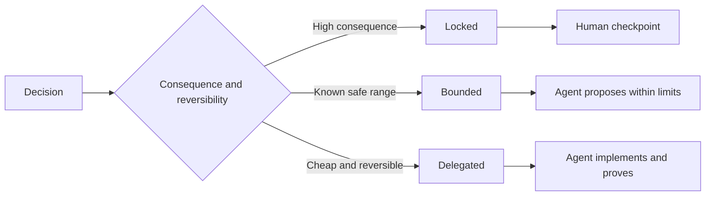

# Write Specifications That Preserve Judgment · 写出保留判断力的规格说明

> A useful specification fixes invariants and evidence while leaving reversible implementation choices open. It is a decision boundary, not a screenplay.

**Type:** Learn + Build
**Languages:** Python (stdlib)
**Prerequisites:** Phase 14 lesson 50
**Time:** ~75 minutes

## Learning Objectives · 学习目标

- 区分结果（outcome）、不变量（invariants）、示例（examples）、非目标（non-goals）与证明（proof）。
- 把决策标记为锁定（locked）、有界（bounded）或下放（delegated）。
- 在选择便宜且可逆的地方，保留 agent 的判断空间。
- 在后果或公开行为改变的地方，要求人工检查点（human checkpoint）。

> Separate outcome, invariants, examples, non-goals, and proof.
> Mark decisions as locked, bounded, or delegated.
> Preserve agent judgment where choices are cheap and reversible.
> Require human checkpoints where consequence or public behavior changes.

## Two Bad Extremes · 两个坏极端

规格不足（underspecified）的任务让 agent 去猜整个系统。规格过度（overspecified）的任务让 agent 去誊写一份可能已经错了的设计。

有用的中间地带是一份可执行契约（executable contract）：

| 面（Surface） | 用途 |
|---|---|
| 结果（Outcome） | 可观察的结果 |
| 不变量（Invariants） | 必须始终为真的条件 |
| 示例（Examples） | 能揭示意图的具体案例 |
| 非目标（Non-goals） | 被有意排除的相邻行为 |
| 决策策略（Decision policy） | 哪些选择被锁定、受限或下放 |
| 证明（Proof） | 完成之前必须交付的证据 |

> An underspecified task asks an agent to guess the system. An overspecified task asks it to transcribe a design that may already be wrong.
> The useful middle is an executable contract: ...

## Three Decision Modes · 三种决策模式

- **锁定（Locked）**：agent 不得自行选择。用于公开兼容性、权限、安全、不可逆成本或产品承诺。
- **有界（Bounded）**：agent 可以在显式限制内选择。用于搜索预算、重试次数、允许的依赖，或一个已知的接口家族。
- **下放（Delegated）**：agent 拥有这个选择，并且必须解释它。用于局部结构、命名、可逆重构和实现细节。



> **Locked:** the agent must not choose. ... **Bounded:** the agent may choose inside explicit limits. ... **Delegated:** the agent owns the choice and must explain it.

## Specify Behavior Through Examples · 用示例规定行为

示例比形容词更能压缩意图。「Helpful」「robust」「production-ready」都不可执行。一小组正常、边界、失败与禁止示例，让构建者和验证者都拿到具体的东西。

示例不能替代不变量。一个通过的用例证明不了普遍的安全规则。

> Examples compress intent better than adjectives. “Helpful,” “robust,” and “production-ready” are not executable. A small set of normal, edge, failure, and forbidden examples gives both the builder and verifier something concrete.
> Examples do not replace invariants. One passing case cannot prove a universal safety rule.

## Proof Must Match the Claim · 证明必须匹配论断

- 单元测试证明局部函数契约。
- 线上协议测试（wire test）证明序列化与传输行为。
- 浏览器旅程（browser journey）证明一条界面路径。
- 回放集（replay set）证明代表性案例上的行为。
- 审计日志（audit log）证明权限边界守住了。

不要把更低层的证明当作更高层论断的证据。

> A unit test proves a local function contract. ... An audit log proves that authority boundaries held.
> Do not accept a lower layer as proof of a higher-layer claim.

## Preserve Unknowns Deliberately · 刻意保留未知

规格说明可以写「实现可以选择任何能在时间预算内返回结果的只读数据源」。这不是含糊。它是一个有边界、有证明的、被有意下放的决策。

当证据变化时，规格说明应当演进。保住锁定与有界选择背后的理由，让后来的团队无需考古就能修订它们。

> A specification can say “the implementation may choose any read-only source that returns within the time budget.” That is not vagueness. It is an intentional delegated decision with a boundary and proof.
> Specifications should evolve when evidence changes. Preserve the reason behind locked and bounded choices so later teams can revise them without archaeology.

## Build It · 动手造

实验校验每一个契约面，检查决策模式，并写出 `outputs/executable-specification.json`。

```bash
python3 code/main.py
python3 -m unittest discover code/tests -v
```

把生产写操作的决策从锁定改为下放。解释为什么 schema 接受这个值，而产品风险不接受。

> The lab validates every contract surface, checks decision modes, and writes `outputs/executable-specification.json`.
> Move the production-write decision from locked to delegated. Explain why the schema accepts the value but the product risk does not.

## Exercises · 练习

1. 把一张待办工单转换成六个规格说明面。
2. 用一条不变量和两个示例替换三条实现指令。
3. 标记每一个决策，并为每个锁定或有界的选择给出理由。
4. 为每条不变量添加一个证明回执（proof receipt）。
5. 移除一条既无证据也无风险理由的约束。

## Further Reading · 延伸阅读

- [Nuseibeh and Easterbrook, Requirements Engineering: A Roadmap](https://www.cs.toronto.edu/~sme/papers/2000/ICSE2000.pdf)，关于目标、精确规格、验证、一致与演进之间的关系。
- [Zave and Jackson, Four Dark Corners of Requirements Engineering](https://doi.org/10.1145/237432.237434)，关于把环境假设、需求与规格说明分开。
- [Gotel and Finkelstein, An Analysis of the Requirements Traceability Problem](https://doi.org/10.1109/ICRE.1994.292398)，关于保住「一条需求为何存在、从何而来」。

## What You Keep · 你保留的产物

保留 `outputs/executable-specification.json`。它会成为编码 agent 与人类评审者共享的那份契约。

> Keep `outputs/executable-specification.json`. It becomes the contract that coding agents and human reviewers share.
