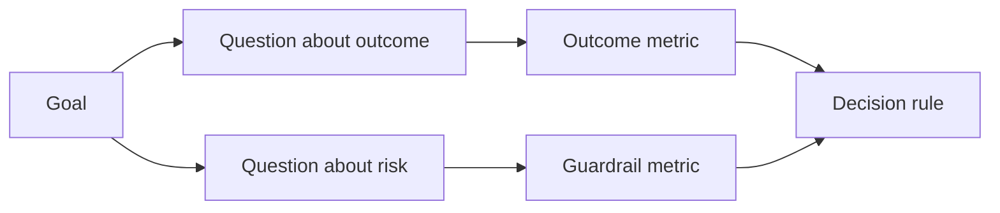

# Design Success Metrics Before the Result Exists · 在结果存在之前设计成功指标

> Measurement should answer a decision, not decorate a dashboard. Start with the goal, derive questions, then choose the smallest metrics that answer them.

**Type:** Learn + Build
**Languages:** Python (stdlib)
**Prerequisites:** Phase 14 lessons 47 and 51
**Time:** ~70 minutes

## Learning Objectives · 学习目标

- 从一个结果目标推导出问题与指标。
- 在观察结果之前，定义阈值、窗口、来源与方向。
- 让结果指标与护栏（guardrail）和反向指标（counter-metric）成对出现。
- 让评估证据匹配这个构建必须支撑的决策。

> Derive questions and metrics from an outcome goal.
> Define thresholds, windows, sources, and directions before observing results.
> Pair outcome metrics with guardrails and counter-metrics.
> Match evaluation evidence to the decision the build must support.

## Goal, Question, Metric · 目标、问题、指标

从一个目标开始：

> 缩短识别受影响服务的时间，同时不增加不安全操作。

推导出问题：

- 多快能识别出正确的服务？
- 识别出的服务有多频繁是正确的？
- 诊断是否保持只读？
- 这个工作流是否增加了告警误关（alert dismissal）或操作员负担？

然后选择能把这些问题描述变成可操作测量的指标。



> Start with a goal: “Reduce time to identify the affected service without increasing unsafe actions.” ... Then choose metrics that operationalize those questions.

## A Metric Needs a Contract · 每个指标都需要一份契约

每个指标都需要：

| 字段 | 示例 |
|---|---|
| 名称 | `median_identification_seconds` |
| 方向 | at most（不超过） |
| 阈值 | 120 |
| 窗口 | 十次事故回放 |
| 来源 | 回放事件日志 |
| 总体 | 参与试点的值班工程师 |
| 类型 | 结果（outcome）或护栏（guardrail） |

没有来源和窗口，一个数字无法复现。没有阈值，一个数字无法驱动决策。

> Every metric needs: ... Without source and window, a number cannot be reproduced. Without a threshold, it cannot drive a decision.

## Outcome, Guardrail, and Counter-Metric · 结果指标、护栏与反向指标

- **结果指标（Outcome metric）**：期望的状态改善了吗？
- **护栏（Guardrail）**：固定的约束仍然成立吗？
- **反向指标（Counter-metric）**：局部的改善是否把成本或伤害转移到了别处？

对一个事故工作流来说，光快不够。正确率、生产写操作、操作员负担和漏掉的告警，共同防止「快但不安全」的结果。

> **Outcome metric:** did the desired state improve? **Guardrail:** did a fixed constraint remain true? **Counter-metric:** did the local improvement shift cost or harm elsewhere?
> For an incident workflow, speed is not enough. Correctness, production writes, operator workload, and missed alerts protect against a fast but unsafe result.

## Offline and Online Evidence · 离线与在线证据

离线回放有利于可重复性和边界覆盖。有界试点（bounded pilot）有利于真实行为、信任和工作流效应。两者不能互相替代。

使用能回答当前决策的最便宜证据。不要仅仅因为实现就绪，就把真实用户暴露出来。

> Offline replay is useful for repeatability and edge coverage. A bounded pilot is useful for real behavior, trust, and workflow effects. Neither substitutes for the other.
> Use the cheapest evidence that can answer the current decision. Do not expose real users merely because the implementation is ready.

## Decide Before You Measure · 在测量之前先定好决策

在看到结果之前，先写好通过、失败与含糊三条路径。否则团队会为了保护这个构建而挪动阈值。

例子：

- 通过：正确服务率至少 0.9，且中位时间不超过 120 秒；
- 失败：出现任何生产写操作，或正确率低于 0.75；
- 含糊：小幅改进但方差很大，需要更大的回放集。

> Write the pass, fail, and ambiguous paths before seeing results. Otherwise the team will move the threshold to protect the build.

## Build It · 动手造

实验校验测量计划，按包容阈值（inclusive thresholds）评估，记录缺失值，并写出 `outputs/measurement-report.json`。

```bash
python3 code/main.py
python3 -m unittest discover code/tests -v
```

删掉护栏指标，观察为什么即使结果指标都还在，这个计划也变得无效。

> The lab validates a measurement plan, evaluates inclusive thresholds, records missing values, and writes `outputs/measurement-report.json`.
> Remove the guardrail metric and observe why the plan becomes invalid even when the outcome metrics remain.

## Exercises · 练习

1. 从一个结果目标推导出三个问题。
2. 加一个反向指标，用来捕捉被转移到另一个角色的成本。
3. 为每个指标定义来源、总体与窗口。
4. 在生成数值之前，写好通过、失败与含糊的决策。
5. 找出一个容易采集、却无法改变决策的指标。把它删掉。

## Further Reading · 延伸阅读

- [Basili, Software Modeling and Measurement: The Goal/Question/Metric Paradigm](https://drum.lib.umd.edu/items/8119803a-362b-42ec-b6ce-2311713e7236)，从显式目标推导出可操作的测量。
- [Basili, Caldiera, and Rombach, The Goal Question Metric Approach](https://www.cs.toronto.edu/~sme/CSC444F/handouts/GQM-paper.pdf)，把这个方法当作一个反馈与改进系统来应用。

## What You Keep · 你保留的产物

保留 `outputs/measurement-report.json`。它为原型、试点或生产阶段定义证据门槛（evidence gate）。

> Keep `outputs/measurement-report.json`. It defines the evidence gate for the prototype, pilot, or production stage.
