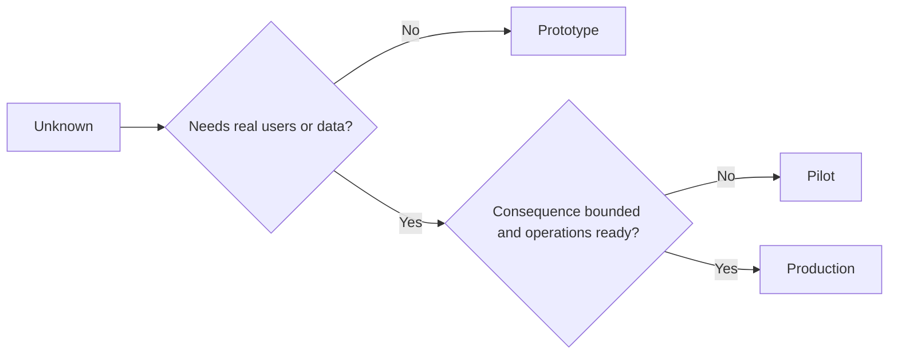

# Choose Prototype, Pilot, or Production Deliberately · 有意识地选择原型、试点还是生产

> These are different learning environments, not levels of polish. Choose the stage that answers the current unknown with the least unnecessary consequence.

**Type:** Learn + Build
**Languages:** Python (stdlib)
**Prerequisites:** Phase 14 lessons 50 to 52
**Time:** ~70 minutes

## Learning Objectives · 学习目标

- 从未知、受众、数据、后果与就绪度出发选择构建阶段。
- 定义各阶段专属的控制措施与退出标准（exit criteria）。
- 防止原型悄悄变成生产系统。
- 在证据与运营证明合理之前，推迟授予真实权限。

> Choose a build stage from the unknown, audience, data, consequence, and readiness.
> Define stage-specific controls and exit criteria.
> Prevent prototypes from quietly becoming production systems.
> Delay real authority until evidence and operations justify it.

## Three Different Questions · 三个不同的问题

| 阶段 | 首要问题 |
|---|---|
| 原型（Prototype） | 这个机制到底能不能产出证据？ |
| 试点（Pilot） | 在有界的真实受众和真实条件下，它能安全工作吗？ |
| 生产（Production） | 在承诺的可靠性与风险水平上，我们能持续拥有它吗？ |

原型可以在技术上完整，同时仍然是用完即弃的。试点可以使用生产数据，同时保持受众与权限受限。当组织接受持续责任时，生产才开始。

> A prototype can be technically complete and still be disposable. A pilot can use production data while remaining limited in audience and authority. Production begins when the organization accepts ongoing responsibility.

## Prototype · 原型

当未知不需要真实用户或真实数据时，使用原型。保持它：

- 可丢弃（discardable）；
- 隔离（isolated）；
- 行为面窄；
- 对学习问题显式；
- 不带虚假的运营保证。

在机制挣得下一个阶段之前，不要优化架构。

> Use a prototype when the unknown does not require real users or real data. Keep it: discardable; isolated; narrow in behavior; explicit about the learning question; free of false operational guarantees.
> Do not optimize architecture before the mechanism earns another stage.

## Pilot · 试点

当未知需要真实行为、真实数据或真实工作流，但后果或就绪度还不兼容大范围发布时，使用试点。

一个试点需要：

- 一个有名有姓的受众；
- 一位人类负责人（owner）；
- 有界的时长与权限；
- 审计与回滚；
- 结果与护栏阈值；
- 针对「扩大、修订或停止」的退出标准。

> Use a pilot when the unknown requires real behavior, realistic data, or a real workflow, but consequence or readiness is not yet compatible with broad release.
> A pilot needs: a named audience; a human owner; bounded duration and authority; audit and rollback; outcome and guardrail thresholds; exit criteria for expand, revise, or stop.

## Production · 生产

生产需要的比部署更多：

- 服务级别目标（service level objective）；
- 值班与事故归属；
- 安全与隐私评审；
- 成本与容量控制；
- 回滚与恢复；
- 持续监控；
- 一条退役路径（retirement path）。



> Production needs more than deployment: a service level objective; on-call and incident ownership; security and privacy review; cost and capacity controls; rollback and recovery; continuous monitoring; a retirement path.

## Stage Drift · 阶段漂移（stage drift）

当代码获得了用户、数据或权限、却没有获得归属（ownership）时，原型代码就变得危险。在配置、访问控制、遥测（telemetry）和文档里标记原型与试点的边界。一条警告横幅是不够的。

阶段应当可以从系统本身观察出来。

> Prototype code becomes dangerous when it acquires users, data, or authority without acquiring ownership. Mark prototype and pilot boundaries in configuration, access control, telemetry, and documentation. A warning banner is not enough.
> The stage should be observable from the system itself.

## Build It · 动手造

实验从决策上下文选择阶段，返回所需的控制措施，并写出 `outputs/stage-decisions.json`。

```bash
python3 code/main.py
python3 -m unittest discover code/tests -v
```

把试点例子改成低后果且运营就绪。解释还需要哪些额外证据才足以支持进入生产。

> The lab chooses a stage from the decision context, returns required controls, and writes `outputs/stage-decisions.json`.
> Change the pilot example to low consequence with operational readiness. Explain what additional evidence would justify production.

## Exercises · 练习

1. 按学习阶段而不是部署状态，给当前的三个项目分类。
2. 写出包含「停止」决策的试点退出标准。
3. 加一个技术控制，防止原型接触到生产数据。
4. 找出第一个让这个构建成为生产的运营责任。
5. 为有界试点设计一份回滚回执（rollback receipt）。

## Further Reading · 延伸阅读

- [Barry Boehm, A Spiral Model of Software Development and Enhancement](https://dl.acm.org/doi/10.1145/12944.12948)，让每一轮迭代的投入与它已经解决的风险相匹配。
- [Fagerholm et al., Building Blocks for Continuous Experimentation](https://doi.org/10.1145/2601248.2601276)，持续运行实验所需的组织与技术条件。

## What You Keep · 你保留的产物

保留 `outputs/stage-decisions.json`。它记录了每个阶段为何成立，以及进入下一个阶段之前必须存在哪些控制。

> Keep `outputs/stage-decisions.json`. It records why each stage is justified and which controls must exist before the next one.
