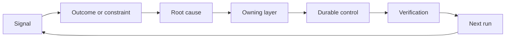

# Build a Feedback Ratchet with Ownership and Retirement · 构建带归属与退役机制的反馈棘轮（feedback ratchet）

> Shipping closes one build loop and opens the learning loop. Evidence must change the system or it becomes telemetry nobody owns.

**Type:** Learn + Build
**Languages:** Python (stdlib)
**Prerequisites:** Phase 14 lessons 46 and 53
**Time:** ~75 minutes

## Learning Objectives · 学习目标

- 把事故、评估、用户行为和纠正转化为有归属（owned）的行动。
- 把每个信号路由到上下文、评估、策略、运行时或待办。
- 按严重程度与频率为复现排定优先级。
- 给每个控制一个退役条件（retirement condition）。
- 用证据、权衡和一位可问责的负责人来传达交付决策。

> Turn incidents, evaluations, user behavior, and corrections into owned actions.
> Route each signal to context, evaluation, policy, runtime, or backlog.
> Prioritize recurrence by severity and frequency.
> Give every control a retirement condition.
> Communicate a delivery decision with evidence, tradeoffs, and an accountable owner.

## Feedback Is Infrastructure · 反馈是基础设施

一个团队可以收集 trace、评估、支持工单和事故日志，却不从其中任何一个学到东西。缺失的机制是晋级（promotion）：一条从观察到持久变更的既定路径，带归属、带证明。

这个循环是：

1. 观察到一个具体信号；
2. 把它连接到一个结果、约束或假设；
3. 找到拥有这个原因的最早系统层；
4. 创建一个有界变更；
5. 验证复现的可能性确实变小了；
6. 复查这个控制是否应当保留。

> A team can collect traces, evaluations, support tickets, and incident logs without learning from any of them. The missing mechanism is promotion: a defined path from observation to a durable change with an owner and proof.

## Route to the Owning Layer · 路由到归属层

| 信号 | 去处 |
|---|---|
| 误报、回归、错误结果 | 评估或测试 |
| 缺失上下文、重复劳动、过时事实 | 上下文来源或检索路径 |
| 不安全动作或权限缺口 | 策略或权限边界 |
| 超时、重试风暴、依赖不可用 | 运行时控制 |
| 新产品需求或未解决的权衡 | 已塑形的待办项（shaped backlog item） |

在最早有效的层修掉原因。当一个测试或权限就能让失败不可能发生时，不要再往 prompt 里加一段话。



> Fix the cause at the earliest effective layer. Do not add another prompt paragraph when a test or permission can make the failure impossible.

## Ownership Is Part of the Control · 归属是控制的一部分

每个棘轮行动需要：

- 一位归属人（owner）；
- 一个基于后果与复现的优先级；
- 要修改的产物（artifact）；
- 证明这个变更的验证；
- 一个复查或过期窗口；
- 一个退役条件。

没有归属的改进，只是一条排版更好看的观察记录。

> Every ratchet action needs: one owner; a priority based on consequence and recurrence; the artifact to change; the verification that proves the change; a review or expiry window; a retirement condition.
> An unowned improvement is an observation with better formatting.

## Retire Stale Controls · 退役过时的控制

反馈系统会积累策略。这些策略可能变得自相矛盾且昂贵。在以下时刻复查控制：

- 架构或工作流发生变化；
- 一个更低层的不变量取代了更高层的指令；
- 受保护的失败在选定的窗口内没有再出现；
- 这个控制阻碍正当工作的频率超过了它阻止伤害的频率。

退役同样需要证据。不要因为一个控制「感觉旧了」就删掉它。

> Feedback systems accumulate policy. That policy can become contradictory and expensive. ... Retirement also needs evidence. Do not delete a control because it feels old.

## Connect Build and Coding-Agent Feedback · 连接构建与编码 agent 的反馈

同一个棘轮同时服务两条线：

- 产品证据改变结果框架（outcome frame）、假设、切片或测量计划。
- 编码 agent 的纠正改变测试、上下文、范围、自动化或交接。
- 事故可以同时改变产品边界和 agent 工作台（workbench）。

这就是为什么塑形构建不是一个在编码之前就结束的阶段。它贯穿每一次被接受的变更。

> The same ratchet serves both tracks: ... This is why shaping the build is not a phase that ends before coding. It continues through every accepted change.

## Build It · 动手造

实验对信号分类，创建有归属的棘轮行动，为它们排定优先级，并写出 `outputs/feedback-backlog.json`。

```bash
python3 code/main.py
python3 -m unittest discover code/tests -v
```

增加一个运行时超时信号，确认它被路由到运行时，而不是普通待办。

> The lab classifies signals, creates owned ratchet actions, prioritizes them, and writes `outputs/feedback-backlog.json`.
> Add a runtime timeout signal and confirm that it routes to the runtime rather than the general backlog.

## Practice Lab: Own a Decision After a Setback · 实践实验：在挫折之后为决策负责

从你职业路线（career route）的作品集项目中选一个工作流。带它走完一次决策、一个小实验和一次复查。把证据保存在 [career delivery template](https://github.com/rohitg00/ai-engineering-from-scratch/blob/main/phases/14-agent-engineering/54-build-the-feedback-ratchet/outputs/career-delivery-evidence.md) 中。

Python 实验生成示例待办行动。它不观察用户、不测量干预，也不证明职业就绪。跑完它只是这个练习的准备。

> Choose one workflow from your career route's portfolio project. Carry it through one decision, a small experiment, and a review. Keep the evidence in the career delivery template.
> The Python lab generates example backlog actions. It does not observe users, measure an intervention, or prove career readiness. Completing its run is preparation for this exercise.

### 1. Establish What Happened · 搞清楚发生了什么

记录用户、任务、当前工作流，以及你想改进的结果。附上一份经同意的观察、一份脱敏的支持记录，或一份可复现的任务 trace。把你观察到的、别人转述的、和你推断出来的分开。

找到一个挫折（setback）：一个失败的假设、一个不可用的结果、一笔意外的成本，或一次被延误的交接。说明是哪份证据改变了你的理解。挫折需要的是一个回应和一个决策，而不是围绕它写出来的成功故事。

如果你无法接触真实用户，就与一位同伴或按一个明确声明的场景运行一次清晰标注的模拟。把模拟观察与真实用户证据分开。不要编造访谈、批准、采用或业务影响。

> Record the user, task, current workflow, and the outcome you wanted to improve. Separate what you observed from what someone reported and what you inferred.
> Find a setback: a failed assumption, an unusable result, an unexpected cost, or a delayed handoff. A setback needs a response and a decision, not a success story written around it.
> Do not invent interviews, approvals, adoption, or business impact.

### 2. Make Progress Within Your Authority · 在你的权限内取得进展

列出未知项，选择能解决其中最重大未知的最便宜的可逆行动。说明哪些你能自行决定、哪些被现有协议限定、哪些需要在执行前获得授权。

例如，你可以在等待使用客户数据的许可时，先准备一份脱敏的离线回放。主动性意味着推进已获授权的工作，并让被阻塞的决策清晰可见。它不扩大你的访问权或审批权。

> List the unknowns and choose the cheapest reversible action that could resolve the most consequential one. State what you can decide, what is bounded by an existing agreement, and what needs authorization before execution.
> Taking initiative means moving authorized work forward and making the blocked decision clear. It does not expand your access or approval rights.

### 3. Compare Options and Brief the Decision Owner · 比较选项并向决策负责人简报

为不需要实现细节的人写一份简短的决策简报。包括：

- 用户问题，以及改变了计划的证据；
- 至少两个选项，在可信时包括一个更便宜的人工或「不构建」选项；
- 质量、交互设计、工作量、运营成本与风险的权衡；
- 你的推荐、剩余不确定性，以及需要的决策；
- 决策负责人、受影响的利益相关者，以及需要决策的日期。

请一位同伴扮演受影响的利益相关者，质疑其中一个权衡。记录这条反对意见，以及它如何改变（或没能改变）你的推荐。把角色扮演反馈标注为模拟；它不能替代真实利益相关者的同意。

> Write a short decision brief for someone who does not need the implementation detail. Include: the user problem and the evidence that changed the plan; ... quality, interaction design, effort, operating cost, and risk tradeoffs; your recommendation, remaining uncertainty, and the decision needed; the decision owner, affected stakeholders, and the date the decision is needed.
> Label role-play feedback as simulated; it cannot stand in for an actual stakeholder's agreement.

### 4. Run a Bounded Experiment · 跑一个有界实验

根据你要回答的问题，选择原型、试点或生产工作。在收集结果之前，定义受众、数据、权限、时长、回滚，以及继续、调整或停止的条件。

从用户的起点出发，把交互完整走查一遍直到任务完成。包含一个错误输出或缺数据的用例。观察用户能否在没有你暗中帮助的情况下注意到失败、纠正它并恢复。

把人工评审与纠正时间计入工作流。一个更快的模型响应，仍可能让完整任务更慢或更难信任。

> Choose prototype, pilot, or production work based on the question you need to answer. Define the audience, data, authority, duration, rollback, and conditions for continue, change, or stop before collecting the result.
> Count human review and correction time as part of the workflow. A faster model response can still make the complete task slower or harder to trust.

### 5. Compare Outcomes and Economics · 比较结果与经济学

用相同的指标定义、任务总体、采集方法和可比较的观察窗口，记录基线与后续。把样本数、排除项和证据链接放在数字旁边。如果这些条件变了，解释为什么这次比较是受限的。

包括一个用户结果、一个质量或安全护栏，以及总人工评审工作量。即使没达标也要记录结果。小样本或模拟样本只支持有界的学习结论，不支持「已证明的业务影响」这类论断。

用模型调用、重试、配套服务和人工评审来估算每个成功完成任务的成本。说明劳动费率假设，并把实测用量与估算分开。把这个成本与人工替代方案或项目背后的价值假设做比较。

用现有的 [FinOps for LLMs lesson](https://aiengineeringfromscratch.com/lesson?path=phases/17-infrastructure-and-production/27-finops-llms) 深入归因与单位经济学。换模型只是可能的应对之一；收窄工作流或保留一个人工步骤，可能是更好的产品决策。

> Record a baseline and a follow-up using the same metric definition, task population, collection method, and comparable observation windows. Keep sample counts, exclusions, and evidence links next to the numbers.
> Small or simulated samples support a bounded learning claim, not a claim of proven business impact.
> Estimate cost per successfully completed task using model calls, retries, supporting services, and human review.

### 6. Close the Loop · 闭合循环

用预先声明的标准推荐继续、调整或停止。如果证据不明确，指出缺失的观察和下一个有界检验。记录可问责决策负责人的回应；如果还没有决策，就保持待定。

为交付流程本身选一个改进：更清晰的任务框架、更早的用户走查、更好的评审清单、更小的 agent 交接，或更紧的评估用例。指派一位归属人和一个复查日期。

到了复查时，决定保留、修订还是退役这个改进。记录做出该选择的证据。一个制造了更多工作、却没有阻止目标失败的新清单，没有赢得永久存在的资格。

> Use the predeclared criteria to recommend continue, change, or stop. If the evidence is inconclusive, name the missing observation and the next bounded test.
> At review, decide whether to keep, revise, or retire that improvement. Record the evidence for the choice. A new checklist that creates more work without preventing the target failure has not earned permanence.

## Shipped Artifact · 交付产物

把 [career-delivery-evidence.md](https://github.com/rohitg00/ai-engineering-from-scratch/blob/main/phases/14-agent-engineering/54-build-the-feedback-ratchet/outputs/career-delivery-evidence.md) 复制到你自己的项目里，用证据链接把它填写完整。保持 checked-in 模板可复用。在你的职业作品集产物中包含决策简报、交互走查、测量比较和有归属的后续行动。

> Copy career-delivery-evidence.md into your own project and complete it with evidence links. Keep the checked-in template reusable. Include the decision brief, interaction walkthrough, measurement comparison, and owned follow-up with your career portfolio artifact.

## Verify It · 自查验证

与一位同伴一起使用这份人工验收评分表。把每一行标记为 **达标**、**需改进** 或 **未观察到**，并给出证据链接或一个具体的缺失观察。字段填上了，不代表判断就是对的。

| 检查项 | 满足它的证据 |
|---|---|
| 工作流有据可依 | 一条可追溯的观察支撑问题；转述的论断、推断和模拟都被标注出来。 |
| 权限受到尊重 | 可逆的下一步工作清晰；任何受限动作都等待它真正的决策负责人。 |
| 权衡已被传达 | 记录了可信的替代方案、一次利益相关者的反对、一个推荐，以及一个明确的决策请求。 |
| 交互已被测试 | 走查覆盖成功、失败、恢复和人工评审工作量。 |
| 结果已被比较 | 基线与后续的定义对齐；样本、护栏、成本和比较局限可见。 |
| 挫折已被承担 | 证据改变了一次继续/调整/停止决策和一个可问责的下一步行动。 |
| 流程已被改进 | 一个工作流改进拥有归属人、复查日期，以及基于证据的保留/修订/退役决策。 |

未被观察到的真实用户行为仍然是一个缺口，即使每个模拟步骤都通过了。在作品集结论中保留这条边界，并指出弥补它所需的下一次观察。

> Use this manual acceptance rubric with a peer. Mark each row **met**, **needs work**, or **not observed**, and give an evidence link or a specific missing observation. A filled field is not proof that the judgment was sound.
> Unobserved real-user behavior remains a gap even when every simulated step passes. Preserve that boundary in the portfolio claim and identify the next observation needed to close it.

## Exercises · 练习

1. 把一次事故和一条用户投诉转化为棘轮行动。
2. 说出能防止每次复现的最早层。
3. 给实验输出加上验证命令或观察。
4. 为一条策略规则定义退役条件。
5. 把一条被接受的纠正追溯回下一个任务框架。

## Further Reading · 延伸阅读

- [Basili, Caldiera, and Rombach, The Goal Question Metric Approach](https://www.cs.toronto.edu/~sme/CSC444F/handouts/GQM-paper.pdf)，通过面向目标的度量实现组织学习。
- [Fagerholm et al., Building Blocks for Continuous Experimentation](https://doi.org/10.1145/2601248.2601276)，把证据与持续产品开发连接起来的技术与组织闭环。
- [Nuseibeh and Easterbrook, Requirements Engineering: A Roadmap](https://www.cs.toronto.edu/~sme/papers/2000/ICSE2000.pdf)，把需求看作随系统生命周期演化的东西。

## What You Keep · 你保留的产物

保留 `outputs/feedback-backlog.json` 作为路由示例，并把你完成的职业交付证据作为你自己决策的记录。它们共同闭合 Product Judgment and Delivery 路线，并为下一个结果框架提供输入。

> Keep `outputs/feedback-backlog.json` as the routing example and your completed career delivery evidence as the record of your own decisions. Together they close the Product Judgment and Delivery path and inform the next outcome frame.
