# Communication Protocols · 通信协议

> 说不上同一种语言的智能体成不了团队，只是一群朝虚空喊话的陌生人。
> Agents that can't speak the same language aren't a team. They're strangers shouting into the void.

**Type:** Build
**Languages:** TypeScript
**Prerequisites:** Phase 14 (Agent Engineering), Lesson 16.01 (Why Multi-Agent)
**Time:** ~120 minutes

## Learning Objectives · 学习目标

- 实现 MCP 的工具发现与调用（tool discovery and invocation），让智能体能够使用外部服务器暴露的工具
- 构建 A2A 的 agent card 与任务端点（task endpoint），让一个智能体可以通过 HTTP 把工作委派（delegate）给另一个智能体
- 对比 MCP（工具访问）、A2A（智能体对智能体）、ACP（企业审计）与 ANP（去中心化信任），并解释哪种协议解决哪类问题
- 在一个系统中把多种协议接线到一起：智能体通过 MCP 发现工具、通过 A2A 委派任务

> Implement MCP tool discovery and invocation so agents can use tools exposed by external servers
> Build an A2A agent card and task endpoint that allows one agent to delegate work to another over HTTP
> Compare MCP (tool access), A2A (agent-to-agent), ACP (enterprise audit), and ANP (decentralized trust) and explain which protocol solves which problem
> Wire multiple protocols together in a single system where agents discover tools via MCP and delegate tasks via A2A

## The Problem · 问题在哪

你把系统拆成了多个智能体（agent）：一个研究员、一个程序员、一个审稿人。它们各自的单点工作都很出色。但现在你需要它们真正地互相交谈。

你的第一版做法显而易见：传字符串。研究员返回一大坨文本，程序员各显神通地去解析。它能用——直到程序员误解了一份研究摘要，或者两个智能体互相等待对方而死锁（deadlock），或者你需要不同团队构建的智能体协同工作。突然之间，「传字符串就行」全面崩塌。

这就是通信协议（communication protocol）问题。没有一份关于智能体如何交换信息的共享契约（shared contract），多智能体系统就是脆弱的、无法审计的，而且只要超出你亲手写的那几个智能体的范围就根本无法扩展。

AI 生态用四种协议回应了这个问题，每一种解决其中一个切面：

- **MCP** 负责工具访问
- **A2A** 负责智能体间协作
- **ACP** 负责企业级可审计性
- **ANP** 负责去中心化身份与信任

本课内容很深。你会读到每种规范里真实的线上格式（wire formats），构建能运行的实现，并把四种协议接成一个统一系统。

> You split your system into multiple agents. A researcher, a coder, a reviewer. They're great at their individual jobs. But now you need them to actually talk to each other.
> Your first attempt is obvious: pass strings around. ... Suddenly "just pass strings" falls apart.
> This is the communication protocol problem. Without a shared contract for how agents exchange information, multi-agent systems are fragile, unauditable, and impossible to scale beyond a handful of agents you personally wrote.
> This lesson goes deep. You will read real wire formats from each spec, build working implementations, and connect all four into a unified system.

## The Concept · 概念

### The Protocol Landscape · 协议全景

把这四种协议想成不同的层次，每一层回答一个不同的问题：

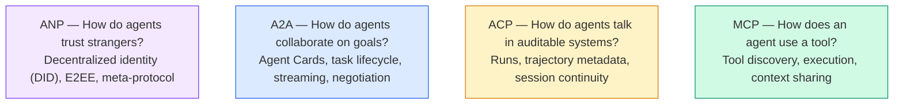

它们不是竞争者。它们在不同层面解决不同的问题。

> Think of these four protocols as layers, each addressing a different question:
> They're not competitors. They solve different problems at different levels.

### MCP (Recap) · MCP（回顾）

MCP 在 Phase 13 已经深入讲过。快速回顾：MCP 标准化了 LLM 连接外部工具与数据源的方式。它是一个**客户端-服务器（client-server）**协议：智能体（客户端）发现并调用服务器暴露的工具。

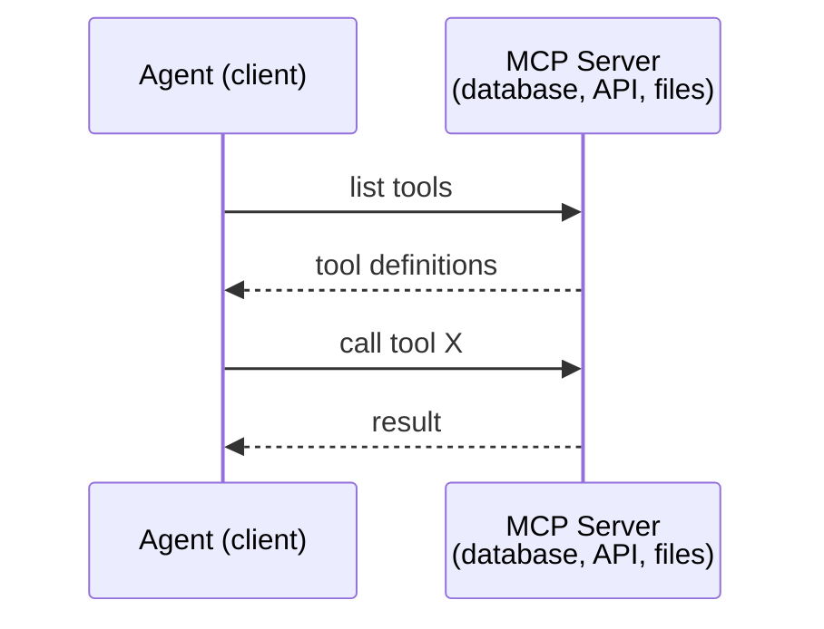

MCP 是**智能体到工具（agent-to-tool）**的通信。它帮不了智能体彼此交谈。

> MCP is covered in depth in Phase 13. Quick recap: MCP standardizes how an LLM connects to external tools and data sources. It's a client-server protocol where the agent (client) discovers and calls tools exposed by a server.
> MCP is agent-to-tool communication. It doesn't help agents talk to each other.

### A2A (Agent2Agent Protocol) · A2A（Agent2Agent 协议）

**创建方：** Google（现已归入 Linux Foundation，规范标识 `lf.a2a.v1`）
**规范版本：** 1.0.1
**解决的问题：** 自主智能体之间如何协作、协商、并互相委派任务？

A2A 是**点对点智能体协作（peer-to-peer agent collaboration）**协议。MCP 把智能体连到工具，A2A 把智能体连到其他智能体。每个智能体在一个众所周知的 URL（well-known URL）上发布一张 **Agent Card**，其他智能体据此发现它、与它协商、并向它委派任务。

> **Created by:** Google (now under Linux Foundation as `lf.a2a.v1`)
> **Spec version:** 1.0.1
> **Problem:** How do autonomous agents collaborate, negotiate, and delegate tasks to each other?
> A2A is the protocol for **peer-to-peer agent collaboration**. Where MCP connects an agent to tools, A2A connects an agent to other agents. Each agent publishes an **Agent Card** at a well-known URL, and other agents discover, negotiate with, and delegate tasks to it.

#### How A2A Works · A2A 如何工作

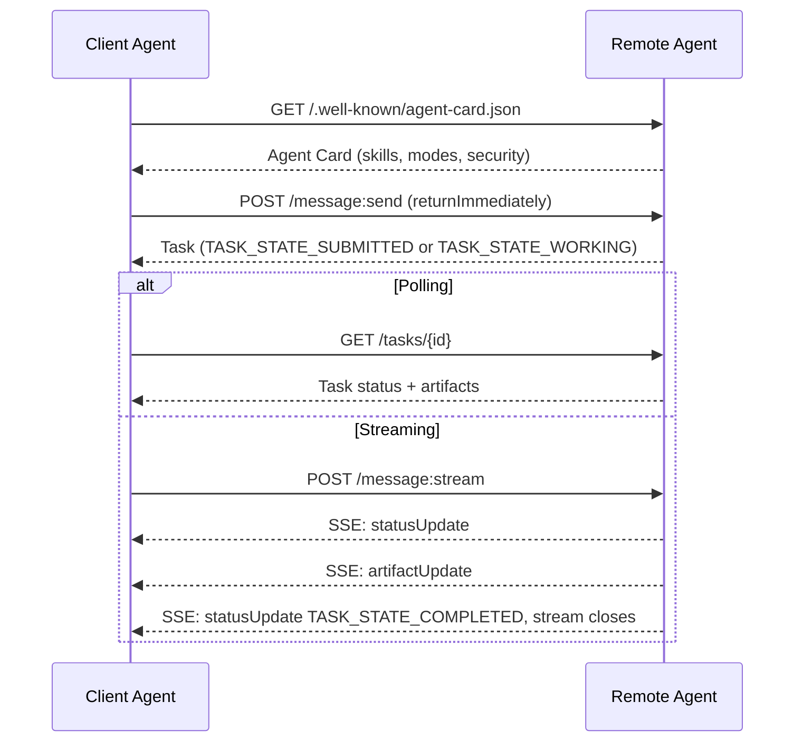

#### The Real Agent Card · 真实世界里的 Agent Card

这是一张 A2A Agent Card 在真实环境中的样子。通过 `GET /.well-known/agent-card.json` 提供：

```json
{
  "name": "Research Agent",
  "description": "Searches documentation and summarizes findings",
  "version": "1.0.0",
  "supportedInterfaces": [
    {
      "url": "https://research-agent.example.com/a2a/v1",
      "protocolBinding": "JSONRPC",
      "protocolVersion": "1.0"
    },
    {
      "url": "https://research-agent.example.com/a2a/rest",
      "protocolBinding": "HTTP+JSON",
      "protocolVersion": "1.0"
    }
  ],
  "provider": {
    "organization": "Your Company",
    "url": "https://example.com"
  },
  "capabilities": {
    "streaming": true,
    "pushNotifications": false
  },
  "defaultInputModes": ["text/plain", "application/json"],
  "defaultOutputModes": ["text/plain", "application/json"],
  "skills": [
    {
      "id": "web-research",
      "name": "Web Research",
      "description": "Searches the web and synthesizes findings",
      "tags": ["research", "search", "summarization"],
      "examples": ["Research the latest changes in React 19"]
    },
    {
      "id": "doc-analysis",
      "name": "Documentation Analysis",
      "description": "Reads and analyzes technical documentation",
      "tags": ["docs", "analysis"],
      "inputModes": ["text/plain", "application/pdf"],
      "outputModes": ["application/json"]
    }
  ],
  "securitySchemes": {
    "bearer": {
      "httpAuthSecurityScheme": {
        "scheme": "Bearer",
        "bearerFormat": "JWT"
      }
    }
  },
  "securityRequirements": [{ "schemes": { "bearer": { "list": [] } } }]
}
```

值得注意的关键点：
- **技能（Skills）** 描述一个智能体能做什么。每个技能有 ID、标签（tags）和支持的输入/输出 MIME 类型。客户端智能体据此判断这个远端智能体能否处理自己的请求。
- **supportedInterfaces** 列出多种协议绑定（protocol bindings）。同一个智能体可以同时讲 JSON-RPC、REST 和 gRPC。
- **安全**内建于卡片之中：`securitySchemes` 声明每种安全方案，`securityRequirements` 说明哪些方案适用。客户端在发出第一个请求之前就知道自己需要什么认证。

> This is what an A2A Agent Card actually looks like in the wild. Served at `GET /.well-known/agent-card.json`:
> **Skills** are what an agent can do. Each has an ID, tags, and supported input/output MIME types. This is how a client agent decides whether this remote agent can handle its request.
> **supportedInterfaces** lists multiple protocol bindings. A single agent can speak JSON-RPC, REST, and gRPC simultaneously.
> **Security** is built into the card: `securitySchemes` names each scheme and `securityRequirements` says which ones apply. The client knows what auth it needs before making a single request.

#### Task Lifecycle · 任务生命周期

任务是 A2A 中核心的工作单元。它在定义好的状态之间流转（下图省略了每个状态在线上都带的 `TASK_STATE_` 前缀）：

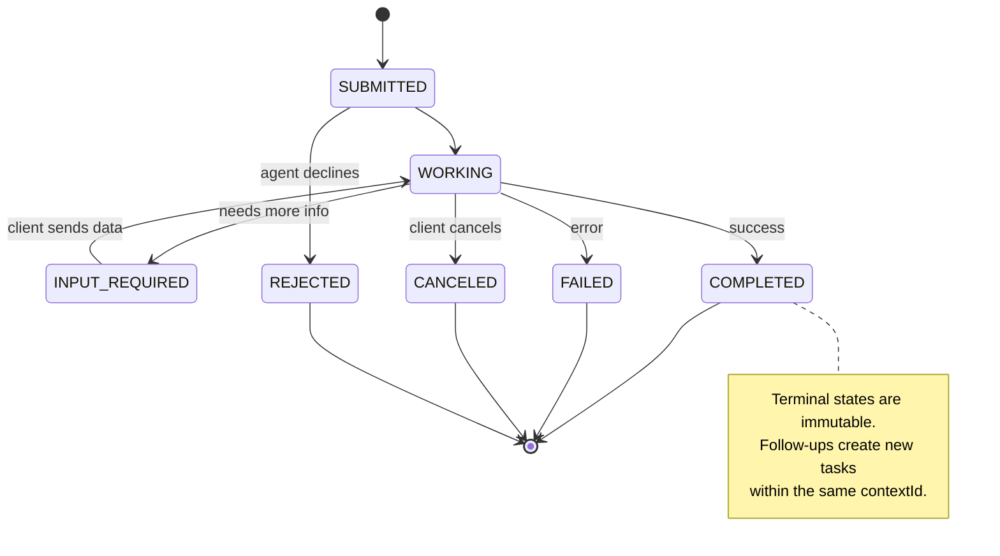

全部 8 个状态（规范还定义了一个哨兵值 `UNSPECIFIED`，此处省略）：

| 状态 | 终态？ | 含义 |
|---|---|---|
| `TASK_STATE_SUBMITTED` | 否 | 已确认，尚未开始处理 |
| `TASK_STATE_WORKING` | 否 | 正在处理中 |
| `TASK_STATE_INPUT_REQUIRED` | 否 | 智能体需要客户端提供更多信息 |
| `TASK_STATE_AUTH_REQUIRED` | 否 | 需要身份认证 |
| `TASK_STATE_COMPLETED` | 是 | 成功完成 |
| `TASK_STATE_FAILED` | 是 | 以错误告终 |
| `TASK_STATE_CANCELED` | 是 | 完成前被取消 |
| `TASK_STATE_REJECTED` | 是 | 智能体拒绝了该任务 |

任务一旦到达终态（terminal state），就不可再变。不再接受任何后续消息。后续请求会在同一个 `contextId` 下创建新任务。

> Tasks are the core unit of work in A2A. They move through defined states (the diagram drops the `TASK_STATE_` prefix that every state carries on the wire):
> All 8 states (the spec also defines `UNSPECIFIED` as a sentinel, omitted here):
> Once a task reaches a terminal state, it's immutable. No further messages. Follow-ups create a new task within the same `contextId`.

#### Wire Format · 线上格式

A2A 使用 JSON-RPC 2.0。下面是一次真实消息交互的样子：

**客户端发送一条消息：**
```json
{
  "jsonrpc": "2.0",
  "id": 1,
  "method": "SendMessage",
  "params": {
    "message": {
      "messageId": "msg-001",
      "role": "ROLE_USER",
      "parts": [{ "text": "Research React 19 compiler features" }]
    },
    "configuration": {
      "acceptedOutputModes": ["text/plain", "application/json"],
      "historyLength": 10
    }
  }
}
```

**智能体响应一个任务：**
```json
{
  "jsonrpc": "2.0",
  "id": 1,
  "result": {
    "task": {
      "id": "task-abc-123",
      "contextId": "ctx-xyz-789",
      "status": {
        "state": "TASK_STATE_COMPLETED",
        "timestamp": "2026-03-27T10:30:00Z"
      },
      "artifacts": [
        {
          "artifactId": "art-001",
          "name": "research-results",
          "parts": [{
            "data": {
              "findings": [
                "React 19 compiler auto-memoizes components",
                "No more manual useMemo/useCallback needed",
                "Compiler runs at build time, not runtime"
              ]
            },
            "mediaType": "application/json"
          }]
        }
      ]
    }
  }
}
```

**通过 SSE 流式传输：**
```text
POST /message:stream HTTP/1.1
Content-Type: application/a2a+json
A2A-Version: 1.0

data: {"task":{"id":"task-123","contextId":"ctx-123","status":{"state":"TASK_STATE_WORKING"}}}

data: {"statusUpdate":{"taskId":"task-123","contextId":"ctx-123","status":{"state":"TASK_STATE_WORKING","message":{"messageId":"msg-002","role":"ROLE_AGENT","parts":[{"text":"Searching documentation..."}]}}}}

data: {"artifactUpdate":{"taskId":"task-123","contextId":"ctx-123","artifact":{"artifactId":"art-1","parts":[{"text":"partial findings..."}]},"append":true,"lastChunk":false}}

data: {"statusUpdate":{"taskId":"task-123","contextId":"ctx-123","status":{"state":"TASK_STATE_COMPLETED"}}}
```

> A2A uses JSON-RPC 2.0. Here's what a real message exchange looks like:
> **Client sends a message:**
> **Agent responds with a task:**
> **Streaming via SSE:**

### ACP (Agent Communication Protocol) · ACP（智能体通信协议）

**创建方：** IBM / BeeAI
**规范版本：** 0.2.0（OpenAPI 3.1.1）
**现状：** 正在 Linux Foundation 之下并入 A2A
**解决的问题：** 智能体之间如何以完全可审计、会话可延续、轨迹可追踪的方式通信？

ACP 是**企业级协议**。和很多二手摘要说的相反，ACP **并不**使用 JSON-LD。它是一个通过 OpenAPI 定义的直白 REST/JSON API。它的特别之处在于 **TrajectoryMetadata（轨迹元数据）**：每个智能体响应都可以携带一份详细日志，记录产生该响应的推理步骤与工具调用。

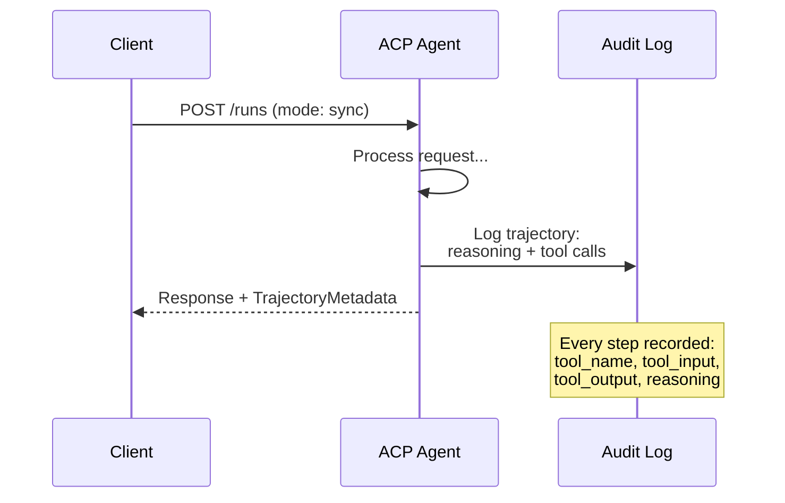

> **Created by:** IBM / BeeAI
> **Spec version:** 0.2.0 (OpenAPI 3.1.1)
> **Status:** Merging into A2A under the Linux Foundation
> **Problem:** How do agents communicate with full auditability, session continuity, and trajectory tracking?
> ACP is the **enterprise protocol**. Unlike what many summaries claim, ACP does **not** use JSON-LD. It's a straightforward REST/JSON API defined via OpenAPI. What makes it special is **TrajectoryMetadata**: every agent response can carry a detailed log of the reasoning steps and tool calls that produced it.

#### Agent Discovery in ACP · ACP 中的智能体发现

ACP 定义了四种发现方式：

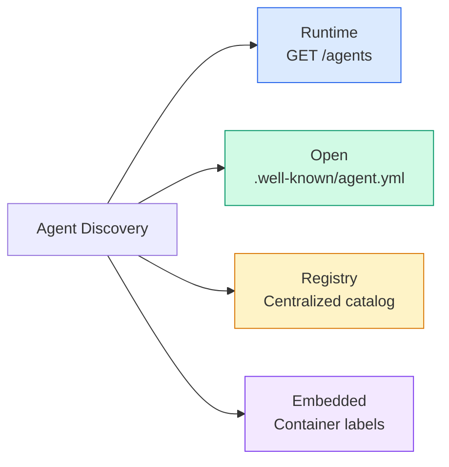

**AgentManifest** 比 A2A 的 Agent Card 更简单：

```json
{
  "name": "summarizer",
  "description": "Summarizes documents with source citations",
  "input_content_types": ["text/plain", "application/pdf"],
  "output_content_types": ["text/plain", "application/json"],
  "metadata": {
    "tags": ["summarization", "RAG"],
    "framework": "BeeAI",
    "capabilities": [
      {
        "name": "Document Summarization",
        "description": "Condenses long documents into key points"
      }
    ],
    "recommended_models": ["llama3.3:70b-instruct-fp16"],
    "license": "Apache-2.0",
    "programming_language": "Python"
  }
}
```

> ACP defines four discovery methods:
> The **AgentManifest** is simpler than A2A's Agent Card:

#### Run Lifecycle · Run（运行）的生命周期

ACP 用「Run」而不是「Task」。一个 Run 是一次智能体执行，有三种模式：

| 模式 | 行为 |
|---|---|
| `sync` | 阻塞式。响应中包含完整结果。 |
| `async` | 立即返回 202。通过轮询 `GET /runs/{id}` 获取状态。 |
| `stream` | SSE 流。智能体工作时事件实时触发。 |

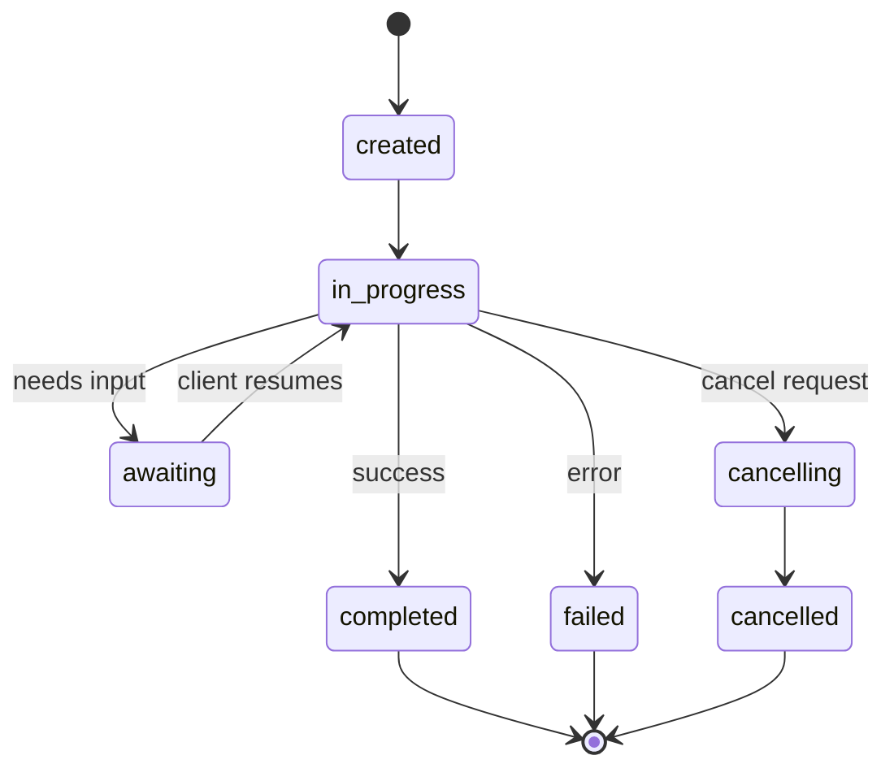

> ACP uses "Runs" instead of "Tasks". A Run is an agent execution with three modes:

#### TrajectoryMetadata (The Audit Trail) · TrajectoryMetadata（审计轨迹）

这是 ACP 最关键的差异化能力。每个消息部件（message part）都可以携带元数据，精确展示智能体做了什么：

```json
{
  "role": "agent/researcher",
  "parts": [
    {
      "content_type": "text/plain",
      "content": "The weather in San Francisco is 72F and sunny.",
      "metadata": {
        "kind": "trajectory",
        "message": "I need to check the weather for this location",
        "tool_name": "weather_api",
        "tool_input": { "location": "San Francisco, CA" },
        "tool_output": { "temperature": 72, "condition": "sunny" }
      }
    }
  ]
}
```

对受监管行业来说，这就是黄金。每个答案都附带一条可证明的推理链：调用了哪些工具、用了什么输入、收到了什么输出。没有黑箱。

ACP 还支持 **CitationMetadata** 用于来源标注（source attribution）：

```json
{
  "kind": "citation",
  "start_index": 0,
  "end_index": 47,
  "url": "https://weather.gov/sf",
  "title": "NWS San Francisco Forecast"
}
```

> This is ACP's key differentiator. Every message part can include metadata showing exactly what the agent did:
> For regulated industries this is gold. Every answer comes with a provable chain of reasoning: which tools were called, what inputs were used, what outputs were received. No black box.
> ACP also supports **CitationMetadata** for source attribution:

### ANP (Agent Network Protocol) · ANP（智能体网络协议）

**创建方：** 开源社区（由 GaoWei Chang 发起）
**代码仓库：** [github.com/agent-network-protocol/AgentNetworkProtocol](https://github.com/agent-network-protocol/AgentNetworkProtocol)
**解决的问题：** 来自不同组织的智能体，如何在没有中心权威的情况下互相信任？

ANP 是**去中心化身份协议**。它用 W3C 去中心化标识符（Decentralized Identifiers, DIDs）和端到端加密（end-to-end encryption）来建立信任。A2A 里你通过已知端点发现智能体；ANP 则让智能体用密码学方式证明自己的身份。

ANP 有三层：

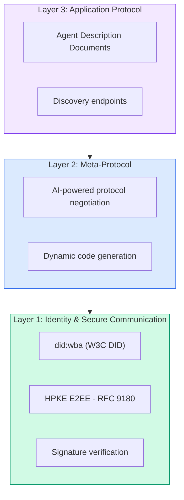

> **Created by:** Open-source community (founded by GaoWei Chang)
> **Problem:** How do agents from different organizations trust each other without a central authority?
> ANP is the **decentralized identity protocol**. It builds trust using W3C Decentralized Identifiers (DIDs) and end-to-end encryption. Unlike A2A where you discover agents through known endpoints, ANP lets agents prove their identity cryptographically.
> ANP has three layers:

#### DID Documents (Real Structure) · DID 文档（真实结构）

ANP 使用一种名为 `did:wba`（Web-Based Agent，基于 Web 的智能体）的自定义 DID 方法。DID `did:wba:example.com:user:alice` 解析到 `https://example.com/user/alice/did.json`：

```json
{
  "@context": [
    "https://www.w3.org/ns/did/v1",
    "https://w3id.org/security/suites/jws-2020/v1",
    "https://w3id.org/security/suites/secp256k1-2019/v1"
  ],
  "id": "did:wba:example.com:user:alice",
  "verificationMethod": [
    {
      "id": "did:wba:example.com:user:alice#key-1",
      "type": "EcdsaSecp256k1VerificationKey2019",
      "controller": "did:wba:example.com:user:alice",
      "publicKeyJwk": {
        "crv": "secp256k1",
        "x": "NtngWpJUr-rlNNbs0u-Aa8e16OwSJu6UiFf0Rdo1oJ4",
        "y": "qN1jKupJlFsPFc1UkWinqljv4YE0mq_Ickwnjgasvmo",
        "kty": "EC"
      }
    },
    {
      "id": "did:wba:example.com:user:alice#key-x25519-1",
      "type": "X25519KeyAgreementKey2019",
      "controller": "did:wba:example.com:user:alice",
      "publicKeyMultibase": "z9hFgmPVfmBZwRvFEyniQDBkz9LmV7gDEqytWyGZLmDXE"
    }
  ],
  "authentication": [
    "did:wba:example.com:user:alice#key-1"
  ],
  "keyAgreement": [
    "did:wba:example.com:user:alice#key-x25519-1"
  ],
  "humanAuthorization": [
    "did:wba:example.com:user:alice#key-1"
  ],
  "service": [
    {
      "id": "did:wba:example.com:user:alice#agent-description",
      "type": "AgentDescription",
      "serviceEndpoint": "https://example.com/agents/alice/ad.json"
    }
  ]
}
```

值得注意的关键点：
- **密钥分离（Key separation）** 是强制的。签名密钥（secp256k1）与加密密钥（X25519）各自独立。
- **`humanAuthorization`** 是 ANP 独有的。这些密钥在使用前需要显式的人类批准（生物识别、密码、HSM）。资金转账这类高风险操作走这条路径。
- **`keyAgreement`** 密钥用于 HPKE 端到端加密（RFC 9180）。
- **service** 部分链接到智能体描述（Agent Description）文档。

> ANP uses a custom DID method called `did:wba` (Web-Based Agent). The DID `did:wba:example.com:user:alice` resolves to `https://example.com/user/alice/did.json`:
> **Key separation** is enforced. Signing keys (secp256k1) are separate from encryption keys (X25519).
> **`humanAuthorization`** is unique to ANP. These keys require explicit human approval (biometric, password, HSM) before use. High-risk operations like fund transfers go through this path.
> **`keyAgreement`** keys are used for HPKE end-to-end encryption (RFC 9180).
> The **service** section links to the Agent Description document.

#### How Trust Works in ANP · ANP 中信任如何建立

ANP **不**使用信任网络（web-of-trust）或背书图（endorsement graph）。信任是双向的、按每次交互逐一验证的：

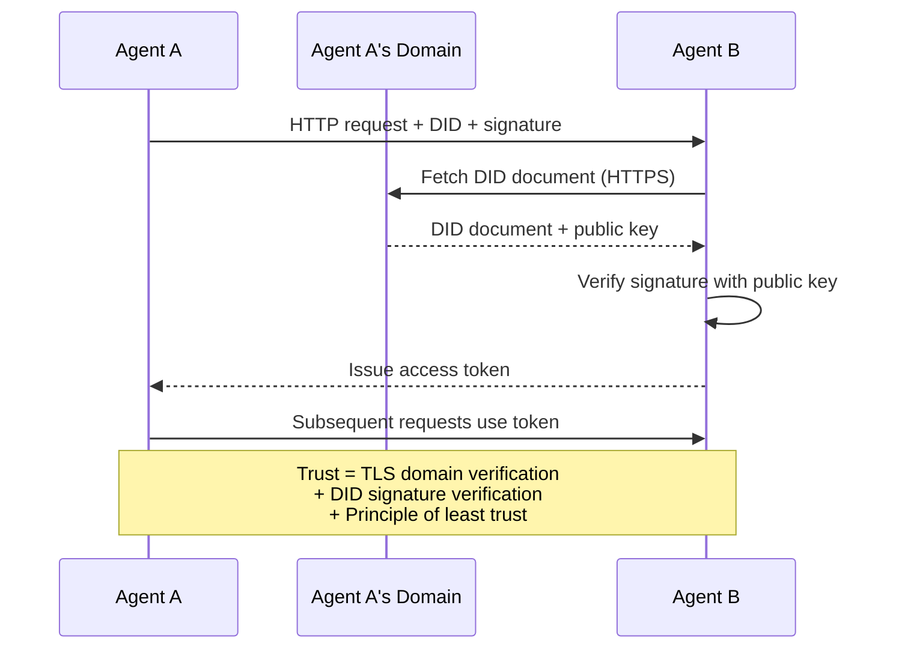

信任来自三个来源：
1. **域名级 TLS** 验证 DID 文档所在的主机
2. **DID 密码学签名** 验证智能体的身份
3. **最小信任原则（principle of least trust）** 只授予最小权限

没有基于八卦传播（gossip）的信任扩散，也没有 PageRank 式打分。你通过每个智能体自己的 DID 直接验证它。

> ANP does **not** use a web-of-trust or endorsement graph. Trust is bilateral and verified per-interaction:
> Trust comes from three sources:
> 1. **Domain-level TLS** verifies the DID document host
> 2. **DID cryptographic signatures** verify the agent's identity
> 3. **Principle of least trust** grants only minimum permissions
> There's no gossip-based trust propagation or PageRank scoring. You verify each agent directly through its DID.

#### Meta-Protocol Negotiation · 元协议协商

这是 ANP 最新颖的特性。当来自不同生态的两个智能体相遇时，它们不需要预先约定的数据格式。它们用自然语言协商：

```json
{
  "action": "protocolNegotiation",
  "sequenceId": 0,
  "candidateProtocols": "I can communicate using:\n1. JSON-RPC with hotel booking schema\n2. REST with OpenAPI 3.1 spec\n3. Natural language over HTTP",
  "modificationSummary": "Initial proposal",
  "status": "negotiating"
}
```

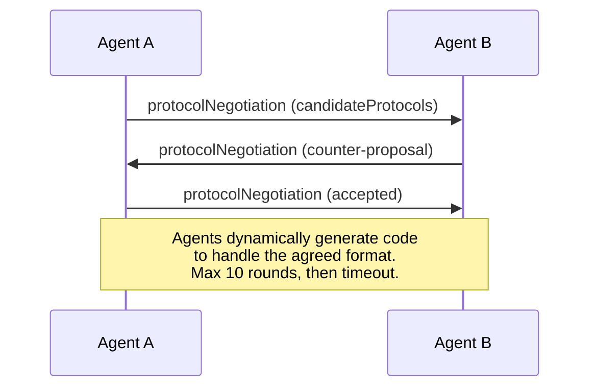

两个智能体来回磋商（最多 10 轮），直到就某种格式达成一致，然后动态生成处理该格式的代码。状态取值：`negotiating`（协商中）、`rejected`（已拒绝）、`accepted`（已接受）、`timeout`（超时）。

这意味着两个从未打过交道的智能体，可以在没有任何人事先定义共享 schema 的情况下，自己琢磨出怎么通信。

> This is ANP's most novel feature. When two agents from different ecosystems meet, they don't need pre-agreed data formats. They negotiate in natural language:
> The agents go back and forth (max 10 rounds) until they agree on a format, then dynamically generate code to handle it. Status values: `negotiating`, `rejected`, `accepted`, `timeout`.
> This means two agents that have never seen each other before can figure out how to communicate without anyone pre-defining a shared schema.

### Comparison (Corrected) · 对比（已校正）

| | MCP | A2A | ACP | ANP |
|---|---|---|---|---|
| **创建方** | Anthropic | Google / Linux Foundation | IBM / BeeAI | 社区 |
| **规范格式** | JSON-RPC | JSON-RPC / REST / gRPC | OpenAPI 3.1 (REST) | JSON-RPC |
| **主要用途** | 智能体到工具 | 智能体到智能体 | 智能体到智能体 | 智能体到智能体 |
| **发现方式** | 工具列表 | `/.well-known/agent-card.json` | `GET /agents`、`/.well-known/agent.yml` | `/.well-known/agent-descriptions`、DID service 端点 |
| **身份** | 隐式（本地） | 安全方案（OAuth、mTLS） | 服务器级 | W3C DID（`did:wba`）+ E2EE |
| **审计轨迹** | 不适用 | 基础（任务历史） | TrajectoryMetadata（工具调用、推理） | 未正式规定 |
| **状态机** | 不适用 | 9 个任务状态 | 7 个 run 状态 | 不适用 |
| **流式传输** | 不适用 | SSE | SSE | 与传输无关 |
| **独特特性** | 工具 schema | Agent Card + Skills | Trajectory 审计轨迹 | 元协议协商 |
| **最适合** | 工具与数据 | 动态协作 | 受监管行业 | 跨组织信任 |
| **现状** | 稳定 | 稳定（v1.0） | 正在并入 A2A | 活跃开发中 |

### How They Work Together · 它们如何协同工作

这些协议并不互斥。一个现实中的企业系统会同时使用多种：

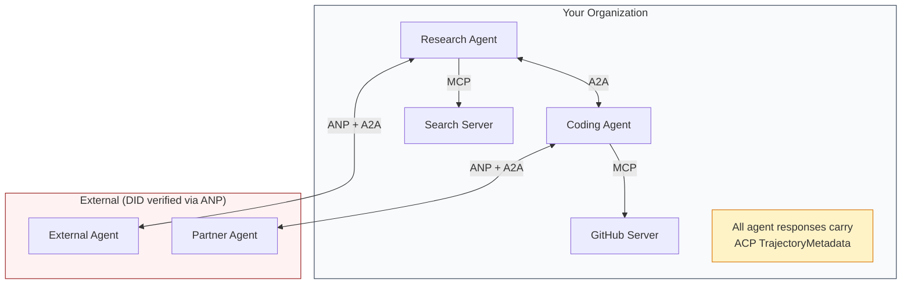

- **MCP** 把每个智能体连到自己的工具
- **A2A** 负责智能体之间的协作（内部与外部）
- **ACP** 把响应包上轨迹元数据以便审计
- **ANP** 为你不控制的智能体提供身份验证

```figure
swarm-message-bus
```

> These protocols are not mutually exclusive. A realistic enterprise system uses multiple:
> - **MCP** connects each agent to its tools
> - **A2A** handles collaboration between agents (internal and external)
> - **ACP** wraps responses in trajectory metadata for auditability
> - **ANP** provides identity verification for agents you don't control

## Build It · 动手造

### Step 1: Core Message Types · 第 1 步：核心消息类型

每个多智能体系统都从消息格式起步。我们定义的类型对应真实协议所使用的结构：

```typescript
import crypto from "node:crypto";

type MessageRole = "ROLE_USER" | "ROLE_AGENT";

type MessagePart =
  | { text: string }
  | { data: unknown; mediaType: string }
  | { url: string; filename: string; mediaType: string };

type TrajectoryEntry = {
  reasoning: string;
  toolName?: string;
  toolInput?: unknown;
  toolOutput?: unknown;
  timestamp: number;
};

type AgentMessage = {
  id: string;
  role: MessageRole;
  parts: MessagePart[];
  trajectory?: TrajectoryEntry[];
  replyTo?: string;
  timestamp: number;
};

function createMessage(
  role: MessageRole,
  parts: MessagePart[],
  replyTo?: string
): AgentMessage {
  return {
    id: crypto.randomUUID(),
    role,
    parts,
    replyTo,
    timestamp: Date.now(),
  };
}

function textMessage(role: MessageRole, text: string): AgentMessage {
  return createMessage(role, [{ text }]);
}
```

注意：`MessagePart` 是多模态的（文本、结构化数据、文件），与真实的 A2A 和 ACP 规范一致。和 A2A 1.0 一样，哪个字段存在（`text`、`data` 或 `url`）就说明这个 part 是什么；没有 `kind` 标签。`TrajectoryEntry` 捕获推理链，对应 ACP 的 TrajectoryMetadata。

> Every multi-agent system starts with a message format. We define types that map to what the real protocols use:
> Notice: `MessagePart` is multimodal (text, structured data, files) just like the real A2A and ACP specs. As in A2A 1.0, the field that is present (`text`, `data`, or `url`) says what the part is; there is no `kind` tag. `TrajectoryEntry` captures the reasoning chain, matching ACP's TrajectoryMetadata.

### Step 2: A2A Agent Card and Registry · 第 2 步：A2A Agent Card 与注册表

构建与真实 A2A 规范一致的智能体发现：

```typescript
type Skill = {
  id: string;
  name: string;
  description: string;
  tags: string[];
  inputModes: string[];
  outputModes: string[];
};

type AgentInterface = {
  url: string;
  protocolBinding: string;
  protocolVersion: string;
};

type AgentCard = {
  name: string;
  description: string;
  version: string;
  supportedInterfaces: AgentInterface[];
  capabilities: {
    streaming: boolean;
    pushNotifications: boolean;
  };
  defaultInputModes: string[];
  defaultOutputModes: string[];
  skills: Skill[];
};

class AgentRegistry {
  private cards: Map<string, AgentCard> = new Map();

  register(card: AgentCard) {
    this.cards.set(card.name, card);
  }

  discoverBySkillTag(tag: string): AgentCard[] {
    return [...this.cards.values()].filter((card) =>
      card.skills.some((skill) => skill.tags.includes(tag))
    );
  }

  discoverByInputMode(mimeType: string): AgentCard[] {
    return [...this.cards.values()].filter(
      (card) =>
        card.defaultInputModes.includes(mimeType) ||
        card.skills.some((skill) => skill.inputModes.includes(mimeType))
    );
  }

  resolve(name: string): AgentCard | undefined {
    return this.cards.get(name);
  }

  listAll(): AgentCard[] {
    return [...this.cards.values()];
  }
}
```

这比一个简单的「名字到能力」映射丰富得多。你可以按技能标签、按输入 MIME 类型或按名字发现智能体，正如真实 A2A 规范所支持的。

> Build agent discovery that matches the real A2A spec:
> This is substantially richer than a simple name-to-capability map. You can discover agents by skill tags, by input MIME types, or by name, just like the real A2A spec supports.

### Step 3: A2A Task Lifecycle · 第 3 步：A2A 任务生命周期

构建完整的任务状态机：

```typescript
type TaskState =
  | "TASK_STATE_SUBMITTED"
  | "TASK_STATE_WORKING"
  | "TASK_STATE_INPUT_REQUIRED"
  | "TASK_STATE_AUTH_REQUIRED"
  | "TASK_STATE_COMPLETED"
  | "TASK_STATE_FAILED"
  | "TASK_STATE_CANCELED"
  | "TASK_STATE_REJECTED";

const TERMINAL_STATES: TaskState[] = [
  "TASK_STATE_COMPLETED",
  "TASK_STATE_FAILED",
  "TASK_STATE_CANCELED",
  "TASK_STATE_REJECTED",
];

type TaskStatus = {
  state: TaskState;
  message?: AgentMessage;
  timestamp: number;
};

type Artifact = {
  id: string;
  name: string;
  parts: MessagePart[];
};

type Task = {
  id: string;
  contextId: string;
  status: TaskStatus;
  artifacts: Artifact[];
  history: AgentMessage[];
};

type TaskEvent =
  | { statusUpdate: { taskId: string; status: TaskStatus } }
  | {
      artifactUpdate: {
        taskId: string;
        artifact: Artifact;
        append: boolean;
        lastChunk: boolean;
      };
    };

type TaskHandler = (
  task: Task,
  message: AgentMessage
) => AsyncGenerator<TaskEvent>;

class TaskManager {
  private tasks: Map<string, Task> = new Map();
  private handlers: Map<string, TaskHandler> = new Map();
  private listeners: Map<string, ((event: TaskEvent) => void)[]> = new Map();

  registerHandler(agentName: string, handler: TaskHandler) {
    this.handlers.set(agentName, handler);
  }

  subscribe(taskId: string, listener: (event: TaskEvent) => void) {
    const existing = this.listeners.get(taskId) ?? [];
    existing.push(listener);
    this.listeners.set(taskId, existing);
  }

  async sendMessage(
    agentName: string,
    message: AgentMessage,
    contextId?: string
  ): Promise<Task> {
    const handler = this.handlers.get(agentName);
    if (!handler) {
      const task = this.createTask(contextId);
      task.status = {
        state: "TASK_STATE_REJECTED",
        timestamp: Date.now(),
        message: textMessage("ROLE_AGENT", `No handler for ${agentName}`),
      };
      return task;
    }

    const task = this.createTask(contextId);
    task.history.push(message);
    task.status = { state: "TASK_STATE_SUBMITTED", timestamp: Date.now() };

    this.processTask(task, handler, message).catch((err) => {
      task.status = {
        state: "TASK_STATE_FAILED",
        timestamp: Date.now(),
        message: textMessage("ROLE_AGENT", String(err)),
      };
    });
    return task;
  }

  getTask(taskId: string): Task | undefined {
    return this.tasks.get(taskId);
  }

  cancelTask(taskId: string): boolean {
    const task = this.tasks.get(taskId);
    if (!task || TERMINAL_STATES.includes(task.status.state)) return false;
    task.status = { state: "TASK_STATE_CANCELED", timestamp: Date.now() };
    this.emit(taskId, {
      statusUpdate: { taskId, status: task.status },
    });
    return true;
  }

  private createTask(contextId?: string): Task {
    const task: Task = {
      id: crypto.randomUUID(),
      contextId: contextId ?? crypto.randomUUID(),
      status: { state: "TASK_STATE_SUBMITTED", timestamp: Date.now() },
      artifacts: [],
      history: [],
    };
    this.tasks.set(task.id, task);
    return task;
  }

  private async processTask(
    task: Task,
    handler: TaskHandler,
    message: AgentMessage
  ) {
    task.status = { state: "TASK_STATE_WORKING", timestamp: Date.now() };
    this.emit(task.id, {
      statusUpdate: { taskId: task.id, status: task.status },
    });

    try {
      for await (const event of handler(task, message)) {
        if (TERMINAL_STATES.includes(task.status.state)) break;

        if ("statusUpdate" in event) {
          task.status = event.statusUpdate.status;
        }
        if ("artifactUpdate" in event) {
          const update = event.artifactUpdate;
          const existing = task.artifacts.find(
            (a) => a.id === update.artifact.id
          );
          if (existing && update.append) {
            existing.parts.push(...update.artifact.parts);
          } else {
            task.artifacts.push(update.artifact);
          }
        }
        this.emit(task.id, event);
      }
    } catch (err) {
      task.status = {
        state: "TASK_STATE_FAILED",
        timestamp: Date.now(),
        message: textMessage("ROLE_AGENT", String(err)),
      };
      this.emit(task.id, {
        statusUpdate: { taskId: task.id, status: task.status },
      });
    }
  }

  private emit(taskId: string, event: TaskEvent) {
    for (const listener of this.listeners.get(taskId) ?? []) {
      listener(event);
    }
  }
}
```

这里实现的是真实的 A2A 任务生命周期：`TASK_STATE_SUBMITTED`、`TASK_STATE_WORKING`、`TASK_STATE_INPUT_REQUIRED`，然后进入某个终态。处理器（handler）是异步生成器（async generators），产出 `statusUpdate` 与 `artifactUpdate` 事件——与 SSE 流承载的包装结构完全相同。

> Build the full task state machine:
> This implements the real A2A task lifecycle: `TASK_STATE_SUBMITTED`, `TASK_STATE_WORKING`, `TASK_STATE_INPUT_REQUIRED`, then a terminal state. Handlers are async generators that yield `statusUpdate` and `artifactUpdate` events, the same wrappers the SSE stream carries.

### Step 4: ACP-Style Audit Trail · 第 4 步：ACP 风格的审计轨迹

用轨迹追踪（trajectory tracking）包住通信：

```typescript
type AuditEntry = {
  runId: string;
  agentName: string;
  input: AgentMessage[];
  output: AgentMessage[];
  trajectory: TrajectoryEntry[];
  status: "created" | "in-progress" | "completed" | "failed" | "awaiting";
  startedAt: number;
  completedAt?: number;
  sessionId?: string;
};

class AuditableRunner {
  private log: AuditEntry[] = [];
  private handlers: Map<
    string,
    (input: AgentMessage[]) => Promise<{
      output: AgentMessage[];
      trajectory: TrajectoryEntry[];
    }>
  > = new Map();

  registerAgent(
    name: string,
    handler: (input: AgentMessage[]) => Promise<{
      output: AgentMessage[];
      trajectory: TrajectoryEntry[];
    }>
  ) {
    this.handlers.set(name, handler);
  }

  async run(
    agentName: string,
    input: AgentMessage[],
    sessionId?: string
  ): Promise<AuditEntry> {
    const entry: AuditEntry = {
      runId: crypto.randomUUID(),
      agentName,
      input: structuredClone(input),
      output: [],
      trajectory: [],
      status: "created",
      startedAt: Date.now(),
      sessionId,
    };
    this.log.push(entry);

    const handler = this.handlers.get(agentName);
    if (!handler) {
      entry.status = "failed";
      return entry;
    }

    entry.status = "in-progress";
    try {
      const result = await handler(input);
      entry.output = structuredClone(result.output);
      entry.trajectory = structuredClone(result.trajectory);
      entry.status = "completed";
      entry.completedAt = Date.now();
    } catch (err) {
      entry.status = "failed";
      entry.trajectory.push({
        reasoning: `Error: ${String(err)}`,
        timestamp: Date.now(),
      });
      entry.completedAt = Date.now();
    }
    return entry;
  }

  getFullAuditLog(): AuditEntry[] {
    return structuredClone(this.log);
  }

  getAuditLogForAgent(agentName: string): AuditEntry[] {
    return structuredClone(
      this.log.filter((e) => e.agentName === agentName)
    );
  }

  getAuditLogForSession(sessionId: string): AuditEntry[] {
    return structuredClone(
      this.log.filter((e) => e.sessionId === sessionId)
    );
  }

  getTrajectoryForRun(runId: string): TrajectoryEntry[] {
    const entry = this.log.find((e) => e.runId === runId);
    return entry ? structuredClone(entry.trajectory) : [];
  }
}
```

每次智能体执行都产生一条完整的审计记录：进去的是什么、出来的是什么，以及中间完整的工具调用与推理步骤轨迹。你可以按智能体、按会话或按单次 run 查询。

> Wrap communication with trajectory tracking:
> Every agent execution produces a full audit entry: what went in, what came out, and the complete trajectory of tool calls and reasoning steps in between. You can query by agent, by session, or by individual run.

### Step 5: ANP-Style Identity Verification · 第 5 步：ANP 风格的身份验证

构建基于 DID 的身份与验证：

```typescript
type VerificationMethod = {
  id: string;
  type: string;
  controller: string;
  publicKeyDer: string;
};

type DIDDocument = {
  id: string;
  verificationMethod: VerificationMethod[];
  authentication: string[];
  keyAgreement: string[];
  humanAuthorization: string[];
  service: { id: string; type: string; serviceEndpoint: string }[];
};

type AgentIdentity = {
  did: string;
  document: DIDDocument;
  privateKey: crypto.KeyObject;
  publicKey: crypto.KeyObject;
};

class IdentityRegistry {
  private documents: Map<string, DIDDocument> = new Map();

  publish(doc: DIDDocument) {
    this.documents.set(doc.id, doc);
  }

  resolve(did: string): DIDDocument | undefined {
    return this.documents.get(did);
  }

  verify(did: string, signature: string, payload: string): boolean {
    const doc = this.documents.get(did);
    if (!doc) return false;

    const authKeyIds = doc.authentication;
    const authKeys = doc.verificationMethod.filter((vm) =>
      authKeyIds.includes(vm.id)
    );

    for (const key of authKeys) {
      const publicKey = crypto.createPublicKey({
        key: Buffer.from(key.publicKeyDer, "base64"),
        format: "der",
        type: "spki",
      });
      const isValid = crypto.verify(
        null,
        Buffer.from(payload),
        publicKey,
        Buffer.from(signature, "hex")
      );
      if (isValid) return true;
    }
    return false;
  }

  requiresHumanAuth(did: string, operationKeyId: string): boolean {
    const doc = this.documents.get(did);
    if (!doc) return false;
    return doc.humanAuthorization.includes(operationKeyId);
  }
}

function createIdentity(domain: string, agentName: string): AgentIdentity {
  const did = `did:wba:${domain}:agent:${agentName}`;
  const { publicKey, privateKey } = crypto.generateKeyPairSync("ed25519");

  const publicKeyDer = publicKey
    .export({ format: "der", type: "spki" })
    .toString("base64");

  const keyId = `${did}#key-1`;
  const encKeyId = `${did}#key-x25519-1`;

  const document: DIDDocument = {
    id: did,
    verificationMethod: [
      {
        id: keyId,
        type: "Ed25519VerificationKey2020",
        controller: did,
        publicKeyDer,
      },
      {
        id: encKeyId,
        type: "X25519KeyAgreementKey2019",
        controller: did,
        publicKeyDer,
      },
    ],
    authentication: [keyId],
    keyAgreement: [encKeyId],
    humanAuthorization: [],
    service: [
      {
        id: `${did}#agent-description`,
        type: "AgentDescription",
        serviceEndpoint: `https://${domain}/agents/${agentName}/ad.json`,
      },
    ],
  };

  return { did, document, privateKey, publicKey };
}

function signPayload(identity: AgentIdentity, payload: string): string {
  return crypto
    .sign(null, Buffer.from(payload), identity.privateKey)
    .toString("hex");
}
```

这里镜像了真实的 ANP 身份模型：智能体拥有的 DID 文档中，认证密钥、密钥协商（key agreement）密钥与人类授权密钥各自分离。`IdentityRegistry` 模拟了 DID 解析（在生产环境中，这一步会是对智能体所属域名的 HTTP 请求）。

> Build DID-based identity and verification:
> This mirrors the real ANP identity model: agents have DID documents with separate authentication, key agreement, and human authorization keys. The `IdentityRegistry` simulates DID resolution (in production this would be HTTP fetches to the agent's domain).

### Step 6: Protocol Gateway · 第 6 步：协议网关

把四种协议接进一个统一系统：

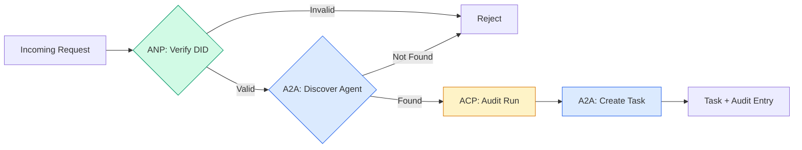

```typescript
class ProtocolGateway {
  private registry: AgentRegistry;
  private taskManager: TaskManager;
  private auditRunner: AuditableRunner;
  private identityRegistry: IdentityRegistry;

  constructor(
    registry: AgentRegistry,
    taskManager: TaskManager,
    auditRunner: AuditableRunner,
    identityRegistry: IdentityRegistry
  ) {
    this.registry = registry;
    this.taskManager = taskManager;
    this.auditRunner = auditRunner;
    this.identityRegistry = identityRegistry;
  }

  async delegateTask(
    fromDid: string,
    signature: string,
    targetAgent: string,
    message: AgentMessage,
    sessionId?: string
  ): Promise<{ task: Task; audit: AuditEntry } | { error: string }> {
    if (!this.identityRegistry.verify(fromDid, signature, message.id)) {
      return { error: "Identity verification failed" };
    }

    const card = this.registry.resolve(targetAgent);
    if (!card) {
      return { error: `Agent ${targetAgent} not found in registry` };
    }

    const audit = await this.auditRunner.run(
      targetAgent,
      [message],
      sessionId
    );
    const task = await this.taskManager.sendMessage(targetAgent, message);

    return { task, audit };
  }

  discoverAndDelegate(
    fromDid: string,
    signature: string,
    skillTag: string,
    message: AgentMessage
  ): Promise<{ task: Task; audit: AuditEntry } | { error: string }> {
    const candidates = this.registry.discoverBySkillTag(skillTag);
    if (candidates.length === 0) {
      return Promise.resolve({
        error: `No agents found with skill tag: ${skillTag}`,
      });
    }
    return this.delegateTask(
      fromDid,
      signature,
      candidates[0].name,
      message
    );
  }
}
```

网关在一次调用中做了四件事：
1. **ANP**：通过 DID 签名验证调用者的身份
2. **A2A**：发现目标智能体并检查其能力
3. **ACP**：把执行包进带轨迹的审计轨迹中
4. **A2A**：创建一个带完整生命周期追踪的任务

> Connect all four protocols into a unified system:
> The gateway does four things in one call:
> 1. **ANP**: Verifies the caller's identity via DID signature
> 2. **A2A**: Discovers the target agent and checks capabilities
> 3. **ACP**: Wraps the execution in an audit trail with trajectory
> 4. **A2A**: Creates a task with full lifecycle tracking

### Step 7: Wire It All Together · 第 7 步：全部串起来

```typescript
async function protocolDemo() {
  const registry = new AgentRegistry();
  registry.register({
    name: "researcher",
    description: "Searches and summarizes findings",
    version: "1.0.0",
    supportedInterfaces: [
      {
        url: "https://researcher.local/a2a/v1",
        protocolBinding: "JSONRPC",
        protocolVersion: "1.0",
      },
    ],
    capabilities: { streaming: true, pushNotifications: false },
    defaultInputModes: ["text/plain"],
    defaultOutputModes: ["text/plain", "application/json"],
    skills: [
      {
        id: "web-research",
        name: "Web Research",
        description: "Searches the web",
        tags: ["research", "search", "summarization"],
        inputModes: ["text/plain"],
        outputModes: ["application/json"],
      },
    ],
  });
  registry.register({
    name: "coder",
    description: "Writes code from specs",
    version: "1.0.0",
    supportedInterfaces: [
      {
        url: "https://coder.local/a2a/v1",
        protocolBinding: "JSONRPC",
        protocolVersion: "1.0",
      },
    ],
    capabilities: { streaming: false, pushNotifications: false },
    defaultInputModes: ["text/plain", "application/json"],
    defaultOutputModes: ["text/plain"],
    skills: [
      {
        id: "code-gen",
        name: "Code Generation",
        description: "Generates code",
        tags: ["coding", "generation"],
        inputModes: ["text/plain", "application/json"],
        outputModes: ["text/plain"],
      },
    ],
  });

  const taskManager = new TaskManager();
  const auditRunner = new AuditableRunner();

  const researchTrajectory: TrajectoryEntry[] = [];

  taskManager.registerHandler(
    "researcher",
    async function* (task, message) {
      yield {
        statusUpdate: {
          taskId: task.id,
          status: {
            state: "TASK_STATE_WORKING" as const,
            timestamp: Date.now(),
          },
        },
      };

      researchTrajectory.push({
        reasoning: "Searching for React 19 documentation",
        toolName: "web_search",
        toolInput: { query: "React 19 compiler features" },
        toolOutput: {
          results: ["react.dev/blog/react-19", "github.com/react/react"],
        },
        timestamp: Date.now(),
      });

      researchTrajectory.push({
        reasoning: "Extracting key findings from search results",
        toolName: "doc_analysis",
        toolInput: { url: "react.dev/blog/react-19" },
        toolOutput: {
          summary:
            "React 19 compiler auto-memoizes, no manual useMemo needed",
        },
        timestamp: Date.now(),
      });

      yield {
        artifactUpdate: {
          taskId: task.id,
          artifact: {
            id: crypto.randomUUID(),
            name: "research-results",
            parts: [
              {
                data: {
                  findings: [
                    "React 19 compiler auto-memoizes components",
                    "No more manual useMemo/useCallback needed",
                    "Compiler runs at build time, not runtime",
                  ],
                  sources: ["react.dev/blog/react-19"],
                },
                mediaType: "application/json",
              },
            ],
          },
          append: false,
          lastChunk: true,
        },
      };

      yield {
        statusUpdate: {
          taskId: task.id,
          status: {
            state: "TASK_STATE_COMPLETED" as const,
            timestamp: Date.now(),
          },
        },
      };
    }
  );

  auditRunner.registerAgent("researcher", async () => ({
    output: [
      textMessage("ROLE_AGENT", "React 19 compiler auto-memoizes components"),
    ],
    trajectory: researchTrajectory,
  }));

  const identityRegistry = new IdentityRegistry();

  const coderIdentity = createIdentity("coder.local", "coder");
  const researcherIdentity = createIdentity("researcher.local", "researcher");

  identityRegistry.publish(coderIdentity.document);
  identityRegistry.publish(researcherIdentity.document);

  const gateway = new ProtocolGateway(
    registry,
    taskManager,
    auditRunner,
    identityRegistry
  );

  console.log("=== Protocol Demo ===\n");

  console.log("1. Agent Discovery (A2A)");
  const researchAgents = registry.discoverBySkillTag("research");
  console.log(
    `   Found ${researchAgents.length} agent(s):`,
    researchAgents.map((a) => a.name)
  );

  console.log("\n2. Identity Verification (ANP)");
  const message = textMessage("ROLE_USER", "Research React 19 compiler features");
  const signature = signPayload(coderIdentity, message.id);
  const verified = identityRegistry.verify(
    coderIdentity.did,
    signature,
    message.id
  );
  console.log(`   Coder DID: ${coderIdentity.did}`);
  console.log(`   Signature verified: ${verified}`);

  console.log("\n3. Task Delegation (A2A + ACP + ANP)");
  const result = await gateway.delegateTask(
    coderIdentity.did,
    signature,
    "researcher",
    message,
    "session-001"
  );

  if ("error" in result) {
    console.log(`   Error: ${result.error}`);
    return;
  }

  console.log(`   Task ID: ${result.task.id}`);
  console.log(`   Task state: ${result.task.status.state}`);
  console.log(`   Artifacts: ${result.task.artifacts.length}`);

  console.log("\n4. Audit Trail (ACP)");
  console.log(`   Run ID: ${result.audit.runId}`);
  console.log(`   Status: ${result.audit.status}`);
  console.log(`   Trajectory steps: ${result.audit.trajectory.length}`);
  for (const step of result.audit.trajectory) {
    console.log(`     - ${step.reasoning}`);
    if (step.toolName) {
      console.log(`       Tool: ${step.toolName}`);
    }
  }

  console.log("\n5. Full Audit Log");
  const fullLog = auditRunner.getFullAuditLog();
  console.log(`   Total runs: ${fullLog.length}`);
  for (const entry of fullLog) {
    const duration = entry.completedAt
      ? `${entry.completedAt - entry.startedAt}ms`
      : "in-progress";
    console.log(`   ${entry.agentName}: ${entry.status} (${duration})`);
  }
}

protocolDemo().catch((err) => {
  console.error("Protocol demo failed:", err);
  process.exitCode = 1;
});
```

## What Goes Wrong · 哪里会出问题

协议解决的是一切顺利的路径（happy path）。以下是生产环境中会坏掉的地方：

**Schema 漂移（schema drift）。** 智能体 A 发布了一张 Agent Card，宣称输出 `application/json`。但 JSON schema 在版本之间变了。智能体 B 按旧格式解析，拿到一堆垃圾。修复：为你的技能和输出 schema 加版本号。A2A 规范之所以在 Agent Card 上支持 `version` 字段，正是为了这个。

**状态机违规。** 某个智能体处理器产出了 `TASK_STATE_COMPLETED` 状态更新，然后又试图继续产出 artifact。任务已经不可变。你的代码会静默丢弃这些更新，或者直接抛异常。修复：在产出之前检查终态。上面的 `TaskManager` 通过在终态后 `break` 强制了这一点。

**信任解析失败。** 智能体 A 想验证智能体 B 的 DID，但 B 的域名挂了。DID 文档取不到。你是 fail open（接受未验证的智能体）还是 fail closed（拒绝一切）？ANP 推荐配合最小信任原则采用 fail closed。

**轨迹膨胀（trajectory bloat）。** ACP 的轨迹日志很强大但代价高昂。一个每次 run 调用 200 次工具的复杂智能体会产生巨大的审计条目。修复：按可配置的详细程度记录轨迹。为合规记录工具名与输入输出，非受监管的工作负载则跳过推理步骤。

**发现的惊群效应（thundering herd）。** 50 个智能体在启动时同时查询 `GET /agents`。修复：给 Agent Card 缓存加 TTL、错开各家的发现间隔，或者用推送式注册替代轮询。

> Protocols solve the happy path. Here's what breaks in production:
> **Schema drift.** Agent A publishes an Agent Card advertising `application/json` output. But the JSON schema changes between versions. Agent B parses the old format and gets garbage. Fix: version your skills and output schemas. The A2A spec supports `version` on Agent Cards for this reason.
> **State machine violations.** ... Fix: check terminal state before yielding. The `TaskManager` above enforces this with the `break` after terminal states.
> **Trust resolution failures.** ... Do you fail open (accept unverified agents) or fail closed (reject everything)? ANP recommends fail closed with the principle of least trust.
> **Trajectory bloat.** ACP trajectory logging is powerful but expensive. ... Fix: log trajectory at configurable verbosity levels. Record tool names and IO for compliance, skip reasoning steps for non-regulated workloads.
> **Discovery thundering herd.** 50 agents all query `GET /agents` simultaneously on startup. Fix: cache Agent Cards with TTL, stagger discovery intervals, or use push-based registration instead of polling.

## Use It · 实战用法

### Real Implementations · 真实实现

**A2A** 是最成熟的。Google 的[官方规范](https://github.com/google/A2A)在 Linux Foundation 之下开源，提供 Python 和 TypeScript 的 SDK。如果你的智能体需要动态发现与协作，从这里开始。

**ACP** 正在并入 A2A。IBM 的 [BeeAI 项目](https://github.com/i-am-bee/acp)创造了 ACP，作为 REST 优先的替代方案，但轨迹元数据的理念正在被吸收进 A2A 生态。即使你用 A2A 作为传输层，也请采用 ACP 的模式（轨迹日志、run 生命周期）。

**ANP** 是最实验性的。[社区仓库](https://github.com/agent-network-protocol/AgentNetworkProtocol)提供了 Python SDK（AgentConnect）。元协议协商这个理念确实新颖。对于跨组织的智能体部署，值得持续关注。

**MCP** 已经在 Phase 13 讲过。如果你想让智能体使用工具，MCP 就是标准。

> **A2A** is the most mature. Google's [official spec](https://github.com/google/A2A) is open-source under the Linux Foundation. SDKs for Python and TypeScript. If your agents need dynamic discovery and collaboration, start here.
> **ACP** is merging into A2A. ... Use ACP patterns (trajectory logging, run lifecycle) even if you use A2A as the transport.
> **ANP** is the most experimental. ... Worth watching for cross-organizational agent deployments.
> **MCP** is already covered in Phase 13. If you want agents to use tools, MCP is the standard.

### Picking the Right Protocol · 选对协议

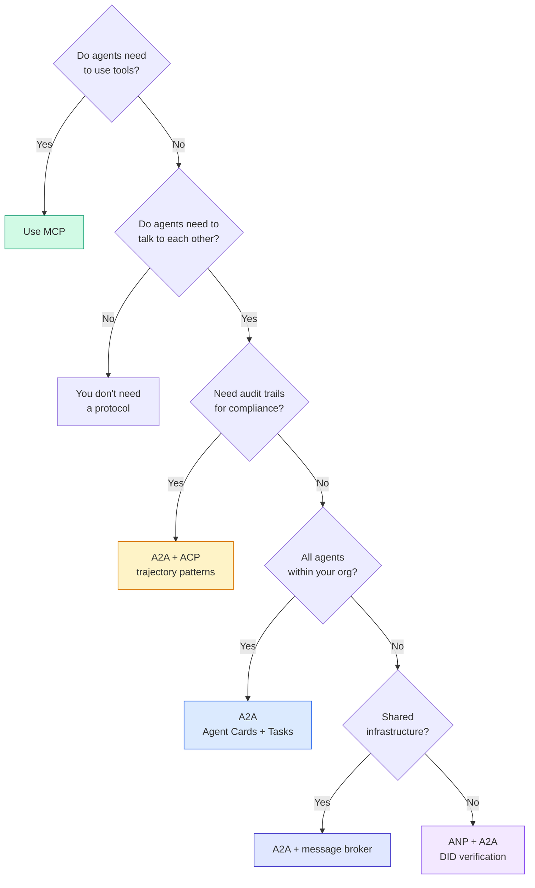

## Ship It · 交付

本课产出：
- `code/main.ts` —— 四种协议模式的完整实现
- `outputs/prompt-protocol-selector.md` —— 一个帮你为系统选择协议的提示词

> This lesson produces:
> - `code/main.ts` -- complete implementation of all four protocol patterns
> - `outputs/prompt-protocol-selector.md` -- a prompt that helps you choose protocols for your system

## Exercises · 练习

1. **多跳任务委派。** 扩展 `TaskManager`，让一个智能体处理器可以把子任务委派给其他智能体。研究员收到一个任务后，把「搜索」和「总结」两个子任务分别委派给两个专家智能体，等两者都完成，再把结果合并进自己的 artifact。

2. **流式审计轨迹。** 修改 `AuditableRunner` 以支持流式模式：不再等待完整结果，而是在轨迹条目新增时实时产出 `AuditEntry` 更新。用一个产出审计快照的异步生成器来实现。

3. **DID 轮换。** 给 `IdentityRegistry` 增加密钥轮换。智能体应能发布一份带更新密钥的新 DID 文档，同时维护一个 `previousDid` 引用。验证方在宽限期内应同时接受当前密钥和上一代密钥的签名。

4. **协议协商。** 实现 ANP 的元协议理念。两个智能体交换带候选格式的 `protocolNegotiation` 消息（例如「我能讲 JSON-RPC」对「我偏好 REST」）。最多 3 轮之后，双方就某种格式达成一致或超时。约定的格式决定它们使用哪个 `TaskManager` 或 `AuditableRunner`。

5. **限流发现。** 添加一个 `RateLimitedRegistry` 包装器：用可配置的 TTL 缓存 Agent Card 查询，并限制每个智能体每秒的发现查询次数。模拟 100 个智能体启动时互相发现的惊群效应，并测量差异。

## Key Terms · 术语表

| 术语 | 大家怎么说 | 实际含义 |
|------|----------------|----------------------|
| MCP | “AI 工具的协议” | 一个客户端-服务器协议，用于智能体发现和使用工具。是智能体到工具，不是智能体到智能体。 |
| A2A | “Google 的智能体协议” | Linux Foundation 之下的点对点智能体协作协议。通过 Agent Card 发现，9 状态任务生命周期，SSE 流式传输。支持 JSON-RPC、REST 和 gRPC 绑定。 |
| ACP | “企业级智能体消息” | IBM/BeeAI 的智能体 run REST API，带 TrajectoryMetadata：每个响应都携带完整的推理与工具调用链。正在并入 A2A。 |
| ANP | “去中心化智能体身份” | 一个社区协议，用 `did:wba`（DID）做密码学身份、HPKE 做端到端加密，并用 AI 驱动的元协议协商让从未谋面的智能体协同工作。 |
| Agent Card | “智能体的名片” | 位于 `/.well-known/agent-card.json` 的 JSON 文档，描述技能、支持的 MIME 类型、安全方案和协议绑定。 |
| DID | “去中心化 ID” | W3C 标准：密码学可验证的身份，托管在智能体自己的域名上。ANP 使用 `did:wba` 方法。 |
| TrajectoryMetadata | “审计回执” | ACP 的机制：把推理步骤、工具调用及其输入输出附加到每个智能体响应上。 |
| Meta-protocol | “智能体协商怎么说话” | ANP 的方法：智能体用自然语言动态商定数据格式，然后生成代码来处理这些格式。 |
| Task | “一个工作单元” | A2A 的有状态对象，跟踪工作从提交到完成的全过程。到达终态后不可变。 |

## Further Reading · 延伸阅读

- [Google A2A specification](https://github.com/google/A2A) —— 官方规范与 SDK（v1.0.1，Linux Foundation）
- [IBM/BeeAI ACP specification](https://github.com/i-am-bee/acp) —— 智能 run 与轨迹元数据的 OpenAPI 3.1 规范
- [Agent Network Protocol](https://github.com/agent-network-protocol/AgentNetworkProtocol) —— 基于 DID 的身份、端到端加密、元协议协商
- [Model Context Protocol docs](https://modelcontextprotocol.io/) —— Anthropic 的 MCP 规范（Phase 13 已讲）
- [W3C Decentralized Identifiers](https://www.w3.org/TR/did-core/) —— 支撑 ANP 的身份标准
- [RFC 9180 (HPKE)](https://www.rfc-editor.org/rfc/rfc9180) —— ANP 用于端到端加密的加密方案
- [FIPA Agent Communication Language](http://www.fipa.org/specs/fipa00061/SC00061G.html) —— 现代智能体协议的学术前身
