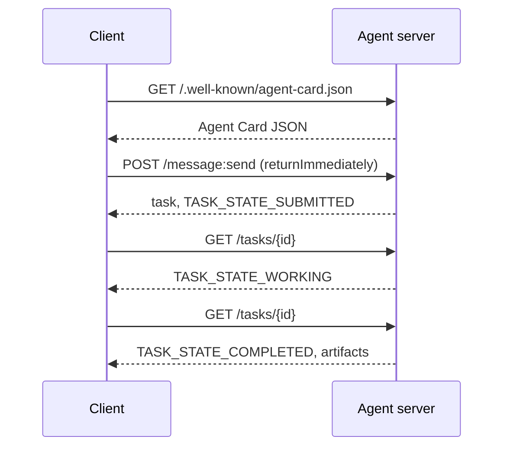

# A2A · Agent 到 Agent 协议（A2A protocol）

> Google 于 2025 年 4 月发布了 A2A；到 2026 年 4 月，规范已更新至 https://a2a-protocol.org/latest/specification/，并有 150+ 家组织支持。A2A 是 MCP（第 13 课）的水平向补充：MCP 是垂直的（agent ↔ 工具），A2A 是点对点的（agent ↔ agent）。它定义了 Agent Card（智能体卡片，用于发现）、带产物（artifact）的任务（文本、结构化数据、视频）、不透明的任务生命周期（opaque lifecycle）以及认证。生产系统越来越多地把 MCP 与 A2A 搭配使用。2025-2026 年间，Google Cloud 把 A2A 支持整合进了 Vertex AI Agent Builder。

> Google announced A2A in April 2025; by April 2026 the spec is at https://a2a-protocol.org/latest/specification/ and 150+ organizations back it. A2A is the horizontal complement to MCP (Lesson 13): where MCP is vertical (agent ↔ tools), A2A is peer-to-peer (agent ↔ agent). It defines Agent Cards (discovery), tasks with artifacts (text, structured data, video), opaque task lifecycles, and auth. Production systems increasingly pair MCP with A2A. Google Cloud rolled A2A support into Vertex AI Agent Builder during 2025-2026.

**Type:** Learn + Build
**Languages:** Python（stdlib、`http.server`、`json`）
**Prerequisites:** Phase 16 · 04（Primitive Model）
**Time:** ~75 分钟

## Problem · 问题

你的 agent 需要调用另一个系统上的另一个 agent。怎么做？你可以暴露一个 HTTP 端点，定义一套定制的 JSON schema，然后指望对方恰好说得通。结果每一对 agent 都变成一次定制集成。

A2A 就是给这类调用准备的通用线上协议（wire protocol）。标准的发现机制、标准的任务模型、标准的传输方式、标准的产物格式。就像 HTTP+REST，只不过把 agent 当作一等公民。

> Your agent needs to call another agent on another system. How? You can expose an HTTP endpoint, define a bespoke JSON schema, and hope the other side speaks it. Every pair of agents becomes a custom integration.
> A2A is the universal wire protocol for that call. Standard discovery, standard task model, standard transport, standard artifacts. Like HTTP+REST but for agents as first-class citizens.

## Concept · 概念

### The four elements · 四个要素

**Agent Card（智能体卡片）。** 位于 `/.well-known/agent-card.json` 的一个 JSON 文档，描述这个 agent：名称、技能、`supportedInterfaces`（端点 URL、协议绑定、协议版本）、默认输入与输出媒体类型，以及认证要求（`securitySchemes` 加上 `securityRequirements`）。发现（discovery）就是通过读取这张卡片完成的。

```http
GET /.well-known/agent-card.json HTTP/1.1
Host: agent.example.com
```

```json
{
  "name": "code-review-agent",
  "description": "Reviews Python and TypeScript code.",
  "version": "1.0.0",
  "supportedInterfaces": [
    {
      "url": "https://agent.example.com",
      "protocolBinding": "HTTP+JSON",
      "protocolVersion": "1.0"
    }
  ],
  "capabilities": {"streaming": false, "pushNotifications": false},
  "securitySchemes": {
    "bearer": {"httpAuthSecurityScheme": {"scheme": "Bearer"}}
  },
  "securityRequirements": [{"schemes": {"bearer": {"list": []}}}],
  "defaultInputModes": ["text/plain", "application/json"],
  "defaultOutputModes": ["application/json"],
  "skills": [
    {
      "id": "review-python",
      "name": "Review Python",
      "description": "Reviews Python code.",
      "tags": ["code-review", "python"]
    },
    {
      "id": "review-typescript",
      "name": "Review TypeScript",
      "description": "Reviews TypeScript code.",
      "tags": ["code-review", "typescript"]
    }
  ]
}
```

> **Agent Card.** A JSON document at `/.well-known/agent-card.json` describing the agent: name, skills, `supportedInterfaces` (endpoint URL, protocol binding, protocol version), default input and output media types, and auth requirements (`securitySchemes` plus `securityRequirements`). Discovery happens by reading the card.

**Task（任务）。** 工作单元。一个异步的、有状态的对象，带生命周期：`TASK_STATE_SUBMITTED` → `TASK_STATE_WORKING` → `TASK_STATE_COMPLETED` / `TASK_STATE_FAILED` / `TASK_STATE_CANCELED`。客户端发送一条消息，服务端创建任务，客户端轮询或订阅更新。

**Artifact（产物）。** 任务产出的结果类型。文本、结构化 JSON、图片、视频、音频。产物是带类型的：每个 part 携带 `text`、`raw`、`url` 或 `data` 之一，并且可以声明自己的 `mediaType`，所以不同模态都是一等公民。

**不透明生命周期（opaque lifecycle）。** A2A 不规定远端 agent *如何*解决任务。客户端只看到状态迁移和产物；具体实现可以自由使用任何框架。

> **Task.** The unit of work. An async, stateful object with a lifecycle: `TASK_STATE_SUBMITTED` → `TASK_STATE_WORKING` → `TASK_STATE_COMPLETED` / `TASK_STATE_FAILED` / `TASK_STATE_CANCELED`. A client sends a message, the server creates the task, and the client polls or subscribes for updates.
> **Artifact.** The result type produced by a task. Text, structured JSON, image, video, audio. Artifacts are typed: each part carries one of `text`, `raw`, `url`, or `data` and can name its `mediaType`, so different modalities are first-class.
> **Opaque lifecycle.** A2A does not prescribe *how* the remote agent solves the task. The client sees state transitions and artifacts; the implementation is free to use any framework.

### The MCP/A2A split · MCP 与 A2A 的分工

- **MCP**（第 13 课）：agent ↔ 工具。agent 通过 JSON-RPC 读写工具服务器。默认无状态（stateless）。
- **A2A**：agent ↔ agent。对等协议（peer protocol）；双方都是拥有各自推理能力的 agent。

生产级多 agent 系统两者并用。一个 A2A 对等端会在自己那一侧调用 MCP 工具。这条分工线让两个关注点各自保持干净。

> - **MCP** (Lesson 13): agent ↔ tool. The agent reads/writes via JSON-RPC to a tool server. Stateless by default.
> - **A2A**: agent ↔ agent. Peer protocol; both sides are agents with their own reasoning.
> Production multi-agent systems use both. An A2A peer calls MCP tools on its side. The split keeps the two concerns clean.

### Discovery flow · 发现流程



这些是 HTTP+JSON 绑定的路由，并且每个请求都携带 `A2A-Version: 1.0`。默认情况下 `SendMessage` 会一直阻塞到任务到达终态或中断态，所以轮询式客户端会设置 `configuration.returnImmediately`，让任务立刻返回。

或者用流式：`POST /message:stream` 返回 Server-Sent Events（先是一个 `task` 事件，然后是 `statusUpdate` 和 `artifactUpdate` 事件），而 `/tasks/{id}:subscribe` 可以重新接入一个正在运行的任务。当任务到达终态时流关闭；没有 `final` 标志。

> These are the HTTP+JSON binding routes, and every request carries `A2A-Version: 1.0`. By default `SendMessage` blocks until the task reaches a terminal or interrupted state, so a polling client sets `configuration.returnImmediately` to get the task back at once.
> Or with streaming: `POST /message:stream` returns Server-Sent Events (a `task` first, then `statusUpdate` and `artifactUpdate` events), and `/tasks/{id}:subscribe` reattaches to a running task. The stream closes when the task reaches a terminal state; there is no `final` flag.

### Auth · 认证

A2A 支持三种常见模式：

- **Bearer token**：OAuth2 或不透明令牌（`httpAuthSecurityScheme` 或 `oauth2SecurityScheme`）。
- **mTLS**：双向 TLS；组织之间互相证明身份（`mtlsSecurityScheme`）。
- **API key**：放在 header、查询参数或 cookie 中的密钥（`apiKeySecurityScheme`）。

认证在 Agent Card 中声明：`securitySchemes` 列出每种方案，`securityRequirements` 说明客户端必须满足哪些。客户端发现并遵从。

> A2A supports three common patterns:
> - **Bearer token**: OAuth2 or opaque (`httpAuthSecurityScheme` or `oauth2SecurityScheme`).
> - **mTLS**: mutual TLS; organizations prove identity to each other (`mtlsSecurityScheme`).
> - **API key**: a key in a header, query parameter, or cookie (`apiKeySecurityScheme`).
> Auth is declared in the Agent Card: `securitySchemes` names each scheme and `securityRequirements` says which ones a client must satisfy. Clients discover and comply.

### 150+ organizations by April 2026 · 截至 2026 年 4 月的 150+ 家组织

企业采用推动了 A2A 的规模。一句话总结：A2A 成了企业级 agent 系统跨越信任边界的方式。Google Cloud 交付了 Vertex AI Agent Builder 的 A2A 支持；Microsoft Agent Framework 支持它；大多数主流框架（LangGraph、CrewAI、AutoGen）都提供 A2A 适配器。

> Enterprise adoption drove A2A scale. The headline: A2A became the way enterprise agent systems cross trust boundaries. Google Cloud shipped Vertex AI Agent Builder A2A support; Microsoft Agent Framework supports it; most major frameworks (LangGraph, CrewAI, AutoGen) ship A2A adapters.

### Where A2A wins · A2A 的优势场景

- **跨组织调用。** A 公司的 agent 调用 B 公司的 agent。没有 A2A，每一对都是一份定制契约。
- **异构框架。** LangGraph agent 调用 CrewAI agent 调用定制的 Python agent。A2A 把它们归一化。
- **带类型的产物。** 视频结果、结构化 JSON、音频——全都是一等公民。
- **长时任务。** 不透明生命周期 + 轮询让以小时计的任务变得简单直接。

> - **Cross-organization calls.** Agent at company A calls agent at company B. Without A2A, every pair is a bespoke contract.
> - **Heterogeneous frameworks.** LangGraph agent calls CrewAI agent calls custom Python agent. A2A normalizes.
> - **Typed artifacts.** Video result, structured JSON, audio — all first-class.
> - **Long-running tasks.** Opaque lifecycle + polling makes hours-long tasks straightforward.

### Where A2A struggles · A2A 的短板

- **延迟敏感的微调用。** A2A 的生命周期是异步的。亚毫秒级的 agent 到 agent 调用不合适；直接用 RPC。
- **紧耦合的进程内 agent。** 如果两个 agent 跑在同一个 Python 进程里，A2A 的 HTTP 往返纯属多余。
- **小团队。** 规范的开销是真实存在的；纯内部使用的 agent 可能不需要这套形式化。

> - **Latency-sensitive micro-calls.** A2A's lifecycle is async. Sub-millisecond agent-to-agent does not fit; use direct RPC.
> - **Tight-coupled in-process agents.** If both agents run in the same Python process, A2A's HTTP round-trip is overkill.
> - **Small teams.** Spec overhead is real; internal-only agents may not need the formality.

### A2A vs ACP, ANP, NLIP · A2A 与 ACP、ANP、NLIP

2024-2026 年间出现了几个相关规范：

- **ACP**（IBM/Linux 基金会）——A2A 的前身，范围更窄。
- **ANP**（Agent Network Protocol）——以对等发现为重，去中心化优先。
- **NLIP**（Ecma 自然语言交互协议，2025 年 12 月标准化）——自然语言内容类型。

截至 2026 年 4 月，A2A 是采用最广的对等协议。对比参见 arXiv:2505.02279（Liu et al., "A Survey of Agent Interoperability Protocols"）。

```figure
sw-agent-card-discovery
```

> Several related specs emerged in 2024-2026:
> - **ACP** (IBM/Linux Foundation) — predecessor to A2A, narrower scope.
> - **ANP** (Agent Network Protocol) — peer-discovery-heavy, decentralized-first.
> - **NLIP** (Ecma Natural Language Interaction Protocol, standardized December 2025) — natural-language content type.
> A2A is the most-adopted peer protocol as of April 2026. See arXiv:2505.02279 (Liu et al., "A Survey of Agent Interoperability Protocols") for the comparison.

## Build It · 动手造

`code/main.py` 基于 `http.server` 和 JSON，在 1.0 HTTP+JSON 绑定上实现了一个 A2A 最小化的服务端与客户端。服务端：

- 暴露 `/.well-known/agent-card.json`，
- 接受 `POST /message:send`，
- 管理任务状态，
- 在 `GET /tasks/{id}` 上返回产物。

客户端：

- 获取 Agent Card，
- 带 `returnImmediately` 发送消息，
- 轮询直到完成，
- 读取产物。

运行：

```
python3 code/main.py
```

脚本先在后台线程里启动服务端，然后对它运行客户端。你会看到完整流程：发现、提交、轮询、产物。

> `code/main.py` implements an A2A-minimal server and client using `http.server` and JSON, on the 1.0 HTTP+JSON binding. The server: exposes `/.well-known/agent-card.json`, accepts `POST /message:send`, manages task state, returns artifacts on `GET /tasks/{id}`. The client: fetches the Agent Card, sends a message with `returnImmediately`, polls until completion, reads the artifact.
> The script starts the server in a background thread, then runs the client against it. You see the complete flow: discovery, submit, poll, artifact.

## Use It · 实战用法

`outputs/skill-a2a-integrator.md` 设计一次 A2A 集成：Agent Card 内容、任务 schema、认证选型、流式 vs 轮询。

> `outputs/skill-a2a-integrator.md` designs an A2A integration: Agent Card contents, task schemas, auth choice, streaming vs polling.

## Ship It · 交付

检查清单：

- **固定规范版本。** A2A 仍在演进；每个 `supportedInterfaces` 条目都声明自己的 `protocolVersion`，客户端发送 `A2A-Version: 1.0`。
- **幂等的任务创建。** 重复提交（网络重试）应该只产生一个任务。用客户端的 `messageId` 去重。
- **产物 schema。** 声明 agent 会返回哪些形状；消费方应当做校验。
- **限流 + 认证。** A2A 是面向公网的；应用标准 Web 安全实践。
- **失败任务的死信处理。** 随时间检查模式，找出反复出现的失败类型。

> Checklist:
> - **Pin the spec version.** A2A is still evolving; every `supportedInterfaces` entry declares its `protocolVersion`, and clients send `A2A-Version: 1.0`.
> - **Idempotent task creation.** Duplicate submissions (network retries) should produce one task. Deduplicate on the client's `messageId`.
> - **Artifact schemas.** Declare what shapes the agent returns; consumers should validate.
> - **Rate limits + auth.** A2A is public-facing; apply standard web security.
> - **Dead-letter for failed tasks.** Inspect patterns over time for recurring failure types.

## Exercises · 练习

1. 运行 `code/main.py`。确认客户端能发现服务端并收到正确的产物。
2. 给服务端加第二个技能（比如 "summarize"）。更新 Agent Card。再写一个根据任务类型挑选技能的客户端。1.0 的请求没有 skill 字段，所以服务端要按消息的 parts 来路由。
3. 实现 `POST /message:stream`：用 Server-Sent Events 应答（先是一个 `task`，然后是 `statusUpdate` 事件），并在终态时关闭流。客户端需要做什么不同的改动？
4. 阅读 A2A 规范（https://a2a-protocol.org/latest/specification/）。找出规范强制要求、而本演示没有实现的三件事。
5. 比较 A2A（Agent Card 发现）与 MCP（服务端通过 `listTools` 列出能力）。「自描述的 agent」与「探测能力」之间的取舍是什么？

## Key Terms · 术语表

| 术语 | 大家怎么说 | 实际含义 |
|------|----------------|------------------------|
| A2A | "Agent 到 agent" | 让 agent 跨系统调用其他 agent 的对等协议。Google，2025 年。 |
| Agent Card | "agent 的名片" | 位于 `/.well-known/agent-card.json` 的 JSON，描述技能、`supportedInterfaces`、认证。 |
| Task | "工作单元" | 带生命周期的异步有状态对象；完成时产出产物。 |
| Artifact | "结果" | 带类型的输出：文本、结构化 JSON、图片、视频、音频。一等公民媒体。 |
| Opaque lifecycle | "怎么解决是 agent 自己的事" | 客户端只看到状态迁移；服务端自由选择框架/工具。 |
| Discovery | "找到那个 agent" | `GET /.well-known/agent-card.json` 返回卡片。 |
| MCP vs A2A | "工具 vs 对等端" | MCP：垂直 agent ↔ 工具。A2A：水平 agent ↔ agent。 |
| ACP / ANP / NLIP | "兄弟协议" | 相邻的规范；2026 年 A2A 采用最广。 |

## Further Reading · 延伸阅读

- [A2A specification](https://a2a-protocol.org/latest/specification/) —— 权威规范
- [A2A v1.0.1 release](https://github.com/a2aproject/A2A/tree/v1.0.1) —— 本课所依据的带标签的 `docs/specification.md` 与 `specification/a2a.proto`
- [Google Developers Blog — A2A announcement](https://developers.googleblog.com/en/a2a-a-new-era-of-agent-interoperability/) —— 2025 年 4 月的发布文章
- [A2A GitHub repo](https://github.com/a2aproject/A2A) —— 参考实现与 SDK
- [Liu et al. — A Survey of Agent Interoperability Protocols](https://arxiv.org/html/2505.02279v1) —— MCP、ACP、A2A、ANP 对比
