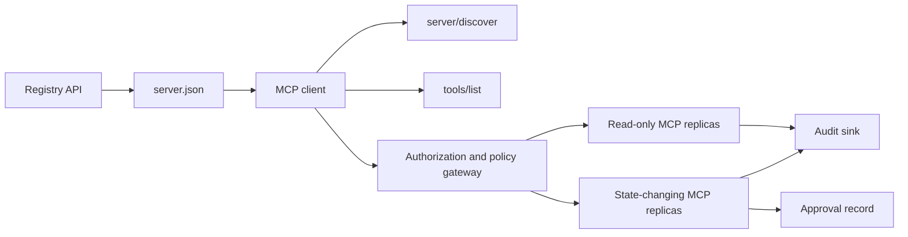

# Capstone 13: Stateless MCP Server with Registry and Governance · 毕业项目 13：带注册表与治理的无状态 MCP 服务器

> 生产级 MCP 不是单个服务器进程。它是一条契约链：可发布的元数据、活体发现、无状态请求信封、授权、策略、审计与部署证据。

> Production MCP is not one server process. It is a chain of contracts: publishable metadata, live discovery, a stateless request envelope, authorization, policy, audit, and deployment evidence.

**Type:** Capstone
**Languages:** Python and TypeScript reference models; any production language
**Prerequisites:** Phase 11, Phase 13, Phase 14, Phase 17, and Phase 18
**Required MCP deep dives:** [Lesson 28: Tool Contracts](../../../13-tools-and-protocols/28-mcp-tool-contracts-and-content/docs/en.md), [Lesson 29: Reliability](../../../13-tools-and-protocols/29-mcp-reliability-cancellation-and-flow-control/docs/en.md), [Lesson 30: Registry Supply Chain](../../../13-tools-and-protocols/30-mcp-registry-supply-chain-and-drift/docs/en.md), and [Lesson 31: Conformance Operations](../../../13-tools-and-protocols/31-mcp-conformance-versioning-and-operations/docs/en.md)
**Protocol target:** MCP `2026-07-28`
**Time:** ~25 hours

## Learning Objectives · 学习目标

- 实现无状态的 MCP 请求与结果信封。
- 让 Registry 元数据与活体协议发现保持分离。
- 构建确定性的、缓存感知的工具发现。
- 对每一次工具调用强制执行 issuer、audience、scope 与审批策略。
- 部署不需要会话亲和的 Streamable HTTP。
- 在线路、授权、策略、注册表和审计边界上证明行为。

> Implement the stateless MCP request and result envelope.
> Keep Registry metadata separate from live protocol discovery.
> Build deterministic, cache-aware tool discovery.
> Enforce issuer, audience, scope, and approval policy for every tool call.
> Deploy Streamable HTTP without session affinity.
> Prove behavior at the wire, authorization, policy, registry, and audit boundaries.

## Required MCP Prerequisite Path · 必修 MCP 先修路径

在把这个毕业项目当作生产级之前，按顺序完成下列四个互链的 Phase 13 课：

1. [Lesson 28](../../../13-tools-and-protocols/28-mcp-tool-contracts-and-content/docs/en.md) 定义本服务器必须暴露的工具、schema、内容、分页、补全、路由与错误契约。
2. [Lesson 29](../../../13-tools-and-protocols/29-mcp-reliability-cancellation-and-flow-control/docs/en.md) 定义取消竞争、截止时间、幂等、背压、重试与重连行为。
3. [Lesson 30](../../../13-tools-and-protocols/30-mcp-registry-supply-chain-and-drift/docs/en.md) 定义命名空间、溯源、准入 pin、Registry 状态、漂移、账本与回滚证据。
4. [Lesson 31](../../../13-tools-and-protocols/31-mcp-conformance-versioning-and-operations/docs/en.md) 定义 golden 与 negative 转写、严格的版本纪元、SDK 差分检查、代理证明、脱敏、健康与发布闸门。

这个毕业项目整合上述工件；它不会用一个顺利路径的 SDK 测试把它们取而代之。

> Complete the four linked Phase 13 lessons in order before treating this capstone as production-ready:
> The capstone integrates those artifacts. It does not replace them with one happy-path SDK test.

## The Problem · 问题

一个内部平台需要只读数据工具和一小组改变状态的工具。开发者必须能够发现这台服务器、理解如何连接、检查它的活体能力，并且只能调用自己被授权使用的操作。

难的不是注册一个函数。难的是让六种不同的「真相」保持一致：

1. `server.json` 说明这台服务器可以被安装或访问到哪里。
2. `server/discover` 说明活体进程现在支持什么。
3. 每个请求说明它使用的协议修订版和客户端能力。
4. 授权把调用者绑定到正确的 issuer、资源和 scope。
5. 策略决定这个具体动作是否可以运行。
6. 审计证据记录越过了边界的东西，同时不泄漏机密或敏感载荷。

任何一项发生漂移，平台就可能列出一台根本连不上的服务器、路由一个不兼容的客户端、接受一个为别的资源铸造的令牌，或者让一个破坏性动作绕过预期的评审就执行了。

> An internal platform needs read-only data tools and a small set of state-changing tools. Developers must be able to discover the server, understand how to connect, inspect its live capabilities, and call only the operations they are authorized to use.
> The difficult part is not registering a function. The difficult part is keeping six different truths aligned:
> If any one of these drifts, the platform may list a server that cannot be reached, route an incompatible client, accept a token minted for another resource, or expose a destructive action without the expected review.

## The Two Discovery Layers · 两个发现层

Registry 和活体 MCP 服务器回答的是不同的问题。

| 层 | 契约 | 它回答的问题 |
|---|---|---|
| 发布 | `server.json` 和 Registry API | 这台服务器是什么，它的包或 remote 端点在哪，如何配置？ |
| 运行时 | `server/discover` | 这个进程支持哪些协议版本、能力、扩展和服务器身份？ |

官方 Registry 使用带版本号的 `server.json` schema。remote 条目可以填写一个 Streamable HTTP URL：

```json
{
  "$schema": "https://static.modelcontextprotocol.io/schemas/2025-12-11/server.schema.json",
  "name": "com.example/internal-readonly",
  "title": "Internal Read-Only Tools",
  "description": "Read-only incident and data lookup tools.",
  "version": "1.0.0",
  "remotes": [
    {
      "type": "streamable-http",
      "url": "https://mcp.internal.example.com/readonly"
    }
  ]
}
```

Registry schema 版本和 MCP 协议修订版彼此独立。不要为了让两个日期一致而改写其中之一。每份文档都按它自己的契约来校验。

schema 合法不等于拥有命名空间。一个针对 `example.com` 完成验证的发布者，使用反向 DNS 命名空间 `com.example/*` 或其某个子命名空间。Registry 的认证流程证明这份所有权。把域名的标签按普通顺序倒过来写，指的就是另一个命名空间。

stdlib 参考模型的 `validate_registry_document` 函数刻意只做部分的 remote-profile 校验。它检查官方必需的 `name`、`description` 和 `version` 字段；可选的 `title`；发布名称与长度约束；具体版本号的形状；以及每条 `streamable-http` 或 `sse` remote 的 HTTP(S) URL 形状。它还要求 `remotes` 列表非空，因为本毕业项目总要活体探测一个 remote。`validate_publisher_namespace` 单独把名称对照已验证的发布者域名校验；`validate_runtime_alignment` 则把发布的名称和版本与活体 `serverInfo` 对比。官方 schema 还支持仅含 package 的记录以及更多 remote 字段。发布之前，用钉住的官方 JSON Schema 或 `mcp-publisher` 校验整份文档；不要把这个零依赖子集冒充完整 schema 校验。

服务器必须实现 `server/discover`；客户端可以在调用其他方法之前先调用它。本毕业项目的客户端在解析出端点后就这样做，并拿到当前协议修订版和活体能力：

```json
{
  "resultType": "complete",
  "supportedVersions": ["2026-07-28"],
  "capabilities": {
    "tools": {
      "listChanged": false
    }
  },
  "_meta": {
    "io.modelcontextprotocol/serverInfo": {
      "name": "com.example/internal-readonly",
      "version": "1.0.0"
    }
  },
  "ttlMs": 3600000,
  "cacheScope": "public"
}
```

私有目录可以索引额外的所有权、评审或生命周期数据，但不得把这些数据凭空造为 MCP 线上字段或 `server.json` 根字段。把组织策略存放在已发布记录旁边。确需公开的自定义元数据时，使用 Registry 的 `_meta.io.modelcontextprotocol.registry/publisher-provided` 扩展，并守住其 4 KB 上限。

> The Registry and the live MCP server answer different questions.
> The Registry schema version and the MCP protocol revision are independent. Do not rewrite one date to match the other. Validate each document against its own contract.
> Schema validity does not prove namespace ownership. A publisher verified for `example.com` uses the reverse-DNS namespace `com.example/*` or one of its child namespaces.
> The stdlib model's `validate_registry_document` function is intentionally a partial remote-profile validator. ... Before publication, validate the entire document with the pinned official JSON Schema or `mcp-publisher`; do not present this dependency-free subset as full schema validation.
> The server must implement `server/discover`; a client may call it before other methods.
> A private catalog may index extra ownership, review, or lifecycle data, but it must not invent that data as MCP wire fields or root `server.json` fields.

## Stateless MCP Core · 无状态 MCP 核心

MCP 修订版 `2026-07-28` 移除了协议会话和 `initialize` / `notifications/initialized` 握手，也移除了 `Mcp-Session-Id`。

每个请求都在 `params._meta` 里携带协议上下文：

```json
{
  "io.modelcontextprotocol/protocolVersion": "2026-07-28",
  "io.modelcontextprotocol/clientCapabilities": {},
  "io.modelcontextprotocol/clientInfo": {
    "name": "internal-platform-client",
    "version": "1.0.0"
  }
}
```

版本和能力是请求事实，不是连接事实。负载均衡器可以把相邻的请求发给不同的健康副本，因为任何一个副本都能从消息本身校验这个请求。

普通结果包含 `resultType: "complete"`。服务器应在每个结果的 `_meta.io.modelcontextprotocol/serverInfo` 里放上自己的身份。缺失或非字符串的协议版本属于无效参数 `-32602`。错误 `-32022` 只用于「提供了字符串但不被支持」的情况，其 data 恰好是 `{"supported": ["2026-07-28"], "requested": "..."}`。

> MCP revision `2026-07-28` removes protocol sessions and the `initialize` / `notifications/initialized` handshake. It also removes `Mcp-Session-Id`.
> Every request carries protocol context in `params._meta`:
> The version and capabilities are request facts, not connection facts. A load balancer may send consecutive requests to different healthy replicas because either replica can validate the request from the message itself.
> Ordinary results include `resultType: "complete"`. Servers should place their identity in `_meta.io.modelcontextprotocol/serverInfo` on each result. A missing or non-string protocol version is invalid params `-32602`. Error `-32022` is only for a supplied string that is unsupported, with exactly `{"supported": ["2026-07-28"], "requested": "..."}` as its data.

### Cacheable discovery · 可缓存的发现

对同一个有效工具集，`tools/list` 必须是确定性的。结果包括：

- `ttlMs`，给客户端的新鲜度提示；
- `cacheScope`，`public` 或 `private`；
- 稳定的工具顺序，让相同的列表可以复用 prompt 缓存；
- `resultType: "complete"` 和服务器身份元数据。

按用户的授权通常应产生 `cacheScope: "private"`。不要把用户各自的工具可见性藏在共享的 public 缓存后面。

> `tools/list` must be deterministic for the same effective tool set. The result includes:
> Per-user authorization should normally produce `cacheScope: "private"`. Do not put user-specific tool visibility behind a shared public cache.

## Streamable HTTP · Streamable HTTP 传输

网络服务器暴露一个接受 POST 的 MCP 端点。每个 JSON-RPC 请求或通知各自发一个 POST。

对于请求，服务器要么返回一个 JSON 对象，要么返回一条以该请求为作用域的 SSE 流。长活的 `subscriptions/listen` 请求承载 opt-in 的变更通知。当前传输层没有独立的 GET 流、会话 DELETE、会话头或 `Last-Event-ID` 重放。

每个请求包含：

- `MCP-Protocol-Version`，与请求体元数据一致；
- `Mcp-Method`，与 JSON-RPC 方法一致；
- `tools/call`、`resources/read` 和 `prompts/get` 要带 `Mcp-Name`；
- `Accept: application/json, text/event-stream`。

镜像头不匹配就用规定的 `-32020` 错误拒绝。校验 `Origin`，把本地开发服务器绑到回环地址，对远程客户端做认证，并把请求作用域的 SSE 响应关闭视为取消。



```figure
cf-mcp-gate
```

> A network server exposes one MCP endpoint that accepts POST. Each JSON-RPC request or notification gets its own POST.
> For a request, the server returns either one JSON object or an SSE stream scoped to that request. A long-lived `subscriptions/listen` request carries opted-in change notifications. There is no standalone GET stream, session DELETE, session header, or `Last-Event-ID` replay in the current transport.
> Reject mismatched mirrored headers with the specified `-32020` error. Validate `Origin`, bind local development servers to loopback, authenticate remote clients, and treat a closed request-scoped SSE response as cancellation.

## Authorization and Policy · 授权与策略

传输层元数据不是授权。每一次调用都要校验授权。

对远程服务器：

1. 发现受保护资源元数据。
2. 为该资源选择授权服务器。
3. 客户端注册优先使用 Client ID Metadata Documents。把 Dynamic Client Registration 视为兼容性支持。
4. 授权过程中发送资源指示符（resource indicator）。
5. 对照该流程记录的授权服务器，校验返回的 `iss` 值。
6. 客户端凭据按 issuer 分别存键。绝不在不同 issuer 之间复用注册数据。
7. 在 MCP 服务器端校验令牌的 issuer、audience 或资源、过期时间与 scope。
8. 对具体的工具和参数再做一次策略决策。

`readOnlyHint`、`destructiveHint` 这类工具注解帮助客户端呈现风险。它们不是可信的授权控制。

> Transport metadata is not authorization. Validate authorization on every call.
> Prefer Client ID Metadata Documents for client registration. Treat Dynamic Client Registration as compatibility support.
> Validate token issuer, audience or resource, expiry, and scopes at the MCP server.
> Apply a second policy decision to the concrete tool and arguments.
> Tool annotations such as `readOnlyHint` and `destructiveHint` help clients present risk. They are not trusted authorization controls.

### Approval is a record, not a magic scope · 审批是一份记录，不是一个魔法 scope

改变状态的调用需要一份审批记录，绑定到操作者、工具、规范化参数或其摘要、目标环境、过期时间，以及一次性或可重复使用策略。光靠一条聊天消息不构成审批证明。

Python 参考模型对键排序后的规范化 JSON 做哈希，再把该摘要与令牌主体、工具名、服务器 URL 和过期时间绑定。改动哪怕一个参数之后重放这份记录，都会在处理器运行之前失败。审批是独立的证据，不是往访问令牌上追加的一个 scope。

当能实质缩小爆炸半径时，把高风险工具放在单独可评审的平面上。只有凭据、策略、部署身份和审计控制也都分离，这种分离才有意义。

> A state-changing call needs an approval record bound to the actor, tool, normalized arguments or digest, target environment, expiry, and one-time or repeat-use policy. A chat message alone is not proof of approval.
> The Python model hashes canonical JSON with sorted keys, then binds that digest with the token subject, tool name, server URL, and expiry. Replaying the record after changing even one argument fails before the handler runs. Approval is separate evidence, not a scope added to the access token.
> Keep high-risk tools on a separately reviewable surface when that materially reduces blast radius. Separation is useful only if credentials, policy, deployment identity, and audit controls are also separate.

## Build It · 动手造

### 1. Model publication metadata · 建模发布元数据

创建 `server.json` 并做 schema 校验。包含一个稳定的名称（位于发布者已完成认证的命名空间内），外加版本、描述、适用的官方 `repository` 或 `packages` 元数据，以及一个 remote 或 stdio 传输。机密一律用声明式环境变量输入，绝不写死字面值。

### 2. Implement live discovery · 实现活体发现

在任何功能 RPC 之前实现 `server/discover`。通告支持的协议版本、能力、扩展和服务器身份。加一个使用 `-32022` 的版本拒绝用例。

### 3. Implement the stateless envelope · 实现无状态信封

每个请求都要求协议版本和客户端能力。每个结果都返回 `resultType` 和服务器身份。移除初始化状态、按连接缓存的能力集合和会话标识。

### 4. Build the tool surface · 构建工具面

从两个只读工具和一个改变状态的工具起步。每个工具都要有有界的 JSON Schema、精确的描述、确定的结果形状和如实的注解。客户端依赖结构化结果时补上输出 schema。

### 5. Add cache-aware listing · 加入缓存感知列表

按稳定顺序返回工具，带 `ttlMs` 和 `cacheScope`。把缓存过期与列表变更通知行为分开演练。

### 6. Add authorization and policy · 加入授权与策略

校验 issuer、audience、过期时间和 scope。每次工具调用都跑一次策略决策。审批绑定到具体的高风险动作。在执行处理器之前，先拒绝缺失或过期的审批。

### 7. Separate registry and runtime validation · 分离注册表与运行时校验

先校验静态 `server.json` 记录，再用 `server/discover` 探测 remote 端点。当发布的 remote、身份、版本或必需能力与活体进程不一致时，报告漂移。

### 8. Add audit evidence · 加入审计证据

记录操作者、issuer、资源、工具、策略决策、请求标识、trace 上下文、延迟和结果。持久化之前对敏感参数和结果做脱敏或摘要。审计 sink 保持在模型可见上下文之外。

### 9. Exercise horizontal scaling · 演练水平扩展

把两个无状态副本放到负载均衡器后面。发送至少 100 个并发请求。证明正确性不依赖亲和性。如果某个工具需要跨调用状态，铸造一个显式的不透明句柄，存进共享的持久化系统。

### 10. Cross the real wire · 走真实线路

对真实的服务器二进制跑一致性检查。抓取请求头和 JSON 请求体，而不只是 SDK 对象。演练错误版本、头不匹配、缺 scope、错 audience、畸形参数、处理器失败、取消和缓存过期。

> Create and schema-validate `server.json`. Include a stable name inside the namespace authenticated for the publisher, plus version, description, official `repository` or `packages` metadata when applicable, and a remote or stdio transport. Keep secrets as declared environment-variable inputs, never literal values.
> Implement `server/discover` before any feature RPC. Advertise supported protocol versions, capabilities, extensions, and server identity. Add a version rejection case using `-32022`.
> Require protocol version and client capabilities in every request. Return `resultType` and server identity in every result. Remove initialization state, connection-scoped capability caches, and session identifiers.
> Run conformance checks against the actual server binary. Capture request headers and JSON bodies, not only SDK objects.

## Required Evidence Pack · 必需证据包

提交中缺了下面五类证据的任何一类，就视为不完整：

| 证据 | 最低证明 | 来源课 |
|---|---|---|
| 线路 | golden 与 negative 用例的脱敏原始请求头和 JSON-RPC 请求体，含元数据类型失败、头不匹配、不支持的版本、缺失或未知的 `resultType`、通知无响应、响应 ID 匹配 | [Lesson 31](../../../13-tools-and-protocols/31-mcp-conformance-versioning-and-operations/docs/en.md) |
| 代理 | 同一个稳定用例分别直连和经过部署的中间人运行，带 ingress、origin、egress 的状态与 body 摘要；证明协议错误不会被折叠成笼统的 500 响应，流式也不会被缓冲 | [Lessons 29](../../../13-tools-and-protocols/29-mcp-reliability-cancellation-and-flow-control/docs/en.md) 和 [31](../../../13-tools-and-protocols/31-mcp-conformance-versioning-and-operations/docs/en.md) |
| 准入 | 已验证的发布者命名空间、不可变的 Registry 记录摘要、工件或 remote 溯源、活体 `server/discover` 的身份与能力观测、描述符 pin、当前 Registry 状态、准入账本事件 | [Lesson 30](../../../13-tools-and-protocols/30-mcp-registry-supply-chain-and-drift/docs/en.md) |
| 重试 | 取消与完成的赛跑、显式超时、安全的读重试、变更幂等键、重连后重取，以及证明请求取消不会悄然变成持久任务取消 | [Lesson 29](../../../13-tools-and-protocols/29-mcp-reliability-cancellation-and-flow-control/docs/en.md) |
| 回滚 | 精确的上一版本、准入与工件摘要、描述符 pin、生效中的 Registry 状态、当前健康窗口、路由恢复结果、脱敏后的决策证据 | [Lessons 30](../../../13-tools-and-protocols/30-mcp-registry-supply-chain-and-drift/docs/en.md) 和 [31](../../../13-tools-and-protocols/31-mcp-conformance-versioning-and-operations/docs/en.md) |

把脱敏证据包的摘要随发布一起保存。任何一类缺失就扣住发布。不要用进程内调度器推断代理行为，用 Registry 里有记录推断准入，用一个新的 JSON-RPC id 推断重试安全，用「上一个部署还在」推断回滚就绪。

> A submission is incomplete until it contains all five evidence classes:
> Store a digest of the redacted pack with the release. If any class is missing, hold the release. Do not infer proxy behavior from an in-process dispatcher, admission from Registry presence, retry safety from a new JSON-RPC id, or rollback readiness from “the previous deployment.”

## Local Reference Models · 本地参考模型

Python 参考模型演示注册表元数据、反向 DNS 发布者命名空间校验、发布与运行时的身份比对、活体发现、确定性工具列表、按请求元数据、可信 issuer、audience、过期时间与 scope 检查、绑定动作的审批、一个有文档说明的部分 Registry 校验器、策略与审计——全程不打开任何网络套接字：

```bash
cd phases/19-capstone-projects/13-mcp-server-with-registry
python3 code/main.py
python3 -m unittest discover -s code/tests -v
```

TypeScript 项目在不依赖 MCP SDK 的情况下，通过 stdio 暴露无状态 JSON-RPC 形态。它的 `tools/call` 路径强制执行与 `tools/list` 所通告一致的有界输入 schema；已知工具收到无效参数时，返回带 `isError: true` 的完整结果，而不会调用执行器：

```bash
cd phases/19-capstone-projects/13-mcp-server-with-registry/code/ts
npm install
npm run typecheck
npm test
npm run demo
```

这些模型证明的是本地契约逻辑。它们不证明 HTTP 头、OAuth 交换、Registry 发布、OPA 集成、负载均衡或采集器接收。

> The Python model demonstrates registry metadata, reverse-DNS publisher namespace validation, publication-to-runtime identity checks, live discovery, deterministic tool listing, per-request metadata, trusted-issuer, audience, expiry, and scope checks, action-bound approvals, a documented partial Registry validator, policy, and audit without opening a network socket:
> The TypeScript project exposes the stateless JSON-RPC shape over stdio without an MCP SDK. Its `tools/call` path enforces the same bounded input schemas advertised by `tools/list`; invalid arguments for a known tool return a complete result with `isError: true` without invoking the executor:
> These models prove local contract logic. They do not prove HTTP headers, OAuth exchange, Registry publication, OPA integration, load balancing, or collector receipt.

## Wire Example · 线上报文示例

```http
POST /mcp HTTP/1.1
Host: mcp.internal.example.com
Content-Type: application/json
Accept: application/json, text/event-stream
MCP-Protocol-Version: 2026-07-28
Mcp-Method: tools/call
Mcp-Name: postgres.readonly
Authorization: Bearer REDACTED

{
  "jsonrpc": "2.0",
  "id": 42,
  "method": "tools/call",
  "params": {
    "name": "postgres.readonly",
    "arguments": {"sql": "SELECT 1"},
    "_meta": {
      "io.modelcontextprotocol/protocolVersion": "2026-07-28",
      "io.modelcontextprotocol/clientCapabilities": {},
      "io.modelcontextprotocol/clientInfo": {
        "name": "internal-platform-client",
        "version": "1.0.0"
      }
    }
  }
}
```

## Ship It · 交付

交付一个包含以下内容的仓库：

- 一份 schema 合法的 `server.json`；
- 只读与改变状态的服务器面；
- `server/discover`、确定性 `tools/list` 和策略把关的 `tools/call`；
- 一个带两个可互换副本的 Streamable HTTP 部署；
- 授权与审批集成；
- 一个 Registry 发布端或私有 Registry API 适配器；
- 策略定义和绑定动作的审批记录；
- 脱敏的审计输出与 trace 传播；
- 线路与代理失败证据；
- 准入、重试、健康与回滚证据，附脱敏证据包的摘要。

| 权重 | 评分标准 | 证据 |
|---:|---|---|
| 25 | 协议正确性 | 无状态请求元数据、发现、结果、请求头与 negative 用例 |
| 20 | 授权 | issuer、audience、过期时间、scope 与绑定动作的审批用例 |
| 15 | Registry 完整性 | 合法的 `server.json`、发布记录、活体发现探测与漂移报告 |
| 15 | 策略与安全 | 允许、拒绝、畸形、过期审批与敏感数据用例 |
| 15 | 规模与可靠性 | 双副本、不依赖亲和性、取消、超时与恢复 |
| 10 | 可审计性 | 脱敏的接收侧审计与 trace 证据 |

## Exercises · 练习

1. 改动已发布的 remote URL，而保持活体服务器不变。让注册表校验报告出确切的漂移。
2. 用相同输入把 `tools/list` 发两遍，证明工具顺序逐字节稳定。然后让 `ttlMs` 过期并刷新。
3. 用一个不同的 `MCP-Protocol-Version` 头发送合法请求体。返回 `-32020`，并且不调用策略或工具。
4. 为只读服务器铸造一个令牌，然后出示给改变状态的服务器。证明 audience 校验在处理器运行之前就失败。
5. 把一份审批绑定到一个规范化参数摘要上。改动其中一个字段，证明这份审批无法重放。
6. 把相邻调用路由到交替的副本。凡工作流需要持久化的地方，用显式共享句柄替换隐藏的进程内存。
7. 弄断一条请求作用域的 SSE 连接，然后用新的 JSON-RPC 请求 ID 重试。验证没有走任何 `Last-Event-ID` 恢复路径。

> 2. Send `tools/list` twice with identical inputs and prove byte-stable tool order. Then expire `ttlMs` and refresh.
> 4. Mint a token for the read-only server and present it to the state-changing server. Prove audience validation fails before the handler runs.
> 5. Bind an approval to one normalized argument digest. Change one field and prove the approval cannot be replayed.
> 7. Break a request-scoped SSE connection and retry with a new JSON-RPC request ID. Verify that no `Last-Event-ID` recovery path is used.

## Key Terms · 术语表

| 术语 | 俗称 | 实际含义 |
|---|---|---|
| Stateless MCP | "任何地方都不留状态" | 没有协议会话；跨调用状态是显式的、由服务器管理的 |
| `server.json` | "工具清单" | Registry 元数据：命名、打包、配置与传输 |
| `server/discover` | "那个握手" | 一个普通的强制 RPC，用于活体版本与能力，不是会话初始化器 |
| Cache scope | "能缓存吗" | 一个可缓存结果对共享或私有复用是否安全 |
| Policy decision | "令牌允许了" | 对操作者、工具、目标、参数与上下文的独立决策 |
| Approval record | "有人点了同意" | 绑定到一个操作者和一个后果性动作、带过期策略的证据 |
| Explicit handle | "一个会话 ID" | 由服务器管理的具名状态的普通应用数据，不是协议连接状态 |

## Further Reading · 延伸阅读

- [MCP 2026-07-28 key changes](https://modelcontextprotocol.io/specification/2026-07-28/changelog)
- [Streamable HTTP](https://modelcontextprotocol.io/specification/2026-07-28/basic/transports/streamable-http)
- [Server discovery](https://modelcontextprotocol.io/specification/2026-07-28/server/discover)
- [MCP authorization](https://modelcontextprotocol.io/specification/2026-07-28/basic/authorization)
- [Official Registry server.json requirements](https://github.com/modelcontextprotocol/registry/blob/main/docs/reference/server-json/official-registry-requirements.md)
- [Official Registry OpenAPI contract](https://registry.modelcontextprotocol.io/openapi.yaml)
