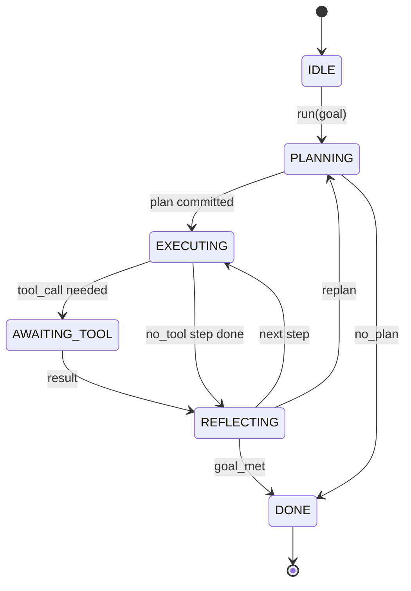

# Agent Harness Loop Contract · Agent Harness 循环契约

harness 即 agent，模型只是一颗协处理器（coprocessor）。本课把这套循环契约（loop contract）冻结下来，任何模型都能接进来。

> The harness is the agent. The model is a coprocessor. This lesson freezes the loop contract you can wire any model into.

**Type:** Build
**Languages:** Python
**Prerequisites:** Phase 13 lessons 01-07, Phase 14 lesson 01
**Time:** ~90 minutes

## Learning Objectives · 学习目标
- 把 agent harness 循环规约为一台带显式转移的确定性状态机（state machine）。
- 实现十个生命周期钩子（hook）主题，运维者通过它们接入策略、遥测与护栏。
- 定义两个拉取点（pull point）：循环在此把控制权交还调用方，并在新输入到来时恢复执行。
- 强制执行每会话预算（轮数、工具调用数、墙钟时间），超限时不得泄漏部分状态。
- 发出十一类类型化事件，让下游 UI 与追踪器无需直接检查循环即可订阅。

> Specify an agent harness loop as a deterministic state machine with explicit transitions.
> Implement ten lifecycle hook topics that operators wire policy, telemetry, and guardrails into.
> Define two pull points where the loop yields control back to the caller and resumes on a fresh input.
> Enforce per-session budgets (turns, tool calls, wall-clock) without leaking partial state on exceeding.
> Emit a typed stream of eleven event types so downstream UIs and tracers can subscribe without inspecting the loop directly.

```figure
cf-loop-contract
```

## The frame · 整体框架

一个能无人值守连跑四十轮的编码 agent 不是聊天循环。它是一台状态机：节点可以被运维者拦截，边可以被运维者审计。一旦把契约写下来，更换模型、工具或策略就不再是一次重构，而只是一次注册调用。

本课构建的就是这份契约。我们命名了六个状态、十个钩子主题、两个拉取点、十一类事件，以及一个预算包络（budget envelope）。harness 里其余的一切（工具注册表、JSON-RPC 传输、分发器、规划器）都插进这个形状里。

> A coding agent that runs unattended for forty turns is not a chat loop. It is a state machine whose nodes the operator can intercept and whose edges the operator can audit. Once you write the contract down, swapping models, tools, or policies stops being a refactor. It becomes a registration call.
> This lesson builds that contract. We name six states, ten hook topics, two pull points, eleven event types, and a budget envelope. Everything else in the harness (tool registry, JSON-RPC transport, dispatcher, planner) plugs into this shape.

## The states · 状态

循环有六个状态。五个是活跃的，一个是终态。



`IDLE` 是唯一的合法入口。`DONE` 是唯一的合法出口。`AWAITING_TOOL` 是唯一会产生拉取点的状态。其余所有转移都是内部的。

状态机是确定性的：给定同一份事件日志，harness 会回到同一个状态。正是这个性质让你可以在调试时重放会话，而无需重新调用模型。

> The loop has six states. Five are active. One is terminal.
> `IDLE` is the only legal entry point. `DONE` is the only legal exit. `AWAITING_TOOL` is the only state that yields a pull point. Every other transition is internal.
> The state machine is deterministic. Given the same event log, the harness re-enters the same state. That property is what lets you replay sessions for debugging without re-calling the model.

## The hook topics · 钩子主题

钩子（hook）是运维者接入循环的接缝。harness 会触发十个主题。每个主题接受任意数量的订阅者，订阅者按注册顺序触发。订阅者可以修改载荷（payload）、抛异常中止本轮，或返回哨兵值跳过下一步。

```text
before_plan         after_plan
before_tool_call    after_tool_call
before_step         after_step
on_error
on_pause
on_budget_exceeded
on_complete
```

这个形状是 Claude Code、Cursor 和 OpenCode 到 2025 年年中都收敛到的同一套。命名是功能性的，不是品牌化的。拦截 `rm -rf` 的钩子放在 `before_tool_call`；发送 OpenTelemetry span 的钩子放在 `after_step`；在暂停的会话上恢复执行的钩子放在 `on_pause`。

> Hooks are the operator's seam into the loop. The harness fires ten topics. Each topic accepts any number of subscribers. Subscribers fire in registration order. A subscriber may mutate the payload, raise to abort the turn, or return a sentinel to skip the next step.
> The shape mirrors what Claude Code, Cursor, and OpenCode all converged on by mid-2025. The names are functional, not branded. A hook that blocks `rm -rf` lives in `before_tool_call`. A hook that ships an OpenTelemetry span lives in `after_step`. A hook that resumes on a paused session lives in `on_pause`.

## The pull points · 拉取点

循环有两次交出控制权。第一次在 `AWAITING_TOOL`：没有工具结果就无法继续推进。第二次在 `on_pause`：预算耗尽，或某个钩子显式要求人工审查。

拉取点不是异常，而是一次返回。调用方检查 harness 状态，取来 harness 要的东西，然后调用 `resume(payload)`，harness 从停下的地方继续。这与 Python 生成器是同一个形状。拉取点上用什么传输由你选择：TUI 里是一次按键，MCP 上是 `tools/call`，队列里是一次任务轮询。

> The loop yields control twice. First on `AWAITING_TOOL` when it cannot make progress without a tool result. Second on `on_pause` when the budget is exhausted or a hook explicitly requests human review.
> A pull point is not an exception. It is a return. The caller inspects the harness state, fetches whatever the harness asked for, and calls `resume(payload)`. The harness picks up where it stopped. ... The transport over the pull point is your choice. In a TUI it is keypress. Over MCP it is `tools/call`. Over a queue it is a job poll.

## The event stream · 事件流

循环在契约的特定位置把事件追加进一条类型化流（typed stream）。流是只追加的（append-only），订阅者可以从任意偏移量重放。实现的十一类事件是：

- `session.start` — 调用 `run(goal)` 时发出一次
- `plan.draft` — 规划器返回草稿计划时发出
- `plan.commit` — 草稿被提交为活跃计划之后发出
- `step.start` — 每个执行中的步骤开始时发出
- `step.end` — 每个执行中的步骤结束时发出
- `tool.call` — 需要工具的步骤把控制权交还调用方时发出
- `tool.result` — 恢复执行并带有工具结果时发出
- `tool.error` — 恢复执行但带错误，或钩子中止调用时发出
- `budget.warn` — 达到某个预算上限时发出
- `session.pause` — 循环因暂停（预算或钩子）而交出控制权时发出
- `session.complete` — 循环到达 `DONE` 时发出一次

事件不重复钩子的载荷。钩子是命令式的（修改、中止），事件是观察性的（记录、外发）。把两者看作正交的。

> The loop appends events to a typed stream at specific points in the contract. The stream is append-only and subscribers can replay from any offset. The eleven implemented event types are:
> - `session.start` — emitted once when `run(goal)` is called
> - `plan.draft` — emitted when the planner returns a draft plan
> - `plan.commit` — emitted after the draft is committed as the active plan
> - `step.start` — emitted at the start of each executing step
> - `step.end` — emitted at the end of each executing step
> - `tool.call` — emitted when a tool-requiring step yields control to the caller
> - `tool.result` — emitted on resume with a tool result
> - `tool.error` — emitted on resume with an error or when a hook aborts the call
> - `budget.warn` — emitted when a budget limit is reached
> - `session.pause` — emitted when the loop yields on a pause (budget or hook)
> - `session.complete` — emitted once when the loop reaches `DONE`
> The events do not duplicate hook payloads. Hooks are imperative (mutate, abort). Events are observational (record, ship). Treat them as orthogonal.

## The budget envelope · 预算包络

每个会话携带三个上限：轮数、工具调用数、墙钟秒数。每轮把 turns 加一，每次工具调用把 tool calls 加一，墙钟在每次状态转移时检查。任一上限到达时，循环触发 `on_budget_exceeded`、发出 `budget.warn`，然后在下一个拉取点以 budget-exceeded 原因转移到 `IDLE`。

预算不是杀死开关（kill switch），而是一次让位（yield）。由调用方决定是扩大预算并恢复执行，还是关闭会话。

> A session carries three limits. Turn count, tool call count, wall-clock seconds. Each turn increments turns by one. Each tool call increments tool calls by one. Wall-clock is checked on every state transition. When any limit is reached, the loop fires `on_budget_exceeded`, emits `budget.warn`, then transitions to `IDLE` with a budget-exceeded reason on the next pull point.
> The budget is not a kill switch. It is a yield. The caller decides whether to extend the budget and resume, or to close the session.

## What this lesson does not do · 本课不做什么

本课不调用模型，不注册真实工具，也不实现传输——那些是接下来四课的内容。本课把契约钉死，让后面四课能直接插进来而无需重写。

`main.py` 里的确定性规划器只是一个替身：它返回一个硬编码的三步计划，其中两步需要工具结果。重点是循环，不是计划。

> It does not call a model. It does not register real tools. It does not implement a transport. Those are the next four lessons. This lesson nails the contract so the next four can plug into it without rewriting.
> The deterministic planner in `main.py` is a stand-in. It returns a hardcoded plan of three steps, two of which require a tool result. The point is the loop, not the plan.

## How to read the code · 如何读代码

`HarnessLoop` 是主类：它持有状态、触发钩子、发出事件。`Budget` 跟踪上限。`Event` 是流上的类型化信封。`HookRegistry` 是分发表。`_transition` 是唯一改变状态的函数，所以状态机不变式集中在一个地方。

先把 `main.py` 从头到尾读一遍，再读 `code/tests/test_loop.py`。测试钉住了每一条转移和每一个钩子的触发顺序。

> `HarnessLoop` is the main class. It holds state, fires hooks, emits events. `Budget` tracks limits. `Event` is the typed envelope on the stream. `HookRegistry` is the dispatch table. `_transition` is the only function that changes state, so the state machine invariants live in one place.
> Read `main.py` top to bottom. Then read `code/tests/test_loop.py`. The tests pin every transition and every hook firing order.

## Going further · 更进一步

在生产环境构建 harness，最难的部分不是状态机，而是让契约可被强制执行。契约必须挺过规划器的热重载，挺过一个返回畸形 JSON 的工具，挺过一个在四十轮会话进行到三分之二时在 `before_tool_call` 里抛异常的钩子。本课的测试演练了这些失败模式。跑一遍，弄坏它们，再补用例。

下一课加入工具注册表，再下一课是 JSON-RPC 传输，然后是分发器。到第二十四课，本文件里的这个循环将带着真实计划、真实工具和被强制执行的真实预算跑起来。

> The hardest part of building a harness in production is not the state machine. It is making the contract enforceable. The contract has to survive a hot reload of the planner. It has to survive a tool that returns malformed JSON. It has to survive a hook that raises in `before_tool_call` two-thirds of the way through a forty-turn session. The tests in this lesson exercise those failure modes. Run them. Break them. Add cases.
> The next lesson adds the tool registry. After that, the JSON-RPC transport. After that, the dispatcher. By lesson twenty-four, the loop in this file will be running a real plan against real tools with real budgets enforced.
