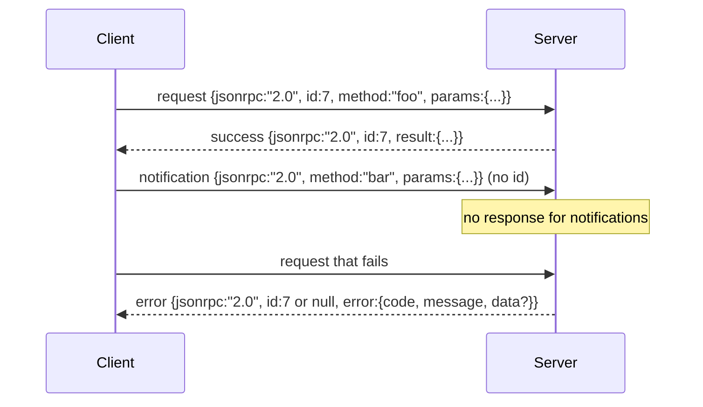

# JSON-RPC 2.0 Over Newline-Delimited Stdio · 基于换行分隔 stdio 的 JSON-RPC 2.0

模型客户端与工具服务器之间的传输，就是 stdio 上的 JSON-RPC。亲手实现一遍，你就明白每一层帧封装（framing）都在为什么买单。

> The transport between a model client and a tool server is JSON-RPC over stdio. Hand-rolling it once teaches you what every framing layer is paying for.

**Type:** Build
**Languages:** Python
**Prerequisites:** Phase 13 lessons 01-07, Phase 14 lesson 01
**Time:** ~90 minutes

## Learning Objectives · 学习目标
- 说 JSON-RPC 2.0：以换行分隔的 JSON 帧在 stdin 和 stdout 上传输。
- 掌握五个标准错误码（-32700、-32600、-32601、-32602、-32603），并以正确的语义暴露它们。
- 区分请求、响应、通知（notification）和批次（batch），不发明新的信封键。
- 每行至多处理一个解析错误，不污染流的其余部分。
- 用 io.BytesIO 构建自终止演示，让本课无需派生子进程即可运行。

> Speak JSON-RPC 2.0 framed as newline-delimited JSON over stdin and stdout.
> Map the five standard error codes (-32700, -32600, -32601, -32602, -32603) and surface them with the right semantics.
> Distinguish requests, responses, notifications, and batches without inventing new envelope keys.
> Handle one parse error per line without poisoning the rest of the stream.
> Build a self-terminating demo using io.BytesIO so the lesson runs without spawning a child process.

```figure
cf-jsonrpc-frames
```

## Why JSON-RPC stays the lingua franca · 为什么 JSON-RPC 仍是通用语

2026 年的一个编码 agent，单次会话要和大约十二个工具服务器对话。每个服务器是独立进程或远程端点。线上格式自 2013 年以来就没变过。JSON-RPC 2.0 只有两页纸的规范。它存活下来，是因为那些替代方案（gRPC、每次调用走 HTTP、自定义二进制）都强加了 JSON-RPC 不必承受的取舍：它们只能在流式、批量和传输耦合里三选一。JSON-RPC 在 stdio、socket、websocket 和 HTTP 上都是对称的，而且只要双方遵守规范，客户端就能驱动一个它从未见过的服务器。

本课构建的是 stdio 变体：换行分隔的 JSON。每个请求一行，每个响应一行，传输边界就是 `\n`。

> A coding agent in 2026 talks to maybe twelve tool servers in a single session. Each server is a separate process or a remote endpoint. The wire format has been the same since 2013. JSON-RPC 2.0 is two-page spec. It survives because the alternatives (gRPC, HTTP per call, custom binary) all impose a tradeoff JSON-RPC does not: they pick either streaming or batching or transport-coupling. JSON-RPC is symmetric across stdio, sockets, websockets, and HTTP, and a client can drive a server it has never seen if both honor the spec.
> This lesson builds the stdio variant. Newline-delimited JSON. Each request is one line. Each response is one line. The transport boundary is `\n`.

## The wire shape · 线上形状

信封共有四种形状。两种由客户端说，两种由服务器说。



通知（notification）没有 `id`，服务器绝不能响应它。如果服务器对通知返回了响应，客户端无法把它挂回任何调用点。就这一条规则，让帧计算的复杂度保持简单。

批次（batch）是请求或通知组成的 JSON 数组。服务器以响应数组作答，顺序任意，每个非通知条目对应一个响应。如果批次里全是通知，服务器什么都不发。

> Four envelope shapes exist. Two are spoken by the client. Two are spoken by the server.
> A notification has no `id`. The server must not respond to it. If a server returns a response to a notification, the client has no way to attach it to a call site. That single rule keeps the framing math simple.
> A batch is a JSON array of requests or notifications. The server replies with an array of responses, in any order, one per non-notification entry. If every entry in the batch is a notification, the server sends nothing back.

## The five error codes · 五个错误码

```text
-32700  Parse error      JSON could not be parsed
-32600  Invalid Request  Envelope shape is wrong
-32601  Method not found
-32602  Invalid params
-32603  Internal error
```

-32000 到 -32099 之间的码保留给服务器自定义错误，其余都是应用自定义的。本课只用到那五个。如果你的处理器抛了异常，传输层会把它包成 -32603，并把异常类名放进 `data.exception`。

解析错误有一条特殊规则：响应里的 `id` 是 `null`，因为请求根本没解析出足以提取 id 的内容。

> The codes between -32000 and -32099 are reserved for server-defined errors. Everything else is application-defined. The lesson sticks to the five. If your handler raises, the transport wraps it as -32603 with the exception class name in `data.exception`.
> A parse error has a special rule. The `id` in the response is `null`, because the request never parsed enough to extract an id.

## Newline framing and the BytesIO demo · 换行分帧与 BytesIO 演示

传输层一次读一行。一行是指字节流中到 `\n`（含）为止的内容。某一行解析不了时，传输层写出一条 `id: null` 的 -32700 响应并继续。流没有被污染，下一行照常从头解析。

本课把一对 `io.BytesIO` 包装成 stdin 和 stdout：服务器读取请求直到 EOF，为每个请求写出响应，然后返回；客户端再把响应读回来。没有进程派生，没有超时。传输行为与真实子进程管道完全一致，因为 Python 的 `io` 接口呈现的是同样的 `.readline()` 和 `.write()` 契约。

> The transport reads one line at a time. A line is bytes up to and including `\n`. If a line cannot be parsed, the transport writes a -32700 response with `id: null` and continues. The stream is not poisoned. The next line gets parsed fresh.
> For the lesson we wrap an `io.BytesIO` pair as stdin and stdout. The server reads requests until EOF, writes responses for each, and returns. The client reads the responses back. No process spawn. No timeouts. The transport behavior is identical to a real subprocess pipe because Python's `io` interface presents the same `.readline()` and `.write()` contract.

## Method dispatch · 方法分发

传输层不知道存在哪些方法。它把调用转交给 harness 提供的可调用对象 `handler(method, params)`。处理器返回结果或抛异常。三个异常类对应特定的错误码。

```text
MethodNotFound -> -32601
InvalidParams  -> -32602
Anything else  -> -32603 with exception name in data
```

传输层永远看不到工具注册表，注册表躲在处理器后面。这正是我们想要的分层：传输层说的是 JSON-RPC，注册表说的是工具形状，分发器（第二十三课）把它们缝在一起。

> The transport does not know which methods exist. It hands off to a callable `handler(method, params)` that the harness supplies. The handler returns a result or raises. Three exception classes surface specific codes.
> The transport never sees a tool registry. The registry sits behind the handler. This is the layering we want. The transport speaks JSON-RPC. The registry speaks tool shapes. The dispatcher (lesson twenty-three) stitches them together.

## Stream behavior on errors · 出错时的流行为

```text
client writes              server reads             server writes
---------------            -----------              -------------
{...valid request...}      parses ok                {...response, id matches...}
{...broken json...         parse fails              {id:null, error: -32700}
{...valid request...}      parses ok                {...response, id matches...}
{...missing method...}     invalid envelope         {id:X, error: -32600}
```

一行坏 JSON 不会停掉循环，一个缺失的 `method` 字段不会停掉循环，处理器抛异常也不会停掉循环。传输层一直读到 EOF 为止。

> A broken JSON line does not stop the loop. A missing `method` field does not stop the loop. A handler exception does not stop the loop. The transport keeps reading until EOF.

## Notifications and asymmetric flows · 通知与非对称流

通知是即发即忘（fire-and-forget）的。harness 用通知承载进度事件、取消信号和日志行。通知让一个长时间运行的工具能够流式地报告状态更新，而不必为每条更新来回一次。

本课实现了一个出站通知辅助函数 `write_notification`。服务器在请求处理期间用它发出进度。演示展示了这个模式：一个请求进来，处理器发出两条进度通知，然后写出最终响应。

> A notification is fire-and-forget. The harness uses notifications for progress events, cancellation signals, and log lines. Notifications are how a long-running tool can stream status updates without round-tripping for each one.
> The lesson implements one outbound notification helper, `write_notification`. The server uses it to emit progress while a request is in flight. The demo shows the pattern: a request comes in, the handler emits two progress notifications, then writes the final response.

## How to read the code · 如何读代码

`code/main.py` 定义了 `StdioTransport`、解析辅助函数（`parse_request`）、三个写出辅助函数（`write_response`、`write_error`、`write_notification`）以及分发循环 `serve`。错误码常量放在模块作用域。

`code/tests/test_transport.py` 覆盖五个错误码、通知（不写出响应）、批次（数组进、数组出、跳过通知）、坏 JSON（解析错误后继续），以及处理器在调用中途写出通知的非对称流。

> `code/main.py` defines `StdioTransport`, the parse helper (`parse_request`), the three write helpers (`write_response`, `write_error`, `write_notification`), and the dispatch loop `serve`. The error code constants live at module scope.
> `code/tests/test_transport.py` covers the five error codes, notifications (no response written), batches (array in, array out, notifications skipped), broken JSON (parse error then continue), and the asymmetric flow where a handler writes a notification mid-call.

## Going further · 更进一步

对后续课程来说，这个传输已经够用了。生产级传输会再加三样东西：一个能在转发中存活的关联 id 字段（你的 `id` 已经是了，但在网格里你还需要一个外层 trace id）；一个取消通道（形如 `$/cancelRequest`、携带在途调用 id 的通知）；以及一个内容类型协商握手，让同一个 socket 既能说 JSON-RPC 也能说 Streamable HTTP。这些都不改变线上格式，它们只是添加元数据。

> This transport is enough for the lessons that follow. Production transports add three things. A correlation id field that survives forwarding (your `id` is already this, but in a mesh you need an outer trace id too). A cancellation channel (a notification like `$/cancelRequest` with the id of the in-flight call). And a content-type negotiation handshake so the same socket can speak JSON-RPC and Streamable HTTP. None of those change the wire. They add metadata.
