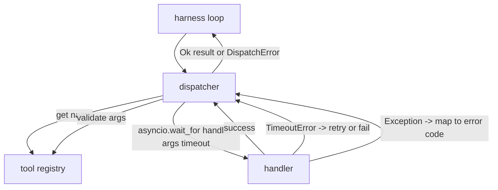
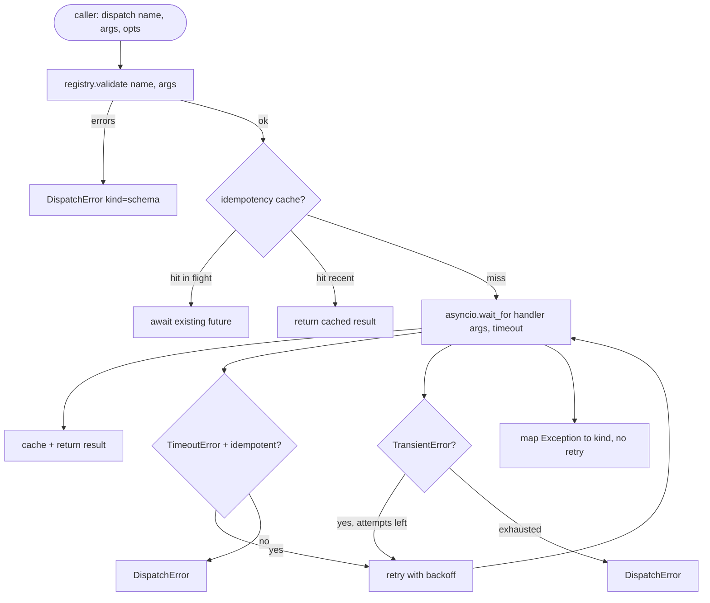

# Function Call Dispatcher · 函数调用分发器

模式许下的每一个承诺，都要由分发器（dispatcher）来兑现：超时、重试、去重、错误映射——全部落在同一条接缝上。

> The dispatcher is where the harness pays for every promise the schema made. Timeouts, retries, dedupe, error mapping. All on one seam.

**Type:** Build
**Languages:** Python
**Prerequisites:** Phase 13 lessons 01-07, Phase 14 lesson 01
**Time:** ~90 minutes

## Learning Objectives · 学习目标
- 给工具处理器包上一层每次调用的超时，超时返回类型化错误，而不是让循环挂死。
- 应用带抖动（jitter）和最大尝试次数的指数退避（exponential backoff）重试。
- 用幂等键（idempotency key）对重试去重，让与慢速原调用赛跑的重试不会执行两次。
- 把处理器异常和传输故障映射到 harness 循环已经理解的单个错误信封上。
- 用并发上限约束并行分发，让四十个工具调用的扇出（fan-out）不耗尽事件循环。

> Wrap a tool handler in a per-call timeout that returns a typed error instead of hanging the loop.
> Apply exponential backoff retry with jitter and a maximum attempt count.
> Deduplicate retries on an idempotency key so a retry that races with a slow original does not run twice.
> Map handler exceptions and transport faults onto a single error envelope the harness loop already understands.
> Bound parallel dispatch with a concurrency limit so a fan-out of forty tool calls does not exhaust the event loop.

```figure
cf-dispatch-retry
```

## Where the dispatcher sits · 分发器坐在哪里

它位于 harness 循环（第二十课）和工具注册表（第二十一课）之间。传输（第二十二课）喂给循环，循环把一次工具调用交给分发器，分发器向注册表取记录、运行处理器，然后返回结果或一个 JSON-RPC 形状的错误信封。



分发器是唯一知道定时器、重试和幂等的层。循环不知道，注册表不知道，处理器也不知道。这个隔离正是重点。

> Between the harness loop (lesson twenty) and the tool registry (lesson twenty-one). The transport (lesson twenty-two) feeds the loop. The loop hands a tool call to the dispatcher. The dispatcher calls the registry, runs the handler, and returns either a result or a JSON-RPC-shaped error envelope.
> The dispatcher is the only layer that knows about timers, retries, and idempotency. The loop does not. The registry does not. The handler does not. That isolation is the point.

## Timeouts · 超时

每个工具有一个默认超时。注册表记录里带着 `timeout_ms`，当 harness 传入每次调用的覆盖值时，分发器用覆盖值替换它。我们用 `asyncio.wait_for`：超时后处理器任务被取消，分发器返回 `DispatchError(kind="timeout")`。

对非幂等工具来说，超时默认不是可重试错误。一个超时的 `db.write` 可能提交了，也可能没提交——重试就会重复写入。分发器尊重注册表记录里的 `idempotent` 标志：幂等工具重试，非幂等工具不重试。

> Each tool has a default timeout. The registry record carries `timeout_ms`. The dispatcher overrides it from a per-call override when the harness passes one. We use `asyncio.wait_for`. On timeout, the handler task is cancelled and the dispatcher returns `DispatchError(kind="timeout")`.
> A timeout is not a retryable error by default for non-idempotent tools. A `db.write` that timed out may or may not have committed. Retrying duplicates the write. The dispatcher honors the `idempotent` flag from the registry record. Idempotent tools retry. Non-idempotent tools do not.

## Retries with exponential backoff · 指数退避重试

重试策略是最多三次尝试。退避是带抖动的指数退避。

```text
attempt 1  -> delay 0
attempt 2  -> delay 0.1s * (1 + random[0..0.5])
attempt 3  -> delay 0.4s * (1 + random[0..0.5])
```

只有 `timeout` 和 `transient` 错误会重试。`schema` 错误、`not_found` 和 `internal` 错误不重试：模式错误是确定性的，重试不会改变结果，只会烧掉预算。

重试循环尊重来自 harness 的预算。如果调用方的剩余工具调用额度为零，分发器在第一次尝试就直接快速失败，返回 `kind="budget_exceeded"`。

> The retry policy is three attempts maximum. Backoff is exponential with jitter.
> Only `timeout` and `transient` errors retry. A `schema` error, a `not_found`, or an `internal` error does not retry. Schema errors are deterministic. Retrying does not change the outcome and burns the budget.
> The retry loop respects the budget from the harness. If the caller's budget has zero remaining tool calls, the dispatcher fails fast on the first attempt and returns `kind="budget_exceeded"`.

## Idempotency key dedupe · 幂等键去重

原调用还在途时就触发的重试，是一个真实存在的生产 bug。第一次调用在四点九秒时还挂着（恰好卡在超时以内），重试在第五秒触发——现在有两个请求在同一后端上赛跑。如果这个工具是 `payments.charge`，你就扣了两次款。

分发器接受一个可选的 `idempotency_key`。当一个调用到达时，如果同一个键还在途，分发器就等待那个在途的 future 并返回其结果。缓存把键保留到完成之后六十秒，以吸收迟到重试。

键是调用方的责任。harness 从规划器派生它：`f"{step_id}:{tool_name}:{hash(args)}"`。分发器不发明键，因为只从参数派生键会让两个语义不同的调用看起来相同。

> A retry that fires while the original is still in flight is a real production bug. The first call hangs at four point nine seconds (just under the timeout). The retry fires at five seconds. Now two requests race against the same backend. If the tool is `payments.charge`, you charged twice.
> The dispatcher accepts an optional `idempotency_key`. If the same key is in flight when a call arrives, the dispatcher waits on the in-flight future and returns its result. The cache holds keys for sixty seconds after completion to absorb late retries.
> The key is the caller's responsibility. The harness derives it from the planner: `f"{step_id}:{tool_name}:{hash(args)}"`. The dispatcher does not invent keys, because deriving a key from arguments alone makes two semantically-different calls look the same.

## Error envelope · 错误信封

一次失败的分发返回单一的形状。

```text
DispatchError
  kind        : "timeout" | "transient" | "schema" | "not_found" | "internal" | "budget_exceeded"
  message     : str
  attempts    : int
  jsonrpc_code: int   (one of -32601, -32602, -32603)
```

harness 循环按 `kind` 映射到下一个状态。`schema` 和 `not_found` 走 `on_error` 并触发重规划；`timeout` 和 `transient` 走 `on_error`，视尝试次数决定是否重规划；`budget_exceeded` 触发 `on_budget_exceeded`。

> A failed dispatch returns a single shape.
> The harness loop maps `kind` to the next state. `schema` and `not_found` go to `on_error` and trigger a replan. `timeout` and `transient` go to `on_error` and may or may not replan depending on attempts. `budget_exceeded` triggers `on_budget_exceeded`.

## Concurrency limit on fan-out · 扇出时的并发上限

`gather(*calls)` 会同时运行所有协程。四十个工具调用就是四十条打开的 socket 或四十条子进程管道。大多数后端都不喜欢来自同一个客户端的四十条并行连接。

分发器用一个信号量（semaphore）包住 `gather`。默认并发上限是八。每次调用在分发前获取信号量、完成时释放。调用方看到的仍是 `gather` 形状的输出，但实际调度是有界的。

> `gather(*calls)` runs all coroutines simultaneously. With forty tool calls, that is forty open sockets or forty subprocess pipes. Most backends do not like forty parallel connections from one client.
> The dispatcher wraps `gather` in a semaphore. Default concurrency limit is eight. Each call acquires the semaphore before dispatching and releases on completion. The caller sees `gather`-shaped output but the actual scheduling is bounded.

## Flow for one call · 单次调用的流程



## How to read the code · 如何读代码

`code/main.py` 定义了 `Dispatcher`、`DispatchError` 和 `TransientError`。分发器在构造时接收一个注册表。异步的 `dispatch(name, args, ...)` 是唯一入口。每次尝试的超时在 `_run_with_retries` 内部用 `asyncio.wait_for` 内联施加。`gather_bounded(calls)` 在并发上限下运行多次分发。

`code/tests/test_dispatcher.py` 覆盖超时触发、瞬时错误重试、模式错误不重试、幂等去重（同键的两个并发调用坍缩成一次处理器调用）以及并发限制（信号量实际生效）。

测试用 `asyncio.sleep(0)` 和确定性的基于 `Counter` 的处理器，所以它们在几毫秒内跑完，不依赖墙钟时序。

> `code/main.py` defines `Dispatcher`, `DispatchError`, and `TransientError`. The dispatcher takes a registry on construction. The async `dispatch(name, args, ...)` is the only entry point. Per-attempt timeouts are applied inline inside `_run_with_retries` using `asyncio.wait_for`. `gather_bounded(calls)` runs many dispatches with the concurrency limit.
> `code/tests/test_dispatcher.py` covers timeout firing, retry on transient, no-retry on schema error, idempotency dedupe (two concurrent calls with the same key collapse to one handler invocation), and concurrency limiting (the semaphore in action).
> The tests use `asyncio.sleep(0)` and deterministic `Counter`-based handlers, so they finish in milliseconds and do not depend on wall-clock timing.

## Going further · 更进一步

生产级分发器会加两个扩展。第一，在每个转移点做结构化日志（循环的事件流已经给了你这些，但分发器自己也应发出 `dispatch.attempt` 和 `dispatch.retry` 事件）。第二，熔断器（circuit breaker）：在一个窗口内失败 N 次之后，工具进入冷却期，期间分发直接返回 `kind="circuit_open"`，不再尝试处理器。两者都能叠在这个分发器上而不改变契约。

第二十四课把分发器接到一个计划-执行 agent 上，让你看到全部四个部件一起运转。

> Two extensions production dispatchers add. First, structured logging at every transition (which the loop's event stream already gives you, but the dispatcher should also emit `dispatch.attempt` and `dispatch.retry` events). Second, circuit breakers: after N failures in a window, a tool gets a cool-down period where dispatches return immediately with `kind="circuit_open"` instead of attempting the handler. Both fit on top of this dispatcher without changing the contract.
> Lesson twenty-four glues the dispatcher to a plan-and-execute agent so you see all four pieces in motion.
