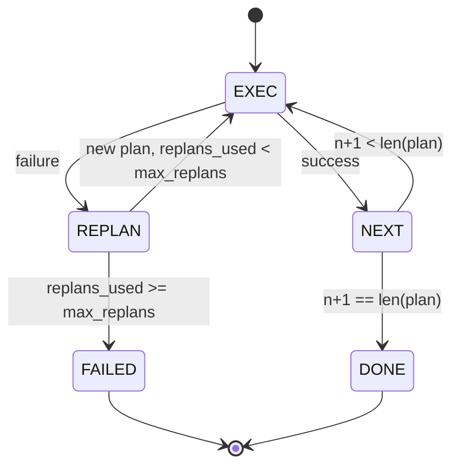

# Plan-Execute Control Flow · 计划-执行控制流

活不过一次失败的计划只是脚本；能重规划的脚本才是 agent。先把重规划器（replanner）造出来。

> A plan that cannot survive a failure is a script. A script that can replan is an agent. Build the replanner first.

**Type:** Build
**Languages:** Python
**Prerequisites:** Phase 13 lessons 01-07, Phase 14 lesson 01
**Time:** ~90 minutes

## Learning Objectives · 学习目标
- 把计划表示为带类型的有序步骤列表，让执行器能推断进度和结局。
- 顺序执行步骤，失败时以受控方式交还给规划器。
- 从当前游标出发、带着上一次错误重新规划，让下一份计划是有依据的。
- 每次修订发出一个计划差异（plan diff），让下游追踪器或 UI 能展示计划为什么变了。
- 强制执行两个预算：硬性步骤上限和硬性重规划上限。

> Represent a plan as an ordered list of typed steps so the executor can reason about progress and outcome.
> Execute steps sequentially with a controlled failure handoff back to the planner.
> Replan from the current cursor with the prior error in the context so the next plan is informed.
> Emit a plan diff on each revision so a downstream tracer or UI can show why the plan changed.
> Enforce two budgets: a hard step ceiling and a hard replan ceiling.

```figure
cg-plan-replan
```

## Plan and execute, not chain-of-thought · 计划-执行，而非思维链

思维链（chain-of-thought）agent 边生成 token 边让循环去猜工具调用在哪里结束。计划-执行 agent 先发出一份结构化计划，再确定性地执行每个步骤。计划是 harness 可以内省的数据，执行则是 harness 把这份数据送过分发器。

两个部件：一个产出计划的规划器，一个运行计划的执行器。有意思的活儿在执行器撞上失败时发生。三个选项：

```text
1. Abort         (return failed, surface the error)
2. Skip          (mark step failed, continue with the rest)
3. Replan        (hand the error to the planner, get a new plan from the cursor)
```

重规划（replan）是那个把脚本变成 agent 的选项。

> A chain-of-thought agent emits tokens and lets the loop guess where the tool call ends. A plan-and-execute agent emits a structured plan first, then executes each step deterministically. The plan is data the harness can introspect. The execution is the harness running that data through a dispatcher.
> Two pieces. A planner that produces a plan. An executor that runs the plan. The interesting work is what happens when the executor hits a failure. Three options:
> Replan is the one that turns a script into an agent.

## The Step shape · Step 的形状

```text
Step
  id              : int           (monotonic within a plan revision)
  tool_name       : str
  args            : dict
  expected_outcome: str           (planner's stated success condition)
  result          : Any | None
  error           : str | None
```

`expected_outcome` 是规划器随步骤一起发出的一句短话。执行器不强制它。它服务于两件事：重规划器在修订计划时读它；事件流把它发出去，让追踪器能展示「这一步本来要做 X」。

> `expected_outcome` is a short sentence the planner emits alongside the step. It is not enforced by the executor. It is for two things: the replanner reads it when revising the plan; the event stream emits it so a tracer can show "this step was supposed to do X."

## The planner shape · 规划器的形状

```python
def planner(goal: str, history: list[Step], last_error: str | None) -> list[Step]:
    ...
```

一个纯函数。`goal` 是用户目标。`history` 是已执行的步骤（结果和错误已填入）。`last_error` 首次调用时为 None，之后每次调用都是最近一次失败的消息。规划器返回从游标开始的下一份计划。

规划器不知道执行器的存在，不知道重试，也不知道超时。它产出一份计划，仅此而已。

> A pure function. `goal` is the user goal. `history` is the steps already executed (with results and errors filled in). `last_error` is None on the first call and the most recent failure message on every subsequent call. The planner returns the next plan starting from the cursor.
> The planner does not know about the executor. It does not know about retries. It does not know about timeouts. It produces a plan. That is all.

## The executor · 执行器

执行器是一台小型状态机。每个步骤都走一遍分发器，结局有三种：成功、可重规划的失败、致命失败。可重规划的失败交还给规划器；致命失败（预算耗尽、重规划上限触顶）返回 `FAILED` 会话结果。



> The executor is a small state machine. Each step runs through the dispatcher. The outcome is one of three things: success, failure-replannable, failure-fatal. Replannable failures hand back to the planner. Fatal failures (budget exceeded, replan ceiling hit) return a `FAILED` session result.

## Plan diffs on revision · 修订时的计划差异

规划器在失败之后返回新计划时，执行器发出一个带三个字段的 `plan.diff` 事件。

```text
removed: list of step ids that were in the old plan and are not in the new
added  : list of step ids in the new plan that were not in the old
revised: list of step ids whose tool_name or args changed
```

追踪器或 UI 可以把它渲染成：被移除的步骤画删除线，新增的步骤加高亮。重点不在差异格式本身，而在于修订是一个可见的事件，不是一次无声的重写。

> When the planner returns a new plan after a failure, the executor emits a `plan.diff` event with three fields.
> A tracer or UI can render this as a strikethrough on the removed steps and a highlight on the added ones. The point is not the diff format. The point is that revision is a visible event, not a silent rewrite.

## Two budgets, both hard · 两个硬预算

`max_steps` 限制整个会话（含重规划）的步骤执行总数，默认十二。一份五步的线性计划如果重规划两次、每次新增三步，就会达到十六次执行而超出预算；执行器将拒绝这次重规划并返回 FAILED。

`max_replans` 限制第一份计划之后规划器被调用的次数，默认五。这是更重要的那个限制：一个连着五次返回同一份坏计划的规划器，否则会一直循环到步骤预算把它逮住为止。给重规划设上限，让失败来得更快、原因更清楚。

> `max_steps` caps total step executions across the whole session, including replans. Default is twelve. A linear five-step plan that replans twice and adds three steps each time hits sixteen executions and would exceed the budget. The executor will refuse the replan and return FAILED.
> `max_replans` caps the number of times the planner is called after the first plan. Default is five. This is the more important limit. A planner that returns the same broken plan five times in a row would otherwise loop until the step budget catches it. Capping replans makes the failure faster and the reason clearer.

## The deterministic planner in this lesson · 本课的确定性规划器

本课不调用模型。课程内置了一个按 `last_error` 选计划的确定性规划器。

```text
last_error is None    -> emit a four-step plan
last_error matches X  -> emit a three-step plan that routes around X
last_error matches Y  -> emit a two-step plan that gives up gracefully
otherwise             -> return [] (signals nothing to replan)
```

这足以测试执行器在每一条转移路径上的行为：成功、重规划一次、重规划两次、重规划耗尽、步骤预算耗尽。

> We do not call a model in this lesson. The lesson ships a deterministic planner that picks a plan based on `last_error`.
> This is enough to test the executor's behavior on every transition path: success, replan-once, replan-twice, replan-exhaustion, and step-budget exhaustion.

## Result shape · 结果形状

```text
SessionResult
  status      : "completed" | "failed"
  reason      : str     ("goal_met" | "step_budget" | "replan_budget" | "no_plan")
  history     : list[Step]
  revisions   : list[PlanDiff]
  events      : list[Event]
```

第二十课的 harness 循环可以直接读取这个结果。执行每个步骤的是第二十三课的分发器，校验每个步骤参数的是第二十一课的注册表，而第二十二课的传输则可以把这整个流程通过 JSON-RPC 暴露给模型客户端。

> The harness loop from lesson twenty can read this directly. The dispatcher from lesson twenty-three is what executes each step. The registry from lesson twenty-one validates each step's args. The transport from lesson twenty-two would surface this whole flow over JSON-RPC to a model client.

## How to read the code · 如何读代码

`code/main.py` 定义了 `PlanExecuteAgent`、`Step`、`PlanDiff`、`SessionResult` 和确定性规划器。执行器是单个 `run(goal)` 方法，返回一个 `SessionResult`。计划差异通过比较步骤 id 和 `(tool_name, args)` 元组得出。

`code/tests/test_agent.py` 覆盖线性成功、中途失败后重规划一次、重规划耗尽返回 `failed:replan_budget`、步骤预算耗尽，以及计划差异事件的格式。

> `code/main.py` defines `PlanExecuteAgent`, `Step`, `PlanDiff`, `SessionResult`, and the deterministic planner. The executor is a single `run(goal)` method that returns a `SessionResult`. The plan diff is computed by comparing step ids and `(tool_name, args)` tuples.
> `code/tests/test_agent.py` covers a linear success, a mid-plan failure that replans once, replan exhaustion that returns `failed:replan_budget`, step-budget exhaustion, and the plan-diff event format.

## Going further · 更进一步

把它接到真实模型上之后，你会想要两个扩展。第一，部分计划缓存：当计划在六步里的前三步成功然后失败时，你不会想重跑前三步。执行器已经保存了历史，规划器只需要去读它。第二，并行分支：当前执行器是严格串行的，一个发出独立分支（用 `gather_step` 而不是 `next_step`）的规划器，可以通过分发器并发运行两个工具调用。

两者都带来真实的复杂度，也都是在把线性执行器钉死之后更容易添加的东西。这正是本课做的事。

> Two extensions you will want once you wire this to a real model. First, partial-plan caching: when a plan succeeds for the first three of six steps and then fails, you do not want to re-run the first three. The executor already keeps history; the planner just needs to read it. Second, parallel branches: the current executor is strictly sequential. A planner that emits an independent branch (`gather_step` instead of `next_step`) can run two tool calls concurrently through the dispatcher.
> Both add real complexity. Both are easier to add once the linear executor is pinned. That is what this lesson does.
