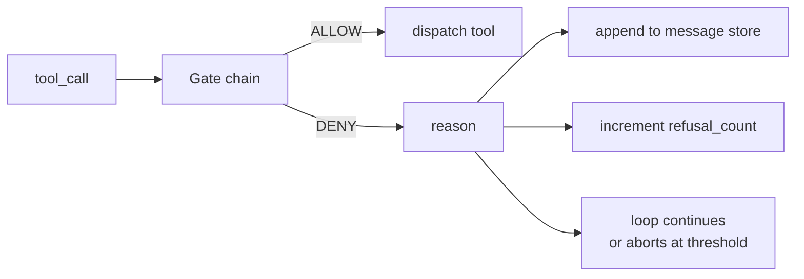
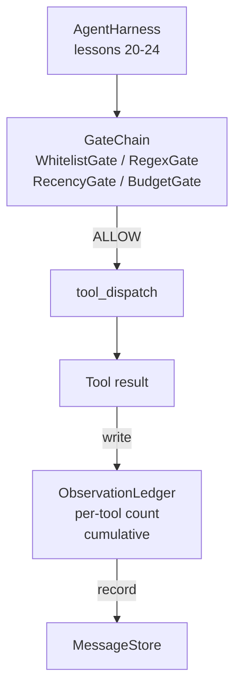

# Capstone Lesson 25: Verification Gates and the Observation Budget · Capstone 第 25 课：验证门与观察预算

一个没有验证层的 agent harness，就是一件披着风衣的许愿。本课构建一条确定性的门链（gate chain），由它决定一次工具调用是否允许触发、agent 允许看到输出的多少、以及 agent 读取过多时循环必须在何时停下。这条链是一些小的、有名有姓的门（gate）加上一本观察账本（observation ledger）的函数，账本记录模型被展示过的每一个 token。

> An agent harness without a verification layer is a wish in a trenchcoat. This lesson builds the deterministic gate chain that decides whether a tool call is allowed to fire, how much of its output the agent is allowed to see, and when the loop has to stop because the agent has read too much. The chain is a function of small, named gates plus an observation ledger that tracks every token the model has been shown.

**Type:** Build
**Languages:** Python (stdlib)
**Prerequisites:** Phase 19 · 20-24 (Track A1: agent loop, tool registry, message store, prompt builder, model router), Phase 14 · 33 (instructions as constraints), Phase 14 · 36 (scope contracts), Phase 14 · 38 (verification gates)
**Time:** ~90 minutes

## Learning Objectives · 学习目标

- 构建一个 `VerificationGate` 协议，带有确定性的 `evaluate(call)` 方法。
- 把预算门、新鲜度门、白名单门和正则门组合成一条带短路语义的链。
- 用按工具、按轮次键控的 `ObservationLedger` 跟踪每一次观察。
- 当累计观察预算将被超出时，拒绝该工具调用。
- 暴露一个结构化的 `GateDecision` 记录，供下游可观测性系统摄取。

> Build a `VerificationGate` protocol with a deterministic `evaluate(call)` method.
> Compose budget, recency, whitelist, and regex gates into a chain with short-circuit semantics.
> Track every observation through an `ObservationLedger` keyed by tool and turn.
> Refuse a tool call when the cumulative observation budget would be exceeded.
> Surface a structured `GateDecision` record that downstream observability can ingest.

## The Problem · 问题所在

当 agent harness 让模型自由调用工具时，三类 bug 会在真实使用的第一个小时内出现。

第一类是无界观察（unbounded observation）。在一个 20 万行的仓库上跑一次 grep，会把五十万 token 的输出倾倒进下一轮。模型每一千字节才看到一条匹配，其余上下文全部浪费。token 账单巨大，而 agent 在这个任务上变得更差、而不是更好。

第二类是过期的新鲜度（stale recency）。一个长时间运行的任务累积了五十次工具调用。模型把第三轮的第一次 read_file 当成实时状态来读；第四十七轮做的编辑永远不出现，因为提示词构建器把最早的观察先序列化了。

第三类是权限蔓延（privilege creep）。一个研究任务从调用 `web_search` 开始，不知怎么最后跑起了 `shell`——因为模型编造了一个工具名，而 harness 默认放行。等有人去读追踪记录时，/tmp 里已经躺了个垃圾文件，还有一次 curl 打向了私有 API。

验证门（verification gate）就是 harness 里说「不」的组件。它不是模型，也不是裁判。它是一个关于 `(call, history, ledger)` 的确定性函数，返回 ALLOW 或 DENY 以及一个理由。理由被记录，模型被告知，循环继续或中止。

> When an agent harness lets the model call tools freely, three classes of bug appear within the first hour of real use.
> The first is unbounded observation. A grep across a 200K-line repo dumps half a million tokens of output into the next turn. The model sees one match per kilobyte and the rest of the context is wasted. The token bill is large and the agent is now worse, not better, at the task.
> The second is stale recency. A long-running task accumulates fifty tool calls. The model rereads the first read_file from turn three as if it were live state. Edits made on turn forty-seven never show up because the prompt builder serialized the earliest observations first.
> The third is privilege creep. A research task starts by calling `web_search`, then somehow ends up running `shell` because the model invented a tool name and the harness defaulted to permissive. By the time anyone reads the trace, a junk file is sitting in /tmp and a curl ran against a private API.
> A verification gate is the harness component that says no. It is not a model. It is not a judge. It is a deterministic function of `(call, history, ledger)` that returns either ALLOW or DENY with a reason. The reason is logged. The model is told. The loop continues or aborts.

## The Concept · 概念



门是任何带 `evaluate(call, ctx) -> GateDecision` 方法的东西。链是一个有序列表，求值在第一个 DENY 处短路。顺序很重要：便宜的结构门要跑在昂贵的 token 计数门之前。

本课内置四个门：

- `WhitelistGate`。允许的工具名是一个显式集合，集合之外一律拒绝。这是最便宜的门，第一个跑。
- `RegexGate`。工具参数与正则表达式匹配。适合拒绝带 `rm -rf` 的 shell 调用，或打向内网 IP 的 HTTP 调用。对调用载荷是纯函数。
- `RecencyGate`。模型只看得到最近 N 轮的观察，更老的观察被遮蔽。该门拒绝那种会把一个已经老化的观察窗口继续拉长的工具调用。
- `BudgetGate`。模型在整个会话中累计读取的 token 有一个上限。当账本说上限已到，之后每一次工具调用都被拒绝。

观察账本是记账员。每次成功的工具调用写入一行：工具名、轮次、发出的 token 数、累计值。账本回答两个问题：模型总共看了多少，以及它对工具 X 看了多少。预算门读第一个；按工具的预算门读第二个——它将作为练习由你来写。

```figure
cg-gate-chain
```

> A gate is anything with an `evaluate(call, ctx) -> GateDecision` method. The chain is an ordered list. Evaluation short-circuits on the first deny. Order matters: cheap structural gates run before expensive token-counting gates.
> This lesson ships four gates:
> The observation ledger is the bookkeeping. Every successful tool call writes one row: tool name, turn, tokens emitted, cumulative. The ledger answers two questions: how much has the model seen total, and how much has it seen of tool X. The budget gate reads the first. A per-tool budget gate, which you will write as an exercise, reads the second.

## Architecture · 架构



harness 询问这条链。链要么点头，要么拒绝。点头时：工具运行，账本计数，结果追加进消息存储。拒绝时：拒绝理由作为系统消息交给模型，由循环决定重试还是中止。

> The harness asks the chain. The chain either nods or refuses. If it nods, the tool runs, the ledger ticks, and the result is appended to the message store. If it refuses, the model is handed the refusal as a system message and the loop decides whether to retry or abort.

## What you will build · 你将构建什么

实现是一个 `main.py` 加测试。

1. `Observation` 和 `ToolCall` 数据类定义线上形状。
2. `ObservationLedger` 记录 `(turn, tool, tokens)` 行，并回答 `cumulative()` 和 `per_tool(name)`。
3. `GateDecision` 携带 `(allow, reason, gate_name)`。
4. `VerificationGate` 是协议，每个门实现 `evaluate(call, ctx)`。
5. `GateChain` 包装一个有序列表：依次调用每个门，返回第一个 DENY；如果所有门都放行则返回 ALLOW。
6. 演示跑一个小型合成 agent 循环：三轮，第三轮触发预算门，循环报告一次干净的拒绝和一个非零的拒绝计数。

token 计数器故意用一个愚蠢的 `len(text) // 4` 启发式。本课的重点是门的管线，不是分词器。生产环境请换成真正的分词器。

> The implementation is a single `main.py` plus tests.
> The demo runs a tiny synthetic agent loop. Three turns. The third turn trips the budget gate and the loop reports a clean refusal with a non-zero refusal count.
> The token counter is intentionally a stupid `len(text) // 4` heuristic. The point of this lesson is the gate plumbing, not the tokenizer. Drop in a real tokenizer in production.

## Why the chain order matters · 为什么链的顺序重要

一次 DENY 比一次 ALLOW 便宜。`WhitelistGate` 是 O(1) 的哈希查找；`RegexGate` 是 O(pattern * argv)；`RecencyGate` 读消息存储的一小片；`BudgetGate` 读整本账。按成本升序排列它们，被拒的调用就能在做昂贵工作之前短路。

也要按爆炸半径排序。白名单是最强的主张：这个工具不在契约里。正则门次之：这个参数不在契约里。新鲜度再往后：harness 仍然在意，但调用在结构上是合法的。预算排最后，因为按定义它只在其他一切都通过之后才会触发。

> A deny is cheaper than an allow. `WhitelistGate` runs in O(1) hash lookup. `RegexGate` runs in O(pattern * argv). `RecencyGate` reads a small slice of the message store. `BudgetGate` reads the entire ledger. You order them by ascending cost so a denied call short-circuits before doing the expensive work.
> You also order them by blast radius. Whitelist is the strongest claim: this tool is not in the contract. The regex gate is next: this argument is not in the contract. Recency comes after: the harness still cares but the call is structurally legal. Budget is last because, by definition, it only fires when everything else passed.

## How this composes with the rest of Track A · 如何与 Track A 其余部分组合

前面的课程给了你循环、工具注册表、消息存储、提示词构建器和模型路由器。本课加上模型与工具之间的那一层。第 26 课交付沙箱——门链说 ALLOW 之后，分发器就把工具调用交给它。第 27 课交付评测框架，把拒绝计数记录为质量信号。第 28 课把门决策接进 OpenTelemetry span。第 29 课把这一整套缝成一个能用的编码 agent。

> The previous lessons gave you the loop, the tool registry, the message store, the prompt builder, and the model router. This lesson adds the layer between the model and the tools. Lesson 26 ships the sandbox that the dispatcher hands the tool call to once the gate chain says ALLOW. Lesson 27 ships the eval harness that records refusal counts as a quality signal. Lesson 28 wires the gate decisions into OpenTelemetry spans. Lesson 29 stitches the lot into a working coding agent.

## Running it · 运行

```bash
cd phases/19-capstone-projects/25-verification-gates-observation-budget
python3 code/main.py
python3 -m pytest code/tests/ -v
```

演示逐轮打印轨迹（包括每一次门决策）并以零退出。测试覆盖账本、每个门的隔离行为、链的短路，以及端到端的合成循环。

> The demo prints a turn-by-turn trace including every gate decision and exits zero. The tests cover the ledger, each gate in isolation, the chain short-circuit, and the synthetic loop end-to-end.
