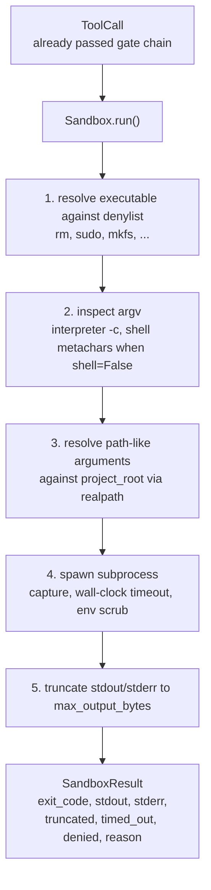
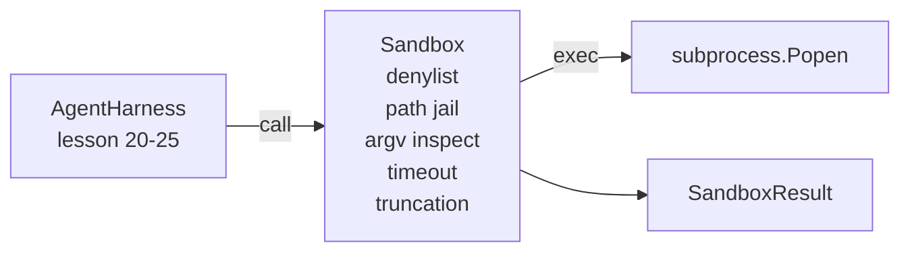

# Capstone Lesson 26: Sandbox Runner with Denylist and Path Jail · Capstone 第 26 课：带拒绝名单与路径监狱的沙箱运行器

验证门决定一次工具调用该不该运行；沙箱决定它运行时会发生什么。本课交付一个子进程运行器：拒绝危险的可执行文件，拒绝危险的 argv 形状，把每个文件路径关进以项目根为界的监狱（path jail），截断超长输出，并在墙钟超时后杀掉失控进程。它是横在模型与操作系统之间的两层里的第二层。

> The verification gate decides whether a tool call should run. The sandbox decides what happens when it does. This lesson ships a subprocess runner that refuses dangerous executables, refuses dangerous argv shapes, jails every file path to a project root, truncates oversized output, and kills runaway processes on a wall-clock timeout. It is the second of two layers that sit between the model and the operating system.

**Type:** Build
**Languages:** Python (stdlib)
**Prerequisites:** Phase 19 · 25 (verification gates and observation budget), Phase 14 · 33 (instructions as constraints), Phase 14 · 38 (verification gates)
**Time:** ~90 minutes

## Learning Objectives · 学习目标

- 构建一个包装 `subprocess.run` 的 `Sandbox` 类，带超时、捕获和截断。
- 按名字对照拒绝名单（denylist）拒绝命令，按结构对照 argv 检查器拒绝命令。
- 拒绝任何解析后落在声明项目根之外的路径参数。
- 在 shell 模式关闭时拒绝 shell 元字符。
- 返回一个结构化的 `SandboxResult`，供下游可观测性和评测框架摄取。

> Build a `Sandbox` class wrapping `subprocess.run` with timeout, capture, and truncation.
> Refuse a command by name against a denylist and by structure against an argv inspector.
> Refuse any path argument that resolves outside a declared project root.
> Refuse shell metacharacters when shell mode is off.
> Return a structured `SandboxResult` that downstream observability and the eval harness can ingest.

## The Problem · 问题所在

一个能 shell 出去的编码 agent，可以安装后门、窃取密钥、搞砖一台开发笔记本，并在一轮之内烧出一笔云账单。代价最低的防御是不给它 shell；次低的是一个对精确模式清单说「不」的沙箱。

三类失败在 agent 追踪记录里反复出现。

第一类是危险可执行文件。一个被催着修路径问题的模型会去试 `sudo`、`chmod -R 777`、`rm -rf`、`mkfs`、`dd`。这些都不该出现在 agent 运行里。拒绝名单按名字和别名逮住它们。

第二类是 argv 花招。一个被告知「不许用 shell」的模型会把攻击通过解释器管道出去：`python3 -c "import os; os.system('rm -rf /')"`、`bash -c '...'`、`node -e '...'`、`perl -e '...'`。沙箱需要知道：任何带 `-c` 类旗标运行的解释器，不过是一个多了几步的 shell 调用。

第三类是路径逃逸。模型被告知去读 `./src/main.py`，却读了 `../../etc/passwd`。沙箱把每个路径参数用 `os.path.realpath` 解析后断言前缀，从而把它们关进监狱。

沙箱不是操作系统意义上的安全边界：一个拿到代码执行的坚定攻击者仍然能逃出去。沙箱是开发期的护栏：它让常见失败模式变得响亮，并阻止 agent 出于纯粹的笨拙造成损害。

> A coding agent that can shell out can install backdoors, exfiltrate keys, brick a developer laptop, and rack up a cloud bill in a single turn. The least costly defense is to not give it shell. The second least costly is a sandbox that says no to a precise list of patterns.
> Three classes of failure recur in agent traces.
> The first is dangerous executables. A model under pressure to fix a path issue will try `sudo`, `chmod -R 777`, `rm -rf`, `mkfs`, `dd`. None of these belong in an agent run. The denylist catches them by name and by alias.
> The second is argv tricks. A model that has been told no shell will pipe an attack through an interpreter: `python3 -c "import os; os.system('rm -rf /')"`, `bash -c '...'`, `node -e '...'`, `perl -e '...'`. The sandbox needs to know that any interpreter run with a `-c`-like flag is just a shell call with extra steps.
> The third is path escape. The model is told to read `./src/main.py` and instead reads `../../etc/passwd`. The sandbox jails every path argument by resolving it through `os.path.realpath` and asserting the prefix.
> The sandbox is not a security boundary in the operating system sense. A determined attacker with code execution can still break out. The sandbox is a development-time guardrail: it makes the common failure modes loud and stops the agent from doing damage out of sheer ineptitude.

## The Concept · 概念



沙箱有四条拒绝轴：名字、argv、路径、结构。每条轴都是关于这次调用的纯函数，此时还没有任何子进程。只有每条轴都通过之后，子进程才会被派生。

`SandboxResult` 的退出码沿用惯例：0 成功，非零失败，外加三个哨兵码——denied（-100）、timed_out（-101）和 truncated（退出码是真实值，另设一个标志位）。下游课程读取这个结构化结果，而不是去解析 stderr。

```figure
cg-path-jail
```

> The sandbox has four refusal axes: name, argv, path, structure. Each axis is a pure function of the call, no subprocess yet. The subprocess only spawns after every axis has passed.
> The `SandboxResult` exit codes are the conventional ones: 0 success, non-zero failure, plus three sentinel codes for denied (-100), timed_out (-101), and truncated (the exit code is the real one, with a flag set). Downstream lessons read this structured result rather than parsing stderr.

## Architecture · 架构



拒绝名单是可执行文件基本名（basename）的 frozenset。别名（`/bin/rm`、`/usr/bin/rm`）都解析到同一个基本名。argv 检查器认识解释器的形状：任何 argv，只要 argv[0] 是解释器且后面的某个参数以 `-c` 或 `-e` 开头，即拒绝。shell 元字符（`;`、`|`、`&`、`>`、`<`、反引号、`$()`）在调用没有显式请求 shell 时导致拒绝。

路径监狱是最精妙的一块。沙箱在构造时接受一个 `project_root`。任何看起来像路径的参数（包含 `/` 或匹配一个存在的文件）都经 `os.path.realpath` 归一化，然后对照项目根的 realpath 检查。解析出的目标不在根之下即拒绝。符号链接逃逸尝试（项目根里一个指向外部的符号链接）靠检查 realpath 而非字面路径来挡住。

> The denylist is a frozenset of executable basenames. Aliases (`/bin/rm`, `/usr/bin/rm`) all resolve to the same basename. The argv inspector knows the interpreter shape: any argv where argv[0] is an interpreter and any later arg starts with `-c` or `-e` is denied. Shell metacharacters (`;`, `|`, `&`, `>`, `<`, backticks, `$()`) cause refusal when the call did not explicitly request a shell.
> The path jail is the most subtle piece. The sandbox accepts a `project_root` at construction. Any argument that looks like a path (contains `/` or matches an existing file) is normalized through `os.path.realpath`, then checked against the realpath of the project root. If the resolved target is not under the root, refusal. Symlink escape attempts (a symlink in the project root that points outside) are blocked by checking realpath, not the literal path.

## What you will build · 你将构建什么

实现是 `main.py` 加一个测试目录。

1. `SandboxResult` 数据类：exit_code、stdout、stderr、truncated、timed_out、denied、reason、duration_ms。
2. `SandboxConfig` 数据类：project_root、max_output_bytes、timeout_seconds、denylist、interpreter_block。
3. `Sandbox` 类：`run(argv, *, shell=False, cwd=None)` 返回一个 `SandboxResult`。
4. 内部拒绝辅助函数：`_check_executable_denylist`、`_check_argv_interpreter`、`_check_shell_metachars`、`_check_path_jail`。
5. 输出截断，带清晰的 `truncated` 标志和捕获流里的一行标记。
6. 底部演示：一串合法与对抗性调用，每个都连同其结果一起展示。

沙箱默认以 `shell=False` 和 `capture_output=True` 使用 `subprocess.run`。墙钟超时用 `timeout` 参数；捕获到 `TimeoutExpired` 时，沙箱杀掉进程组并合成一个 SandboxResult。

> The implementation is `main.py` plus a tests dir.
> The sandbox uses `subprocess.run` with `shell=False` by default and `capture_output=True`. The wall-clock timeout uses the `timeout` argument; on `TimeoutExpired`, the sandbox kills the process group and synthesizes a SandboxResult.

## Why this is not a real sandbox · 为什么这不是真正的沙箱

本课的沙箱不使用 namespaces、cgroups、seccomp、gVisor、Firecracker 或任何内核级隔离。子进程能做的事，沙箱都能做。保护是结构性的：agent 被拒绝最常见的危险调用方式，响亮的拒绝进入可观测性系统，而不是被静默执行。

生产级 agent 要在其上再叠几层：在无特权的 Docker 容器里运行，在 microVM 里运行，丢弃 capabilities，把项目根只读挂载、另挂一个可读写的临时目录，对内存和 CPU 设 ulimit，把环境变量擦洗到已知安全的白名单。第 29 课做了其中一部分。操作系统级隔离不在本课范围内。

> The lesson sandbox does not use namespaces, cgroups, seccomp, gVisor, Firecracker, or any kernel-level isolation. Anything the subprocess can do, the sandbox can do. The protection is structural: the agent is denied the most common dangerous invocations, and the loud refusal goes into observability instead of silently running.
> For production agents you layer on top: run inside an unprivileged Docker container, run inside a microVM, drop capabilities, mount the project root read-only and a scratch dir read-write, set ulimit on memory and CPU, scrub the environment to a known-safe whitelist. Lesson 29 does some of this. Operating-system isolation is out of scope for this lesson.

## Running it · 运行

```bash
cd phases/19-capstone-projects/26-sandbox-runner-denylist
python3 code/main.py
python3 -m pytest code/tests/ -v
```

演示创建一个临时目录、放入一个干净文件，然后跑一整套调用。合法调用成功；被拒调用返回 `denied=True` 的 SandboxResult 和一个理由；超时返回 `timed_out=True`；截断置 `truncated=True`。演示打印一张 JSON 结果表并以零退出。

> The demo creates a temp directory, drops a clean file into it, then runs a battery of calls. Legal calls succeed. Denied calls return SandboxResult with `denied=True` and a reason. Timeouts return `timed_out=True`. Truncation sets `truncated=True`. The demo prints a JSON table of outcomes and exits zero.

## How this composes with the rest of Track A · 如何与 Track A 其余部分组合

第 25 课产出门链。第 26 课是在门说 ALLOW 之后运行的执行器。第 27 课的评测框架把沙箱结果与每个任务的期望退出码做比较。第 28 课在每次 `Sandbox.run` 调用周围发出一个 `gen_ai.tool.execution` span。第 29 课的端到端演示让一个真实的编码 agent 穿过这两层。

> Lesson 25 produced the gate chain. Lesson 26 is the executor that runs after a gate ALLOW. Lesson 27's eval harness compares the sandbox results against the expected exit-code per task. Lesson 28 emits a `gen_ai.tool.execution` span around each `Sandbox.run` invocation. Lesson 29's end-to-end demo wires a real coding agent through both layers.
