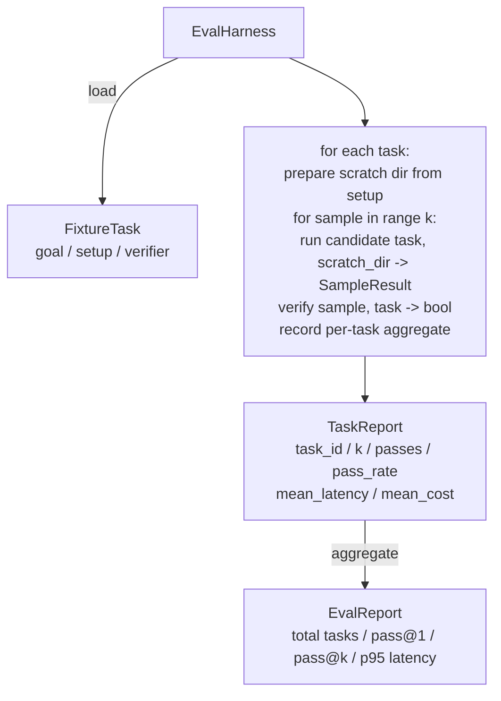

# Capstone Lesson 27: Eval Harness with Fixture Tasks · Capstone 第 27 课：带夹具任务的评测框架

编码 agent 的好坏，取决于你用什么任务套件去量它。本课构建一个评测框架（eval harness）：取一个夹具任务（fixture task）文件夹，把每个任务跑过候选 agent，经一个确定性校验器（verifier）判分通过或失败，再把结果聚合为 pass@1、pass@k、平均延迟和平均成本。这个框架是让你能区分「回归」与「重构」的事实来源。

> A coding agent is only as good as the suite of tasks you measure it against. This lesson builds an evaluation harness that takes a folder of fixture tasks, runs each through a candidate agent, scores pass or fail through a deterministic verifier, and aggregates the results into pass@1, pass@k, mean latency, and mean cost. The harness is the source of truth that lets you tell a regression from a refactor.

**Type:** Build
**Languages:** Python (stdlib)
**Prerequisites:** Phase 19 · 25 (verification gates), Phase 19 · 26 (sandbox runner), Phase 14 · 30 (eval-driven agent development), Phase 14 · 19 (SWE-bench and GAIA benchmarks)
**Time:** ~90 minutes

## Learning Objectives · 学习目标

- 把夹具任务定义为目标（goal）、环境准备（setup）与校验器（verifier）的三元组。
- 对每个任务跑多个样本并计分，计算 pass@1 和 pass@k。
- 把延迟和成本聚合为均值和 95 分位指标。
- 把确定性校验器（文件 diff、退出码、正则匹配）接成可复用的函数。
- 发出一份结构化 JSON 报告，供回归追踪脚本摄取。

> Define a fixture task as a triple of goal, setup, and verifier.
> Score multiple sample runs per task and compute pass@1 and pass@k.
> Aggregate latency and cost into mean and 95th-percentile metrics.
> Wire deterministic verifiers (file diff, exit code, regex match) into reusable functions.
> Emit a structured JSON report a regression-tracking script can ingest.

## The Problem · 问题所在

没有评测框架的 agent 基准会被三种失败模式缠上。

第一种是未验证的通过。agent 说它修好了 bug，人类瞥了一眼 diff，测试套件被标绿，三周后回归测试又浮出同一个 bug。agent 进行了貌似合理的推理，却什么都没真修。

第二种是未被发现的回归。一次提示词模板改动让 agent 在吵闹的任务上好了 4%，在安静的任务上差了 14%。没有金标准集（goldset）和按任务计分，这个回归就一路溜进 main，直到客户投诉才现身。

第三种是按任务的漂移。评测周一跑的是 100 个任务，周五只剩 95 个，因为有人重命名了五个夹具。通过率看起来进步了 5%，其实没有。

评测框架就是把这一切失败变成事实的程序：它每次都跑每一个夹具，顺序可复现，对着一个在确定性检查上返回真或假的校验器。

> Three failure modes plague agent benchmarks built without an eval harness.
> The first is unverified pass. The agent says it fixed the bug, the human glances at the diff, the suite is marked green, and three weeks later the regression test surfaces the same bug. The agent had reasoned plausibly without actually fixing anything.
> The second is undetected regression. A change to the prompt template makes the agent 4% better on the loud task and 14% worse on the quiet one. Without a goldset and a per-task score, the regression rides into main and surfaces only when a customer complains.
> The third is per-task drift. The eval was run on Monday with 100 tasks and on Friday with 95 of them, because somebody renamed five fixtures. The pass rate looks like a 5% improvement. It isn't.
> The harness is the program that turns these failures into facts. It runs every fixture, every time, in a reproducible order, against a verifier that returns true or false on a deterministic check.

## The Concept · 概念

```mermaid
flowchart LR
  F1[fixtures/task_001/<br/>task.json + expected/] --> Harness
  F2[fixtures/task_002/<br/>...] --> Harness
  Harness[Harness<br/>for each task:<br/>setup / run agent k samples /<br/>verify each sample /<br/>record latency, cost]
  Harness --> Report[EvalReport<br/>pass@1 / pass@k<br/>mean ms / p95 ms<br/>mean cost]
```

一个 `FixtureTask` 是一个小 JSON 文件加一个可选的 `expected/` 目录。JSON 声明一个 `id`、一个 `goal`（喂给 agent 的提示词）、一个 `setup` 块（要放进临时目录的文件）和一个 `verifier` 块。verifier 块点名框架校验器注册表里的一个函数，并给出它的参数。

三种校验器形状覆盖了大多数有用的任务。

第一种是 `file_equals`。agent 跑完之后，把某个指定文件与期望内容比较。它抓的是「用这个确切方式修这个 bug」型任务。

第二种是 `regex_match`。指定文件的内容与一个正则匹配。它抓的是「函数必须存在并返回 X」型任务——这类任务存在许多可接受的解。

第三种是 `shell_exit_zero`。框架运行一条 shell 命令（经由第 26 课的沙箱），只有命令以零退出才算通过。它抓的是「测试必须通过」型任务。

框架把每个任务跑 `k` 次。pass@k 是 `1 - (1 - p)^k`，其中 p 是经验通过率；框架同时报告原始计数，让你能看出方差。延迟按每个样本的墙钟计。成本取 agent 自报的值（token 数、美元，或两者都有）；框架把它对样本求和，给出按任务和聚合两组数字。

```figure
pass-at-k
```

> A `FixtureTask` is a small JSON file plus an optional `expected/` directory. The JSON declares an `id`, a `goal` (the prompt fed to the agent), a `setup` block (files to drop into the scratch dir), and a `verifier` block. The verifier block names a function in the harness's verifier registry and supplies its arguments.
> Three verifier shapes cover the majority of useful tasks.
> The harness runs each task `k` times. Pass@k is `1 - (1 - p)^k` where p is the empirical pass rate; the harness also reports raw counts so you can spot variance. Latency is wall-clock per sample. Cost is whatever the agent self-reports (token count, USD, or both); the harness sums it across samples and presents the per-task and aggregate numbers.

## Architecture · 架构



候选项是一个可调用对象：`Callable[[FixtureTask, str], SampleResult]`。框架用 `tempfile.mkdtemp()` 创建临时目录，并把它的路径当普通字符串传入。框架不关心候选者怎么工作：它可以是一个确定性的补丁应用器（对框架自测有用）、一个真实的 LLM agent、一个模糊测试器。契约就是 SampleResult。

> The candidate is a callable: `Callable[[FixtureTask, str], SampleResult]`. The harness creates the scratch directory via `tempfile.mkdtemp()` and passes its path as a plain string. The harness does not care how the candidate works. The candidate could be a deterministic patch applier (useful for harness self-tests), a real LLM agent, a fuzzer. The contract is the SampleResult.

## What you will build · 你将构建什么

`main.py` 交付：

1. `FixtureTask` 数据类。
2. `SampleResult` 数据类：success_self_reported、latency_ms、cost_units、edits。
3. `TaskReport`、`EvalReport` 数据类，带 `to_dict()`。
4. `VerifierRegistry`，把校验器名映射到函数。内置校验器：file_equals、regex_match、shell_exit_zero。
5. `EvalHarness` 类：对一个目录的任务跑候选者，返回 EvalReport。
6. 五个夹具任务，捆绑在 `tasks/` 里：
   - `fizzbuzz` 里的差一错误（off-by-one）
   - `factorial` 缺少 return
   - 错误消息里的拼写错误
   - 空函数体
   - 链表遍历里的差一错误
7. 一个确定性参考候选（`apply_known_fixes`），框架用它演示一次干净的 pass@1 = 1.0。
8. 演示打印 EvalReport JSON 并以零退出。

夹具任务以 JSON 文件形式捆绑在 `tasks/`，加上 `tasks/<id>/buggy/` 和 `tasks/<id>/expected/` 里的成对源文件。框架把 buggy 拷进临时目录、交给候选者、再对照 expected 校验。

> `main.py` ships:
> The fixture tasks are bundled as JSON files in `tasks/` plus paired source files in `tasks/<id>/buggy/` and `tasks/<id>/expected/`. The harness copies buggy into a scratch dir, hands it to the candidate, and verifies against expected.

## Why pass@k and not just pass@1 · 为什么是 pass@k 而不只是 pass@1

真实的 LLM agent 是随机的。pass@1 = 0.6 看起来像失败；pass@5 = 0.95 则说明 agent 大多数时候能拿到正确答案，只是在早期样本上选错了。解法是采样与排序，而不总是更多训练。pass@k 把这一点变得可见。

pass@k 与 pass@1 并列报告，因为 pass@k 会遮住一种真实的失败：如果模型二十次里才对一次，你手里并没有一个有用的 agent。框架把两者都摆出来。

> Real LLM agents are stochastic. A pass@1 of 0.6 looks like a failure. A pass@5 of 0.95 says the agent gets the right answer most of the time but is choosing wrong on early samples. The fix is sampling and ranking, not always more training. Pass@k makes that visible.
> Pass@k is reported alongside pass@1 because pass@k papers over a real failure: if the model gets the right answer once in twenty tries you do not have a useful agent. The harness shows both.

## How this composes with the rest of Track A · 如何与 Track A 其余部分组合

第 25 课产出门链，第 26 课产出沙箱。框架在任何 `shell_exit_zero` 校验器上使用沙箱。第 28 课把每次框架运行包进一条 OTel trace。第 29 课针对一个捆绑夹具跑端到端演示，并断言参考候选的 pass@1 = 1.0。

> Lesson 25 produced the gate chain. Lesson 26 produced the sandbox. The harness uses the sandbox for any `shell_exit_zero` verifier. Lesson 28 wraps each harness run in an OTel trace. Lesson 29 runs the end-to-end demo against one of the bundled fixtures and asserts pass@1 = 1.0 for the reference candidate.

## Running it · 运行

```bash
cd phases/19-capstone-projects/27-eval-harness-fixture-tasks
python3 code/main.py
python3 -m pytest code/tests/ -v
```

演示以 JSON 打印 EvalReport，包括 pass@1、pass@5、平均延迟和按任务细分。退出码为零。测试覆盖校验器函数、pass@k 计算、夹具加载，以及框架对捆绑参考候选的端到端运行。

> The demo prints the EvalReport in JSON, including pass@1, pass@5, mean latency, and per-task breakdown. The exit code is zero. The tests cover the verifier functions, the pass@k math, fixture loading, and the harness end-to-end against the bundled reference candidate.
