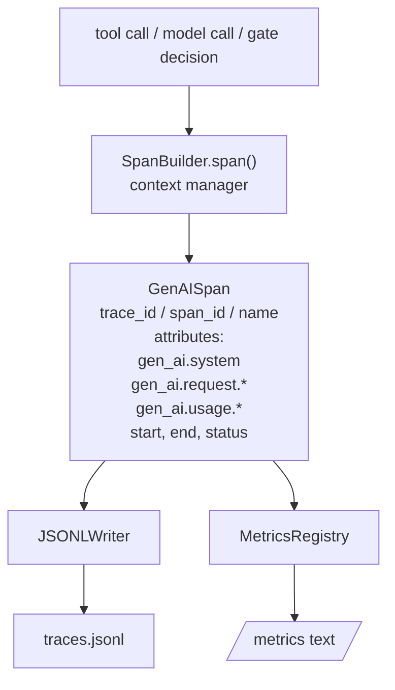
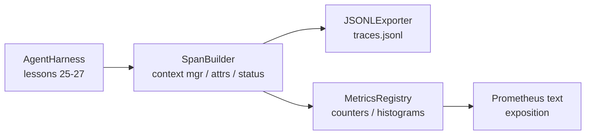

# Capstone Lesson 28: Observability with OTel GenAI Spans and Prometheus Metrics · 毕业课 28：OTel GenAI Span 与 Prometheus 指标可观测性

> 没有可观测性（observability）的智能体 harness 是一个烧钱的黑盒。本课手写一个 span 构造器（span builder），产出符合 OpenTelemetry GenAI 语义约定（semantic conventions）的记录，把它们一行一个 span 地写进 JSON-Lines 文件，并以 Prometheus 文本格式暴露计数器（counter）和直方图（histogram）。全部是标准库 Python，完全离线运行。
>
> An agent harness without observability is a black box that costs money. This lesson hand-rolls a span builder that emits records compliant with the OpenTelemetry GenAI semantic conventions, writes them to a JSON-Lines file one span per line, and exposes counters and histograms in Prometheus text format. The whole thing is stdlib Python and runs offline.

**Type:** Build
**Languages:** Python (stdlib)
**Prerequisites:** Phase 19 · 25 (verification gates), Phase 19 · 26 (sandbox), Phase 19 · 27 (eval harness), Phase 13 · 20 (OpenTelemetry GenAI), Phase 14 · 23 (OTel GenAI conventions)
**Time:** ~90 minutes

## Learning Objectives · 学习目标

- 构建一个按 OpenTelemetry GenAI 语义约定定型的 span 数据类（data class）。
- 实现一个 JSONL 导出器（exporter），每行写一条自包含的 span。
- 构建带标签（label）的计数器与直方图，并以 Prometheus 文本格式暴露。
- 用一个 span 上下文管理器（context manager）包装任意可调用对象，记录耗时、状态与异常。
- 验证产出的 span 能通过 `json.loads` 完成往返（roundtrip）并符合规范的形状。

> Build a span data class shaped to the OpenTelemetry GenAI semantic conventions.
> Implement a JSONL exporter that writes one self-contained span per line.
> Build counters and histograms with labels and Prometheus text-format exposition.
> Wrap any callable in a span context manager that records duration, status, and exceptions.
> Verify that the emitted spans roundtrip through `json.loads` and match the spec shape.

## The Problem · 问题在哪

生产环境里的编码智能体每一轮都产出三类产物：一次模型调用、一次工具执行、一个验证门禁（verification gate）决策。没有结构化遥测（telemetry），三者全都派不上用场。

第一种失败模式是 trace 缺失。周二出了故障，可唯一的记录是一份 500 行的聊天日志。哪个工具跑了、跑了多久、prompt 灌进去多少 token、门禁有没有拒绝过任何东西——全都没有记录。智能体作者只能靠猜。

第二种失败模式是 trace 解析不了。harness 确实写了 span，但用的是自己临时发明的字段名。Grafana、Honeycomb、Jaeger 或本地 CLI 谁都读不了。团队技术栈里现成的工具全部白费，因为 span 不符合标准。

第三种失败模式是指标没有被聚合。你能在 trace 里看到某次慢的工具调用，却回答不了「过去一小时 read_file 调用的 p95 延迟是多少」，因为没有指标，只有 trace。

OpenTelemetry GenAI 语义约定正是为此而存在的。它定义了一小组标准属性（attribute），供所有 LLM 框架的 span 发射方共享。只要你的 harness 写这些属性，每一个兼容 OTel 的后端都能读取。

> A coding agent in production produces three classes of artifact every turn: a model call, a tool execution, and a verification gate decision. ... The first failure mode is the missing trace. ... The second failure mode is the unparseable trace. ... The third failure mode is the unaggregated metric. ... The OpenTelemetry GenAI semantic conventions exist exactly for this.

## The Concept · 概念



harness 里的每个操作都产出一个 span。一个 span 拥有：trace id（整个智能体调用）、span id（当前这一个操作）、名字（例如 `gen_ai.chat`、`gen_ai.tool.execution`）、遵循 GenAI 约定的属性、开始与结束时间，以及一个状态（status）。

GenAI 约定标准化了这些属性键：`gen_ai.system`（哪个提供商，例如 `anthropic`、`openai`）、`gen_ai.request.model`（模型 id）、`gen_ai.request.max_tokens`、`gen_ai.usage.input_tokens`、`gen_ai.usage.output_tokens`、`gen_ai.response.model`、`gen_ai.response.id`、`gen_ai.operation.name`，以及工具专用的 `gen_ai.tool.name` 和 `gen_ai.tool.call.id`。

导出器写 JSONL，一行一个 JSON 对象。这是下游工具能流式处理、grep 和导入的最简单格式。真正的 OTel 导出器说的是 OTLP gRPC；本课的 JSONL 导出器是它的离线等价物，在任何工作站上都以零退出码结束。

指标与 trace 并存。一个计数器在每次工具调用时递增：`tools_called_total{tool="read_file"}`。一个直方图记录观测到的延迟：`tool_latency_ms{tool="read_file"}`。两者都序列化成 Prometheus 文本暴露（exposition）格式——拉取式（pull-based）指标的事实标准。

```figure
trace-spans
```

> Every operation in the harness produces a span. A span has a trace id (the whole agent invocation), a span id (this one operation), a name (e.g. `gen_ai.chat`, `gen_ai.tool.execution`), attributes that follow the GenAI conventions, a start and end time, and a status. ... The exporter writes JSONL. One JSON object per line. ... Metrics live next to traces. ... Both serialise into Prometheus text exposition format, which is the de-facto standard for pull-based metrics.

## Architecture · 架构



span 构造器是一个小类，它的 `span(name, attrs)` 方法返回一个上下文管理器。这个上下文管理器在进入时记录开始时间，退出时记录结束时间，若抛出异常则附加异常信息，并把定稿的 span 推给导出器。

指标注册表（metrics registry）就是两个字典（dict）。计数器是 `{(name, frozen_labels): int}`。直方图把原始样本存在一个列表里，在暴露时才序列化成 Prometheus 直方图桶（bucket）。

> The span builder is a small class with a `span(name, attrs)` method that returns a context manager. The context manager records start time on enter, records end time on exit, attaches an exception if one was raised, and pushes the finalised span to the exporter.
> The metrics registry is two dicts. Counters are `{(name, frozen_labels): int}`. Histograms keep raw samples in a list and serialise to Prometheus histogram buckets at exposition time.

## What you will build · 你将构建什么

`main.py` 包含：

1. `GenAISpan` 数据类：trace_id、span_id、parent_span_id、name、attributes、start_unix_nano、end_unix_nano、status、status_message、events。
2. `SpanBuilder` 类，带 `span(name, attrs, parent=None)` 上下文管理器。
3. `JSONLExporter` 类，带 `export(span)` 方法，追加一行。
4. `Counter` 与 `Histogram` 类，外加 `MetricsRegistry`。
5. `prometheus_exposition(registry)`，产出文本格式输出。
6. `wrap_tool_call(name)` 装饰器，发射 span 并更新指标。
7. Demo：合成一次完整的智能体调用（`gen_ai.chat` span 包住工具 span），写出 traces.jsonl，打印 Prometheus 暴露结果，以零退出码结束。

span id 和 trace id 是 16 字节十六进制字符串，由 `os.urandom` 生成。这与 OTel 的 W3C trace context 一致。导出器从不抛异常；IO 错误会被上浮，但 harness 继续运行。

直方图有一组固定的桶（OTel 对毫秒级延迟的默认值：5, 10, 25, 50, 100, 250, 500, 1000, 2500, 5000, 10000, +Inf）。样本以列表存储；暴露时按需计算每个桶的计数。

> The span id and trace id are 16-byte hex strings, generated from `os.urandom`. That matches OTel's W3C trace context. The exporter never throws; IO errors are surfaced but the harness keeps running.
> The histogram has a fixed bucket set (the OTel default for latency in milliseconds: 5, 10, 25, 50, 100, 250, 500, 1000, 2500, 5000, 10000, +Inf). Samples are stored as a list; exposition computes per-bucket counts on demand.

## Why hand-rolled instead of opentelemetry-sdk · 为什么手写而不用 opentelemetry-sdk

OTel Python SDK 是一个真实的依赖。它还有几千行代码、为 OTLP 导出器准备的多个进程，以及一笔会压垮单课预算的运行时开销。手写版本教的是线上格式（wire format）。生产环境里你把同样的属性接进真正的 SDK，就能免费得到 OTLP 导出器、批处理（batching）和资源探测（resource detection）。

这些约定是稳定的。本课产出的线上格式到 2030 年还能被解析，因为 OTel 从不破坏 GenAI 属性名；只新增。

> The OTel Python SDK is a real dependency. It is also several thousand lines of code, multiple processes for the OTLP exporter, and a runtime cost that swamps a lesson budget. The hand-rolled version teaches the wire format. In production you wire the same attributes into the real SDK and get the OTLP exporter, batching, and resource detection for free.
> The conventions are stable. The wire format the lesson emits will keep parsing in 2030 because OTel never breaks GenAI attribute names; they only add new ones.

## How this composes with the rest of Track A · 与 Track A 其余部分如何组合

第 25 课产出了门禁链（gate chain）。第 26 课产出了沙箱（sandbox）。第 27 课产出了评测框架（eval harness）。第 28 课让这三者变得可观测。第 29 课把端到端 demo 的每一步都包进 span，并在最后打印 Prometheus 文本。

> Lesson 25 produced the gate chain. Lesson 26 produced the sandbox. Lesson 27 produced the eval harness. Lesson 28 makes all three observable. Lesson 29 wraps every step of the end-to-end demo in spans and prints the Prometheus text at the end.

## Running it · 运行方式

```bash
cd phases/19-capstone-projects/28-observability-otel-traces
python3 code/main.py
python3 -m pytest code/tests/ -v
```

demo 会在本课工作目录产出一个 `traces.jsonl`（结束时清理），然后打印三条 span 的样本，再打印计数器与直方图的 Prometheus 暴露结果。测试验证：span 能往返序列化、规范的 GenAI 属性都在、计数器正确递增、直方图暴露里出现预期的桶计数。

> The demo emits a `traces.jsonl` in the lesson's working dir (cleaned up at the end), then prints a sample of three spans, then prints the Prometheus exposition for the counters and histograms. The tests verify that spans serialise round-trip, that the canonical GenAI attributes are present, that counters increment correctly, and that the histogram exposition contains the expected bucket counts.
