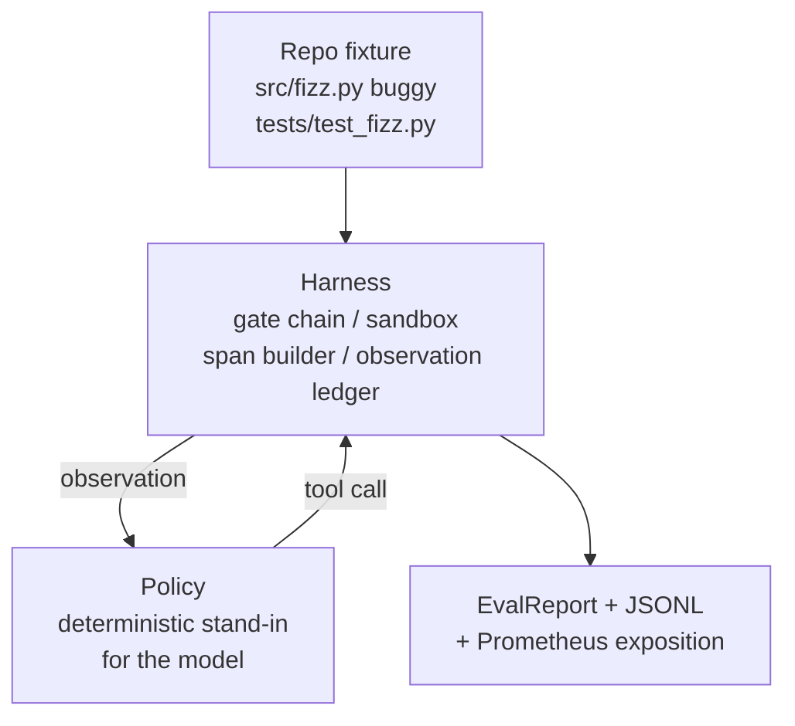
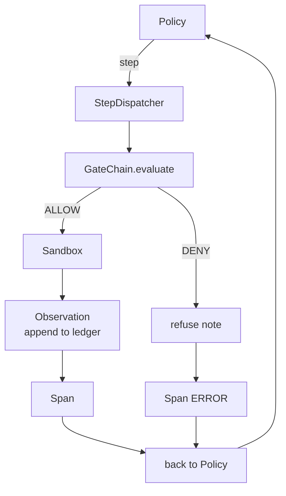

# Capstone Lesson 29: End-to-End Coding Agent on the Harness · 毕业课 29：跑在 harness 上的端到端编码智能体

> Track A 的收获时刻。本课把门禁链（gate chain）、沙箱（sandbox）、评测框架（eval harness）和 OTel span 缝合成一个能跑的编码智能体，在一个多文件 Python 项目里修一个真实（但很小、夹具级）的 bug。这个智能体是确定性策略（policy），不是 LLM；这个替换让课程可复现，也说明从头到尾真正有趣的部分是 harness。契约完全一致：真正的模型从策略接缝处插进来。
>
> Track A's payoff. This lesson stitches the gate chain, the sandbox, the eval harness, and the OTel spans into one working coding agent that fixes a real (small, fixture-scale) bug in a multi-file Python project. The agent is a deterministic policy, not an LLM; the substitution makes the lesson reproducible and shows that the harness was the interesting part all along. The contract is identical: a real model plugs in at the policy seam.

**Type:** Build
**Languages:** Python (stdlib)
**Prerequisites:** Phase 19 · 25 (verification gates), Phase 19 · 26 (sandbox), Phase 19 · 27 (eval harness), Phase 19 · 28 (observability), Phase 14 · 38 (verification gates), Phase 14 · 41 (workbench for real repos), Phase 14 · 42 (agent workbench capstone)
**Time:** ~90 minutes

## Learning Objectives · 学习目标

- 把门禁链、沙箱、评测框架和 span 构造器组合成单个智能体循环。
- 实现一个用 read_file、run_tests 和 write_file 修夹具 bug 的确定性策略。
- 在一次端到端运行中同时执行全局步数预算（step budget）与观测 token 预算。
- 为整次运行发出完整的 OTel GenAI trace 与 Prometheus 指标。
- 验证智能体在少于 12 步内解出夹具任务，且合法工具上零次触发门禁。

> Compose the gate chain, sandbox, eval harness, and span builder into a single agent loop.
> Implement a deterministic policy that uses read_file, run_tests, and write_file to fix a fixture bug.
> Enforce a global step budget plus an observation token budget across an end-to-end run.
> Emit complete OTel GenAI traces and Prometheus metrics for the full run.
> Verify the agent solves the fixture in fewer than 12 steps with zero gate trips on legal tools.

## The Problem · 问题在哪

大多数智能体 demo 都在隔离中工作：沙箱归沙箱，评测框架归评测框架，span 发射器归 span 发射器。单看都没问题。一组合，接缝就露馅了。

门禁链说 ALLOW，沙箱却因为一个链没想到的理由拒绝。评测框架记了一个 pass，OTel span 却显示门禁拒绝了智能体声称用过的工具。Prometheus 计数器该加一次却加了两次。观测预算超了，智能体还在跑，因为预算记在链里，沙箱根本不知道。

本课是整条 track 的集成测试。智能体必须按顺序做完这几件事：读项目、跑测试、从测试失败里定位 bug、写入修复、重跑测试、停下。每个操作都过门禁链。每次工具执行都过沙箱。每一步都包在 span 里。评测框架在最后给整体打分。

> Most agent demos work in isolation: a sandbox by itself, an eval harness by itself, a span emitter by itself. ... The gate chain says ALLOW but the sandbox refuses for a reason the chain did not anticipate. ... This lesson is the integration test for the whole track.

## The Concept · 概念



智能体的策略是一个状态机（state machine）。五个状态。

`SURVEY`：智能体读取项目清单。下一个状态是 RUN_TESTS。

`RUN_TESTS`：智能体运行测试命令。如果测试通过，状态机以成功停机。否则下一个状态是 INSPECT。

`INSPECT`：智能体读取失败的源文件。下一个状态是 FIX。

`FIX`：智能体写入修正后的文件。下一个状态是 VERIFY。

`VERIFY`：智能体再次运行测试命令。测试通过则停机成功，否则以失败停机。

每个状态对应一次工具调用。每次工具调用都穿过门禁链。如果某次工具调用被拒绝，智能体在 trace 里报告这次拒绝并停机。

夹具 bug 是 `fizz.py` 里的一个差一错误（off-by-one）。确定性策略通过正则表达式从测试失败信息里识别出这个 bug，并产出修正后的文件。把策略换成 LLM 也不改变 harness 契约。

```figure
cg-harness-weave
```

> The agent's policy is a state machine. Five states. ... Each state corresponds to a tool call. Each tool call passes through the gate chain. If a tool call is denied, the agent reports the refusal in the trace and halts. ... The fixture bug is an off-by-one in `fizz.py`. The deterministic policy detects the bug from the test failure message via a regex and emits the corrected file. Replacing the policy with an LLM does not change the harness contract.

## Architecture · 架构



本课是自包含的。每个前置课程的原语都在 `main.py` 里以最小规模重新实现（门禁、沙箱、账本、span），课程无需导入兄弟课程就能运行。命名与第 25-28 课完全一致，概念映射毫不含糊。

> The lesson is self-contained. Each prior-lesson primitive is reimplemented at minimal scale in `main.py` (gate, sandbox, ledger, span) so the lesson runs without importing siblings. The names match lessons 25-28 exactly so the conceptual mapping is unambiguous.

## What you will build · 你将构建什么

`main.py` 包含：

1. 最小 harness 原语，沿用与第 25-28 课相同的命名：`GateChain`、`Sandbox`、`ObservationLedger`、`SpanBuilder`、`MetricsRegistry`。
2. `CodingAgentPolicy` 类：五状态状态机。
3. `Repo` 辅助类：准备一个带内置 bug 夹具（fixture）的临时目录。
4. `AgentRun` 类：驱动策略、经 harness 分发、返回 `AgentRunReport`。
5. 一个内置夹具（`fixture_repo/`），含 src/fizz.py、tests/test_fizz.py，以及供评测框架使用的 expected/ 目录树。
6. Demo：端到端运行策略，打印逐步 trace，断言通过，打印指标。

内置夹具与第 27 课的任务结构同形：一个有 bug 的文件加一个测试文件。测试失败信息包含足够的信息，让确定性策略能定位修复。真正的 LLM 干的是同样的活，更慢、召回更广，但不会改变 harness 的预期。

> The bundled fixture is the same shape as lesson 27's task structure: a buggy file and a tests file. The test failure message contains enough information for the deterministic policy to identify the fix. A real LLM would do the same job, slower and with broader recall, but it would not change the harness's expectations.

## Why the policy is not an LLM · 为什么策略不是 LLM

真正的 LLM 需要 API key、网络调用和无法验证的随机性。harness 才是本课关心的部分。换上一个确定性策略，课程就能在任何一个开发者的笔记本上零外部依赖地运行，测试套件也才能断言精确的步数。

本课的策略是 LLM 智能体行为的严格子集。策略读仓库、看失败的测试、定位出错的行、产出修复。LLM 走的是同一个循环、遵守同一个 harness 契约；记账完全一致。

> A real LLM requires an API key, a network call, and unverifiable stochasticity. The harness is the part the lesson cares about. Subbing in a deterministic policy lets the lesson run on any developer laptop with zero external dependencies and lets the test suite assert exact-step counts.
> The lesson's policy is a strict subset of what an LLM agent does. ... An LLM goes through the same loop with the same harness contract; the bookkeeping is identical.

## What the demo asserts · demo 断言了什么

端到端 demo 在退出时断言五件事，测试套件会以程序化方式再次断言它们。

策略在少于 12 步内解出了夹具任务。

观测预算从未被超出。

合法工具上零次门禁拒绝。（智能体从未捏造被拒绝的工具名。）

每一步在 traces.jsonl 里都有对应的 span。

Prometheus 暴露结果里包含一个 `tools_called_total{tool="read_file"}` 条目和一个 `tool_latency_ms` 直方图。

> The end-to-end demo asserts five things at exit time, and the test suite reasserts them programmatically.
> The policy solved the fixture in fewer than 12 steps.
> The observation budget was never exceeded.
> Zero gate denials fired on legal tools. (The agent never invented a denied tool name.)
> The Prometheus exposition contains a `tools_called_total{tool="read_file"}` entry and a `tool_latency_ms` histogram.

## How this composes with the rest of Track A · 与 Track A 其余部分如何组合

本课就是集成。第 25 课写了门禁链。第 26 课写了沙箱。第 27 课写了评测框架。第 28 课写了可观测性。第 29 课证明它们作为一套系统成立。真正的智能体 harness 从这里延伸：把确定性策略换成模型，把内置夹具换成真实仓库任务，把 JSONL 导出器换成 OTLP。

> This lesson is the integration. Lesson 25 wrote the gate chain. Lesson 26 wrote the sandbox. Lesson 27 wrote the eval harness. Lesson 28 wrote the observability. Lesson 29 proves they work as a system. A real agent harness extends from here: swap the deterministic policy for a model, swap the bundled fixture for a real-repo task, swap the JSONL exporter for OTLP.

## Running it · 运行方式

```bash
cd phases/19-capstone-projects/29-end-to-end-coding-task-demo
python3 code/main.py
python3 -m pytest code/tests/ -v
```

demo 打印逐步 trace、最终评测报告和 Prometheus 暴露结果。退出码为零。测试覆盖策略状态迁移、对合成工具调用的门禁拒绝、内置夹具上的端到端运行，以及步数预算不变量。

> The demo prints a per-step trace, the final eval report, and the Prometheus exposition. Exit code is zero. The tests cover the policy state transitions, the gate refusals on synthetic tool calls, the end-to-end run on the bundled fixture, and the step-budget invariants.
