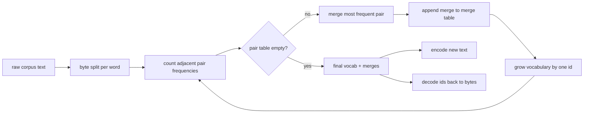
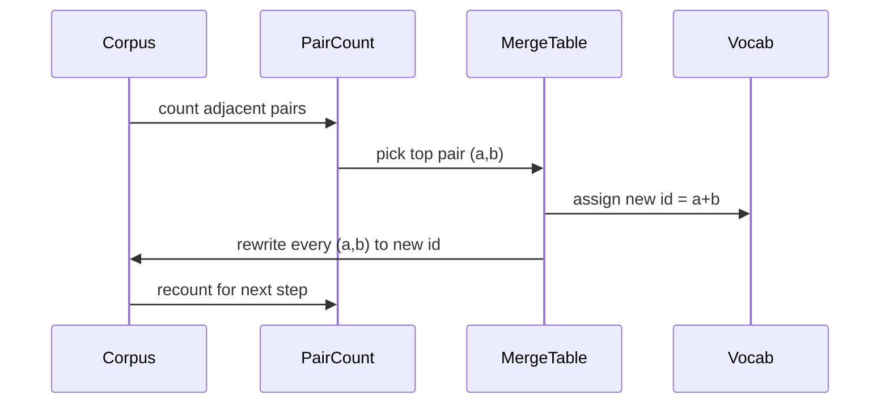

# BPE Tokenizer From Scratch · 从零实现 BPE 分词器（tokenizer）

> 字节进，id 出，id 再变回同样的字节。亲手造出每个现代文本模型至今仍由之出发的那个分词器。
>
> Bytes in, ids out, ids back to the same bytes. Build the tokenizer that every modern text model still starts from.

**Type:** Build
**Languages:** Python
**Prerequisites:** Phase 04 lessons, Phase 07 transformer lessons
**Time:** ~90 minutes

## Learning Objectives · 学习目标

- 在原始文本语料上训练一个字节对编码（Byte-Pair Encoding）词表：反复合并出现最频繁的相邻符号对。
- 实现一张确定性的合并表（merge table），把它套用到新文本上产出一串子词（subword）id。
- 让任意 UTF-8 输入在 id 与字节之间往返（round-trip）而无信息丢失。
- 保留并保护特殊 token（`<|endoftext|>`、`<|pad|>`），让它们在训练与解码中都安然无恙。
- 说清为什么字节级字母表是通用分词器的正确底座。

```figure
cap-bpe-merge
```

> Train a Byte-Pair Encoding vocabulary from a raw text corpus by repeatedly merging the most frequent adjacent symbol pair.
> Implement a deterministic merge table and apply it to fresh text to produce a stream of subword ids.
> Round-trip arbitrary UTF-8 input to ids and back without information loss.
> Reserve and protect special tokens (`<|endoftext|>`, `<|pad|>`) so they survive training and decoding.
> Reason about why a byte-level alphabet is the right floor for a general-purpose tokenizer.

## The frame · 背景

语言模型从来见不到文本，它见到的是整数。从字符串映射到整数列表、再映射回来的那一层就是分词器（tokenizer）。这一层做错了，训练运行里的每一条 loss 曲线都在量错东西。

通用文本模型里占统治地位的子词分词器家族是字节对编码（Byte-Pair Encoding）。想法很小。从一个已知字母表出发。找出训练语料中出现最频繁的相邻符号对。把它合并成一个新符号。重复直到词表（vocabulary）达到目标大小。编码新文本时按同一顺序复用同一张合并表。

我们要造的是字节级变体。字母表是 256 个原始字节，不是 Unicode 码点。正是这个选择让分词器能处理任何 UTF-8 输入，而不会退回「未知 token」。

> A language model never sees text. It sees integers. The map from a string to a list of integers and back is the tokenizer. ... The dominant family of subword tokenizers for general text models is Byte-Pair Encoding. ... We will build the byte-level variant. The alphabet is the 256 raw bytes, not Unicode code points.

## The pipeline · 流水线



训练侧和推理侧共享同一张合并表（merge table）。这份共享就是契约。如果你在推理时改动合并顺序，解码出来的就是另一串 id。

> The training side and the inference side share the merge table. That sharing is the contract. If you change the merge order at inference, you decode a different stream of ids.

## The byte alphabet · 字节字母表

前 256 个 id 保留给原始字节 0x00 到 0xFF。这保证在任何合并发生之前，每个输入字符串都能被词表表达。字节块之后，我们再保留一小段范围给特殊 token（special tokens）。训练循环永远不会把那些 id 提议为合并目标，因为我们让它们从一开始就完全不进入预分词（pretokenized）流。

预分词器（pretokenizer）在训练看到语料之前，先按空白和标点边界把语料切开。没有这一刀，BPE 合并步骤会很乐意学到跨越词边界的合并，词表会被整段常用短语塞满。有了这一刀，合并保持在词内，结果才有泛化能力。

> The first 256 ids are reserved for the raw bytes 0x00 through 0xFF. That guarantees every input string can be expressed in the vocabulary before any merge happens. ... The pretokenizer splits the corpus on whitespace and punctuation boundaries before training sees it. Without that split the BPE merge step would happily learn merges that cross word boundaries and the vocabulary fills up with whole common phrases.

## The training loop · 训练循环

每个训练步，循环做三件事。它遍历语料里的每个词，统计当前符号每一对相邻符号出现的次数，并按该词本身的出现次数加权。它选出计数最高的那一对。它把这一对的每一处出现改写成一个新符号，新符号的 id 取词表中下一个空闲槽位。然后它记录这次合并。



每一步的成本与语料（表示成符号序列列表）的规模成线性关系。一百万个词、目标词表一万个 id 时，循环几秒钟就跑完，因为随着合并落地，符号序列在持续缩短。

> For each training step the loop does three things. It walks every word in the corpus and counts how often each adjacent pair of current symbols appears, weighted by how often the word itself appears. ... The cost of each step is linear in the size of the corpus expressed as a list of symbol sequences.

## Encoding fresh text · 编码新文本

推理不会调用合并计数器。它按合并表被学到的同一顺序套用合并表。对一个新词，编码器从字节切分出发。它扫描当前序列，找排名最低（rank，即最早学到的）的可适用合并。执行那次合并。再扫描。循环直到表里没有任何合并能作用于当前序列。

按排名排序是让编码保持确定性的性质，也使同一输入上的行为与训练一致。最早学到的合并排在表头、最先被套用。如果两个合并都能作用于同一位置，排名更低（更早）的那个赢。

> Inference does not call the merge counter. It applies the merge table in the same order it was learned. ... The ordering by rank is the property that makes encoding deterministic and matches the training behavior on the same input.

## Special tokens · 特殊 token

特殊 token 是字节流永远产生不出来的 id。我们手动保留它们。本课两个就够。

- `<|endoftext|>` 在预训练中分隔文档。它告诉模型「一个新文档从这里开始，别让上一篇的上下文泄漏进来。」
- `<|pad|>` 把短序列填齐，让一个 batch 能拼成矩形张量。训练时损失掩码（loss mask）会把它藏掉。

编码器接受一个允许输入中出现特殊 token 的开关。开关关闭时，字符串 `<|endoftext|>` 和 `<|pad|>` 会被当作拼出它们的那些字节来分词。开关打开时，这两个字面字符串被映射到保留 id，不再参与任何合并。

> Special tokens are ids that the byte stream can never produce. We reserve them by hand. ... `<|endoftext|>` separates documents during pretraining. ... `<|pad|>` fills out short sequences so a batch can be a rectangular tensor. The loss mask hides it during training.

## Round-trip guarantee · 往返保证

先编码再解码必须原样返回输入字节。解码器按顺序把每个 id 的字节展开拼接起来。由于每个 id 要么是原始字节、要么是两个先前已知 id 的拼接，这个递归展开必然终止于原始字节。解码随后返回这些字节拼出的 UTF-8 字符串。

本课的测试套件在一个没见过的句子上、一个带 Unicode emoji 的句子上、以及一个包含字面 `<|endoftext|>` token 的句子上检查这条性质。

> Encoding then decoding must return the input bytes exactly. The decoder concatenates the byte expansion of every id in order. Since every id is either a raw byte or the concatenation of two previously known ids, the recursive expansion always terminates in raw bytes.

## What this lesson does not do · 本课不做什么

它不造一个以最大型生产分词器那种风格驱动的正则预分词器。本课的预分词器只是一个小的空白与标点切分。这足以在小训练语料上产生合理的合并，而且与课程链其余部分的契约保持不变。下一课把分词器当黑盒，在它之上构建滑动窗口（sliding window）数据集。

它不并行化配对计数器。Python 里对几千词语料跑一个循环，远不用一秒就完事。更大的语料，显而易见的做法是按词并行数对、再归约（reduce）。

> It does not build a regex-driven pretokenizer in the style of the largest production tokenizers. ... It does not parallelize the pair counter.

## How to read the code · 如何读代码

`main.py` 定义四个对象。`BPETokenizer` 持有词表、合并表和特殊 token 表。`train` 是训练循环。`encode` 是推理路径。`decode` 是字节拼接。底部的 demo 在内置语料上训练一个小分词器，编码一个留出句（held-out sentence），把 id 解码回去，然后把两者都打印出来。`code/tests/test_bpe.py` 里的测试钉住往返性质、特殊 token 保留和合并顺序。

跑一下 demo。然后把 demo 里的目标词表大小从 300 改成 600，观察留出句编码后的长度如何下降。那条曲线就是 BPE 压缩曲线。

> `main.py` defines four objects. `BPETokenizer` holds the vocabulary, the merge table, and the special-token table. ... Run the demo. Then change the target vocabulary size in the demo from 300 to 600 and watch how the encoded length of the held-out sentence drops. That curve is the BPE compression curve.
