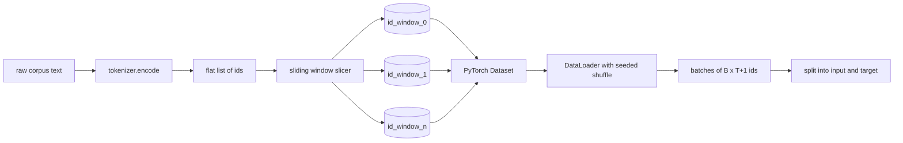
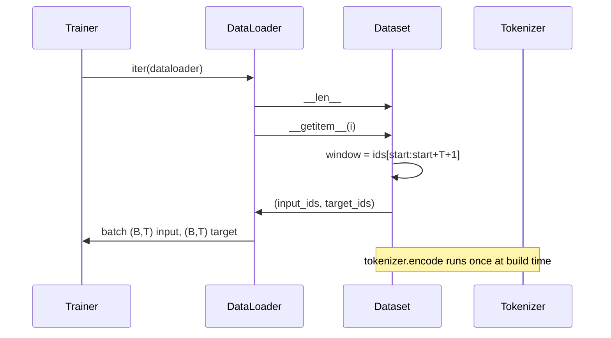

# Tokenized Dataset with Sliding Window · 带滑动窗口的分词数据集（sliding window）

> 一次预训练运行就是一个从 token id 到梯度的函数。本课造的是把 id 送进去的那条传送带。
>
> A pretraining run is a function from token ids to gradients. This lesson builds the conveyor that feeds the ids in.

**Type:** Build
**Languages:** Python
**Prerequisites:** Phase 04 lessons, Phase 07 transformer lessons, Lesson 30 of this phase
**Time:** ~90 minutes

## Learning Objectives · 学习目标

- 调用一次分词器，把原始语料转换成 token id 流。
- 把 id 流切成固定长度的窗口，重叠步长（stride）可配置。
- 构建一个 PyTorch Dataset，为下一 token 预测（next-token prediction）返回输入与目标张量。
- 把数据集包进 DataLoader，用按 epoch 播种的确定性洗牌（shuffle）。
- 推理 stride、冗余与有效数据集大小之间的权衡。

```figure
cap-sliding-window
```

> Convert a raw corpus into a stream of token ids by calling the tokenizer once.
> Slice the id stream into fixed-length windows with a configurable overlap stride.
> Build a PyTorch Dataset that returns input and target tensors for next-token prediction.
> Wrap the dataset in a DataLoader with a deterministic shuffle seeded per epoch.
> Reason about the trade-off between stride, redundancy, and effective dataset size.

## The frame · 背景

一次预训练运行每次读取一个批次的 token id 并更新模型。每个批次的形状由训练契约固定。对因果语言模型（causal language model）来说，批次持有 `(B, T)` 的输入 id 和 `(B, T)` 的目标 id，目标是输入左移一位。数据流水线的职责，就是从一个可能有几个 GB 的原始文本语料里，以确定、可复现的方式按需产出这个契约。

本课构建这条流水线。上一课的分词器把文本变成长长的一维 id 列表。滑动窗口（sliding window）把这个列表切成训练样本。自定义 Dataset 把样本暴露成张量。DataLoader 用已知种子把样本拼批、洗牌。

> A pretraining run reads one batch of token ids at a time and updates the model. ... The job of the data pipeline is to produce that contract on demand, in a deterministic and reproducible way, from a corpus that may be several gigabytes of raw text. ... A sliding window slices that list into training examples.

## The shape contract · 形状契约

因果 LM 消费形状为 `(B, T)` 的 id，`B` 是批大小（batch size），`T` 是上下文长度（context length）。位置 `t` 的目标是位置 `t+1` 的输入。这意味着每个训练样本覆盖 `T+1` 个原始 id。窗口步长控制相邻样本之间有多少重叠。



切片器永远不与语料边界重叠。如果最后一个窗口的 id 不够填满 `T+1` 个位置，切片器直接丢弃它。用 `<|pad|>` 填尾部也是合法选择，但会让损失掩码复杂化。本课选择丢弃。

> A causal LM consumes ids of shape `(B, T)` where `B` is the batch size and `T` is the context length. The target at position `t` is the input at position `t+1`. That means every training example covers `T+1` raw ids. ... If the last window does not have enough ids to fill `T+1` positions, the slicer drops it.

## Why a sliding window · 为什么用滑动窗口

预训练语料是一条长长的 id 流。如果模型见到的都是不重叠窗口，每个训练样本教给它的都是同样的 `T` 个边界。调整 stride 就能挪动这些边界，让模型见到更多样的「预测下一个 token」任务。

stride 取 `T` 产生不重叠窗口。stride 取 `T // 2` 产生百分之五十重叠，有效数据集翻倍。stride 取 `1` 产生最大重叠，数据集增大 `T` 倍。代价是每个 epoch 更多计算，收益是更多边界多样性。大多数预训练运行用的 stride 等于上下文长度，因为语料本来就远大于模型一个 epoch 能跑完的量，边界多样性的论证就弱了。

> A stride of `T` produces non-overlapping windows. A stride of `T // 2` produces fifty-percent overlap and doubles the effective dataset. A stride of `1` produces maximum overlap and increases the dataset by a factor of `T`. ... Most pretraining runs use a stride equal to the context length because the corpus is already much larger than the model can finish in one epoch, so the boundary diversity argument is weaker.

## The Dataset class · Dataset 类

PyTorch Dataset 有两个必需方法。`__len__` 返回样本数。`__getitem__` 以一对张量的形式返回一个样本。我们的 Dataset 存储编码后的 id 流和 stride。索引时即时计算窗口起点，所以内存开销只是一份 id 流拷贝，与 stride 产出多少样本无关。



移一位发生在 `__getitem__` 内部。Dataset 返回 `(input, target)`，其中 `input = window[:-1]`、`target = window[1:]`。两者都是 PyTorch long 张量。训练循环把它们当作 ground truth。

> A PyTorch Dataset has two required methods. `__len__` returns the number of examples. `__getitem__` returns one example as a pair of tensors. ... The shift-by-one happens inside `__getitem__`. The Dataset returns `(input, target)` where `input = window[:-1]` and `target = window[1:]`.

## Deterministic shuffle · 确定性洗牌

`shuffle=True` 的 DataLoader 从 PyTorch 随机数生成器读取。传入一个按 epoch 显式播种的 `torch.Generator`，每次重启运行都得到同样的洗牌结果。想比较两个只差一个超参数的运行时，这个性质很关键。没有种子，两次运行看到的数据顺序不同，loss 曲线会因与改动无关的原因发散。

本课的种子契约很简单。`epoch_seed = base_seed + epoch_index`。基础种子在构造时传入。epoch 索引由训练器在每个 epoch 开头递增。相同基础种子的重跑，每个 epoch 看到的顺序都相同。

> A DataLoader with `shuffle=True` reads from a PyTorch random generator. By passing an explicit `torch.Generator` seeded per epoch, we get the same shuffle every time the run is restarted. ... The seed contract in this lesson is simple. `epoch_seed = base_seed + epoch_index`.

## Batch sampler · 批采样器

PyTorch 默认采样器不放回地均匀随机抽取索引。预训练要的就是这个。在小数据集上微调时契约也一样。DataLoader 调 `B` 次 `__getitem__` 并把结果堆叠成批。因为每个样本按构造等长，不需要任何填充逻辑。

本课为简单起见保持 `num_workers=0`。生产运行中，worker 进程会并行化 `__getitem__` 调用。对这条流水线来说这基本是空操作，因为工作量只是对内存中的张量切一片，但同一个 Dataset API 能干净地支持 worker。

> The default sampler in PyTorch picks indices uniformly at random with replacement disabled. That is what we want for pretraining. ... The lesson keeps `num_workers=0` for simplicity.

## Counting examples · 样本数计算

对长度为 `N` 的 id 流、上下文长度 `T`、步长 `S`，样本数是 `max(0, 1 + (N - (T + 1)) // S)`。本课把这个计算暴露为 Dataset 上的静态方法，训练器不必迭代就能算出每个 epoch 的总步数。

> For an id stream of length `N`, a context length `T`, and a stride `S`, the number of examples is `max(0, 1 + (N - (T + 1)) // S)`. The lesson exposes that calculation as a static method on the Dataset so the trainer can compute total steps per epoch without iterating.

## What this lesson does not do · 本课不做什么

它不从磁盘流式读取。语料整体编码进内存，作为单个张量持有。几百万 id 的语料远不到一百 MB，对本课是合适的形状。磁盘流式读取是另一个关注点，替换存储即可接入，Dataset 契约不变。

它不处理多文档。语料被当作一条连续 id 流。当语料由多个文档构建时，下一篇文档的边界通过插入 `<|endoftext|>` id 来编码。模型学着围绕边界做预测。

> It does not stream from disk. ... Disk streaming is a separate concern that plugs in by replacing the storage but keeps the Dataset contract. ... It does not handle multiple documents.

## How to read the code · 如何读代码

`main.py` 定义两个类和一个辅助函数。`SlidingWindowDataset` 是那个 PyTorch Dataset。`make_dataloader` 返回一个配置好带种子生成器的 DataLoader。`_encode_corpus_to_ids` 是一次性分词调用。底部的 demo 在进程内构建一个小分词器，编码内置语料，构造 dataset 和 dataloader，打印一个批次，并断言形状契约。`code/tests/test_dataset.py` 里的测试钉住窗口数公式、移一位性质、确定性洗牌和 stride 权衡。

跑一下 demo。然后把上下文长度从 16 改成 32，观察每个 epoch 的样本数如何下降。那个数字就是你每个 epoch 的步数预算。

> `main.py` defines two classes and one helper. ... Run the demo. Then change the context length from 16 to 32 and watch how the number of examples per epoch falls. That number is your steps-per-epoch budget.
