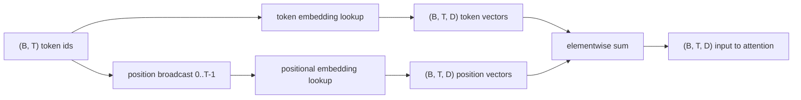
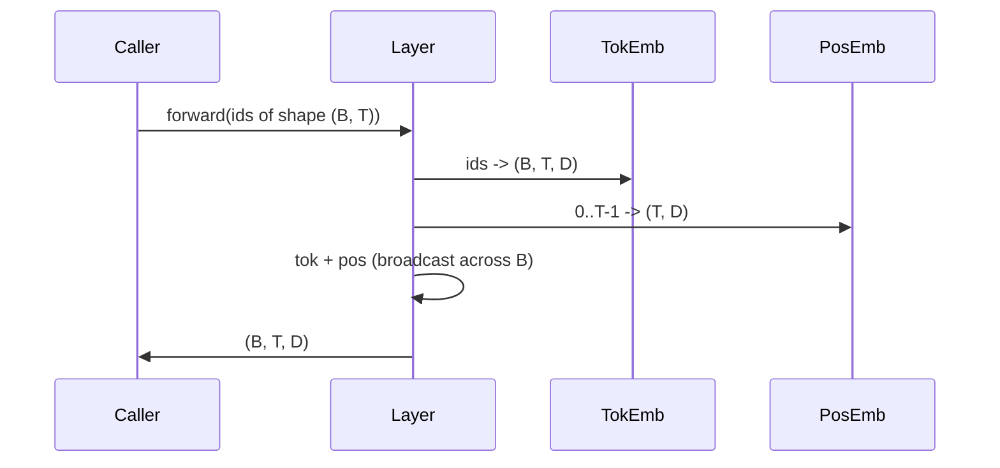

# Token and Positional Embeddings · token 嵌入与位置嵌入（positional embeddings）

> id 是整数，模型要的是向量。两张查找表（lookup table）站在它们中间，而位置表的选择决定了模型能学到什么。
>
> Ids are integers. The model wants vectors. Two lookup tables sit between them, and the choice of the positional one shapes what the model can learn.

**Type:** Build
**Languages:** Python
**Prerequisites:** Phase 04 lessons, Phase 07 transformer lessons, Lessons 30 and 31 of this phase
**Time:** ~90 minutes

## Learning Objectives · 学习目标

- 构建把词表 id 映射到稠密向量的 token 嵌入（token embedding）查找表。
- 构建按位置索引的可学习位置嵌入（learned positional embedding）查找表。
- 构建按位置索引、不带参数的固定正弦位置嵌入（sinusoidal positional embedding）。
- 把 token 嵌入与位置嵌入组合成 transformer 块的单一输入。
- 在长度泛化与参数量上对比可学习嵌入与正弦嵌入。

```figure
cc-embedding-lookup
```

> Build a token-embedding lookup table that maps vocabulary ids to dense vectors.
> Build a learned positional-embedding lookup table indexed by position.
> Build a fixed sinusoidal positional embedding indexed by position with no parameters.
> Compose token and positional embeddings into a single input for a transformer block.
> Contrast learned and sinusoidal embeddings on length generalization and parameter count.

## The frame · 背景

模型与 token id 的第一次接触，是在 token 嵌入矩阵里做一次行查找。矩阵每个词表 id 一行、每个模型维度一列。查找返回一个向量，模型的其余部分把它当作这个 id 的含义。反向传播只更新前向传播中用到的那些行。随着训练推进，这些行的几何结构学会在各个方向上编码相似性。

token id 本身没有顺序。模型需要第二个信号，告诉它位置一和位置十七不一样。这个信号有两个主流选择：可学习位置嵌入（第二张查找表，每个位置一行）和固定正弦位置嵌入（一个无参数的数学公式）。这个选择有后果。可学习表是一个参数，并且受限于模型训练时的最大上下文长度。正弦表理论上无参数、公式可以延伸到任意位置，但本课的 `SinusoidalPositionalEmbedding` 在 `max_context_length` 处预计算一张固定表，`forward` 越过这个界限会直接抛错；所以在这里两个模块都强制了最大上下文长度。即便表大到足以索引，模型在超出训练长度之后仍然可能吃力。

本课把两者都造出来，并与 token 嵌入组合成下一课注意力块的单一输入。

> The model's first contact with a token id is a row lookup in the token-embedding matrix. ... A learned table is a parameter and is bounded by the maximum context length the model was trained on. ... This lesson builds both and composes them with the token embedding into a single input for the next lesson's attention block.

## The shape contract · 形状契约

嵌入阶段的输入是形状 `(B, T)` 的一批 token id。输出是形状 `(B, T, D)` 的张量，`D` 是模型维度。每个批次元素有相同的上下文长度 `T`，每个位置有相同的向量维度 `D`。



组合方式是求和，不是拼接。求和让 `D` 在整个网络中保持不变，并让模型可以在每个特征上自行决定：在这一层，是 token 含义主导还是位置主导。

> The input to the embedding stage is a batch of token ids of shape `(B, T)`. The output is a tensor of shape `(B, T, D)` where `D` is the model dimension. ... The composition is a sum, not a concatenation. Summing keeps `D` constant through the network and lets the model decide on a per-feature basis whether the token meaning or the position dominates at each layer.

## The token embedding matrix · token 嵌入矩阵

token 嵌入是形状 `(V, D)` 的参数张量，`V` 是词表大小。PyTorch 把它暴露为 `nn.Embedding(V, D)`。初始化时元素从一个小高斯分布抽取，习惯上对 transformer 规模的模型取均值 0、标准差 0.02 上下。确切的初始化方式，没有「跨运行保持一致」重要。

前向传播就是一次索引操作。PyTorch 通过按行收集（gather），把 `(B, T)` 的 int64 id 映射成 `(B, T, D)` 的浮点数。反向传播只把梯度累加进前向中被触碰的那些行。没在批次里出现过的两行，这一步梯度为零。

一个微妙的细节。token 嵌入和模型末端的输出投影经常共享权重（权重绑定，weight tying）。发生这种情况时，每次反向传播都会经由输出侧触到嵌入的每一行。本课把两者暴露为独立模块，但在完整模型里同一个矩阵可以扮演两个角色。

> The token embedding is a parameter tensor of shape `(V, D)` where `V` is the vocabulary size. ... The forward pass is a single indexing operation. ... A subtle detail. The token embedding and the output projection at the end of the model often share weights (weight tying).

## The learned positional embedding · 可学习位置嵌入

可学习位置嵌入是第二张 `nn.Embedding`，形状 `(max_context_length, D)`。查找按位置 id `0, 1, 2, ..., T-1` 索引。前向传播把这个位置向量沿批次维度广播（broadcast）出去。

可学习表的缺点：如果模型只训练到位置 `T-1`，位置 `T` 就查不到——那一行不存在。采用这种方案的生产级 decoder-only 模型把最大上下文长度直接焊进架构，拒绝处理更长的输入。

> The learned positional embedding is a second `nn.Embedding` of shape `(max_context_length, D)`. The lookup is keyed by position id `0, 1, 2, ..., T-1`. ... Production decoder-only models that use this scheme bake the maximum context length into the architecture and refuse to process longer inputs.

## The sinusoidal positional embedding · 正弦位置嵌入

正弦位置嵌入是一个从位置到向量的函数。位置 `p`、特征 `i` 产出

```python
angle = p / (10000 ** (2 * (i // 2) / D))
emb[p, 2k]     = sin(angle)
emb[p, 2k + 1] = cos(angle)
```

这个函数没有参数。每个位置的向量都独一无二。波长（wavelength）沿特征维度按几何级数变化，所以低维编码粗粒度位置、高维编码细粒度位置。

`sin` 与 `cos` 联合选择带来的性质是：位置 `p + k` 的向量是位置 `p` 的向量的线性函数。这给注意力层提供了一条学习相对位置偏移的捷径。模型不需要单独的参数来表达「往回看五个 token」。

本课在构造时一次性算出整张正弦表，前向时索引进表。

> The sinusoidal positional embedding is a function from position to vector. ... The wavelength varies geometrically across feature dimensions, so the lower dimensions encode coarse position and the higher dimensions encode fine position. ... The property that follows from the choice of `sin` and `cos` together is that the vector at position `p + k` is a linear function of the vector at position `p`.

## The composition · 组合方式

输入管线按顺序做三件事。读入 token id。查找 token 向量。加上位置向量。返回和。



求和步骤里的广播把 `(T, D)` 的位置张量沿批次维度复制。PyTorch 自动处理这件事，因为位置张量在 unsqueeze 之后形状是 `(1, T, D)`。

> The input pipeline does three things in order. Read the token ids. Look up the token vectors. Add the positional vectors. Return the sum. ... PyTorch handles that automatically because the positional tensor has shape `(1, T, D)` after unsqueeze.

## Contrastive analysis · 对比分析

本课在相同输入上运行两个变体，打印两项诊断。

第一项是参数量。可学习变体在 token 嵌入之上新增 `max_context_length * D` 个参数。正弦变体新增零个。

第二项是相邻位置嵌入之间的余弦相似度。正弦变体的衰减平滑且可预测，因为函数连续。可学习变体在初始化时相似度接近随机，因为各行独立抽取。训练之后，可学习变体通常也会发展出类似的光滑结构，但它得从数据里把结构学出来。

> The first is parameter count. The learned variant adds `max_context_length * D` parameters on top of the token embedding. The sinusoidal variant adds zero. ... The second is the cosine similarity between embeddings at neighbouring positions. ... After training, the learned variant typically develops a similar smooth structure, but it has to discover that structure from data.

## What this lesson does not do · 本课不做什么

它不造旋转位置编码（RoPE）或 AliBi。这些是生产 transformer 的现代选择。它们与这里的嵌入遵循同一个形状契约（对形状 `(B, T, D)` 的向量施加依赖位置的变换），但施加在注意力投影那一步而不是输入处。下一课构建注意力块，其中一个可选扩展就是把旋转编码折进那里的 query-key 投影。

它不训练嵌入。训练需要损失，损失需要模型输出，模型输出需要注意力和 LM head。那是下一课和再下一课的事。

> It does not build rotary positional encoding (RoPE) or AliBi. ... It does not train the embedding. Training requires a loss, which requires a model output, which requires attention and an LM head.

## How to read the code · 如何读代码

`main.py` 定义三个模块。`TokenEmbedding` 包装 `nn.Embedding(V, D)`。`LearnedPositionalEmbedding` 包装 `nn.Embedding(L, D)`。`SinusoidalPositionalEmbedding` 预计算表并把它作为 buffer 暴露。`EmbeddingComposer` 把一个 token 嵌入和一个位置嵌入绑在一起。底部的 demo 打印形状、参数量和相邻位置相似度诊断。`code/tests/test_embeddings.py` 里的测试钉住形状、广播行为、参数量和正弦公式。

跑一下 demo。然后把模型维度 `D` 从 64 改成 32，观察正弦波长频带如何变化。

> `main.py` defines three modules. `TokenEmbedding` wraps `nn.Embedding(V, D)`. `LearnedPositionalEmbedding` wraps `nn.Embedding(L, D)`. `SinusoidalPositionalEmbedding` precomputes the table and exposes it as a buffer. ... Run the demo. Then change the model dimension `D` from 64 to 32 and watch how the sinusoidal wavelength bands change.
