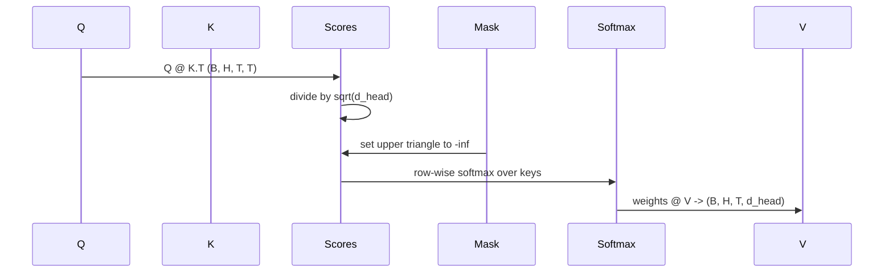

# Multi-Head Self-Attention · 多头自注意力（multi-head self-attention）

> 一个线性投影，三个视图，H 个并行头，一个掩码。这就是模型实际使用中的注意力块。
>
> One linear projection, three views, H parallel heads, one mask. The attention block as the model actually uses it.

**Type:** Build
**Languages:** Python
**Prerequisites:** Phase 04 lessons, Phase 07 transformer lessons, Lessons 30 through 32 of this phase
**Time:** ~90 minutes

## Learning Objectives · 学习目标

- 把批量化的 Query/Key/Value 投影实现为单个线性层切分成 H 个头。
- 以正确的归一化和 dtype 处理计算缩放点积注意力（scaled dot-product attention）。
- 施加因果掩码（causal mask），阻止一个位置看到未来位置。
- 检查固定输入下每个头的注意力权重，推断每个头在看什么。
- 在玩具任务上训练一个小注意力块，观察 loss 下降、各个头开始分工。

```figure
cap-multihead-attention
```

> Implement a batched Query/Key/Value projection as a single linear layer split into H heads.
> Compute scaled dot-product attention with the correct normalization and dtype handling.
> Apply a causal mask that prevents a position from attending to future positions.
> Inspect per-head attention weights for a fixed input and reason about what each head looks at.
> Train a small attention block on a toy task and watch the loss fall as the heads specialize.

## The frame · 背景

注意力是让一个 token 的表示从同一序列的其他 token 那里拉取信息的函数。自注意力（self-attention）指 query、key、value 全部派生自同一个输入。多头（multi-head）指投影被切分成 H 个并行的注意力问题，它们的输出被拼接后再投影回去。

高效的实现模式是：一个从 `D` 投影到 `3 * D` 的线性层，切成三个视图，再重排成 H 个大小为 `D // H` 的头。matmul、softmax 和加权和都以批量张量运算发生，所以各个头在加速器上并行运行。

本课构建这个块。它还加了因果掩码，于是同一份代码可以充当 decoder-only 语言模型里的注意力层。下一课把这个块堆成完整 transformer，再下一课训练它。

> Attention is the function that lets a token's representation pull information from other tokens in the same sequence. ... The efficient implementation pattern is one linear layer that projects from `D` to `3 * D` and gets sliced into three views, then reshaped into H heads of size `D // H` each. ... The next lesson stacks the block into a full transformer and the lesson after trains it.

## The shape contract · 形状契约

输入是 `(B, T, D)`。输出是 `(B, T, D)`。掩码是 `(T, T)` 或可广播到它。块内中间张量的形状是 `(B, H, T, d_head)`，其中 `d_head = D // H`。约束是 `D % H == 0`。

```mermaid
flowchart LR
    A["(B, T, D) input"] --> B[Linear D -> 3D]
    B --> C["split into Q, K, V"]
    C --> D["reshape to (B, H, T, d_head)"]
    D --> E["scores = Q @ K.T / sqrt(d_head)"]
    E --> F[apply causal mask]
    F --> G[softmax over keys]
    G --> H["context = weights @ V"]
    H --> I["reshape to (B, T, D)"]
    I --> J[output Linear D -> D]
    J --> K["(B, T, D) output"]
```



两个线性层（QKV 投影和输出投影）是块里仅有的参数。掩码、softmax、matmul 和重排全都不带参数。

> The input is `(B, T, D)`. The output is `(B, T, D)`. The mask is `(T, T)` or broadcastable to it. Inside the block the intermediate tensors have shape `(B, H, T, d_head)` where `d_head = D // H`. ... The two linear layers (the QKV projection and the output projection) are the only parameters in the block.

## The QKV split · QKV 切分

朴素实现是三个独立线性层，Q、K、V 各一个。高效实现是单个线性层输出 `3 * D` 个特征再切分。两者数学等价，因为三次独立的 `(D, D)` 权重矩阵乘法，恰好等于一次用它们堆叠成的 `(3D, D)` 权重做的矩阵乘法。

高效版本更快，因为加速器启动一次 matmul 而不是三次。它也更好初始化，因为三个子矩阵住在同一个参数张量里，可以一起初始化。

> The naive implementation has three separate linear layers, one each for Q, K, and V. The efficient one has a single layer that outputs `3 * D` features and splits the result. The two are mathematically equivalent because three separate matrix multiplications by `(D, D)` weights are exactly one matrix multiplication by a `(3D, D)` weight stacked from them. ... The efficient version is faster because the accelerator launches one matmul instead of three.

## The head reshape · 头维度重排（reshape）

切分之后，Q、K、V 各是 `(B, T, D)`。要把它们变成 H 个并行注意力问题，先重排成 `(B, T, H, d_head)`，再转置成 `(B, H, T, d_head)`。头维度现在紧挨批次维度，PyTorch 就把每个头的注意力当作 `B * H` 个独立实例上的批量运算。

`d_head` 维度留在最后，让打分 matmul `Q @ K.transpose(-2, -1)` 能把它收缩掉。结果是 `(B, H, T, T)` 的每头注意力分数。

> After the split, each of Q, K, V is `(B, T, D)`. To turn that into H parallel attention problems, we reshape to `(B, T, H, d_head)` and transpose to `(B, H, T, d_head)`. ... The d_head dimension stays last so the score matmul `Q @ K.transpose(-2, -1)` contracts it. The result is `(B, H, T, T)` per-head attention scores.

## Scaling · 缩放

分数在 softmax 之前除以 `sqrt(d_head)`。没有这个缩放，点积随 `d_head` 增大而增大，把 softmax 推进一种「某一项几乎独占全部概率质量、其他项小到可忽略」的状态。这种状态下梯度极小，学习停滞。除以 `sqrt(d_head)` 让分数的方差在不同头大小之间大致恒定。

> Without that scaling, dot products grow as `d_head` grows and push the softmax into a regime where one entry has almost all the mass and the others are vanishingly small. The gradients in that regime are tiny and learning stalls. Dividing by `sqrt(d_head)` keeps the variance of the scores roughly constant across head sizes.

## The causal mask · 因果掩码（causal mask）

decoder-only 语言模型在预测下一个 token 时只能以过去为条件。掩码强制这一点。具体做法：softmax 之前，`(T, T)` 分数矩阵对角线之上的每一项都被替换成负无穷。softmax 之后这些位置的权重为零。



我们把掩码在构造时注册为 buffer，于是它和模型住在同一个设备上，也不进入梯度图。掩码覆盖这个块会见到的最大上下文长度。前向时切出左上角的 `(T, T)`。

> A decoder-only language model can only condition on the past when predicting the next token. The mask enforces that. Concretely, before the softmax, every entry above the diagonal of the `(T, T)` score matrix gets replaced by negative infinity. After softmax those positions get weight zero. ... We register the mask as a buffer at construction so it lives on the same device as the model and is not part of the gradient graph.

## The output projection · 输出投影

每头上下文向量是 `(B, H, T, d_head)`，我们转置回 `(B, T, H, d_head)`，重排成 `(B, T, D)`，再施加最后的 `(D, D)` 线性投影。输出投影让模型混合各个头。没有它，H 个头只能靠后面的层重新组合，这个块就被人为地限死了。

> After per-head context vectors `(B, H, T, d_head)`, we transpose back to `(B, T, H, d_head)`, reshape to `(B, T, D)`, and apply a final `(D, D)` linear projection. The output projection lets the model mix the heads. Without it, the H heads would only ever recombine through later layers and the block would be artificially constrained.

## Attention weight inspection · 注意力权重检查

本课在前向传播上暴露一个 `return_weights=True` 开关。置位时，块在输出之外还返回形状 `(B, H, T, T)` 的每头注意力权重。demo 打印某个头在短输入上的权重热力图，你能看到因果三角形结构和每个位置的聚焦点。

训练好的模型里，不同的头学到不同的模式。有的头盯着紧邻的前一个 token。有的头盯着序列开头。有的头几乎均匀摊开注意力。这个检查钩子就是可解释性（interpretability）工作的入口。

> The lesson exposes a `return_weights=True` flag on the forward pass. When set, the block returns the per-head attention weights of shape `(B, H, T, T)` alongside the output. ... In a trained model, different heads learn different patterns. Some heads attend to the immediately previous token. Some heads attend to the start of the sequence. Some heads spread attention almost uniformly.

## The training demo · 训练演示

`main.py` 底部的 demo 把注意力块接到一个小 LM head 上，在一个重复任务上训练整体。输入的每一行是同一个随机 id 沿上下文复制。目标是输入左移一位，所以模型必须学到「下一个 token 与上一个 token 相同」。损失是交叉熵。在 H=4、D=32、T=12、词表 64 的配置下，loss 从随机水平（约 `log(64) ~ 4.16`）在 CPU 上三个 epoch 内降到远低于 `1.0`。

demo 的目的不是训练一个有用的模型。目的是确认梯度流过块的每一部分，而且在一个答案显而易见的问题上，各个头确实学到了东西。

> The demo at the bottom of `main.py` wires the attention block to a tiny LM head and trains the whole thing on a repeat task. ... With H=4, D=32, T=12, and a vocabulary of 64, the loss falls from random (around `log(64) ~ 4.16`) down to well under `1.0` over three epochs on CPU. ... The point of the demo is not to train a useful model. The point is to confirm the gradients flow through every piece of the block and the heads learn something on a problem where the answer is obvious.

## What this lesson does not do · 本课不做什么

它不加前馈块。真实模型里的 transformer 层是注意力后接一个两层 MLP，各自围绕残差连接（residual connection）和层归一化（layer norm）。下一课补上这些。

它不实现旋转位置编码或 AliBi。两者都施加在同一块的 QKV 投影那一步，但它们是一个独立的教学单元。本课造的块与两者兼容，只要在 matmul 之前变换 Q 和 K。

它不为推理实现 KV 缓存（KV cache）。跨前向传播缓存 key 和 value 是让自回归解码变快的那项优化。它改变 K、V 张量上的形状契约，但不改变 Q 上的。它属于推理课。

> It does not add a feed-forward block. ... It does not implement rotary or AliBi positional encoding. ... It does not implement KV cache for inference. Caching keys and values across forward passes is the optimization that makes autoregressive decoding fast.

## How to read the code · 如何读代码

`main.py` 定义 `MultiHeadSelfAttention`。这个类持有两个线性层和一个注册的掩码 buffer。前向传播依次做投影、重排、打分、掩码、softmax、加权、重排、再投影。底部的 demo 构建一个小模型，用 token 与位置嵌入加 LM head 包住注意力，在复制任务上训练三个 epoch，打印 loss 曲线和每头注意力热力图。`code/tests/test_attention.py` 里的测试钉住形状契约、因果性、softmax 性质、头切分性质和梯度流。

跑一下 demo。然后把 `n_heads` 从 4 加到 8（保持 `d_model=32`，即 `d_head=4`），观察热力图怎么变。

> `main.py` defines `MultiHeadSelfAttention`. The class holds two linear layers and a registered mask buffer. ... The tests in `code/tests/test_attention.py` pin the shape contract, the causality property, the softmax property, the head-split property, and the gradient flow. ... Run the demo. Then increase `n_heads` from 4 to 8 (keeping `d_model=32`, so `d_head=4`) and watch the heatmap change.
