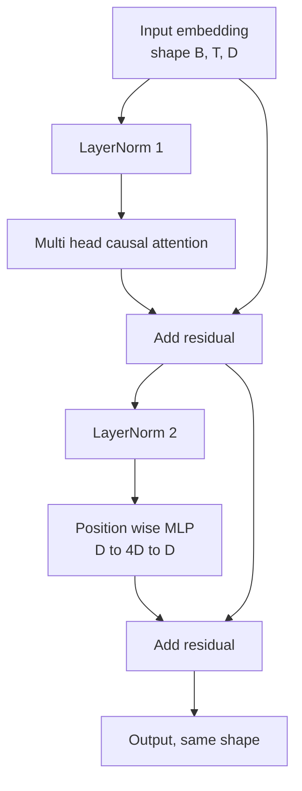
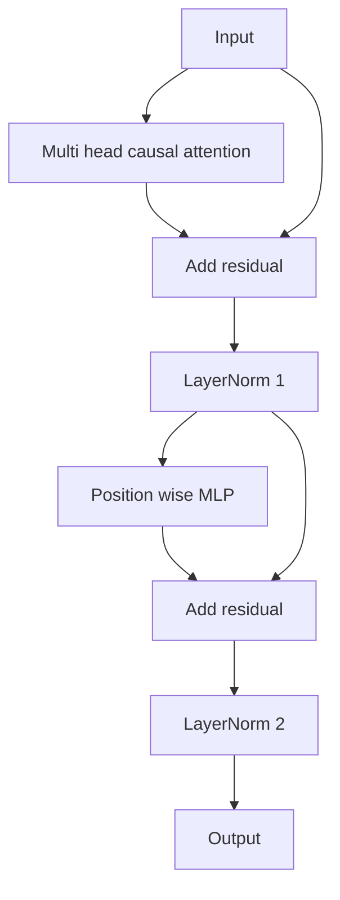

# Transformer Block from Scratch · 从零实现 Transformer 块

> 一个块就是每个现代 decoder LLM 的组成单元。层归一化、多头注意力、残差、MLP、残差。pre-LN 变体不用 warmup 也能稳定训练。post-LN 变体是原始论文交付的版本。本课把两者并排造出来，并展示在常见学习率下哪一个能在 12 层堆叠中活下来。
>
> One block is the unit of every modern decoder LLM. Layer norm, multi head attention, residual, MLP, residual. The pre-LN variant trains stably without warmup. The post-LN variant is what the original paper shipped. This lesson builds both, side by side, and shows which one survives a 12 layer stack at common learning rates.

**Type:** Build
**Languages:** Python
**Prerequisites:** Phase 19 lessons 30 to 33 (tokenizer, embeddings, attention math, batched data loader)
**Time:** ~90 minutes

## Learning Objectives · 学习目标

- 用四件运动部件构建 PyTorch transformer 块：LayerNorm、多头因果注意力、残差连接、逐位置 MLP。
- 把 LayerNorm 摆进两种配置（pre-LN 和 post-LN），并解释为什么其中一种不用 warmup 就能稳定训练。
- 在多头注意力内部实现因果掩码，让 token `i` 看不到 token `j > i`。
- 在 12 层堆叠上追踪两个变体的梯度流，不带一句空话地读出结果。
- 下一课组装 1.24 亿参数 GPT 时，把这个块当作即插单元复用。

> Build a transformer block in PyTorch from the four moving pieces: LayerNorm, multi head causal attention, residual connections, position wise MLP.
> Place the LayerNorms in two configurations (pre-LN and post-LN) and explain why one trains stably without warmup.
> Implement causal masking inside the multi head attention so token `i` cannot see tokens `j > i`.
> Track gradient flow through both variants on a 12 layer stack and read the result without hand waving.
> Reuse the block as a drop-in unit when the next lesson assembles a 124 million parameter GPT.

## The Problem · 问题在哪

transformer 就是一个块反复出现。块错一次，重复十二次，你交付的模型要么第一个 epoch 就发散，要么余下全程都要靠 warmup 补丁吊着。本课里你会看到的两种失败模式一点都不冷门。学习者第一次天真地堆块时它们就会出现。一个是注意力层看到了未来。另一个是 LayerNorm 放在了深度下无法驯服残差信号的位置。

一旦看清，修法是机械的。块恰好有两条残差路径、恰好两个归一化位置。位置选对，堆叠的其余部分只是记账。

> A transformer is one block repeated. ... One is the attention layer attending to the future. The other is the LayerNorm placed where it cannot tame the residual signal at depth. ... The block has exactly two residual paths and exactly two normalization positions. Choose the positions correctly and the rest of the stack is just bookkeeping.

## The Concept · 概念

每个 decoder-only transformer 块都是一个函数：吃进形状 `(batch, sequence, embedding)` 的张量，吐出同形状的张量。内部由两个子层干活。



这是 pre-LN 变体。LayerNorm 位于残差分支内部、子层之前。残差连接把未归一化的信号向前传送。

post-LN 变体把 LayerNorm 挪到残差相加之后。



形状完全一样，训练行为不是。post-LN 下，流回残差路径的梯度必须穿过 LayerNorm。在十二层深度、学习率 `3e-4` 时，这个梯度缩减得足够快，以至于需要 warmup 调度。pre-LN 让残差路径不经过归一化，梯度干净地传播到嵌入层。正因如此，从 GPT-2 起交付的都是 pre-LN 配置。

> Every decoder only transformer block is a function that takes a tensor of shape `(batch, sequence, embedding)` and returns a tensor of the same shape. ... This is the pre-LN variant. The LayerNorm sits inside the residual branch, before the sublayer. The residual connection carries the unnormalized signal forward. ... With post-LN, the gradient that flows back through the residual path must pass through the LayerNorm. ... Pre-LN is the configuration GPT-2 onward ships with for that reason.

### Causal multi head attention · 因果多头注意力

注意力子层把输入按三种方式投影成 query、key、value 张量。每个都从 `(B, T, D)` 重排成 `(B, H, T, D/H)`，`H` 是头数。缩放点积注意力在每个头上计算 `softmax(Q K^T / sqrt(d_k))`，把上三角掩到负无穷，经 softmax 施加掩码，再乘 `V`。各头拼接回单个 `(B, T, D)` 张量后再投影一次。掩码是让模型因果的唯一部件。忘了掩码，你训练的就是一个作弊的模型。

> Scaled dot product attention computes `softmax(Q K^T / sqrt(d_k))` per head, masks the upper triangle to negative infinity, applies the mask via softmax, then multiplies by `V`. ... The mask is the only piece that makes the model causal. Forget the mask and you train a model that cheats.

### The MLP · MLP 子层

逐位置 MLP 对每个 token 独立地施加同一个两层网络。隐藏宽度是嵌入宽度的四倍，激活是 GELU，第二个线性层之后接一个 dropout。MLP 内部没有 token 相互交流。所有 token 混合都发生在注意力里。

> The position wise MLP applies the same two layer network to every token independently. The hidden width is four times the embedding width, the activation is GELU, and a dropout follows the second linear. No tokens talk to each other inside the MLP. All token mixing happens in attention.

### Residual connections do two things · 残差连接做两件事

它们让梯度路径跨深度可加，把梯度范数在十二层里保持在量级上。它们还让每个块学的是对运行中表示的可加更新，而不是整体替换。这两个效应就是块能扩展（scale）的原因。

```figure
cc-transformer-block
```

> They make the gradient path additive across depth, which keeps the gradient norm in scale through twelve layers. They also let each block learn an additive update to the running representation rather than a full replacement. Both effects are why the block scales.

## Build It · 动手造

`code/main.py` 实现了：

- `class LayerNorm`：带可学习 scale 和 shift、有偏 eps，按 token 向量施加。
- `class MultiHeadAttention`：带 `num_heads`、`head_dim = d_model // num_heads`、融合 QKV 投影、注册的因果掩码、注意力与残差 dropout。
- `class FeedForward`：两个线性层、GELU 激活、dropout。
- `class TransformerBlock`：带 `pre_ln` 开关，在两种变体之间切换。
- 一个 demo：构建 6 层 pre-LN 堆叠和 6 层 post-LN 堆叠，喂相同输入，打印 (a) 输出形状、(b) 一次反向传播后嵌入处的梯度范数。

跑起来：

```bash
python3 code/main.py
```

输出：两个堆叠的形状检查、并排的梯度范数。相同学习率下，pre-LN 堆叠的嵌入梯度比 post-LN 堆叠大几个数量级，这就是「pre-LN 不用 warmup 也能训练」的实证信号。

> Output: shape check on both stacks, gradient norms side by side. The pre-LN stack's embedding gradient is order of magnitude larger than the post-LN stack at the same learning rate, which is the empirical signal pre-LN trains without warmup.

## Stack · 技术栈

- `torch` 负责张量数学、autograd 和 `nn.Module` 的管线。
- 不用 `transformers`，不用预训练权重。块从原语实现。

> `torch` for the tensor math, autograd, and `nn.Module` plumbing.
> No `transformers`, no pretrained weights. The block is implemented from primitives.

## Production patterns in the wild · 生产环境的实战模式

三种模式把教科书块变成你能交付的东西。

**融合 QKV 投影。** 三个独立线性层要三次内核启动、三次矩阵乘。一个宽度 `3 * d_model` 的线性层一次启动做完同样的工作，再沿最后一轴切开输出。融合路径在每个加速器上都更快，GPT-2、LLaMA、Mistral 的参考实现全都这么交付。

**注册因果掩码 buffer。** 掩码只依赖最大上下文长度。构造时用 `register_buffer` 分配一次，每次前向切出活动窗口，省掉每次调用的分配。忘了这一点，长上下文下掩码会变成分配器热点。

**Dropout 放两处，不是三处。** dropout 属于注意力 softmax 之后（attention dropout）和 MLP 第二个线性层之后（residual dropout）。加在残差本身上的 dropout 会破坏让梯度在深度下流动的可加恒等性。一些早期实现搞错了这一点，付出了训练脆弱的代价。

> Three patterns turn the textbook block into something you can ship.
> **Fused QKV projection.** ... **Registered causal mask buffer.** ... **Dropout in two places, not three.** ... A dropout on the residual itself breaks the additive identity that lets the gradient flow at depth.

## Use It · 实战用法

- 本课的块不经修改直接插进第 35 课的 GPT 组装。
- pre-LN 变体是每个现代开放权重（open weights）LLM 用的。post-LN 变体是 2017 年原始注意力论文用的。两个都懂，你遇到的任何 decoder 架构都读得懂。
- 把 GELU 换成 SiLU，你就得到 LLaMA 家族的激活。把 LayerNorm 换成 RMSNorm，你就得到 LLaMA 家族的归一化。骨架不变。

> The block in this lesson plugs straight into the GPT assembly in lesson 35 without modification.
> The pre-LN variant is what every modern open weights LLM uses. The post-LN variant is what the original 2017 attention paper used. Knowing both is enough to read any decoder architecture you will encounter.
> Swap the GELU for SiLU and you have the LLaMA family activation. Swap the LayerNorm for RMSNorm and you have the LLaMA family normalization. Same skeleton.

## Exercises · 练习

1. 给块里每个线性层加 `bias=False` 开关。现代开放权重 LLM 的线性层都不带偏置。测量 12 层 768 维模型能省多少参数。
2. 把 `nn.LayerNorm` 换成手写 RMSNorm，验证输出形状不变。
3. 加一个返回第一个头注意力权重的开关，输出 `(B, T, T)` 张量。画出上三角，确认 softmax 之后为零。
4. 构建一个健全性检查：把 `(2, 16, 384)`、`H=6` 的张量喂进两个变体，在权重初始化相同、dropout 置零时断言前向输出不同（例如 `not torch.allclose`）。

> Add a `bias=False` flag to every linear in the block. ... Replace `nn.LayerNorm` with a hand rolled RMSNorm and verify the output shape is unchanged. ... Add a flag that returns the attention weights for the first head as a `(B, T, T)` tensor. ... Build a sanity check that feeds a `(2, 16, 384)` tensor with `H=6` through both variants and asserts the forward outputs are different (for example, `not torch.allclose`) when weights are initialized identically and dropout is set to zero.

## Key Terms · 术语表

| 术语 | 大家怎么说 | 实际含义 |
|------|-----------------|------------------------|
| Pre-LN | 「前置归一化」 | LayerNorm 位于残差分支内部、每个子层之前；残差承载未归一化的信号 |
| Post-LN | 「后置归一化」 | LayerNorm 在残差相加之后；2017 年论文交付的版本，需要 warmup |
| Causal mask | 「三角掩码」 | 注意力 logits 的上三角置为负无穷，使 token i 在 j 大于 i 时读不到 token j |
| Fused QKV | 「合并投影」 | 一个宽度 3D 的线性层代替三个宽度 D 的线性层；一次内核启动、一次矩阵乘 |
| Residual stream | 「跳跃连接」（skip connection） | 自上而下流过每个块的未归一化张量；每个块往它上面做加法 |

> Pre-LN | "Pre norm" | LayerNorm inside the residual branch, before each sublayer; the residual carries the unnormalized signal
> Post-LN | "Post norm" | LayerNorm after the residual add; what the 2017 paper shipped and what needs warmup
> Causal mask | "Triangle mask" | The upper triangle of the attention logits set to negative infinity so token i cannot read token j when j is greater than i

## Further Reading · 延伸阅读

- Phase 7 lesson 02（从零实现自注意力）：本块底下的注意力数学。
- Phase 7 lesson 05（完整 transformer）：同一骨架的 encoder-decoder 版本。
- Phase 10 lesson 04（预训练 mini GPT）：本块接入的训练流程。
- Phase 19 lesson 35（本 track）：把十二个这样的块堆成一个 GPT 模型。

> Phase 7 lesson 02 (self attention from scratch) for the attention math underneath this block.
> Phase 19 lesson 35 (this track) which stacks twelve of these blocks into a GPT model.
