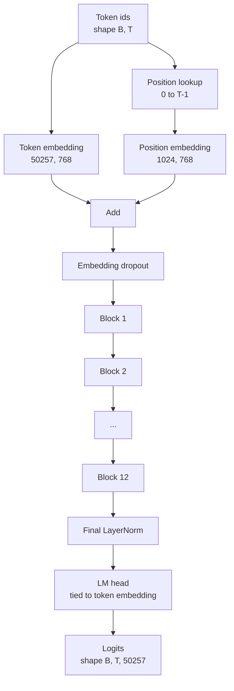
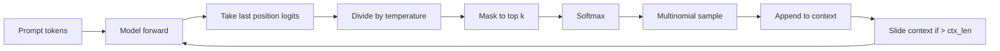

# GPT Model Assembly · GPT 模型组装

> Twelve blocks stacked, a token embedding, a learned position embedding, a final LayerNorm, and a tied language model head. That is the entire 124 million parameter GPT model. This lesson assembles those pieces into a working class, counts the parameters to confirm the model matches the reference 124M shape, and generates text with multinomial sampling, temperature, and top-k.

**Type:** Build
**Languages:** Python
**Prerequisites:** Phase 19 lessons 30 to 34
**Time:** ~90 minutes

## Learning Objectives · 学习目标

- 把第 34 课的 transformer 块组装成一个完整的 GPT 模型：token 嵌入、位置嵌入、N 个块、最后的 LayerNorm、语言模型 head。
- 复现 1.24 亿（124M）参数配置：词表 50257、上下文 1024、嵌入维度 768、十二个注意力头、十二层。
- 把语言模型 head 的权重绑定（weight tying）到 token 嵌入上，并解释为什么在这个规模下能省下约 3800 万参数。
- 用多项式采样（multinomial sampling）、温度缩放（temperature）和 top-k 截断从 prompt 生成文本，并用滑动窗口维持上下文长度。
- 对照 124M 目标测量参数量和前向开销。

> Assemble the transformer block from lesson 34 into a full GPT model: token embedding, position embedding, N blocks, final LayerNorm, language model head.
> Reproduce the 124 million parameter configuration: vocab 50257, context 1024, embedding 768, twelve heads, twelve layers.
> Tie the language model head weights to the token embedding and explain why that saves ~38 million parameters at this scale.
> Generate text from a prompt with multinomial sampling, temperature scaling, and top-k truncation, holding context length with a sliding window.
> Measure parameter count and forward pass cost against the 124M target.

## The Problem · 问题在哪

单个 transformer 块自己什么都干不了。你需要把 token id 变成向量、混入位置信息、把它们送过整个堆栈、再投影回词表 logits。这四步少了任何一步，模型要么前向直接失败，要么位置信息漂移，要么根本不会「说话」。

模型的形状同样要紧。参考的 GPT-2 small 正是在上面那个配置下拥有 1.24 亿参数。这些数字并不神奇。词表 50257 乘以嵌入维度 768 就是 token 表；位置 1024 乘以 768 就是位置表；十二个块、每块约 700 万参数，合计 8400 万；最后的 head 通过权重绑定复用 token 表。把各部分加起来正好落在 1.24 亿。如果模型的参数量对不上参考值，那说明你某处接线接错了。

> A transformer block does nothing on its own. You need to turn token ids into vectors, mix in positional information, run them through the stack, and project back to vocabulary logits. Forget any one of those four steps and the model either fails to forward, drifts in position information, or cannot speak.
> The shape of the model also matters. The reference GPT-2 small is 124 million parameters at exactly the configuration above. ... Building a model whose parameter count does not match the reference is a sign you wired something wrong.

## The Concept · 概念



token id 变成 token 向量，位置 id 变成位置向量，两者相加后送进堆栈。最后的 LayerNorm 是块之外唯一在所有现代变体里都保留下来的部件。LM head 复用 token 嵌入矩阵——这就是权重绑定的含义。

> Token ids become token vectors. Position ids become position vectors. The two are added and sent through the stack. The final LayerNorm is the one piece outside the blocks that survives every modern variant. The LM head reuses the token embedding matrix, which is what weight tying means.

### Weight tying · 权重绑定

token 嵌入的形状是 `(vocab, d_model)`。语言模型 head 需要从 `d_model` 投影回 `vocab`。这两者互为转置。绑定两个字面意义上就是同一个参数张量，用两次。在词表 50257、d_model 768 的规模下，这个矩阵是 3800 万参数。不绑定，你要为它付两次钱；绑定后只付一次，而且还能得到稍微更干净的梯度信号，因为嵌入和 head 一起更新。

> The token embedding has shape `(vocab, d_model)`. The language model head needs to project from `d_model` back to `vocab`. Those are transposes of each other. Tying the two means literally the same parameter tensor, used twice. At vocab 50257 and d_model 768, the matrix is 38 million parameters. Untied, you pay for it twice. Tied, you pay for it once and you also get a slightly cleaner gradient signal because the embedding and head update together.

### Position embedding is learned, not sinusoidal · 位置嵌入是学出来的，不是正弦的

GPT-2 采用的是可学习的位置嵌入。位置表就是一个形状为 `(1024, 768)` 的参数张量。模型每次前向时查找位置 0 到 T-1，并把查到的向量加到 token 嵌入上。这是各种位置方案里最简单的一种（替代方案有 RoPE、ALiBi、T5 相对偏置），也正是 124M 参考实现所用的方案。

> GPT-2 ships a learned position embedding. The position table is one parameter tensor of shape `(1024, 768)`. The model looks up position 0 through T-1 at every forward and adds the lookup to the token embedding. This is the simplest of the position schemes (RoPE, ALiBi, T5 relative bias are the alternatives) and it is what the 124M reference uses.

### Generation: temperature, top-k, multinomial · 生成：温度、top-k、多项式采样

生成是自回归的。每一步，模型都会在每个位置上返回整个词表上的 logits。你只取最后一个位置，除以温度（temperature），可选地把 top-k 之外的 logits 全部屏蔽成负无穷，做 softmax 得到概率，再从所得分布中采样一个 token。



三个旋钮，三种不同行为。温度接近 0 退化为贪心（greedy）；温度为 1 等于模型自身的自然分布；top-k 为 1 就是贪心；top-k 为 40 会过滤掉长尾。这些组合很重要；下一课的训练就会把生成当作定性的评估信号来用。

```figure
cc-gpt-assembly
```

> Generation is autoregressive. At every step, the model returns logits over the full vocabulary at every position. You take the last position only, divide by temperature, optionally mask all but the top k logits to negative infinity, softmax to get probabilities, and sample one token from the resulting distribution. ... Three knobs, three different behaviors. Temperature near zero collapses to greedy. Temperature one matches the model's natural distribution.

## Build It · 动手造

`code/main.py` 实现了：

- `class GPTConfig` dataclass，使用 124M 默认值：`vocab_size=50257`、`context_length=1024`、`d_model=768`、`num_heads=12`、`num_layers=12`、`mlp_expansion=4`、`dropout=0.1`、`use_bias=True`、`weight_tying=True`。
- `class GPTModel`，包含 token 嵌入、位置嵌入、嵌入 dropout、十二个 `TransformerBlock`、最后的 LayerNorm，以及一个在标志位打开时与 token 嵌入绑定的 `lm_head`。
- 一个 `count_parameters` 辅助函数，返回去重后的参数量（这样权重绑定会在计数中被正确对待）。
- 一个 `generate` 函数，实现温度、top-k、多项式采样和滑动窗口上下文。
- 一个演示：构建模型，把参数量与参考的 124M 并排打印，并从一个固定 prompt 生成一小段序列，展示整条流水线端到端跑通。

运行：

```bash
python3 code/main.py
```

输出：参数量与 124M 参考值并列展示、从随机 prompt 生成的 token id，以及一条确认信息——当绑定开启时 LM head 与 token 嵌入共享存储。

为了让演示够快，脚本还会用一个极小配置（`d_model=64`、`num_layers=2`）端到端跑一遍，并内联打印生成的 token 序列。124M 配置会构建，但只对它执行参数量统计和一次前向。

> Output: parameter count alongside the 124M reference, generated token ids from a random prompt, and a confirmation that the LM head and token embedding share storage when tying is on.
> To keep the demo fast, the script also runs a tiny config (`d_model=64`, `num_layers=2`) end to end and prints the generated token sequence inline. The 124M config is built but only its parameter count and one forward pass are exercised.

## Stack · 技术栈

- `torch`：张量运算、autograd 和模块搭建。
- `code/main.py` 在本地重新实现了第 34 课的同一个块模式。

> - `torch` for the tensor math, autograd, and module plumbing.
> - `code/main.py` reimplements the same block pattern from lesson 34 locally.

## Production patterns in the wild · 生产环境中的实战模式

三种模式区分了「能跑起来的模型」和「能上线的模型」。

**把残差投影初始化小。** 注意力的输出投影和 MLP 的第二个线性层都直接接入残差相加。如果用和其他线性层一样的标准差去初始化它们，残差流会随深度增长，把最后的 LayerNorm 推进过热区间。把这两个投影的 std 按 `1 / sqrt(2 * num_layers)` 缩放，残差流在十二层里都能保持在合理范围。

**缓存位置 id 张量，不要重复计算。** `torch.arange(T)` 在每次前向时都分配新内存。在 `__init__` 里为最大上下文分配一次，每次调用切出前 T 个条目，省掉与分配器的往返。

**在参数层面绑定权重，而不只是复制。** 设置 `lm_head.weight = token_embedding.weight` 是共享同一个张量；复制不是。优化器只需更新一个参数，autograd 图也只需一次累加。如果你复制，head 会慢慢偏离嵌入，权重绑定就什么都没买到。

> Three patterns make the difference between a model that runs and a model that ships.
> Scale the std by `1 / sqrt(2 * num_layers)` for those two projections; the residual stream stays in a sane range through twelve layers.
> Setting `lm_head.weight = token_embedding.weight` shares the tensor; copying does not. ... If you copy, the head drifts away from the embedding and weight tying buys you nothing.

## Use It · 实战用法

- 本课的模型类和下一课要训练的模型是同一个形状。
- 把可学习的位置嵌入换成 RoPE，不动块、不动 head，你就得到了 LLaMA 家族。
- 再把 GELU 换成 SiLU、LayerNorm 换成 RMSNorm，LLaMA 家族的其余改动也就齐了。
- 生成函数适用于任何 logits 来源，不只是这个模型。你可以在第 37 课里从预训练 GPT-2 文件拿 logits，复用同一条生成循环。

> Replacing the learned position embedding with RoPE gets you the LLaMA family without touching the block or the head.
> The generation function works with any logits source, not only this model. You can pull logits from a pretrained GPT-2 file in lesson 37 and reuse the same generation loop.

## Exercises · 练习

1. 解开 LM head 与 token 嵌入的绑定，重新数参数。验证差值是 50257 乘 768 = 3800 万。
2. 把可学习的位置嵌入换成构造时计算的正弦表。确认模型仍能前向，且参数量减少 786,432。
3. 给生成加一个 `greedy=True` 标志，跳过采样直接取 argmax。确认序列跨运行是确定的。
4. 加一个 `repetition_penalty` 旋钮：在 softmax 之前，把 prompt 或已生成历史中任何 token 的 logit 除以一个常数。在一个固定 prompt 上展示大于 1 的取值会减少输出中的重复次数。
5. 在 `top_k` 旁边加 `top_p`（nucleus）采样。用两行检查被保留 token 的概率之和超过 `top_p`。

## Key Terms · 术语表

| 术语 | 人们怎么说 | 实际含义 |
|------|-----------------|------------------------|
| Weight tying（权重绑定） | 「绑定的嵌入」 | LM head 与 token 嵌入共享同一个参数张量；省下 vocab × d_model 个参数，与 GPT-2 参考实现一致 |
| Position embedding（位置嵌入） | 「学出来的位置」 | 一张形状为 (context length, d_model) 的独立表，加到 token 向量上；端到端学习 |
| Sliding window context（滑动窗口上下文） | 「上下文上限」 | 当 prompt 加生成 token 超过上下文长度时，丢掉最旧的 token，让活动窗口装得下 |
| Top-k sampling（top-k 采样） | 「K 截断」 | 保留值最大的 K 个 logits，其余屏蔽为负无穷，再对剩下的做 softmax |
| Temperature（温度） | 「采样温度」 | softmax 前把 logits 除以 T；T 小于 1 更尖锐，T 等于 1 保持自然分布，T 大于 1 更平坦 |

## Further Reading · 延伸阅读

- Phase 19 第 34 课：本模型所堆叠的 transformer 块。
- Phase 19 第 36 课：用交叉熵损失驱动本模型的训练循环。
- Phase 19 第 37 课：把预训练 GPT-2 权重加载进这个架构。
- Phase 7 第 07 课（GPT 因果语言建模）：下一 token 预测背后的数学。
- Phase 10 第 04 课（预训练 mini GPT）：同一架构上最早的训练流程。
