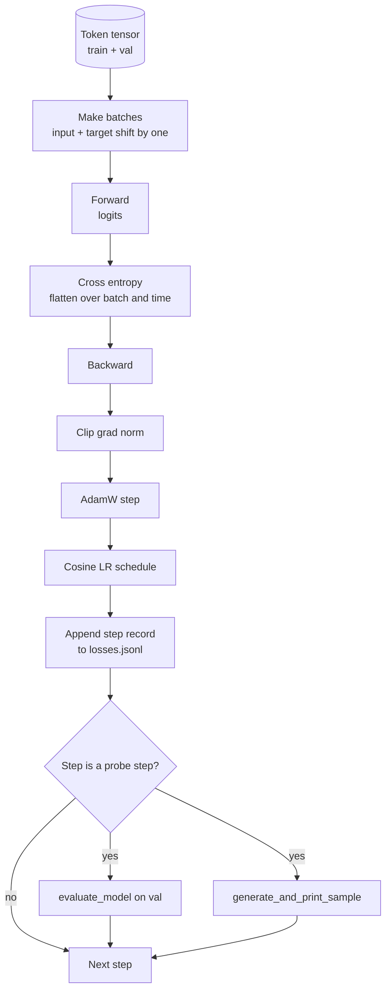

# Training Loop and Evaluation · 训练循环与评估

> A loop that does not measure is a loop that lies. This lesson builds the training loop that drives the GPT model: AdamW with weight decay split, a warmup plus cosine learning rate schedule, a `calc_loss_batch` helper, an `evaluate_model` pass on held out data, a `generate_and_print_sample` qualitative probe every K steps, and a JSONL log of losses you can plot after. The same skeleton trains every decoder LLM you will ever build.

**Type:** Build
**Languages:** Python
**Prerequisites:** Phase 19 lessons 30 to 35
**Time:** ~90 minutes

## Learning Objectives · 学习目标

- 构建一个训练循环：为下一 token 预测做正确的输入/目标对齐，计算交叉熵损失。
- 配置 AdamW：权重衰减只作用于权重张量，不作用于 LayerNorm 或偏置张量。
- 实现带线性 warmup 和余弦衰减的学习率调度，并能读出任一时刻的 LR。
- 用 `evaluate_model` 在留出集（held out split）上评估，让 eval 损失可以跨运行比较。
- 每 K 步用 `generate_and_print_sample` 生成一个定性样本，赶在损失曲线之前发现发散。
- 把每步损失持久化到 JSONL，让你之后可以重载、绘图，并把训练日志作为交付物交付。

> Build a training loop that computes cross entropy loss with the correct input and target alignment for next token prediction.
> Configure AdamW with weight decay applied to weight tensors and not to LayerNorm or bias tensors.
> Implement a learning rate schedule with linear warmup and cosine decay, and read the resulting LR over time.
> Evaluate on a held out split with `evaluate_model` so the eval loss is comparable across runs.
> Generate a qualitative sample every K steps with `generate_and_print_sample` to catch divergence before the loss curve does.
> Persist per step loss to JSONL so you can reload, plot, and ship the training log as a deliverable.

## The Problem · 问题在哪

一个只打印损失、其他什么都不做的训练脚本会以三种方式失败。它无法告诉你损失的下降是不是「对的下降」（模型可能只是在过拟合训练集，什么都没学会）。它无法告诉你发散是否正在开始（损失可能尖一个步就恢复，也可能尖一个步就崩掉）。它无法告诉你模型学到了什么（损失是一个标量，而生成样本是一段文字）。除非循环会「测量」，否则这三种失败全都藏得住。

本课的循环用三种方式测量。每一步在训练 batch 上的损失。每 K 步在留出 batch 上的损失。每 K 步从固定 prompt 生成的一段续写。训练日志落进 JSONL，于是这份产物就是循环的证词。

> A training script that prints the loss but does nothing else fails three ways. It cannot tell you if the loss is decreasing for the right reason (the model could overfit the training set and never learn). It cannot tell you if a divergence is starting (the loss can spike for one step and recover, or one step and crash). It cannot tell you what the model has learned (loss is a scalar; a generated sample is a paragraph). All three failures hide unless the loop measures.
> The training log lands in JSONL so the artifact is the loop's testimony.

## The Concept · 概念



两个不直观的部件是损失对齐（loss alignment）和 AdamW 的衰减分组（decay split）。

### Loss alignment · 损失对齐

模型在每个位置上预测下一个 token。如果输入 batch 是 token `[t0, t1, t2, t3]`，目标 batch 就必须是 `[t1, t2, t3, t4]`。交叉熵在扁平形状 `(batch * seq, vocab)` 上对扁平目标 `(batch * seq,)` 计算。忘了这个错位，你训练的就是「模型预测它自己」——损失收敛到零，却什么有用的东西都没学。

> The model predicts the next token at every position. If the input batch is tokens `[t0, t1, t2, t3]`, the target batch must be `[t1, t2, t3, t4]`. Cross entropy is computed on the flat shape `(batch * seq, vocab)` against the flat target `(batch * seq,)`. Forget the shift and you train the model to predict itself, which converges to zero loss while learning nothing useful.

### AdamW decay split · AdamW 的衰减分组

权重衰减（weight decay）正则化的对象是权重张量，而不是归一化缩放或偏置。把衰减加在 LayerNorm 的 scale 上，会慢慢把 scale 压到零、破坏归一化；把衰减加在偏置上数学上无害，但纯属浪费算力。标准分法是：矩阵形状的张量（线性层权重、嵌入表）吃衰减，凡看起来像缩放或平移的都不吃。

> Weight decay regularizes weight tensors but not normalization scales or biases. Putting decay on the LayerNorm scale slowly drives the scale to zero and breaks normalization. Putting decay on a bias is mathematically harmless but a waste of cycles. The standard split is: matrix shaped tensors (linear weights, embedding tables) get decay, anything that looks like a scale or shift does not.

### Warmup plus cosine schedule · Warmup 加余弦调度

Warmup 在最初几百步里把学习率从零爬升到目标值，让优化器状态有时间填充。余弦衰减在剩余步数里把学习率降回零附近，让最后阶段以小步长精调权重。这个组合是开源权重 LLM 训练中最常见的调度，因为它消掉了最初一千步和最后一千步里大多数脆弱的时刻。

> Warmup ramps the learning rate from zero to the target over a few hundred steps so the optimizer state has time to populate. Cosine decay drops the learning rate back toward zero over the remaining steps so the final phase fine tunes the weights at a small step size. The combination is the most common schedule in open weights LLM training because it removes most of the brittle moments in the first thousand steps and the last thousand steps.

### Held out evaluation · 留出集评估

`evaluate_model` 从验证集里跑固定数量的 batch，累加损失，除以 batch 数，然后返回。没有梯度，没有 dropout。只要种子相同、切分相同，这个数字就可以跨运行复现。把留出损失和训练损失并排汇报，就是你发现过拟合的方式。

> `evaluate_model` runs a fixed number of batches from the validation split, accumulates loss, divides by the batch count, and returns. No gradient. No dropout. The number is reproducible across runs given the same seed and the same split. Reporting the held out loss next to the training loss is how you spot overfitting.

### Qualitative sampling as an early signal · 定性采样：早期信号

一个模型，训练损失掉得很漂亮，生成的样本却全是一个 token——它坏了。一个模型，损失曲线看着平平，生成的样本却渐渐凝成连贯的词——它在学。定性探针比读完整条曲线快，还能抓到标量漏掉的模式。

> A model whose training loss drops nicely but whose generated samples are all the same token is broken. A model whose loss curve looks flat but whose generated samples sharpen into coherent words is learning. The qualitative probe runs faster than reading the full curve and catches modes the scalar misses.

```figure
cap-training-loop
```

## Build It · 动手造

`code/main.py` 实现了：

- `make_batches(token_ids, batch_size, context_length)`：把一条长 token 张量切成输入/目标对。
- `calc_loss_batch(model, inputs, targets)`：前向、展平，返回标量交叉熵。
- `evaluate_model(model, val_loader, max_batches)`：以 no-grad 迭代固定数量的验证 batch，返回平均损失。
- `generate_and_print_sample(model, prompt, max_new_tokens)`：在固定 prompt 上跑第 35 课的生成函数并打印结果。
- `build_param_groups(model, weight_decay)`：产出 AdamW 的两组参数列表。
- `cosine_with_warmup(step, warmup_steps, total_steps, max_lr, min_lr)`：返回给定步数时的 LR。
- `train(...)`：跑循环，把日志持久化到 `outputs/losses.jsonl`，每 `eval_every` 步打印 eval 损失和一个样本。
- 一个演示：在合成数据上训练一个极小模型若干步，写一份 JSONL 日志，并在探针点打印 eval 损失和一个样本。演示在 CPU 上远不到一分钟就能跑完。

运行：

```bash
python3 code/main.py
```

输出：每步损失行、每个探针步的 eval 损失、每个探针步的生成样本，以及最终的 `outputs/losses.jsonl`——你可以逐行用 `json.loads` 加载它。

> Output: per step loss line, eval loss every probe step, a generated sample every probe step, and a final `outputs/losses.jsonl` you can load with `json.loads` per line.

## Stack · 技术栈

- `torch`：autograd、优化器和模块。
- `main.py` 在本地重新实现了第 35 课的 `GPTModel` 和配套模块。

> - `torch` for autograd, optimizer, and modules.
> - `main.py` reimplements the lesson 35 `GPTModel` and supporting modules locally.

## Production patterns in the wild · 生产环境中的实战模式

三种模式能把教科书式的循环变成你可以放心挂一整夜的东西。

**梯度范数裁剪没有商量余地。** 一个坏 batch（异常数据、LR 尖峰、数值边界情况）会产生一个巨大的梯度，抹掉好几个小时的训练。在 `backward` 之后、`step` 之前调用 `torch.nn.utils.clip_grad_norm_(params, max_norm=1.0)`，把优化器保持在安全区间。裁剪值是个自由参数；1 是能在大多数设置下活下来的默认值。

**可断点续训的 JSONL 日志，而不是 pickle 状态。** 每步损失以 `{"step": int, "train_loss": float, "lr": float}` 行记录在 JSONL 里是持久的：任何崩溃都会留下一份可读的产物，你可以 grep，可以用三十行 Python 画图，还可以读最后一个 step 来续训。pickle 状态把你绑死在生成该文件时的模块布局上，一次重构就脆断。

**评估 batch 取自固定切片。** 验证 token 在脚本启动时就被切成 batch，而不是现切现用。可复现性依赖于评估 batch 每次运行完全一致；否则比较两次运行的 eval 损失，测出来的既是模型的差异、也是 batch 洗牌的差异。

> Three patterns turn the textbook loop into something you can leave running overnight.
> `torch.nn.utils.clip_grad_norm_(params, max_norm=1.0)` after `backward` and before `step` keeps the optimizer in a safe range.
> Pickled state ties you to the exact module layout that produced the file, which is brittle across refactors.
> Reproducibility depends on the eval batches being identical from run to run; otherwise comparing eval loss between two runs measures the batch shuffle as much as the model.

## Use It · 实战用法

- 本课的循环骨架和用真实数据训练 124M 模型的骨架是同一个。把合成 token 张量换成 `datasets` 风格的 loader，循环一行不用改。
- JSONL 日志是把一次训练变成证据的交付物。下一课就会用一份这样的日志，把新训练的 checkpoint 和预训练的 checkpoint 做比较。
- 定性样本探针是标量损失替代不了的兜底手段。

> The loop in this lesson is the same skeleton that trains a 124M model on real data. Swap the synthetic token tensor for a `datasets`-style loader and the loop runs unchanged.
> The JSONL log is the deliverable that turns a training run into evidence. The next lesson uses one to compare a freshly trained checkpoint with a pretrained one.

## Exercises · 练习

1. 给 `weight_decay_groups()` 加单元测试，确认 scale 和 bias 参数落入不衰减组、线性权重和嵌入权重落入衰减组。
2. 把合成随机 token 换成来自一个小文本文件的字节，让 demo 在读得懂的东西上训练。验证生成的样本使用的是文件中出现过的字符。
3. 给余弦调度加一个 `max_lr` 的 10% 作为 `min_lr` 下限，并重新绘图。
4. 在 JSONL 日志之外，每 `eval_every` 步保存一个 checkpoint。加一个 `resume_from` 标志，重载模型状态和优化器状态。
5. 在损失旁边记录每步吞吐（tokens/秒），确认它稳定在一个区间内。

## Key Terms · 术语表

| 术语 | 人们怎么说 | 实际含义 |
|------|-----------------|------------------------|
| Loss alignment（损失对齐） | 「错开一位」 | 输入 token 在位置 0..T-1，目标 token 在位置 1..T；交叉熵在展平后的形状上计算 |
| Decay split（衰减分组） | 「两组参数」 | AdamW 给矩阵形状的张量配权重衰减，给 scale 或 bias 张量不配 |
| Warmup | 「爬坡」 | 学习率在固定步数内从零爬升到目标值，让优化器状态有时间填充 |
| Eval batches（评估 batch） | 「留出 batch」 | 验证 token 张量的固定切片，脚本启动时切一次，每次探针用同一份 |
| Qualitative probe（定性探针） | 「样本打印」 | 每 K 步从固定 prompt 生成一小段并打印，抓住单靠损失藏住的失败模式 |

## Further Reading · 延伸阅读

- Phase 19 第 35 课：这个循环驱动的模型。
- Phase 19 第 37 课：把预训练权重加载进同一个模型。
- Phase 10 第 04 课（预训练 mini GPT）：在真实数据上的完整流程。
- Phase 10 第 10 课（评估）：交叉熵损失之外的更完整的评估面。
