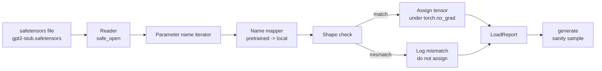

# Loading Pretrained Weights · 加载预训练权重

> Training a 124 million parameter model from scratch is a budget decision; loading a published checkpoint is a Tuesday. This lesson loads pretrained GPT-2 style weights from a safetensors file into the exact architecture from lesson 35, walks the parameter name mapping piece by piece, and sanity generates a continuation to prove the load worked. No network, no third party loaders, no opaque magic.

**Type:** Build
**Languages:** Python
**Prerequisites:** Phase 19 lessons 30 to 36
**Time:** ~90 minutes

## Learning Objectives · 学习目标

- 用 `safetensors` Python 库读取 safetensors 文件，并检查张量的名字和形状。
- 把每个预训练参数名映射到第 35 课 GPT 模型内部的某个参数上。
- 处理已发布 GPT-2 权重与本课程模型之间不同的两套命名约定：`wte/wpe/h.N.attn.c_attn/c_proj` 与 `mlp.c_fc/c_proj`，对上本地的 `tok_embed/pos_embed/blocks.N.attn.qkv/out_proj` 与 `mlp.fc1/fc2`。
- 在任何权重赋值发生之前，检测并拒绝形状不匹配，给出清晰的错误。
- 用加载好的权重生成一段短续写，确认 token 来自加载后的分布，而不是随机初始化的分布。

> Read a safetensors file with the `safetensors` Python library and inspect the tensor names and shapes.
> Map each pretrained parameter name onto a parameter inside the lesson 35 GPT model.
> Handle the two name conventions that differ between published GPT-2 weights and the model in this track: `wte/wpe/h.N.attn.c_attn/c_proj` and `mlp.c_fc/c_proj` versus the locally named `tok_embed/pos_embed/blocks.N.attn.qkv/out_proj` and `mlp.fc1/fc2`.
> Detect and refuse a shape mismatch with a clear error before any weight assignment happens.
> Generate a short continuation with the loaded weights and confirm the tokens come from the loaded distribution, not the randomly initialized one.

## The Problem · 问题在哪

已发布的权重不是为你的架构打包的。它们带着原始实现使用的名字。预训练文件里有形状为 `(2304, 768)` 的 `transformer.h.0.attn.c_attn.weight`；你的模型期望的是形状为 `(2304, 768)` 的 `blocks.0.attn.qkv.weight`（是同一个矩阵，只是布局约定不同），或者你的模型用 `nn.Linear`，它存储的是转置后的矩阵。同一个参数以三种微妙不同的身份出现（名字、形状、字节布局），加载器必须把三者全部对上。

盲目复制的加载器会把正确的张量放进错误的位置，你得到一个只会输出胡言乱语的模型。形状不同就拒绝复制却什么日志都不留的加载器，让你去猜到底是哪个张量没落位。本课的加载器是显式的：每次赋值都记日志，每个形状都检查，一份 `LoadReport` 汇总命中、缺失和形状不匹配，让你读得到发生了什么。

> Published weights are not packaged for your architecture. They carry the names the original implementation used.
> A loader that copies blindly puts the right tensor in the wrong place and you get a model that generates nonsense. A loader that refuses to copy when the shape differs but logs nothing leaves you guessing which tensor failed to land.
> The loader in this lesson is explicit: every assignment is logged, every shape is checked, and a `LoadReport` summarizes hits, misses, and shape mismatches so you can read what happened.

## The Concept · 概念



名字映射器（name mapper）只是一个从字符串到字符串的函数。形状检查就是一个 if。赋值发生在 `torch.no_grad()` 里面，autograd 不会追踪这次加载。报告记录每个名字的结果。

> The name mapper is just a function from string to string. The shape check is one if. The assignment happens inside `torch.no_grad()` so autograd does not track the load. The report holds the outcome of every name.

### The GPT-2 naming convention · GPT-2 命名约定

已发布的 GPT-2 权重挂在这样的名字下：

| 预训练名字 | 形状 | 含义 |
|-----------------|-------|---------|
| `wte.weight` | (50257, 768) | Token 嵌入 |
| `wpe.weight` | (1024, 768) | 位置嵌入 |
| `h.N.ln_1.weight` | (768,) | 块 N 的 LayerNorm 1 缩放（scale） |
| `h.N.ln_1.bias` | (768,) | 块 N 的 LayerNorm 1 平移（shift） |
| `h.N.attn.c_attn.weight` | (768, 2304) | 融合 QKV 线性层权重 |
| `h.N.attn.c_attn.bias` | (2304,) | 融合 QKV 线性层偏置 |
| `h.N.attn.c_proj.weight` | (768, 768) | 注意力输出投影 |
| `h.N.attn.c_proj.bias` | (768,) | 注意力输出投影偏置 |
| `h.N.ln_2.weight` | (768,) | LayerNorm 2 缩放 |
| `h.N.ln_2.bias` | (768,) | LayerNorm 2 平移 |
| `h.N.mlp.c_fc.weight` | (768, 3072) | MLP fc1 权重 |
| `h.N.mlp.c_fc.bias` | (3072,) | MLP fc1 偏置 |
| `h.N.mlp.c_proj.weight` | (3072, 768) | MLP fc2 权重 |
| `h.N.mlp.c_proj.bias` | (768,) | MLP fc2 偏置 |
| `ln_f.weight` | (768,) | 最终 LayerNorm 缩放 |
| `ln_f.bias` | (768,) | 最终 LayerNorm 平移 |

有两个要提前提防的意外。`c_attn`、`c_proj`、`c_fc` 这些线性层存储的矩阵，相对 `nn.Linear.weight` 期望的是转置的；加载器在赋值时做转置。LM head 根本不在文件里；模型依赖与 `wte` 的权重绑定，所以 head 是在 `wte` 落位后用别名设定的。

> Two surprises to plan for. The `c_attn`, `c_proj`, `c_fc` linears are stored with the matrix transposed relative to what `nn.Linear.weight` expects. The loader transposes during assignment. The LM head is not in the file at all; the model relies on weight tying with `wte`, so the head is set by aliasing once `wte` lands.

### The local naming convention · 本地命名约定

本课程的模型使用描述性名字：

| 本地名字 | 含义 |
|------------|---------|
| `tok_embed.weight` | Token 嵌入 |
| `pos_embed.weight` | 位置嵌入 |
| `blocks.N.ln1.scale` | 块 N 的 LayerNorm 1 缩放 |
| `blocks.N.ln1.shift` | LayerNorm 1 平移 |
| `blocks.N.attn.qkv.weight` | 融合 QKV |
| `blocks.N.attn.qkv.bias` | 融合 QKV 偏置 |
| `blocks.N.attn.out_proj.weight` | 注意力输出投影 |
| `blocks.N.attn.out_proj.bias` | 输出投影偏置 |
| `blocks.N.ln2.scale` | LayerNorm 2 缩放 |
| `blocks.N.ln2.shift` | LayerNorm 2 平移 |
| `blocks.N.mlp.fc1.weight` | MLP fc1 |
| `blocks.N.mlp.fc1.bias` | MLP fc1 偏置 |
| `blocks.N.mlp.fc2.weight` | MLP fc2 |
| `blocks.N.mlp.fc2.bias` | MLP fc2 偏置 |
| `final_ln.scale` | 最终 LayerNorm 缩放 |
| `final_ln.shift` | 最终 LayerNorm 平移 |

映射是一个固定函数。本课把它做成一个 dict，由加载器遍历。

> The mapping is a fixed function. The lesson ships it as a dict that the loader iterates.

### The stub fixture · 桩（stub）夹具

真实的 GPT-2 权重有 0.5 GB。演示不去下载它们；它在首次运行时生成一个小型 safetensors 夹具，使用与 GPT-2 完全一致的命名约定，形状对应一个 12 块、d_model 192（而非 768）的模型。这个夹具的结构足以把加载器里的每条代码路径都走到。把夹具换成真实文件，加载器无需修改即可工作。

> Real GPT-2 weights are 0.5 GB. The demo does not download them; it generates a small safetensors fixture at first run, with the exact GPT-2 naming convention and shapes appropriate to a 12-block model at d_model 192 instead of 768. The fixture has the right structure to exercise every code path in the loader. Swap the fixture for the real file and the loader works without modification.

```figure
cc-weight-remap
```

## Build It · 动手造

`code/main.py` 实现了：

- 一个第 35 课 `GPTModel` 的小型复刻，让本课自包含。
- `make_pretrained_to_local(num_layers)`：展开每层的条目。
- `load_safetensors(model, path)`：遍历名字、映射、检查形状、转置 conv1d 风格的权重，并在 `torch.no_grad()` 下赋值。返回一个 `LoadReport`。
- `make_stub_safetensors(path, cfg)`：生成带精确预训练命名约定的夹具文件。
- 一个演示：首次运行时创建 `outputs/gpt2-stub.safetensors`，构建一个全新模型，先捕获随机初始化下的一段生成续写，加载桩文件，再捕获另一段续写，打印两者，并验证两者不同（加载确实改变了模型）。

运行：

```bash
python3 code/main.py
```

输出：夹具路径、逐名字的加载日志、一份 `LoadReport` 摘要、加载前的一段续写、加载后的一段续写，以及一个形状不匹配——夹具里被故意注入了一个坏张量，好把失败路径也走到。

> Output: the fixture path, a per-name load log, a `LoadReport` summary, a continuation before the load, a continuation after the load, and a shape mismatch on a single intentionally bad tensor injected into the fixture so the failure path is exercised.

## Stack · 技术栈

- `safetensors`：磁盘格式和流式读取器。
- `torch`：模型和赋值运算。
- 不用 `transformers`，不用 `huggingface_hub`，没有网络调用。

> - `safetensors` for the on disk format and a streaming reader.
> - `torch` for the model and the assignment math.
> - No `transformers`, no `huggingface_hub`, no network calls.

## Production patterns in the wild · 生产环境中的实战模式

三种模式让加载器能在你并非亲手创建的权重面前活下来。

**在任何赋值之前先校验文件。** 打开文件，列出每个张量的名字、dtype 和形状，带着形状检查跑完整张映射，只有全部成功才开始赋值。半加载的模型是静默失败机器。

**每条赋值都记录源名字和目标名字。** 当哪里看起来不对劲，日志会告诉你哪个张量落到了哪里；否则你就得去读十六进制转储。本课的 `LoadReport` dataclass 跟踪 `loaded`、`missing`、`unexpected` 和 `shape_mismatch` 四个列表，并在最后打印摘要。

**LM head 是权重绑定的别名，不是另一份拷贝。** 加载 `tok_embed` 之后设置 `model.lm_head.weight = model.tok_embed.weight` 是规范做法。把嵌入矩阵复制进一个崭新的 `lm_head.weight` 参数会破坏绑定，并悄悄让你的参数量翻倍。

> Always validate the file before any assignment. Open the file, list every tensor name with its dtype and shape, run the full mapping with shape checks, and only on success start assigning. Half-loaded models are silent failure machines.
> When something looks wrong, the log tells you which tensor landed where; the alternative is reading hexdumps.
> Setting `model.lm_head.weight = model.tok_embed.weight` after loading `tok_embed` is the canonical pattern. Copying the embedding matrix into a fresh `lm_head.weight` parameter breaks tying and quietly doubles your parameter count.

## Use It · 实战用法

- 这个加载器适用于任何使用预训练命名约定的 safetensors 文件。真实 GPT-2 文件（small / medium / large / xl）无需改代码即可工作；只有模型配置不同。
- 更新名字映射后，同样的模式可以扩展到 LLaMA、Mistral、Qwen 权重。形状检查和报告保持不变。
- 加载后的合理性生成是一道快速闸门：如果加载后的样本和加载前的样本一个样，说明加载没有改变模型，也就是映射悄悄漏掉了每一个张量。

> The loader works for any safetensors file that uses the pretrained naming convention. Real GPT-2 files (small / medium / large / xl) work without code changes; only the model config differs.
> Sanity generation after a load is a quick gate: if the post-load samples look like the pre-load samples, the load did not change the model, which means the mapping silently missed every tensor.

## Exercises · 练习

1. 给加载器加一个 `dtype` 参数，在赋值时把每个张量转换成目标 dtype（`bfloat16`、`float16`、`float32`）。确认 `float32` 模型可以降到 `bfloat16` 且仍能生成。
2. 加一个 `expected_layers` 参数：当 checkpoint 的 `h.N` 索引与模型的 `num_layers` 不符时，拒绝加载。
3. 把加载器接进第 35 课的生成函数，产出两个并排的样本：一个来自随机初始化，一个来自加载的夹具。
4. 加一条导出路径：用预训练命名约定把当前模型状态写进一个全新的 safetensors 文件。让加载器往返一次，确认报告里形状不匹配为零。
5. 扩展 `NAME_MAP`，让它能处理 LLaMA 命名约定（无偏置、RMSNorm、融合 qkv 布局），并在你生成的桩 LLaMA 夹具上重跑加载器。

## Key Terms · 术语表

| 术语 | 人们怎么说 | 实际含义 |
|------|-----------------|------------------------|
| Name map（名字映射） | 「键重映射」 | 从预训练张量名到本地参数名的函数；通常是一个字面 dict，每层索引一个条目，用循环展开 |
| Shape mismatch（形状不匹配） | 「形状不对」 | 预训练张量在映射后的名字下存在，但维度与本地参数不一致；加载器拒绝赋值并记录这一对 |
| Transpose-on-load（加载时转置） | 「Conv1d 布局」 | 已发布的 GPT-2 以 nn.Linear 期望布局的转置形式存储注意力和 MLP 投影；加载器在赋值时转置 |
| Weight tying alias（权重绑定别名） | 「共享 LM head」 | 设置 model.lm_head.weight = model.tok_embed.weight，让 head 与嵌入共享存储；head 因此不在文件里 |
| Load report（加载报告） | 「覆盖率摘要」 | 一个跟踪 loaded、missing、unexpected 和 shape_mismatch 列表的小 dataclass；打印它是你判断加载是否成功的方式 |

## Further Reading · 延伸阅读

- Phase 19 第 35 课：接收这些权重的架构。
- Phase 19 第 36 课：产出同形状 checkpoint 的训练循环。
- Phase 10 第 11 课（量化）：内存紧张时，加载好的权重该怎么办。
- Phase 10 第 13 课（构建完整 LLM 流水线）：围绕加载与推理的完整生命周期。
