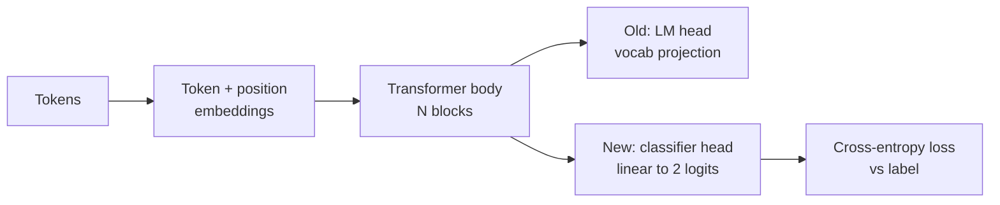
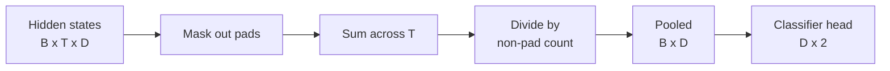
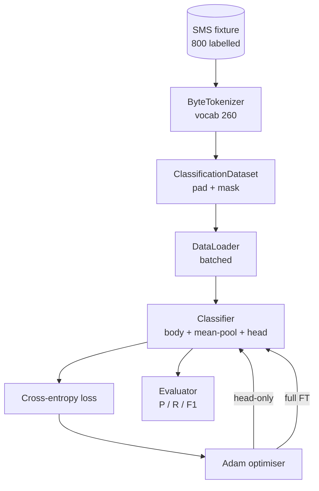

# Capstone Lesson 38: Classifier Fine-Tuning by Head Swap · Capstone 第 38 课：换头法微调分类器

> Track B's first capstone. A pretrained language model is a stack of self-attention blocks ending in a token-prediction head. When you want spam vs ham, the head is wrong but the body is mostly right. This lesson rips the head off, glues a two-class linear layer onto the pooled representation, and trains the classifier two different ways: final-layer only, and full fine-tuning. The eval is precision, recall, and F1 on a held-out split. You learn what each strategy buys you and what it costs.

**Type:** Build
**Languages:** Python (torch, numpy)
**Prerequisites:** Phase 19 lessons 30-37 (NLP LLM track: tokenizer, embedding table, attention block, transformer body, pre-training loop, checkpointing, generation, perplexity)
**Time:** ~90 minutes

## Learning Objectives · 学习目标

- 在不重新初始化主体的前提下，把语言模型头换成分类头。
- 实现两种训练模式：冻结主体（只训头）和全量微调（full fine-tuning），共享同一个训练循环。
- 构建一个感知分词器的数据管线：填充、掩码填充、池化注意力输出。
- 从原始 logits 计算精确率（precision）、召回率（recall）、F1 和混淆矩阵。
- 对参数量、训练时间和提升空间之间的取舍进行推理。

> Replace a language-model head with a classification head without re-initialising the body.
> Implement two training regimes: frozen body (head-only) and full fine-tuning, sharing one training loop.
> Build a tokeniser-aware data pipeline that pads, masks padding, and pools attention output.
> Compute precision, recall, F1, and a confusion matrix from raw logits.
> Reason about the trade-off between parameter count, training time, and head-room.

## The Problem · 问题在哪

你在一个通用语料上预训练了一个小 transformer。它的输出头把最后的隐状态投影到一个 1000-token 词表。现在你手上有 800 条标注为 spam（垃圾短信）或 ham（正常短信）的短信，想要一个二分类器。选项共有三个。

错误选项是在 800 个样本上从零训练一个新分类器。预训练模型的主体已经编码了有用的结构：词的身份、位置、简单共现。把它扔掉，等于浪费了造出它的那些算力。

两个正确选项是：换头、主体冻结；换头、主体可训练。只训头速度快、内存开销几乎为零，在这么少的数据上也几乎不会过拟合。全量微调更慢，在小数据上可能过拟合，但当下游领域偏离预训练语料时能达到更高的准确率。

本课把两种都造出来，让你能在同一个夹具（fixture）上比较它们。

> The wrong option is to train a fresh classifier from scratch on 800 examples. The body of the pretrained model already encodes useful structure: word identity, position, simple co-occurrence. Throwing it away wastes the compute that built it.
> Head-only training is fast, almost free in memory, and rarely overfits with this little data. Full fine-tuning is slower, can overfit on small data, but reaches higher accuracy when the downstream domain drifts from the pretraining corpus.
> This lesson builds both, so you can compare them on the same fixture.

## The Concept · 概念



模型是一个函数 `f_theta(tokens) -> hidden_states`。头是一个函数 `g_phi(hidden) -> logits`。换头意味着保留 `theta`、替换 `g_phi`。主体的参数才是昂贵的大头。头只是一层线性层。

两个可训练参数集合值得区分：

- `theta`（主体）：每个注意力块数以万计的权重。
- `phi`（头）：`hidden_dim * num_classes` 个权重加一个偏置。

只训头时，你对 `phi` 计算梯度、对 `theta` 置零。PyTorch 里把主体参数设为 `requires_grad=False` 即可做到。优化器于是只看到头，主体保持冻结。

全量微调时，你让梯度流回整个堆栈。主体的权重漂移着去拟合分类目标。风险是小数据上的灾难性遗忘（catastrophic forgetting）：主体的预训练被过拟合噪声冲掉。

> The model is a function `f_theta(tokens) -> hidden_states`. The head is a function `g_phi(hidden) -> logits`. Swapping heads means keeping `theta` and replacing `g_phi`. The body's parameters are the expensive part. The head is a single linear layer.
> In head-only training you compute gradients against `phi` and zero them against `theta`. PyTorch lets you do this by setting `requires_grad=False` on body parameters. The optimiser then sees only the head and the body stays frozen.
> The risk is catastrophic forgetting on small data: the body's pretraining gets washed out by overfitting noise.

## The Pooling Question · 池化问题

分类器需要每个序列一个向量，而不是每个 token 一个向量。三种常见选择：

- **平均池化（mean pool）**：沿序列对隐状态取平均，用注意力掩码加权。
- **CLS 池化**：前置一个特殊 token，只用它的输出。BERT 就是这么做的。
- **末 token 池化（last-token pool）**：用最后一个非填充 token。GPT 类分类器这么做。

本课使用带显式注意力掩码加权的平均池化。它最简单，在不同序列长度上给出稳定信号，也不需要预训练一个 CLS token。



> A classifier needs one vector per sequence, not one vector per token. Three common choices:
> This lesson uses mean pooling with explicit attention-mask weighting. It is the simplest, gives a stable signal across sequence lengths, and does not require pretraining a CLS token.

## The Data · 数据

800 条短信，400 条 spam 和 400 条 ham 平衡分布，在 `code/main.py` 里确定性生成。生成器用固定种子，挑选模板、替换槽位填充词，产出 5 到 25 个 token 长的消息。真实数据集有这个夹具没有的噪声。夹具的意义在于可复现。

数据按 80/20 切分：640 条训练、160 条测试。切分是分层的（stratified），测试集保持 50/50 平衡。一个平衡已知的留出集，让精确率和召回率可以被当作诚实的数字来读。

> Real datasets have noise this fixture does not. The point of the fixture is reproducibility.
> The data splits 80/20: 640 train, 160 test. Splits are stratified so the test set keeps the 50/50 balance. A held-out set with a known balance lets precision and recall be read as honest numbers.

## The Metrics · 指标

二分类，类 1 为正类（spam）。四种计数：

- `TP`：预测 spam，实际是 spam。
- `FP`：预测 spam，实际是 ham。
- `FN`：预测 ham，实际是 spam。
- `TN`：预测 ham，实际是 ham。

三个头部指标：

- `precision = TP / (TP + FP)`。被判为 spam 的消息里，多少比例真的是？
- `recall = TP / (TP + FN)`。真实的 spam 里，模型标出了多少？
- `F1 = 2 * P * R / (P + R)`。两者的调和平均。

混淆矩阵把四个计数打成 2x2 网格。demo 会把两种训练模式的混淆矩阵都写到 stdout。

```figure
cap-classifier-head-swap
```

> Binary classification with class 1 as the positive class (spam). Counts are:
> `precision = TP / (TP + FP)`. Of the messages flagged spam, what fraction actually are?
> `recall = TP / (TP + FN)`. Of the actual spam, what fraction did the model flag?
> A confusion matrix prints the four counts as a 2x2 grid. The demo writes this to stdout for both training regimes.

## Architecture · 架构



主体是一个刻意做小的 transformer：vocab 260、hidden 64、4 头、2 块、最大序列 32。它小到两种训练模式都能在 CPU 上九十秒内训到收敛。本课不对它做预训练；`pretrain_quick` 辅助函数改为在同一个夹具的文本上做五个 epoch 的 LM 训练，给主体一个非平凡的起点。这让本课自包含。

> The body is a deliberately tiny transformer: vocab 260, hidden 64, 4 heads, 2 blocks, max sequence 32. It is small enough to train both regimes to convergence inside ninety seconds on CPU. It is not pretrained in the lesson; instead, the `pretrain_quick` helper does five epochs of LM training on the same fixture's text to give the body a non-trivial starting point. This keeps the lesson self-contained.

## What you will build · 你将构建什么

实现是一个 `main.py` 加一个测试模块（`code/tests/test_main.py`）。

1. `ByteTokenizer`：字节到 id 的映射，预留一个 pad id。
2. `Block`：带多头注意力和前馈层的 transformer 块。Pre-norm。
3. `LMBody`：token + 位置嵌入，加一叠块。返回隐状态。
4. `MeanPool`：沿序列轴做掩码加权平均。
5. `Classifier`：主体、池化、线性头。主体在各模式之间是同一个实例。
6. `freeze_body` 和 `unfreeze_body`：切换主体参数的 `requires_grad`。
7. `train_classifier`：一个共享循环。接受模型和一个为可训练参数组配置好的优化器。
8. `evaluate`：跑测试集，返回 `Metrics(precision, recall, f1, confusion)`。
9. `run_demo`：先短暂预训练主体，然后训练并评估 head-only、再全量，打印两份报告，退出码为零。

> The implementation is one `main.py` plus one test module (`code/tests/test_main.py`).
> The body is the same instance across regimes.

## Why the comparison matters · 为什么这个比较重要

head-only 通常训得更快，欠拟合得更优雅。在这个夹具上，二十个 epoch 的 head-only 训练之后，你通常看到精确率在 0.9 附近、召回率在 0.85 附近。全量微调耗时约三倍，最终差距在一两个点之内，取决于随机种子。

本课不选赢家。它教你读数字、读成本。在 800 个样本和一个极小主体上，head-only 是正确的选择。在 80,000 个样本和一个更大的主体上，全量微调开始有回报。你从本课带走的契约是 API：同一个 `train_classifier` 函数处理两者，切换只需一次调用。

> The head-only regime usually trains faster and underfits more gracefully. On this fixture you typically see precision near 0.9 and recall near 0.85 after twenty epochs of head-only training. Full fine-tuning takes about three times longer and lands within a couple of points either way, depending on the random seed.
> The lesson does not pick a winner. It teaches you to read the numbers and the cost. ... The contract you take from this lesson is the API: the same `train_classifier` function handles both, and the toggle is one call.

## Stretch goals · 进阶目标

- 加第三种模式：只解冻最后一个块。它有时被称为部分微调（partial fine-tuning）。比全量 FT 便宜，比 head-only 学得多。
- 加一个学习率调度器。头上用余弦调度、主体上用更小的恒定学习率，是常见的生产配置。
- 把平均池化换成可学习的注意力池化：一个带单个可学习 query 的小注意力层。在更长序列上它常常胜过平均池化。

实现给了你钩子。测试钉住了契约。数字由你去推。

> The implementation gives you the hooks. The tests pin the contract. The numbers are yours to push.
