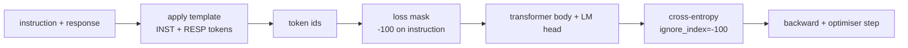
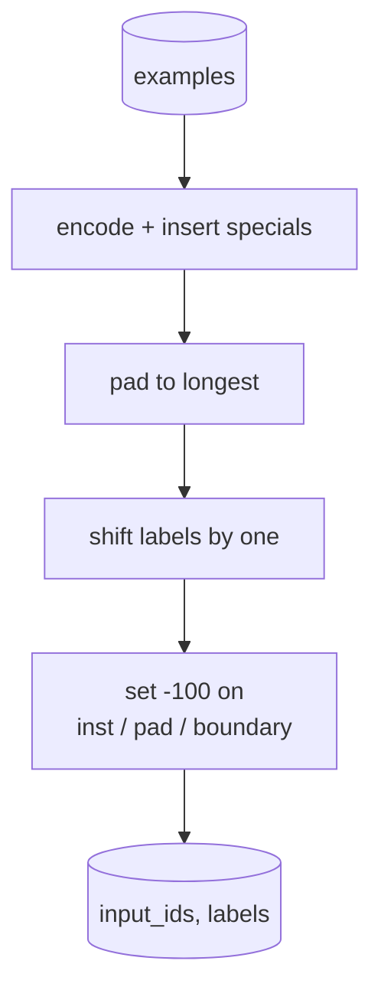
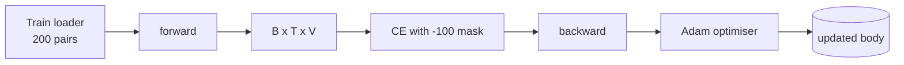

# Capstone Lesson 39: Instruction Tuning by Supervised Fine-Tuning · Capstone 第 39 课：监督微调实现指令微调（SFT）

> A pretrained base model can extend a sequence but cannot follow an instruction. Supervised fine-tuning is the smallest change that fixes this: feed the model paired examples of an instruction and a desired response, and train the body to predict the response tokens. The trick is that you only want the loss to count the response, not the instruction. This lesson builds an Alpaca-style SFT loop with a custom collate function that masks instruction tokens with `ignore_index=-100`, trains on 200 instruction-response pairs, and evaluates on a held-out split using exact-match.

**Type:** Build
**Languages:** Python (torch, numpy)
**Prerequisites:** Phase 19 lessons 30-37 (NLP LLM track: tokenizer, embedding table, attention block, transformer body, pre-training loop, checkpointing, generation, perplexity)
**Time:** ~90 minutes

## Learning Objectives · 学习目标

- 把成对的指令-回答数据格式化成一条带显式边界 token 的因果序列。
- 构建一个 collate 函数，掩掉指令 token，让交叉熵只数回答 token。
- 在 SFT 目标下训练一个微型 transformer 主体，看着评估指标移动。
- 实现贪心与温度采样两种生成，且都尊重回答开始的边界。
- 对生成的补全计算留出集上的精确匹配（exact-match）。

> Format paired instruction-response data into a single causal sequence with explicit boundary tokens.
> Build a collate function that masks instruction tokens so cross-entropy only counts response tokens.
> Train a tiny transformer body under the SFT objective and watch the eval metric move.
> Implement greedy and temperature-sampled generation that respects the response-start boundary.
> Compute held-out exact-match on generated completions.

## The Problem · 问题在哪

一个在下一 token 预测上训练出来的基座模型（base model）完全不知道「指令」是什么。把字符串 `"What is the capital of France?"` 放到它面前，它会接着这个问题往下续写，或者干脆另起一句。模型有语言能力，却没有格式契约（format contract）。

SFT 的契约就是一个字符串模板。每个训练样本变成一条有三个区域的单一序列：

```text
<INST> What is the capital of France? <RESP> The capital of France is Paris.
```

边界 token 是训练时预留的特殊 token。模型学到 `<RESP>` 之后的一切都是回答，而回答才是被打分的东西。基座模型的下一 token 目标仍然适用；只是训练语料里每个样本都长这个形状。

但有一个坑。如果你把整条序列喂给普通的交叉熵损失，你等于也在训练模型预测指令 token。指令是给定条件。你要这些位置上的梯度为零。解法就是掩码（mask）。

> A base model trained on next-token prediction has no idea what an instruction is. Show it the string `"What is the capital of France?"` and it will continue the question or invent a new sentence. The model has the language but not the format contract.
> The boundary tokens are special tokens reserved at training time. The model learns that everything after `<RESP>` is the response and the response is what gets graded.
> The instruction is given. You want zero gradient on those positions. The fix is the mask.

## The Concept · 概念



`ignore_index` 是 `torch.nn.functional.cross_entropy` 的一个特性。任何等于 `ignore_index` 的目标位置贡献零损失、零梯度。PyTorch 的约定值是 `-100`。collate 函数为每个样本构建两个张量：`input_ids`（完整序列）和 `labels`（`input_ids` 的副本，指令位置被覆写为 `-100`）。

模型在前向时看到整条序列；注意力可以关注指令。损失只数回答 token。这正是你想要的：以指令为条件，预测回答。

> `ignore_index` is a feature of `torch.nn.functional.cross_entropy`. Any target position equal to `ignore_index` contributes zero loss and zero gradient. The convention in PyTorch is `-100`. The collate function builds two tensors per example: `input_ids` (the full sequence) and `labels` (a copy of `input_ids` with the instruction positions overwritten by `-100`).
> The model sees the whole sequence during the forward pass; attention can attend to the instruction. The loss only counts response tokens. This is exactly what you want: condition on the instruction, predict the response.

## The Data · 数据

两百个指令-回答对在 `main.py` 里确定性生成，覆盖六种任务类型：

- 单发事实题（X 的首都）
- 算术
- 列表抽取
- 一句话摘要
- 代码（print、sort）
- 定义

每种任务都有模板化的指令和确定性的回答。这是刻意简单的。精确匹配（exact-match）很脆，而本课使用的夹具里，正确答案就是一个特定字符串。真实 SFT 数据集需要模糊指标；原理完全相同。

切分为 160 训练、40 测试。测试集覆盖全部六种任务类型，所以可以汇报分类别的精确匹配。

> Each task has a templated instruction and a deterministic response. This is intentionally simple. Exact-match is brittle, and the lesson uses a fixture where the right answer is one specific string. Real SFT datasets need fuzzy metrics; the principle is identical.
> Splits are 160 train, 40 test. The test set covers all six task types so per-category exact-match can be reported.

## Tokenisation and Padding · 分词与填充

分词器是字节级的，预留三个特殊 token：

- `INST_ID = 256`：标记指令区的开始。
- `RESP_ID = 257`：标记指令与回答之间的边界。
- `PAD_ID = 258`：变长 batch 的填充。

序列是 `[INST] inst_bytes [RESP] resp_bytes [PAD]*`。collate 函数：

1. 对每个样本分词。
2. 把 batch 里的每个样本填充到 batch 内最长序列。
3. 构建 `labels` = `input_ids` 错开一位（因果 LM 目标），其中：
   - 指令区替换为 `-100`。
   - 填充区替换为 `-100`。
   - `RESP_ID` 边界位置本身也替换为 `-100`（你不训练模型去预测边界 token；它要预测的是边界之后的内容）。



错位是标准的因果技巧：`input_ids` 的位置 `i` 预测位置 `i+1`，所以 `labels[i] = input_ids[i+1]`（输入丢掉最后一位，目标丢掉第一位）。掩码在错位之后施加，才能落在正确的位置上。

> The shift is the standard causal trick: position `i` of `input_ids` predicts position `i+1`, so `labels[i] = input_ids[i+1]` (with the final position dropped from the input and the first dropped from the target). The mask is applied after the shift to land on the right positions.

## Training · 训练



循环就是标准的 PyTorch SFT 循环。Adam，学习率 3e-4 到 1e-3 左右，这个夹具上十到二十个 epoch，不用调度器。模型足够小（hidden 96、2 块、最大长度 64），CPU 上两分钟内就能训到收敛。

每第五个 epoch，循环在留出集上跑一次微型评估并打印精确匹配。看着精确匹配从第 1 个 epoch 的 0.0 走到第 15 个 epoch 的 0.85 左右，就是本课的回报时刻：你能亲眼看到模型同时学会格式和答案。

> Every fifth epoch the loop runs a tiny eval pass on the held-out set and prints exact-match. Watching exact-match go from 0.0 at epoch one to something like 0.85 at epoch fifteen is the lesson's payoff: you can see the model learning the format and the answers at the same time.

## Generation · 生成

评估时，模型拿到指令前缀 `[INST] inst_bytes [RESP]`，然后生成 token，直到：

- 序列达到 `max_len`，或
- 模型触发一个特殊的停止启发式：两个连续的句末字节（`.`、`!`、`?`）。

本课自带贪心解码外加一个可选的温度采样器。精确匹配用贪心，因为温度会让指标变成随机的。真实系统常常先采样、再做模糊评判；那条流水线是第 41 课的内容。

> The lesson ships greedy decoding plus an optional temperature sampler. Exact-match uses greedy because temperature would make the metric stochastic. Real systems often sample, then judge fuzzily; that pipeline is lesson 41.

## Exact-Match Evaluation · 精确匹配评估

精确匹配是最严格的文本指标。预测的回答字符串先归一化（转小写、去首尾空白、折叠连续空格），再与以同样方式归一化的参考回答比较。每个样本上指标非 1 即 0。聚合取平均。

真实 SFT 流水线用 token 级 F1（第 41 课）和裁判模型来补充精确匹配。精确匹配依然有用，因为它无歧义；如果它说 0.7，那就是恰好 70% 的测试指令逐字符产出了金标准回答。

```figure
cc-sft-loss-mask
```

> Real SFT pipelines complement exact-match with token-level F1 (lesson 41) and a judge model. Exact-match remains useful because it is unambiguous; if it says 0.7, exactly 70 percent of test instructions produced the gold response character for character.

## What you will build · 你将构建什么

实现是一个 `main.py` 加测试。

1. `InstructionTokenizer`：字节级编码器，预留特殊 token。既编码指令前缀，也编码完整对。
2. `make_dataset`：固定种子生成 200 对，覆盖六种任务类型。
3. `SFTDataset`：每个样本返回 `(input_ids, labels)`，掩码已备好。
4. `sft_collate`：动态填充，构建 batch 张量，在指令和填充位置设 `-100`。
5. `TinyGPT`：transformer 主体加绑定或不绑定的 LM head。
6. `train_sft`：SFT 循环，带逐 epoch 评估钩子。
7. `generate`：从前缀开始因果解码，贪心或采样，带停止启发式。
8. `exact_match`：归一化字符串比较，返回 `[0, 1]` 内的浮点数。
9. `run_demo`：构建数据，训练二十个 epoch，评估，打印分类别明细，成功时退出码为零。

> The implementation is one `main.py` plus tests.

## Why the mask matters · 为什么掩码重要

没有掩码，损失会把指令 token 当作目标。模型学着去预测指令。这是另一个目标，而且会从两个方面产出更差的模型。第一，模型容量被浪费在重建用户永远会提供的输入上。第二，回答损失在梯度总和里占比更小，因为大多数 batch 里指令 token 的数量超过回答 token；优化器在你在意的那部分上的有效学习率比你想的要低。掩码不是抛光；它就是目标本身。

> Without the mask, the loss treats instruction tokens as targets. The model learns to predict the instruction. This is a different objective and produces a worse model in two ways. First, model capacity is wasted reconstructing inputs the user always provides. Second, the response loss is smaller in the gradient sum because instruction tokens outnumber response tokens in most batches; the optimiser's effective learning rate on the part you care about is lower than you intended. The mask is not a polish; it is the objective.

## Stretch goals · 进阶目标

- 加学习率 warmup 接余弦衰减。SFT 对 LR 比预训练更敏感。
- 加逐 token 损失记录，并画出训练全程的损失曲线。注意早期 epoch 由模板 token（`<RESP>`、常见前缀）主导，后期 epoch 由真正的答案 token 主导。
- 把评估扩展到 BLEU-1 或 chrF。精确匹配会低估那些产出了同义改写、答案却正确的模型。
- 加一个多轮格式的聊天模板，并在包含追问的夹具上训练。

实现给了你格式契约、掩码和循环。从基座模型到指令跟随者的目标改变，就是一个 collate 函数。

> The implementation gives you the format contract, the mask, and the loop. The objective change from base model to instruction follower is one collate function.
