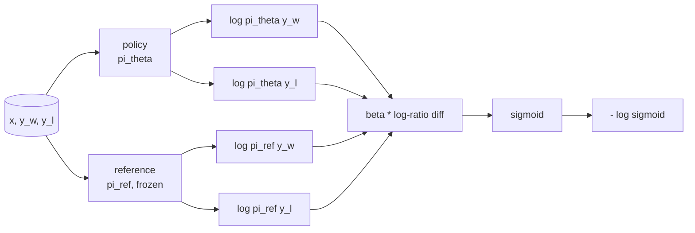
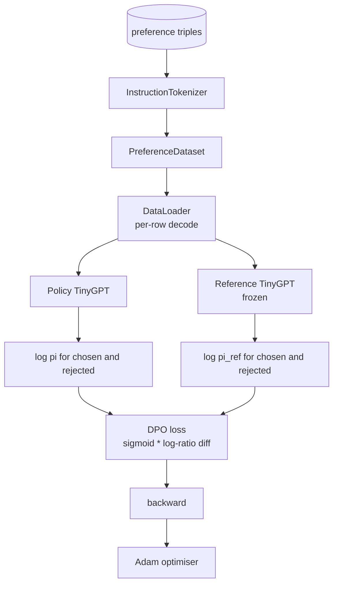

# Capstone Lesson 40: Direct Preference Optimization from Scratch · Capstone 第 40 课：从零实现直接偏好优化（DPO）

> Reward models and PPO are the classical RLHF stack. DPO collapses that stack into a single supervised loss that fits a policy directly against preference pairs. This lesson derives the DPO loss from the reward-difference identity, ships a working reference model plus policy model, computes per-token log-probabilities, and trains a tiny transformer on a preference fixture of chosen and rejected completions. Tests pin the loss math and the gradient direction so you know the implementation matches the paper.

**Type:** Build
**Languages:** Python (torch, numpy)
**Prerequisites:** Phase 19 lessons 30-37 (NLP LLM track: tokenizer, embedding table, attention block, transformer body, pre-training loop, checkpointing, generation, perplexity)
**Time:** ~90 minutes

## Learning Objectives · 学习目标

- 推导 DPO 损失：一个作用在缩放后的对数比差上的 sigmoid，并与隐式奖励（implicit reward）建立联系。
- 构建参考模型 + 策略模型（reference model + policy model）组合：参考冻结、策略可训练。
- 在两个模型下计算序列级对数概率，并掩掉 prompt 位置的贡献。
- 在 `(prompt, chosen, rejected)` 三元组上训练策略，看着 chosen 的对数概率相对 rejected 上升。
- 用测试钉住行为：损失数学、梯度符号、参考不变性。

> Derive the DPO loss as a sigmoid over a scaled log-ratio difference and connect it to the implicit reward.
> Build a reference model + policy model pair with a frozen reference and a trainable policy.
> Compute sequence-level log-probabilities under both models, masking prompt tokens.
> Train the policy on `(prompt, chosen, rejected)` triples and watch the chosen log-prob rise relative to rejected.
> Pin behaviour with tests on the loss math, the gradient sign, and the reference invariance.

## The Problem · 问题在哪

你有一个 SFT 模型。它能跟指令，但输出参差不齐：有的补全清晰，有的啰嗦或错误。你还有一个小型偏好对数据集：同一个 prompt，人类把一个补全标为 chosen（更优），另一个标为 rejected（更差）。

经典 RLHF 的答案是一条两阶段流水线。先在偏好上训练一个奖励模型（reward model）。再用 PPO 对着奖励优化策略（policy）。这可行但昂贵：PPO 期间内存里驻留两个模型、要用 KL 控制把策略拴在参考附近、奖励模型脆弱时会出现奖励作弊（reward hacking）。

DPO 用一个监督损失替换掉这两个阶段。奖励模型从不显式存在。策略直接在偏好对上训练，带一个朝向 SFT 参考的显式 KL 惩罚。在 Bradley-Terry 偏好模型下最优解相同，代码却少得多。

> The classical RLHF answer is a two-stage pipeline. Train a reward model on the preferences. Optimise the policy against the reward with PPO. This works but is expensive: two models in memory during PPO, KL control to keep the policy near the reference, reward hacking when the reward model is brittle.
> DPO replaces both stages with a single supervised loss. The reward model never exists explicitly. The policy is trained directly on the preference pairs, with an explicit KL penalty toward the SFT reference. Same optimal solution under the Bradley-Terry preference model, far less code.

## The Concept · 概念

从 Bradley-Terry 模型出发。给定 prompt `x` 和两个补全 `y_w`（chosen）与 `y_l`（rejected），人类偏好 `y_w` 的概率是

```text
P(y_w > y_l | x) = sigmoid( r(x, y_w) - r(x, y_l) )
```

其中 `r` 是某个潜在奖励函数。RLHF 先从偏好拟合 `r`，再训练策略 `pi` 带着 KL 锚点去最大化 `r`：

```text
max_pi   E_{x, y~pi} [ r(x, y) ] - beta * KL(pi || pi_ref)
```

DPO 的推导观察到：这个目标下的最优策略 `pi*` 关于 `r` 有闭式解：

```text
pi*(y | x) = (1/Z(x)) * pi_ref(y | x) * exp( r(x, y) / beta )
```

对 `r` 重新整理：

```text
r(x, y) = beta * ( log pi*(y | x) - log pi_ref(y | x) ) + beta * log Z(x)
```

`log Z(x)` 项对 `y_w` 和 `y_l` 是同一个（它依赖 `x`，不依赖 `y`），所以在计算偏好差时会消掉：

```text
r(x, y_w) - r(x, y_l) = beta * ( log pi_theta(y_w|x) - log pi_ref(y_w|x)
                                - log pi_theta(y_l|x) + log pi_ref(y_l|x) )
```

代入 Bradley-Terry 的 sigmoid，对偏好对取负对数似然：

```text
L_DPO(theta) = - E_{(x, y_w, y_l)} [
  log sigmoid( beta * ( log pi_theta(y_w|x) - log pi_ref(y_w|x)
                       - log pi_theta(y_l|x) + log pi_ref(y_l|x) ) )
]
```

这就是损失。它是作用在每样本一个标量上的 sigmoid，由四个对数概率算出。没有单独的奖励模型。没有 PPO。损失里没有 KL 项；KL 约束被烘焙进了闭式推导。



> This is the loss. It is a sigmoid over a single scalar per example, computed from four log-probabilities. No separate reward model. No PPO. No KL term in the loss; the KL constraint is baked into the closed-form derivation.

## The Sign of the Gradient · 梯度的符号

任何训练开跑之前都值得做一个健全性检查。对 `log pi_theta(y_w | x)` 取梯度：

```text
d L_DPO / d log pi_theta(y_w | x) = - beta * (1 - sigmoid(z))
```

其中 `z` 是 sigmoid 的自变量。它对所有 `z` 都是负的，这意味着：提高策略对 chosen 补全的对数概率会降低损失。对称地，对 `log pi_theta(y_l | x)` 的梯度是正的：提高 rejected 的对数概率会抬高损失。训练把 chosen 推上去、把 rejected 压下去。参考是冻结的；它不动。

> Take the gradient with respect to `log pi_theta(y_w | x)`:
> This is negative for all `z`, which means: increasing the policy's log-probability of the chosen completion decreases the loss. Symmetrically, the gradient with respect to `log pi_theta(y_l | x)` is positive: increasing the rejected log-probability increases the loss. Training pushes the chosen up and the rejected down. The reference is frozen; it does not move.

## The Data · 数据

本课自带十二个偏好三元组。每个是 `(prompt, chosen, rejected)`。chosen 补全短而精确。rejected 则啰嗦、跑题或错误。这些对覆盖与第 39 课相同的任务族（首都、算术、列表），所以一个从 SFT 基座出发的策略有合理的起点。

夹具刻意很小。生产中的 DPO 在数以万计的偏好对上工作；这里的意义在于：损失数学和循环能在极小数据集上端到端跑通，而且 chosen 对 rejected 的对数概率差距肉眼可见地增长。

> The fixture is intentionally small. DPO works on tens of thousands of pairs in production; here, the point is that the loss math and the loop run end-to-end on a tiny dataset and the chosen-versus-rejected log-prob gap visibly grows.

## Reference Invariance · 参考不变性

DPO 实现必须小心对待参考模型。参考就是原地冻结的 SFT 模型。三条性质必须成立：

- 参考参数永远不接收梯度。
- 参考的对数概率在 epoch 之间永不改变。
- 策略从与参考相同的权重出发。（最优 `theta` 是参考加一个学到的更新；把策略初始化为参考的副本是良定义的起点。）

实现通过以下方式强制这些性质：

- 前向时把参考包在 `torch.no_grad()` 里。
- 给每个参考参数设 `requires_grad=False`。
- 在参考建好之后，用 `policy.load_state_dict(reference.state_dict())` 构建策略。

```figure
cap-dpo-preference
```

> A DPO implementation has to handle the reference model carefully. The reference is the SFT model frozen in place. Three properties have to hold:

## Architecture · 架构



模型是第 39 课用过的同一个 TinyGPT（decoder-only、因果、字节分词器）。参考和策略共享架构；训练中策略的权重从参考漂移开，而参考保持不动。

> The model is the same TinyGPT used in lesson 39 (decoder-only, causal, byte tokeniser). The reference and policy share the architecture; the policy's weights drift from the reference under training while the reference stays fixed.

## What you will build · 你将构建什么

实现是一个 `main.py` 加测试。

1. `InstructionTokenizer`：字节分词器，带 `INST` 和 `RESP` 特殊 token。形状与第 39 课相同。
2. `TinyGPT`：decoder-only transformer。形状与第 39 课相同，所以即使跳过了 39 课，本课也自包含。
3. `make_preferences`：返回十二个 `(prompt, chosen, rejected)` 三元组。
4. `sequence_log_prob`：给定模型、prompt 前缀和一个补全，返回该补全上下一 token 对数概率之和（不含 prompt 位置的贡献）。
5. `dpo_loss`：接受四个对数概率和 `beta`，返回逐样本损失张量和用于记录的隐式奖励差。
6. `train_dpo`：逐 epoch 循环，在策略和参考下计算 chosen 与 rejected 的对数概率，施加损失，并走 Adam。
7. `evaluate_margins`：返回任意时刻策略下 chosen-rejected 对数概率差的均值。
8. `run_demo`：从一次小型热身预训练构建参考和策略，复制权重，训练三十步，打印每步损失和差距，成功时退出码为零。

> The implementation is one `main.py` plus tests.

## Why DPO works · 为什么 DPO 有效

在 Bradley-Terry 偏好模型下，DPO 与 RLHF 数学上等价，只差奖励的参数化方式。隐式奖励 `r(x, y) = beta * (log pi(y|x) - log pi_ref(y|x))` 在偏好下可辨识到相差一个只依赖 `x` 的函数，而这项在差值中消掉。闭式策略让你跳过显式的奖励模型。KL 约束是结构性强制：`pi` 偏离 `pi_ref` 越多，对数比越大，sigmoid 随之饱和，策略走得太远时梯度就被阻尼。参考是你的安全网。

> DPO is mathematically equivalent to RLHF under the Bradley-Terry preference model, up to the parameterisation of the reward. The implicit reward `r(x, y) = beta * (log pi(y|x) - log pi_ref(y|x))` is identifiable from preferences up to a function of `x`, which cancels in the difference. The closed-form policy lets you skip the explicit reward model. The KL constraint is enforced structurally: any deviation of `pi` from `pi_ref` makes the log-ratio larger, and the sigmoid saturates, which damps the gradient when the policy moves too far. The reference is your safety net.

## Stretch goals · 进阶目标

- 给对数概率和加长度归一化：除以补全长度。长度偏置是已知的 DPO 失败模式——模型会偏好更短的补全，因为它们的对数概率绝对值更大。
- 加损失的 IPO 变体：把 sigmoid + log 换成 `(z - 1)^2`。在夹具上比较收敛。
- 加一个标签平滑参数，在硬 chosen-rejected 标签和均匀 0.5 之间插值。
- 把参考换成更小更便宜的模型（知识蒸馏风味）。

实现给了你损失、参考不变性和训练循环。数学是本课。代码让数学落地。

> The implementation gives you the loss, the reference invariance, and the training loop. The math is the lesson. The code makes the math concrete.
