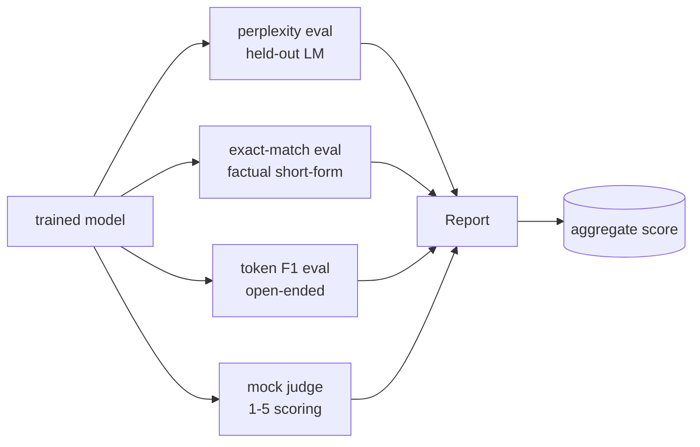
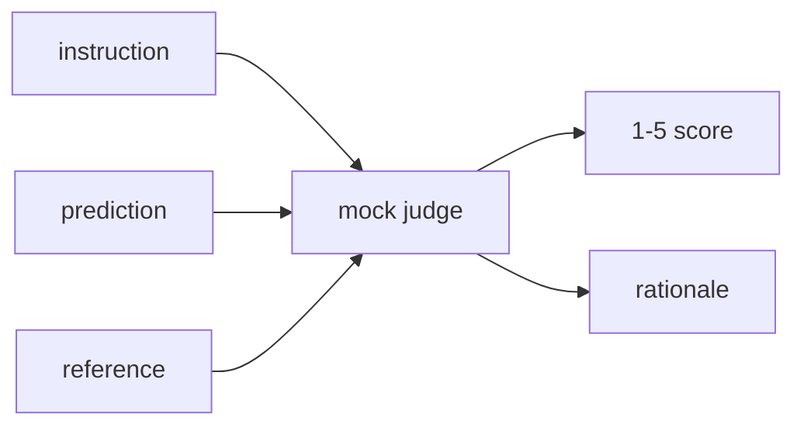
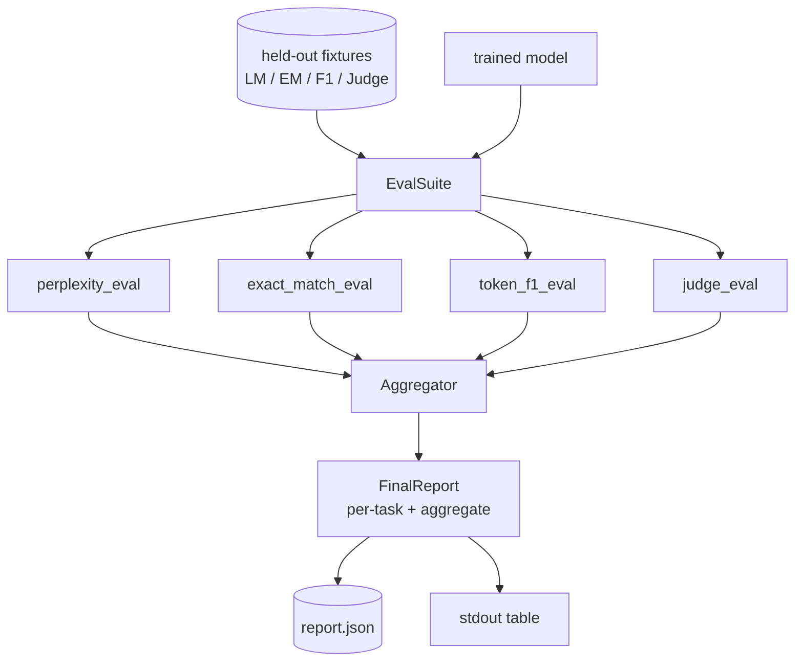

# Capstone Lesson 41: Full Evaluation Pipeline · Capstone 第 41 课：完整评估流水线

> Training is the part you can monitor with loss curves. Evaluation is the part you have to design. This lesson builds a unified eval pipeline that takes any trained language model, runs four heterogeneous evals on it, aggregates the results into a per-task report, and ships a local mock LLM-as-judge so the loop runs without a network. The four evals cover the dimensions every shipping model needs: language modelling (perplexity), short-form correctness (exact-match), open-form similarity (token F1), and qualitative scoring (judge).

**Type:** Build
**Languages:** Python (torch, numpy)
**Prerequisites:** Phase 19 lessons 30-37 (NLP LLM track: tokenizer, embedding table, attention block, transformer body, pre-training loop, checkpointing, generation, perplexity)
**Time:** ~90 minutes

## Learning Objectives · 学习目标

- 在一个微型 transformer 上计算留出集困惑度（perplexity），带掩码 token 的正确计数。
- 在短式事实型 prompt 上运行精确匹配（exact-match）评估。
- 带归一化地计算预测与参考字符串之间的 token 级 F1。
- 构建一个本地模拟 LLM-as-judge，按 1-5 分为模型输出打分。
- 把四个评估聚合成一份带分类别明细的加权报告。

> Compute held-out perplexity with masked-token accounting on a tiny transformer.
> Run an exact-match eval on short-form factual prompts.
> Compute token-level F1 between predicted and reference strings with normalisation.
> Build a local mock LLM-as-judge that scores model outputs on a 1-5 scale.
> Aggregate the four evals into a single weighted report with per-task breakdown.

## The Problem · 问题在哪

单一指标永远描述不了一个语言模型。困惑度说明模型对语言分布拟合得多好，却对它会不会回答问题只字不提。精确匹配说明模型有没有产出金标准字符串，却惩罚正确的同义改写。token F1 容忍改写，却会被错误内容上的词汇重叠骗过。LLM-as-judge 能捕捉定性维度，但昂贵且随机。

你真正想要的流水线是四个都有。每个评估覆盖其他评估漏掉的维度。每个都在为该指标量身裁剪的留出数据子集上运行。最终报告把分类别的数字并排展示，外加一个聚合分，让评审一眼看出模型正在做什么取舍。

本课把这条流水线端到端建出来，装进一个文件。

> A single metric never describes a language model. Perplexity says how well the model fits the language distribution but says nothing about whether it answers questions. Exact-match says whether the model produces the gold string but punishes correct paraphrases. Token F1 forgives paraphrase but is fooled by lexical overlap with wrong content. LLM-as-judge captures qualitative dimensions but is expensive and stochastic.
> The pipeline you actually want has all four. Each eval covers a dimension the others miss. Each runs on a different subset of held-out data shaped for that metric.
> This lesson builds that pipeline, end to end, in one file.

## The Concept · 概念



每个评估都是一个从 `(model, dataset) -> EvalResult` 的函数。结果携带指标值、供检查用的逐样本明细、以及一个用于聚合的名字。流水线用一份配置把它们组合起来，配置说明跑哪些评估、各占多少权重。

> Each eval is a function from `(model, dataset) -> EvalResult`. The result carries the metric value, per-example details for inspection, and a name for the aggregate. The pipeline composes them with a config that says which evals to run and how to weight them.

## Perplexity, properly counted · 困惑度：正确的数法

困惑度是 `exp(mean negative log-likelihood per token)`。实现里有两个陷阱：

- 平均必须只对真实的 token 位置，而不是对 batch * sequence。填充 token 必须从分母里排除，否则困惑度会显得比实际更好。
- 模型预测下一个 token，所以位置 `i` 的 logits 预测的是位置 `i+1` 的 token。这里的 off-by-one 是静默的：损失照常训练，指标却变得毫无意义。

评估按 batch 累加非填充位置上的 `-log p(token)` 和 token 计数，最后再相除。这比按 batch 平均困惑度（会低估短序列的权重）在数值上更安全，也与教科书定义一致。

> The mean must be over actual token positions, not over batch * sequence. Padding tokens have to be excluded from the denominator or perplexity will look better than it is.
> The model predicts the next token, so logits at position `i` predict the token at position `i+1`. Off-by-one mistakes here are silent: the loss still trains, but the metric becomes meaningless.

## Exact-match, with normalisation · 精确匹配：带归一化

评测框架在比较之前对预测和参考都做归一化：

- 转小写。
- 去除首尾空白。
- 内部连续空白折叠成单个空格。
- 当两侧只差标点时，去掉结尾的终止标点（`.`、`!`、`?`）。

归一化让精确匹配在实践中可用。说 `"Paris"` 的模型是对的；说 `"Paris."` 的也是对的；说 `"  paris  "` 的也是对的。但归一化之后，指标仍然要求答案是同一个字符串。

> Normalisation makes exact-match useful in practice. A model that says `"Paris"` is right; one that says `"Paris."` is also right; one that says `"  paris  "` is also right. The metric still requires the answer to be the same string after normalisation.

## Token F1, the right way · token F1：正确的算法

token F1 是在词袋（bag-of-tokens）上计算的精确率与召回率的调和平均。步骤：

1. 归一化预测和参考（与精确匹配相同的规则）。
2. 各自切成 token 列表（空白分词）。
3. 数多重集交集。
4. Precision = `intersection_count / len(pred_tokens)`。Recall = `intersection_count / len(ref_tokens)`。F1 = 调和平均。

预测和参考都为空时，F1 为 1（空洞匹配）。只有一边为空时，F1 为 0。这个模式与 SQuAD 评估参考实现一致，能在改写下产出稳定的数字。

> If both prediction and reference are empty, F1 is 1 (vacuous match). If only one is empty, F1 is 0. This pattern matches the SQuAD evaluation reference and produces stable numbers across paraphrases.

## Local Mock LLM-as-Judge · 本地模拟 LLM 裁判

真裁判是 API 身后的一个前沿模型。本课的裁判必须离线运行。模拟裁判是一个确定性评分器：接受指令、模型预测和参考，返回 `{1, 2, 3, 4, 5}` 里的一个分数外加一行理由。评分规则是显式的：

- 归一化预测等于归一化参考则 5。
- 预测与参考之间的 token F1 至少 0.8 则 4。
- token F1 在 `[0.5, 0.8)` 则 3。
- token F1 在 `[0.2, 0.5)` 则 2。
- 其余情况 1。

这不是真裁判，但接口是对的。之后换上真模型只需改一个函数。流水线根本不关心。



> This is not a real judge, but it has the right interface. Swap in a real model later by changing one function. The pipeline does not care.

## Aggregation · 聚合

聚合分是归一化评估分数的加权平均。每个评估把自己的数字落在 `[0, 1]` 内：

- 困惑度：归一化为 `1 / (1 + log(perplexity))`。困惑度 1 映射到 1，无穷映射到 0。
- 精确匹配：已经在 `[0, 1]` 内。
- token F1：已经在 `[0, 1]` 内。
- 裁判：除以 5。

权重可配置。默认配比是 0.2 困惑度、0.3 精确匹配、0.3 token F1、0.2 裁判。权重的选择是一个产品决策；本课把旋钮暴露出来供你实验。

```figure
cg-eval-quadrant
```

> Weights are configurable. The default mix is 0.2 perplexity, 0.3 exact-match, 0.3 token F1, 0.2 judge. The choice of weights is a product decision; the lesson exposes the knob so you can experiment.

## Architecture · 架构



`EvalSuite` 是一个薄编排器。每个单独的评估是一个自由函数，接受 `(model, tokenizer, dataset, config)` 并返回一个 `EvalResult`。`Aggregator` 收集结果并产出最终报告。demo 打印表格并写一份 JSON 副本，供下游 CI 摄取。

> The `EvalSuite` is a thin orchestrator. Each individual eval is a free function that takes `(model, tokenizer, dataset, config)` and returns an `EvalResult`. The `Aggregator` collects results and produces the final report. The demo prints the table and writes a JSON copy that downstream CI can ingest.

## What you will build · 你将构建什么

实现是一个 `main.py` 加测试。

1. `TinyGPT`：与第 38-40 课相同的 decoder-only 架构，包含进来让本课独立成篇。
2. `InstructionTokenizer`：字节分词器，带 INST / RESP / PAD 特殊 token。
3. 四个夹具：一个 LM 语料、一个 EM 集、一个 F1 集和一个裁判集。各二十个样本，确定性。
4. `perplexity_eval`：返回带困惑度值和逐 token 损失直方图的 `EvalResult`。
5. `exact_match_eval`：返回平均 EM 和逐样本记录。
6. `token_f1_eval`：返回平均 token F1 和逐样本记录。
7. `mock_judge` 和 `judge_eval`：逐样本分数和理由，以及全集上的均分。
8. `Aggregator.normalise`：每个评估各自的归一化规则。
9. `Aggregator.aggregate`：加权平均与组装好的报告。
10. `run_demo`：短暂训练一个极小模型，跑全部四个评估，打印报告表格并写 JSON，成功时退出码为零。

> The implementation is one `main.py` plus tests.

## Reading the report · 怎么读报告

报告有三层。最上面是聚合分。下面是四个分类别数字。再下面是供诊断用的逐样本明细。一次失败的 CI 运行通常看聚合分就够了，但追查回归的评审需要逐样本明细，去看模型在哪些输入上错了。

JSON 转储使用稳定的键，CI 仪表盘可以跨版本画趋势线。美化打印的表格是给训练之后盯着终端看的人类准备的。

> A failing CI run typically wants the aggregate, but a reviewer chasing a regression wants the per-example breakdown to see which inputs the model got wrong.
> The JSON dump uses stable keys so a CI dashboard can plot trend lines across versions. The pretty-printed table is for humans staring at the terminal after a training run.

## Stretch goals · 进阶目标

- 加一个校准评估：模型的 softmax 概率和它的准确率匹配吗？按置信度分桶，报告每个桶上的经验准确率。
- 加一个鲁棒性评估：给每个样本打一个扰动标签（typo、改写、干扰项），报告每种扰动下的指标下降。
- 把模拟裁判换成 HTTP 调用身后的真模型。函数签名不变。
- 加分类别权重学习：不固定权重，而是针对目标模型偏好顺序去拟合权重。

实现给了你四个评估、聚合器和报告。真实评估流水线在其上叠加多得多的维度；模式不变：每个评估一个函数，一个聚合器，一份报告。

> The implementation gives you the four evals, the aggregator, and the report. Real evaluation pipelines layer many more dimensions on top; the pattern stays the same: one function per eval, one aggregator, one report.
