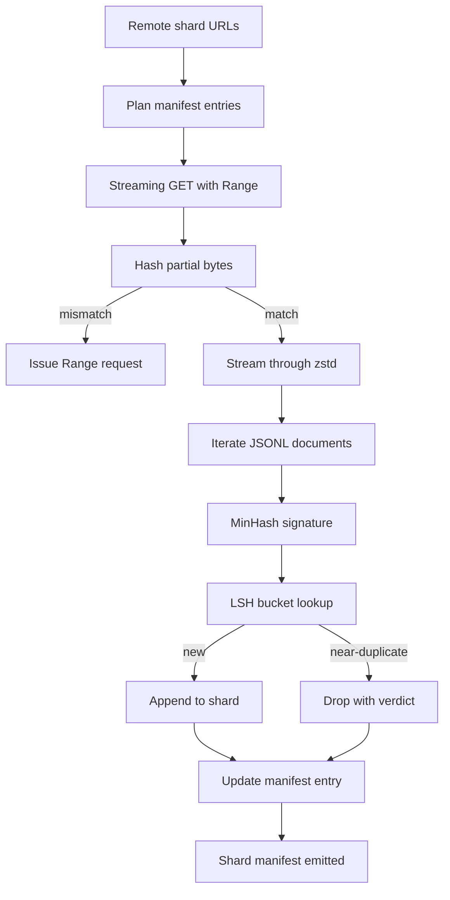

# Large Corpus Downloader · 大规模语料下载器

> 训练语言模型，早在第一次前向传播之前就已经开始了。语料库必须先落到磁盘上：解压完毕、去重完成、可寻址访问，而且要在网络于 4% 处断开之前就把断点续传（resume）方案想清楚。本课构建一个流式下载器（downloader）：拉取压缩分片（shard），用 Zstandard（zstd）即时解压，通过 MinHash 加局部敏感哈希（LSH）为近似重复文档提取指纹，并写出流水线其余环节可以信任的分片清单（manifest）。

> Training a language model begins long before the first forward pass. The corpus has to land on disk, decompressed, deduplicated, and addressable, with the resume story already worked out before the network drops at 4 percent. This lesson builds a streaming downloader that pulls compressed shards, decompresses on the fly with Zstandard, fingerprints near-duplicates via MinHash plus locality-sensitive hashing, and writes a shard manifest the rest of the pipeline can trust.

**类型：** 构建（Build）
**语言：** Python
**前置课程：** Phase 19 第 30-37 课
**时间：** 约 90 分钟

## Learning Objectives · 学习目标

- 用 `urllib` 流式拉取远端分片，用 `zstandard` 解压，全程不把整个文件缓冲进内存。
- 针对已验证的字节偏移（verified byte offset）发起 HTTP `Range` 请求，实现部分下载的断点续传。
- 为每个文档构建 MinHash 签名（signature），再用 LSH 分桶，让近似重复文档落入同一个桶。
- 输出分片清单（manifest），内含内容哈希、字节大小、文档数和去重判定。

> Stream remote shards with `urllib` and decompress with `zstandard` without buffering the whole file in memory.
> Resume partial downloads by issuing HTTP `Range` requests against a verified byte offset.
> Build a MinHash signature per document and bucket it with LSH so near-duplicates collide.
> Emit a shard manifest with content hash, byte size, document count, and dedup verdict.

## The Problem · 问题在哪

第一次在 200 GB 语料库上训练，网络在第 41% 处断开，脚本以一个 `urllib` 异常退出。第二次断在第 78%。到第 99% 的时候，这段下载循环你已经重写了三遍。有两类故障必须从第一分钟起就纳入设计：**部分下载的断点续传**和**重复文档的去除**。两者的解决方案都广为人知；两者又都经常被跳过，因为流水线起初只是一行 `requests.get` 调用，后来才慢慢长出獠牙。

续传是一个 HTTP 问题。服务器必须支持 `Range`，客户端必须对照磁盘上的记录跟踪已验证偏移，而且这个已验证偏移必须在进程死亡后依然存活。偏移和文件哪怕只差一个字节，续传写出来的就是垃圾，语料库就以某种方式被损坏——而且要到分词阶段才会暴露。

去重是一个签名问题。精确哈希去重抓不到近似重复：同一篇维基百科文章带着三种不同的样板页脚出现，同一个代码文件换了许可证头，同一篇博文的每个链接上都挂着跟踪参数。MinHash 加 LSH 能以亚线性代价抓住这些情况。代价是每个文档一次签名计算、每个签名一次桶查询。

> The first time you train on a 200 GB corpus the network drops at percent 41 and the script exits with a `urllib` exception. The two failures you have to design for from minute one are partial-download resume and duplicate document removal. Both have well-known solutions; both are routinely skipped because the pipeline begins as a one-line `requests.get` call that grew teeth.
> Resume is an HTTP problem. If the offset and the file diverge by even one byte the resumed download writes garbage and the corpus is corrupted in a way that only shows up during tokenization.
> Deduplication is a signature problem. Exact-hash dedup misses near-duplicates... MinHash plus LSH catches these at sub-linear cost. The cost is one signature per document and one bucket lookup per signature.

## The Concept · 概念



### Streaming with `urllib` · 用 `urllib` 流式拉取

标准库的 `urllib.request.urlopen` 返回一个文件型对象（file-like object）。把它包进 `zstandard.ZstdDecompressor().stream_reader`，字节就从网络流经解压器进入文档迭代器，全程不会把压缩分片或解压后的分片完整物化到内存里。唯一的内存开销是行缓冲区、当前文档的 MinHash 签名，以及 LSH 索引。

> The standard-library `urllib.request.urlopen` returns a file-like object. Wrap it in a `zstandard.ZstdDecompressor().stream_reader` and the bytes flow from the network through the decompressor into the document iterator without ever materialising the compressed shard or the decompressed shard in memory. The only memory cost is the line buffer, the MinHash signature for the current document, and the LSH index.

### Resume with `Range` · 用 `Range` 断点续传

下载器为每个分片写两个文件：分片本身和一个 `.partial.json` 检查点（checkpoint）。检查点记录 `verified_bytes`、`expected_size`、`sha256_prefix`（对前 `verified_bytes` 个字节计算），以及来源 URL。启动时，下载器读取检查点，对磁盘上已有的字节重新计算 `sha256_prefix`，只有重算哈希匹配时才续传。哈希不对就丢弃部分文件，从字节零重新开始下载。静默损坏不可能发生，因为已验证字节是被检查过的，而不是被假设的。

> The downloader writes two files per shard: the shard itself and a `.partial.json` checkpoint. On startup the downloader reads the checkpoint, recomputes `sha256_prefix` over the on-disk bytes, and only resumes if the recomputed hash matches. If the hash is wrong the partial is discarded and the download restarts from byte zero. Silent corruption is impossible because the verified bytes are checked, not assumed.

### MinHash plus LSH · MinHash 加 LSH

MinHash 用固定大小的空间估计两个集合的 Jaccard 相似度（Jaccard similarity）。对文档而言，这个集合就是文本的 shingle（滑窗 n-gram）。签名是 `k` 个最小哈希值，每个独立的哈希函数贡献一个分量。Jaccard 相似度为 `s` 的两个文档，在签名任一分量上取值一致的概率是 `s`。

LSH 再把这 `k` 个分量分成 `b` 个波段（band），每段 `r` 行，满足 `k = b * r`。两个文档至少在一个波段发生碰撞的概率是 `1 - (1 - s^r)^b`，它在某个 `s` 值附近呈陡峭的阈值，`(b, r)` 就是照着这个目标阈值调的。典型语料去重的阈值是 `s = 0.8`，LSH 研究文献用 `k = 128`、`b = 32`、`r = 4` 达到它。

> MinHash estimates the Jaccard similarity of two sets in fixed space. For a document the set is the shingles (overlapping n-grams) of its text. The signature is `k` minimum hash values, one per independent hash function. Two documents with Jaccard similarity `s` have a probability `s` of agreeing on any single component of the signature.
> LSH then groups the `k` components into `b` bands of `r` rows each, where `k = b * r`. Two documents collide in at least one band with probability `1 - (1 - s^r)^b`, which is a sharp threshold around the value of `s` you tune `(b, r)` to. The threshold for typical corpus dedup is `s = 0.8`, which the LSH research literature reaches with `k = 128`, `b = 32`, `r = 4`.

### Shard manifest as a contract · 分片清单即契约

下载器唯一持久的输出就是清单。清单按分片记录：URL、解压后的字节数、文档数、去重后的唯一文档数，以及最终分片文件的 sha256。下游分词读的是清单，不是目录列表。某个分片缺失或 sha256 不对，清单会让下一个阶段拒绝启动。清单就是「数据下载完了」和「数据下载完且可验证」之间的那条决定性分界线。

```figure
cap-corpus-downloader
```

> The downloader's only durable output is the manifest. Downstream tokenization reads the manifest, not the directory listing. If a shard is missing or its sha256 is wrong, the manifest tells the next stage to refuse to start. The manifest is the deciding edge between "the data is downloaded" and "the data is downloaded and verifiable".

## Build It · 动手造

`code/main.py` 实现了：

- `ShardPlanner` —— 读取分片 URL 列表，生成规划好的清单条目。
- `StreamingDownloader` —— 打开带可选 `Range` 的 `urllib` 流，写入临时文件，每收到一个数据块就更新 `.partial.json` 检查点，并在续传时校验 sha256 前缀。
- `ZstdDocIterator` —— 把文件型流包进 `zstandard.ZstdDecompressor`，每行产出一个文档。
- `MinHasher` —— 用一组固定的哈希种子为字符串生成 `k` 分量签名。
- `LSHIndex` —— 按波段给签名分桶并报告碰撞。
- `Dedup` —— 组合哈希器与索引，把每个文档标记为 `keep` 或 `near_duplicate`，并附带碰撞到的分片 id。
- `ManifestWriter` —— 汇总每个分片的统计信息并写出 `manifest.json`。

文件底部有一个演示（demo）：在磁盘上构建一个小型合成语料库，用 `zstandard` 压缩，通过 `file://` URL 下载，去重，然后打印清单。

运行：

```bash
python3 code/main.py
```

脚本以零退出码结束并打印清单摘要。

> `StreamingDownloader` - opens a `urllib` stream with optional `Range`, writes to a temporary file, updates the `.partial.json` checkpoint on every chunk, and verifies the sha256 prefix on resume.
> `Dedup` - combines hasher and index to label each document `keep` or `near_duplicate` along with the matching shard id.
> A demo at the bottom of the file builds a small synthetic corpus on disk, compresses it with `zstandard`, downloads it through a `file://` URL, deduplicates, and prints the manifest.
> The script exits zero and prints a manifest summary.

## Production Patterns · 生产模式

四个模式把本课扩展到真实语料库。

**先写检查点，再写数据。** 在字节追加进分片之前，`.partial.json` 必须 `fsync`。否则掉电会把顺序颠倒过来：分片字节在磁盘上，检查点里却没有，下一次续传认为自己已验证的字节比实际少，重复的后缀字节就把文件弄坏了。先检查点，后写入。这和预写日志（write-ahead log）是同一门纪律。

**分片化的 LSH 索引。** 在 200 GB 规模下，覆盖整个语料库的单个 LSH 索引在内存里放不下。按第一个波段的哈希把 LSH 索引分区，把分区存到磁盘，新签名只查询它会落进去的那个分区。代价是每个文档多一次磁盘读；收益是 LSH 索引不再是硬性的内存上限。

**墓碑标记，而不是删除。** 被丢弃的重复文档以 `near_duplicate` 判定记录在清单里，并带上它碰撞到的那个文档的分片 id。删掉它们就丢掉了重复与正本之间的联系。墓碑标记（tombstone）保住了审计线索，也让下游流程可以改变对阈值的主意。

**清单里放每个分片的 sha256，再给清单本身一个 sha256。** 清单自己也有内容哈希。下游各阶段先验证清单哈希，再信任分片条目。没有这一层，清单就是静默的攻击面：能篡改单个文件的攻击者就能毁掉整条流水线。

> **Checkpoint before write.** The `.partial.json` must be `fsync`-ed before the bytes are appended to the shard... Checkpoint first, then write. This is the same discipline as a write-ahead log.
> **Sharded LSH index.** The cost is one extra disk read per document; the benefit is that the LSH index is no longer a hard memory ceiling.
> **Tombstone, not delete.** Tombstoning preserves the audit trail and lets a downstream pass change its mind about the threshold.
> **Per-shard sha256 in the manifest, plus a manifest sha256.** Without this the manifest is the silent attack surface: an attacker who can edit a single file can corrupt the whole pipeline.

## Use It · 实战用法

生产模式：

- **每次 CI 运行都要能续传。** CI 运行器是临时的。下载器必须假设每次运行面对的都是全新磁盘，并从缓存或远端恢复。`--cache-dir` 是一等公民旗标。
- **在分词之前去重。** 分词很贵。对同一篇文档跑两遍分词，是花两倍成本买同一条损失曲线。去重在分词的上游，不是下游。
- **清单即合并门禁。** 训练运行从一条固定提交（pinned commit）读取清单 sha256。新的数据集版本需要新的清单提交。代码与数据之间的纽带是 git，不是口口相传。

> **Resume on every CI run.** CI runners are ephemeral. `--cache-dir` is a first-class flag.
> **Dedup before tokenization.** Dedup is upstream of tokenization, not downstream.
> **Manifest as merge gate.** The link between code and data is git, not folklore.

## Ship It · 交付

`outputs/skill-corpus-downloader.md` 在真实项目里会描述：哪些 URL 喂给下载器、检查点目录如何布局、去重用多宽的 shingle 和哪个 `(k, b, r)` 三元组、清单在版本控制里的位置。本课交付的是引擎。

> `outputs/skill-corpus-downloader.md` would, on a real project, describe which URLs feed the downloader, how the checkpoint directory is laid out, what shingle width and `(k, b, r)` triple the dedup uses, and where the manifest lives in version control. This lesson ships the engine.

## Exercises · 练习

1. 加一个 `--shingle-width` 旗标，测量宽度取 3、5、9 时去重判定的变化。为你选定的默认值辩护。
2. 通过嗅探魔数（magic bytes），在 zstd 旁边加上 gzip 支持。下载器不应要求调用方指定编解码器。
3. 加一个 `--resume-only` 模式：找不到检查点就拒绝开始全新下载。在 CI 里很有用，可防止某次运行意外地重新拉取 200 GB。
4. 把 LSH 索引挪到 shelf 或 sqlite 文件里，测量其吞吐量与内存版的对比。
5. 在启动时加一个清单 sha256 校验。磁盘上的清单与 `manifest.lock` 里的清单哈希不一致时，下载器应当失败关闭（fail closed）。

> Add a `--shingle-width` flag and measure how the dedup verdict changes at widths 3, 5, 9. Defend the chosen default.
> Add gzip support next to zstd by sniffing the magic bytes. The downloader should not require the caller to specify the codec.
> Add a `--resume-only` mode that refuses to start a fresh download if no checkpoint is found. Useful in CI to keep one run from accidentally re-pulling 200 GB.
> Move the LSH index to a shelf or sqlite file and measure throughput vs the in-memory variant.
> Add a manifest sha256 check on startup. The downloader should fail closed if the manifest on disk disagrees with the manifest hash in `manifest.lock`.

## Key Terms · 术语表

| 术语 | 人们怎么说 | 实际含义 |
|------|-----------|---------|
| Shard（分片） | 「一个文件」 | 语料库中自带 sha256 的独立切片，是续传与去重的单位 |
| MinHash signature | 「指纹」 | 集合的 `k` 分量草图（sketch），每个分量是某个独立哈希在该集合上的最小值 |
| LSH band | 「桶」 | 由 `r` 个签名分量组成的组，作为碰撞检测的单个桶键 |
| Verified bytes | 「续传偏移」 | sha256 前缀与检查点匹配的磁盘字节；唯一安全的续传起点 |
| Manifest（清单） | 「索引」 | 下载器产出的唯一持久记录，内含内容哈希 |

## Further Reading · 延伸阅读

- [RFC 7233](https://datatracker.ietf.org/doc/html/rfc7233) —— HTTP Range 请求，续传协议
- [Zstandard format specification](https://datatracker.ietf.org/doc/html/rfc8478) —— 让流式解压变得安全的帧格式
- [MinHash](https://en.wikipedia.org/wiki/MinHash) —— 本课使用的签名族
- [Locality-sensitive hashing](https://en.wikipedia.org/wiki/Locality-sensitive_hashing) —— 去重阈值背后的分波段（banding）方案
- Phase 19 · 43 —— 下载器产出所喂给的 HDF5 分词语料库
- Phase 19 · 44 —— 在该语料库上训练所用的余弦调度
- Phase 19 · 45 —— 消费该调度的 AMP 循环
