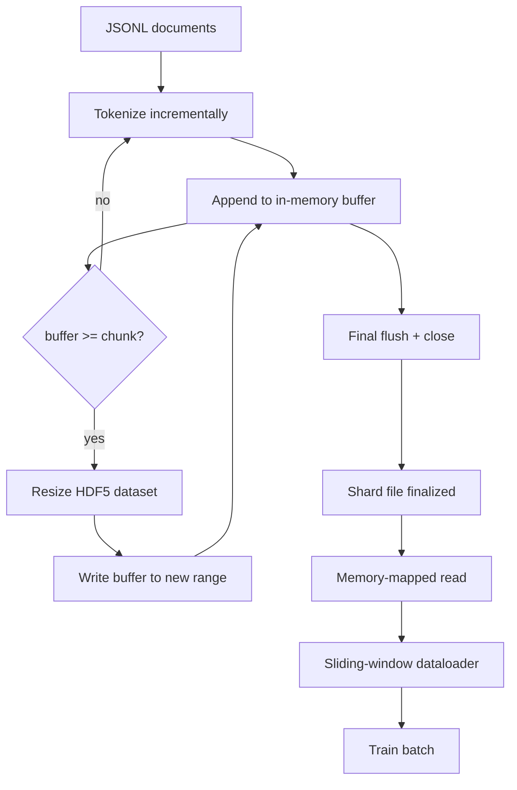

# HDF5 Tokenized Corpus · HDF5 分词语料库

> 下载下来的语料库必须落成一种训练器（trainer）能全速流式读取的布局。磁盘上的 JSONL 撑不过 16 个 dataloader worker 的并发读取；带可调大小（resizable）、分块（chunked）整数数据集的 HDF5 可以。本课把流式分词（tokenization）写进可调大小的 HDF5 数据集，实现跨多个文件的分片写入、训练期的内存映射（memory-mapped）读取，以及一个以正确打包（packing）规则产出定长序列的滑动窗口（sliding window）dataloader。

> The downloaded corpus has to land in a layout the trainer can stream from at line speed. JSONL on disk does not survive 16 dataloader workers. HDF5 with a resizable, chunked integer dataset does. This lesson builds streaming tokenization into a resizable HDF5 dataset, sharded write across multiple files, memory-mapped read at training time, and a sliding-window dataloader that produces fixed-length sequences with the right packing.

**类型：** 构建（Build）
**语言：** Python
**前置课程：** Phase 19 第 30-37 课
**时间：** 约 90 分钟

## Learning Objectives · 学习目标

- 用确定性的分块（chunking）策略，把文档流式写进可调大小的 HDF5 整数数据集。
- 把写入分散到多个 HDF5 文件（分片，shard），让故障影响有界、并行成为可能。
- 通过 HDF5 页缓存（page cache）友好的分块布局把 token 读回来，让 dataloader 只在组批时才拷贝进批缓冲区。
- 实现一个滑动窗口 dataloader，按显式的打包规则产出定长训练序列。

> Stream documents into a resizable HDF5 integer dataset with deterministic chunking.
> Shard the write across multiple HDF5 files so failure is bounded and parallelism is possible.
> Read tokens back through HDF5's page-cache-backed chunked layout so the dataloader copies into batch buffers only at batch time.
> Implement a sliding-window dataloader that emits fixed-length training sequences with explicit packing rules.

## The Problem · 问题在哪

一次现代语言模型训练运行，要靠几十个 worker 以每秒数十万样本的速度读取 token。磁盘上的 JSONL 在第一次冷缓存缺页时就垮掉：JSON 解析器慢，文档边界不可寻址，想定位「第 4,217,884 个样本」就得扫描整个文件。连压缩率很好的 Parquet 也不合适，因为训练器要的不是列，而是一条支持 O(1) 随机访问的扁平 token 流。

HDF5 恰好合适，因为它提供分块、可调大小、纯整数的数据集，其分块在读取时对页缓存友好。训练器请求 `tokens[3,200,000 : 3,200,8192]` 的一小段，HDF5 就把请求的超片（hyperslab）从页缓存拷进一块新分配的 NumPy 数组。代价是一个打开的文件句柄，加上每个 worker 一份分块大小的页缓存占用——比起解码 JSONL 的开销可以忽略不计。

真正的构建难题是让写入侧诚实。可调大小的数据集很容易用错：一次只写一个文档，HDF5 文件会碎片化到不可用；一次 resize 写入全部文档，进程一死就丢掉整个分片。正确的纪律是「先缓冲、再扩展」（buffer-then-extend），缓冲区大小与分块大小对齐，并用分片写入把负载拆到多个文件上，让一次崩溃最多损失一个分片。

> A modern language-model training run reads tokens at hundreds of thousands of samples per second across dozens of workers. JSONL on disk dies at the first cold-cache page fault... Even Parquet, which compresses well, is a poor fit because the trainer does not want columns; it wants a flat token stream with O(1) random access.
> HDF5 fits because it offers a chunked, resizable, integer-only dataset whose chunks are page-cache friendly at read time.
> The build problem is making the write side honest. The right discipline is buffer-then-extend, with a buffer size that matches the chunk size, and a sharded write that splits the workload across files so a crash loses at most one shard.

## The Concept · 概念



### Resizable HDF5 done right · 正确使用可调大小的 HDF5

token 数据集以 `maxshape=(None,)` 和固定的 `chunks=(chunk_size,)` 创建。写入的做法是：把 token 缓冲进一个长度为 `chunk_size` 的 NumPy 数组；缓冲区一满，就把数据集精确扩展 `chunk_size`，并把缓冲区写进新区间。到分片末尾，把残余缓冲区写进最后一个不满的区间。除最后一次外，每次写入都是连续且按分块对齐的；读取方会按分片 HDF5 属性里记录的 `token_count` 截断这最后一 partial 段。

> The token dataset is created with `maxshape=(None,)` and a fixed `chunks=(chunk_size,)`. When the buffer fills, the dataset is resized by exactly `chunk_size` and the buffer is written into the new range. At end-of-shard the residual buffer is written into a final partial range. Every write is contiguous and chunk-aligned except the last one, which the reader is told to truncate at the recorded `token_count` in the shard's HDF5 attributes.

### Sharded write · 分片写入

单个 HDF5 文件是单点故障。流水线并行地写分片：Phase 19 第 42 课的每个输入分片产出一个 HDF5 输出分片。`shards.json` 索引按分片记录文件路径、token 数、文档数，以及 token 之上的 sha256。训练器读 `shards.json` 来计算全局偏移并校验语料库。

> A single HDF5 file is a single point of failure. The pipeline writes shards in parallel: each input shard from Phase 19 lesson 42 produces one HDF5 output shard. A `shards.json` index records, per shard, the file path, the token count, the document count, and a sha256 over the tokens. The trainer reads `shards.json` to compute global offsets and to validate the corpus.

### Memory-mapped read · 内存映射读取

训练时，每个 worker 以 `swmr=True` 模式打开属于自己的那部分 HDF5 文件，请求 `tokens[start:stop]`。一旦分块进入热状态，HDF5 的分块布局就让这次读取由页缓存支撑。worker 从不物化整个文件：切片先拷进 dataloader 的批缓冲区，dataloader 再在组批时把它拷进锁定内存（pinned memory）的训练张量。热路径上每个分块切换只有一次系统调用，其余全是内存访问。

> At training time each worker opens its share of HDF5 files in `swmr=True` mode and asks for `tokens[start:stop]`. HDF5's chunk layout makes this a page-cache-backed read once the chunk is hot. The worker never materialises the whole file: the slice is copied into the dataloader's batch buffer, which the dataloader then copies into a pinned-memory training tensor at batch time. The hot path has one syscall per chunk transition; everything else is RAM access.

### Sliding-window dataloader · 滑动窗口 dataloader

dataloader 是唯一知道训练序列长度的环节。它在全局 token 流里挑一个随机起始下标，读取 `window_size + 1` 个 token，返回 `(input, target) = (tokens[:-1], tokens[1:])`。文档边界不被强制：一个窗口可以横跨两个文档，中间放一个显式的 `boundary_token_id`，让模型学会使用分隔符。这是标准的打包规则；也是新手会忘掉的规则——忘掉之后得到的语料库 8% 是边界 token，92% 才是自然文本。

```figure
cc-hdf5-corpus
```

> The dataloader is the only stage that knows about training-sequence length. It picks a random start index in the global token stream, reads `window_size + 1` tokens, and returns `(input, target) = (tokens[:-1], tokens[1:])`. Document boundaries are not enforced: a window may straddle two documents, with an explicit `boundary_token_id` between them so the model learns to use the separator. This is the standard packing rule; it is also the rule a beginner forgets, ending up with a corpus that is 8 percent training boundary tokens and 92 percent natural text.

## Build It · 动手造

`code/main.py` 实现了：

- `Tokenizer` —— 一个字节级确定性分词器，对演示来说够用。接口是 `encode(text) -> list[int]` 和 `vocab_size`。
- `HDF5ShardWriter` —— 打开可调大小的整数数据集，把 token 缓冲到分块大小，按固定步长扩展并写入，关闭时把 `token_count` 和 `sha256` 记录为 HDF5 属性。
- `ShardedTokenizationPipeline` —— 迭代输入文档，把它们路由给某个 writer，并产出 `shards.json` 索引。
- `MmapTokenStore` —— 以内存映射方式打开分片文件，计算全局偏移，暴露单一的 `get_slice(start, stop)` API。
- `SlidingWindowDataloader` —— 从全局流里挑随机窗口，产出 `(input_ids, target_ids)` NumPy 数组。

文件底部有一个演示：构建一个微型内存语料库，分词成两个分片，以内存映射方式打开它们，跑 10 个批次的 dataloader，打印每批的形状和校验和。

运行：

```bash
python3 code/main.py
```

脚本以零退出码结束并打印批次校验和。

> `HDF5ShardWriter` - opens a resizable integer dataset, buffers tokens to chunk size, resizes and writes in fixed-size strides, records `token_count` and `sha256` as HDF5 attributes on close.
> `SlidingWindowDataloader` - picks random windows from the global stream and yields `(input_ids, target_ids)` NumPy arrays.
> A demo at the bottom of the file builds a tiny in-memory corpus, tokenizes into two shards, opens them via memory map, runs the dataloader for 10 batches, and prints the per-batch shape and a checksum.
> The script exits zero and prints batch checksums.

## Production Patterns · 生产模式

四个模式把本课扩展到真实的训练运行。

**分块大小等于典型读取量。** 训练器每个样本读取 `window_size + 1` 个 token。把 HDF5 分块设为 `window_size` 的倍数，读取就与页缓存对齐。分块不匹配会让吞吐量减半，因为每个样本都要碰两个分块。

**token 数记在属性里，不记在数据集里。** 数据集的尾部切片可能是半满的，因为分块大小不总能整除文档边界。把真实的 `token_count` 作为 HDF5 属性存在数据集上，读取方按这个值截断。没有这一步，读取方会一路走到零填充的 token 里，模型就学会预测零。

**分片 sha256 配并行校验。** 每个分片在 token 字节上有自己的 sha256。训练器可以在训练开始前并行校验所有分片。错误的 sha256 让运行早早失败，而不是在十六小时后的第三个 epoch 才失败。

**两侧都开 `swmr=True`，写入端加 `libver="latest"`。** 单写者多读者（Single-Writer-Multiple-Reader）模式要求写入端以 `libver="latest"` 打开、预先创建所有数据集，然后设置 `file.swmr_mode = True`。此后写入端必须在每次 resize 之后调用 `dataset.flush()`，让以 `swmr=True` 打开的 reader worker 看到一致的数据。漏掉 `libver="latest"` 或在结构变更之后才启用 SWMR，是「文件被锁住」这类故障的常见来源。

> **Chunk size equals the typical read.** Set the HDF5 chunk to a multiple of `window_size` and reads are page-cache aligned. Mismatched chunks halve the throughput because every sample touches two chunks.
> **Token count in attributes, not in the dataset.** Store the real `token_count` as an HDF5 attribute on the dataset and have the reader truncate at that value. Without this the reader walks off the end into zero-padded tokens and the model learns to predict zero.
> **Sharded sha256 with parallel verification.** A wrong sha256 fails the run early, not on epoch three after sixteen hours.
> **`swmr=True` on both sides, with `libver="latest"` on the writer.** After that the writer must call `dataset.flush()` after each resize so reader workers (opened with `swmr=True`) see consistent data. Skipping `libver="latest"` or enabling SWMR after structural changes is a common source of "file is locked" failures.

## Use It · 实战用法

生产模式：

- **每个源分片一个 HDF5。** 下载器（第 42 课）每个 URL 产出一个分片；分词（本课）每个源分片产出一个 HDF5。1:1 的映射让续传和部分故障恢复变得简单。
- **边界 token id。** 边界 token 是分词器词表的一部分，也是 dataloader 唯一会注入的 token。如果模型应当忽略它，训练损失就对边界 token 做掩码；否则模型会学会把它用作序列分隔符。
- **`shards.json` 是唯一事实来源。** 添加新分片意味着写出 HDF5、计算它的 sha256、追加一个条目。训练器启动时读一次该文件，从不碰目录列表。

> **One HDF5 per source shard.** The 1:1 mapping makes resume and partial-failure recovery trivial.
> **Boundary token id.** The training loss masks the boundary token if the model is supposed to ignore it; otherwise it learns to use it as a sequence separator.
> **`shards.json` as the source of truth.** The trainer reads the file once at startup and never touches the directory listing.

## Ship It · 交付

`outputs/skill-hdf5-tokenized-corpus.md` 在真实项目里会描述：哪个分词器喂给流水线、什么分块大小匹配训练器的窗口、`shards.json` 在版本控制里的位置、dataloader worker 如何跨文件分片。本课交付的是引擎。

> `outputs/skill-hdf5-tokenized-corpus.md` would, on a real project, describe which tokenizer feeds the pipeline, what chunk size matches the trainer's window, where `shards.json` lives in version control, and how dataloader workers are sharded across files. This lesson ships the engine.

## Exercises · 练习

1. 给 HDF5 writer 加一个 `--compression gzip` 旗标，在演示语料库上测量吞吐量代价。为你选定的默认值辩护。
2. 给滑动窗口 dataloader 加一个确定性种子，验证相同种子的两次运行产出完全相同的批次。
3. 加一个 `--validate` 模式：读取每个分片，对它的 token 重算 sha256，并与 `shards.json` 比较。CI 应该在训练开始前运行它。
4. 比较分块大小等于、二分之一倍、两倍窗口大小时的 dataloader 吞吐量。报告页缓存的影响。
5. 加一个 `--max-document-tokens` 旗标，在写入时截断超长文档。为这个权衡相对「读取时再决定」辩护。

> Add a `--compression gzip` flag to the HDF5 writer and measure the throughput cost on the demo corpus. Defend the chosen default.
> Add a deterministic seed to the sliding-window dataloader and verify two runs with the same seed produce identical batches.
> Add a `--validate` mode that reads every shard, recomputes the sha256 over its tokens, and compares against `shards.json`. CI should run this before training starts.
> Compare the dataloader throughput at chunk sizes equal to, half of, and twice the window size. Report the page-cache effect.
> Add a `--max-document-tokens` flag that truncates very long documents at write time. Defend the trade-off against deciding at read time.

## Key Terms · 术语表

| 术语 | 人们怎么说 | 实际含义 |
|------|-----------|---------|
| Resizable dataset（可调大小数据集） | 「只追加」 | 带 `maxshape=(None,)` 的 HDF5 数据集，通过 `resize` 调用按分块大小的步长增长 |
| Chunked layout（分块布局） | 「HDF5 怎么存它」 | 固定大小的磁盘页，内核可以内存映射，dataloader 可以连续读取 |
| `swmr` 模式 | 「边写边读」 | 单写者多读者模式，让 dataloader worker 安全地共享文件 |
| Shard index（分片索引） | 「shards.json」 | 所有 token 分片的持久索引，含偏移和内容哈希 |
| Sliding window（滑动窗口） | 「训练样本」 | 全局 token 流的定长切片，训练器把它与右移一位的 target 配对 |

## Further Reading · 延伸阅读

- [HDF5 chunking documentation](https://support.hdfgroup.org/documentation/hdf5/latest/hdf5_chunking.html) —— 本课使用的分块、可调大小数据集布局
- [h5py user guide](https://docs.h5py.org/en/stable/) —— HDF5 的 Python 绑定
- [NumPy memory mapping](https://numpy.org/doc/stable/reference/generated/numpy.memmap.html) —— HDF5 通过 h5py 暴露的读取侧原语
- Phase 19 · 42 —— 产出被本课分词的下载器
- Phase 19 · 44 —— 消费本课 dataloader 的余弦调度
- Phase 19 · 45 —— 包住训练步的 AMP 循环
